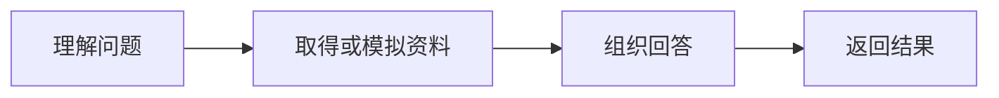

# 第 6 章　框架开发实践

*Hello-Agents：从零开始构建智能体 · 章节学习笔记*

**原作**：Datawhale Hello-Agents 项目及贡献者  
**原文章节**：[第 6 章正文](https://github.com/datawhalechina/hello-agents/blob/36f583c233ea5cee4537ef93455702b55053af18/docs/chapter6/%E7%AC%AC%E5%85%AD%E7%AB%A0%20%E6%A1%86%E6%9E%B6%E5%BC%80%E5%8F%91%E5%AE%9E%E8%B7%B5.md)  

---

<a id="introduction"></a>

## 引言

当智能体开始调用多个工具，或需要几个角色相互配合，独立脚本往往会出现重复的历史管理、消息传递和停止判断。框架试图把这些共同部分整理出来。

本章的四个案例提供了不同观察角度：可以把协作写成对话，也可以围绕消息组织，还可以把步骤明确画成图。选框架以前，先看它让我们怎样描述任务。

<a id="section-6-1"></a>

## 6.1　框架应当帮我们管理什么

模型、工具、状态和控制流程最好能够分别替换。框架提供共同接口后，开发者可以集中处理业务差异，不必每次重写所有基础部分。

不过，接口越多，并不表示应用越可靠。框架中的默认角色、消息广播范围和停止条件，都可能影响结果。学习时可以先找到三件事：状态放在哪里，下一步由谁决定，任务怎样结束。

<a id="section-6-1-1"></a>

### 6.1.1　用四个问题读懂一个陌生框架

第一，模型调用藏在哪一层？第二，消息和状态由谁保存？第三，下一步由模型、调度器还是固定边决定？第四，失败和结束怎样向外报告？这些问题比先记住大量类名更有助于建立整体认识。

还可以区分业务角色与运行机制。产品经理、工程师等名称描述职责；轮流发言、广播、条件跳转则描述控制。相同角色能够放进不同运行机制，相同机制也能处理不同业务。

阅读例子时，先给每个组件标注输入和输出，再沿着一次事件追踪，通常就能看出抽象真正省去了什么，以及哪些逻辑仍由应用负责。

<a id="section-6-2"></a>

## 6.2　AutoGen：把协作组织成对话

原文以 AutoGen 的特定版本介绍分层组件和异步调用，再搭建一个小型软件开发团队。产品经理整理需求，工程师编写实现，审查员检查代码，用户代理承担用户侧的交互。

**示例 6.1　协作开发一个价格展示应用**

```text
用户需求
  → 产品经理形成计划
  → 工程师产出代码
  → 审查员给出问题
  → 修改或交回用户
```

框架可以管理轮流发言和团队消息，角色提示则决定每一方关注什么。异步接口让程序能够在等待网络请求时处理其他工作，但不代表存在依赖的步骤都能同时完成。

<a id="section-6-2-1"></a>

### 6.2.1　对话需要明确的交接和结束规则

如果审查员不断给出笼统建议，工程师就可能一直改下去。我们需要规定交付物、检查标准和停止信号，并限制轮数。

不同角色还可能调用相同基础模型，因此“多个人设都同意”不等于得到独立验证。代码是否能运行，仍需要实际检查。

<a id="section-6-2-2"></a>

### 6.2.2　轮流发言怎样变成软件工作流

`RoundRobinGroupChat` 按已知顺序激活参与者，将新回复加入团队记录，再交给下一位。这个结构适合原文中较清楚的职责顺序，但顺序本身并不理解任务是否完成。

例如，工程师返回一段解释而没有代码，下一位审查员仍可能被激活。应用因此需要约定交付物：计划包含什么、实现怎样提供、审查意见采用什么形式。明确的内容约定与轮流机制共同构成有效流程。

用户代理可以提供反馈或执行经许可的检查，但角色名称不会自动带来真实测试能力。是否调用了执行器、执行环境是什么、结果有没有回到团队，仍需要沿代码核对。

<a id="section-6-2-3"></a>

### 6.2.3　讨论记录与最终产物分别保存

一轮团队对话中可能出现多版代码和相互矛盾的建议。交付时要明确当前采用哪个版本，哪些意见已经处理，哪些仍待核实。

如果只把全部聊天当作产物，接手者需要重新判断哪些内容有效。保留讨论轨迹有助于调试，另行保存当前结果则便于使用。这种状态与过程的区分，在后面的所有多角色项目中都适用。

<a id="section-6-3"></a>

## 6.3　AgentScope：围绕消息与状态组织协作

AgentScope 案例是一场“三国狼人杀”。每个角色既有游戏身份，又有人物设定；控制层维护回合、存活状态和胜负，角色根据允许看到的信息进行决策。

这个例子适合观察消息范围。狼人阵营可以共享某些信息，普通玩家不能看到所有内部讨论。把每条消息广播给全部角色，会直接改变游戏规则。

<a id="section-6-3-1"></a>

### 6.3.1　角色提出行动，控制器执行规则

模型可以表达怀疑或选择目标，但选择是否合法、角色是否仍存活、回合是否允许该动作，应由程序判断。结构化输出便于取出投票和目标，避免从一段发言中猜测真正的行动。

对话内容与游戏状态由此分开：前者可以灵活生成，后者按照明确规则更新。消息、模型接口、记忆和工具等组件，帮助把这两层连接起来。

本章借此讨论更大规模协作的工程需求。异步、通信和恢复机制有价值，也会增加开发复杂度，仍需按应用规模取舍。

<a id="section-6-3-2"></a>

### 6.3.2　公开信息、私有信息与全局状态

狼人杀的公开发言可以让所有存活玩家看到，夜间身份信息则只对特定角色可见。主持游戏的控制器可能知道全局情况，但不能把这些信息全部放进每个玩家的上下文。

| 信息 | 主要接收者 | 对决策的影响 |
| --- | --- | --- |
| 公布的发言与投票结果 | 对应的公开参与者。 | 作为共同历史。 |
| 某角色的私有查验结果 | 拥有该能力的角色。 | 支持其后续判断。 |
| 存活、轮次与胜负条件 | 游戏控制层。 | 决定哪些行动合法。 |

`Msg`、消息中心与工作流组件帮助组织传递，应用仍要规定接收范围。消息发送成功，只能说明通信发生，不能说明信息分配符合游戏规则。

<a id="section-6-3-3"></a>

### 6.3.3　结构化行动与自由发言怎样并存

角色可以用自然语言解释判断，但投票或查验目标最好以明确字段返回。控制器读取字段，校验目标存在且本轮允许，再更新状态；发言文字则进入适当的讨论记录。

这样的设计保留了灵活表达，也减少从长段台词中猜测动作的需要。若输出缺少目标，可以让角色补充或采用预定义失败处理，而不是随意选择一个玩家替代。

<a id="section-6-4"></a>

## 6.4　CAMEL：让互补角色围绕共同目标工作

CAMEL 的经典角色扮演方式，让 AI User 和 AI Assistant 各自承担职责。前者并不一定是真实用户，而是被安排成提出需求、推动步骤的一方；后者执行并回应。

本章让心理学家与作者共同创作一本关于拖延症的短篇科普电子书。一个角色提供内容方向，另一个角色组织面向读者的表达，初始任务说明把二者约束在共同目标内。

<a id="section-6-4-1"></a>

### 6.4.1　初始约定决定讨论能否推进

角色需要知道读者是谁、完成什么产物、怎样交接，以及何时结束。否则对话可能不断礼貌回应，却没有新增内容。

角色扮演为分工提供了直观入口，但角色称号不会自动带来专业可靠性。涉及事实的内容仍需要资料与核查；讨论次数越多，成本也会继续增加。

<a id="section-6-4-2"></a>

### 6.4.2　引导性提示怎样维持共同目标

CAMEL 的角色扮演不仅设定职业，还为双方建立共同任务与协作边界。在科普电子书中，可以明确读者背景、主题范围、篇幅与章节形式，再让一方提出内容需求，另一方组织成稿。

若只说“你是作者”“你是心理学家”，双方可能不断交换宽泛意见。加入当前章节、已经确认的提纲和本轮要完成的段落，才能让讨论持续产生产物。

任务也需要退出条件。例如，约定章节都已有可审阅初稿后，转入统一检查，而不是继续无期限对话。角色的互补性帮助分工，状态记录与终止控制帮助把分工变成流程。

<a id="section-6-4-3"></a>

### 6.4.3　多轮协作不等于事实核查

作者把一项说法改得更通顺，心理学家角色又赞同它，这仍可能只是同一模型重复接受同一个错误。若任务要求实证依据，应让内容与实际来源对应，再进行检查。

这里可以把协作质量拆成两个维度：信息是否正确，表达是否适合读者。不同角色围绕不同维度工作，比只要求“互相讨论直到满意”更容易评估。

<a id="section-6-5"></a>

## 6.5　LangGraph：把执行过程写成状态图

如果我们希望精确规定哪些步骤能够发生，以及失败后走向哪里，图结构会很合适。LangGraph 的基本概念是状态（State）、节点（Node）和边（Edge）。

状态保存过程中需要的字段，节点读取并更新状态，边决定下一个节点。条件边可以根据结果选择路线，循环则允许返回之前的步骤。

**示例 6.2　三步问答助手**

原文用“理解问题—模拟搜索—组织回答”展示最小工作流。这个基础例子主要说明状态怎样在节点间传递，不能因为节点叫 Search 就认为已经连接了真实搜索服务。



进一步加入条件边以后，可以在资料不足时继续搜索，在需要确认时等待人工。流程显式化有助于检查路径，但节点、共享字段和合并规则仍要认真设计。

<a id="section-6-5-1"></a>

### 6.5.1　共享状态究竟是什么

状态图里的状态是一个明确的数据结构，而不是图像中的箭头。问答例子可以保存原问题、理解结果、资料和最终回答；每个节点声明自己读取或更新哪些字段。

```python
from typing import TypedDict

class QuestionState(TypedDict):
    question: str
    intent: str
    evidence: list[str]
    answer: str
```

这是便于解释的结构示意。理解节点填写意图，搜索节点写入资料，回答节点再共同读取。字段缺失或被意外覆盖，会改变下游行为；共享状态不能只靠节点名字来暗示。

<a id="section-6-5-2"></a>

### 6.5.2　条件边怎样实现检查与回退

原文通过节点、边和编译展示工作流。固定边表示必定继续，条件边则让判断结果映射到下一节点。例如，资料为空时继续检索，材料齐全时生成回答，达到预算后结束并报告限制。

循环还需要保留尝试次数或已用查询，否则图虽然画得清楚，仍可能一直走回同一个节点。状态负责记住发生了什么，条件边利用状态决定继续方向。

顺序、分支与循环合在一起以后，图便能表达较复杂控制。它提升了路径可见性，但节点内部的模型判断仍可能出错，外部检查也仍有必要。

<a id="section-6-6"></a>

## 6.6　怎样比较这些组织方式

| 观察角度 | 本章对应的例子 | 需要问的问题 |
| --- | --- | --- |
| 对话推动协作 | AutoGen 软件团队 | 谁接话，交付什么，何时结束？ |
| 消息与规则分离 | AgentScope 狼人杀 | 谁能看到消息，谁维护真实状态？ |
| 角色分工与引导 | CAMEL 电子书 | 双方职责是否互补，任务会不会漂移？ |
| 显式控制路径 | LangGraph 问答 | 状态怎样更新，失败后走哪条边？ |

这些是原文案例强调的用法，不是对框架能力的完整划界。框架持续演进，同一需求也可能有多种实现。下一章将把视角缩小，亲自设计一组能读懂、能扩展的基础接口。

---

<a id="references"></a>

## 参考资料

1. 本章内容依据 Hello-Agents 的[第 6 章原文](https://github.com/datawhalechina/hello-agents/blob/36f583c233ea5cee4537ef93455702b55053af18/docs/chapter6/%E7%AC%AC%E5%85%AD%E7%AB%A0%20%E6%A1%86%E6%9E%B6%E5%BC%80%E5%8F%91%E5%AE%9E%E8%B7%B5.md)整理，完整论述及其参考文献可从原文继续阅读。
2. 实现细节可对照原项目的[第 6 章配套代码](https://github.com/datawhalechina/hello-agents/tree/36f583c233ea5cee4537ef93455702b55053af18/code/chapter6)。正文中的简化流程用于解释设计，不代表这些代码已在本机运行验证。

---

**继续阅读**：[上一章：基于低代码平台的智能体搭建](low-code-platforms.md) · [全书目录](index.md) · [下一章：构建你的智能体框架](build-your-own-framework.md)
