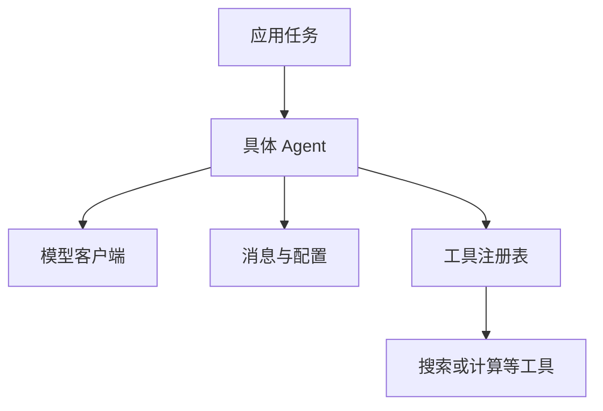

# 第 7 章　构建你的智能体框架

*Hello-Agents：从零开始构建智能体 · 章节学习笔记*

**原作**：Datawhale Hello-Agents 项目及贡献者  
**原文章节**：[第 7 章正文](https://github.com/datawhalechina/hello-agents/blob/36f583c233ea5cee4537ef93455702b55053af18/docs/chapter7/%E7%AC%AC%E4%B8%83%E7%AB%A0%20%E6%9E%84%E5%BB%BA%E4%BD%A0%E7%9A%84Agent%E6%A1%86%E6%9E%B6.md)  

---

<a id="introduction"></a>

## 引言

使用过几个框架以后，我们可以反过来想：如果只保留最需要的部分，一个智能体框架应当是什么样？模型、消息、工具和循环之间，究竟需要哪些约定？

本章从第四章的代码继续整理，搭起 HelloAgents 的基础。重点是让每个组件职责清楚，以后加入记忆或新协议时，能够沿着已有接口扩展。

<a id="section-7-1"></a>

## 7.1　先画出最小的框架

框架并不神秘。它把重复出现的做法整理成共同接口：模型调用走一个入口，消息使用相同结构，工具可以登记和发现，具体智能体只负责自己的决策流程。



轻量的好处是容易追踪。收到一个问题后，我们应该能够找到它怎样变成消息、经过哪个模型请求、触发哪个工具，并把结果放到哪里。抽象如果把这些关系藏得太深，就不利于教学与排错。

<a id="section-7-1-1"></a>

### 7.1.1　从一段脚本拆出稳定边界

可以先把独立脚本中的代码按变化原因分类。更换模型服务时会修改的是客户端；增加搜索能力时会修改的是工具；从 ReAct 换成先规划时，变化的是决策流程。让这些部分分别存在，就减少了互相牵动。

稳定接口并不要求隐藏全部差异。例如，普通文本模型与支持工具调用的模型，能力不一定相同；接口可以提供共同部分，同时允许应用检查所需能力。

依赖方向也应清楚：具体 Agent 依赖模型与工具接口，工具不应反过来依赖某一个业务 Agent。这样，相同计算工具才能被不同范式复用。

<a id="section-7-2"></a>

## 7.2　扩展模型客户端

`HelloAgentsLLM` 集中处理不同模型服务的配置。应用传入模型、地址和凭证，客户端负责形成请求，不必让每个 Agent 都了解服务商的变量命名。

<a id="section-7-2-1"></a>

### 7.2.1　云端与本地服务共用调用入口

本章介绍不同提供商，也接入 vLLM 和 Ollama 等本地服务方案。只要服务暴露了所需的兼容接口，上层就能通过相近方式请求生成。

不过，本地部署工具的内部实现并不相同，支持的模型和功能也要分别核对。统一客户端能够减少调用差异，不能自动补齐服务端没有的能力。

<a id="section-7-2-2"></a>

### 7.2.2　自动配置是便利，也是需要理解的规则

原文通过 `_auto_detect_provider` 与 `_resolve_credentials`，根据环境变量、地址等信息推断配置。它们帮助减少重复填写，但只是按规则识别，并不等于已经验证密钥有效或网络可达。

若多个提供商变量同时存在，应留意选择优先级。调试时明确指定提供商与地址，往往比依赖猜测更容易定位问题。

<a id="section-7-2-3"></a>

### 7.2.3　配置解析与服务连通是两个阶段

配置解析先确定提供商、地址、模型名称与凭证来源。连通测试再真正发送一次适当请求，观察认证、网络和模型标识是否有效。前一阶段成功，并不能代替后一阶段。

若出现错误，可以按层排查：是否选错配置，地址是否能访问，服务是否识别模型，响应结构是否符合客户端预期。这比在每个 Agent 内重复捕获一个笼统异常，更容易定位原因。

不同模型请求还可能支持不同参数。统一客户端应明确哪些是共同配置、哪些需要透传，而不把所有服务当作完全相同。扩展一个新提供商时，最好同时准备固定输入与异常情况的验证样例。

<a id="section-7-3"></a>

## 7.3　统一消息、配置与 Agent 接口

三个基础类让后面的代码使用同一套约定。

| 组件 | 主要职责 | 不应与什么混在一起 |
| --- | --- | --- |
| `Message` | 保存角色、内容及相关元数据。 | 不直接承担整个任务的执行控制。 |
| `Config` | 集中管理模型和运行参数。 | 不把部署配置散落在业务代码中。 |
| `Agent` | 规定名称、依赖和运行入口等共同约定。 | 不强迫每种范式采用完全一样的内部循环。 |

抽象基类规定子类必须提供的行为，具体类再实现 `run` 等方法。消息结构清楚以后，用户输入、模型回复与工具结果就不必都塞进无法区分的字符串。

<a id="section-7-3-1"></a>

### 7.3.1　消息对象与发送格式为什么分开

框架内部的 `Message` 可以带时间和元数据，用于记录来源与调试；发送给模型时，只选择接口要求的字段。内部记录的需要与外部服务的约定，由此可以分别变化。

例如，一条工具结果既要能作为模型输入，也可能需要关联到本地日志中的请求。把关联信息保存在元数据，能够避免为了调试而不断改变用户可见文本。

历史记录还要区分角色。系统要求、用户请求、助手回复和工具结果承担不同作用，不能只因内容都能转换成字符串就随意互换。

<a id="section-7-3-2"></a>

### 7.3.2　一个 Agent 的生命周期

从初始化到一次运行，可以依次看成准备依赖、接收输入、构造上下文、执行具体范式、记录结果与返回产物。共同步骤由基类或辅助组件复用，范式差异留在具体实现中。

```text
初始化：名称、模型、配置、工具
运行前：读取当前输入与有关历史
运行中：模型决策、必要的工具调用
运行后：记录结果、返回回答或任务状态
```

清空历史与创建新会话也需要明确含义。若多个用户共用同一实例而没有区分会话，历史可能混在一起。框架提供历史方法，应用还需要确定实例和用户之间的关系。

<a id="section-7-4"></a>

## 7.4　把经典范式放进共同接口

本章重构 SimpleAgent、ReActAgent、ReflectionAgent 和 PlanAndSolveAgent，并介绍使用原生工具调用的 FunctionCallAgent。

SimpleAgent 展示基础的对话与历史管理，也可以在框架设计下扩展工具能力。ReActAgent 根据观察选择行动；PlanAndSolveAgent 分开安排规划和执行；ReflectionAgent 保存初稿与反馈，迭代改进。

<a id="section-7-4-1"></a>

### 7.4.1　Function Calling 改变了哪一层

文本版实现要求模型生成约定的 Action 字符串，再由正则表达式解析。原生 Function Calling 则向模型提供工具描述与参数结构（schema），并从响应的结构化字段取得名称和参数。

这减少了依赖自然语言格式的部分，但程序仍要解析参数、检查类型、执行函数，再把结果交回模型。模型返回工具调用，并不表示服务已经代替我们执行了本地函数。

各个服务对工具调用的支持可能不同，因此需要选择匹配的模型与接口。框架统一的是应用侧约定，不是所有服务的实现。

<a id="section-7-4-2"></a>

### 7.4.2　相同接口怎样保留不同运行方式

统一 `run` 入口使上层能够用相近方式调用不同 Agent，但内部执行次数并不相同。SimpleAgent 可能直接生成，ReActAgent 可能往返多轮，ReflectionAgent 则会保存与修订多个版本。

因此，比较实现时要看运行轨迹，而不是只看函数签名。最大轮数、当前计划、工具观察和反馈记录，分别服务于不同结构，不能用同一个简单开关代替全部状态。

可以先用固定模型响应验证每种控制器：一次返回工具请求，下一次返回最终文本，观察是否正确结束。这种方式适合检查框架逻辑，也能避免把模型随机行为与程序错误混在一起。

<a id="section-7-4-3"></a>

### 7.4.3　参数转换不是任意猜测

FunctionCallAgent 需要把响应里的参数转换为程序可以使用的类型。字符串形式的数值可能可以按规则转换，但缺少城市名或不合法的枚举值，不能靠猜测补成任意内容。

工具调用标识与对应结果也应保持关联，尤其一次响应包含多个调用时。程序应知道哪份结果属于哪项请求，再构造下一轮输入。结构化协议减少格式歧义，却没有取消这些执行责任。

<a id="section-7-5"></a>

## 7.5　工具系统如何扩展

工具基类规定名称、描述、参数和执行方法；`ToolRegistry` 则负责登记、查找和调用。新增工具可以继承基类，也可以把函数包装成符合约定的工具。

<a id="section-7-5-1"></a>

### 7.5.1　示例：让计算工具做真实运算

原文的计算工具使用表达式解析与受支持的运算符，说明怎样把一个具体能力接入注册表。模型负责提出算式，程序负责计算，返回值再成为后续信息。

输入限制应放在工具实现里。不能仅因为提示要求模型输出算式，就对任意生成内容直接执行。工具说明和执行约束需要相互配合。

<a id="section-7-5-2"></a>

### 7.5.2　示例：统一不同搜索来源

多源搜索把 Tavily 与 SerpApi 接在共同入口后面，再根据配置选择后端。应用不必为每个搜索服务写一套 Agent。

这种封装还需要统一结果格式、保留来源，并处理某个服务失败的情况。合并搜索结果可以补充覆盖，但重复出现的信息不自动等于更可靠的独立证据。

<a id="section-7-5-3"></a>

### 7.5.3　工具链与异步执行

有依赖的工具按顺序连接，前一个输出作为后一个输入；互不依赖的请求，则可以考虑并发执行。前者关注数据怎样传递，后者关注等待和资源安排。

<a id="section-7-5-4"></a>

### 7.5.4　一个工具怎样描述自己

`ToolParameter` 保存参数名、类型、用途、是否必填和默认值。注册表据此生成说明，也可以用这些信息进行基础检查。

| 字段 | 城市查询工具中的示意值 | 作用 |
| --- | --- | --- |
| 名称 | `city` | 与函数输入保持一致。 |
| 类型 | 字符串 | 说明允许的数据形态。 |
| 描述 | 要查询的城市名称 | 帮助模型填写有意义的值。 |
| 必填 | 是 | 缺少时不能直接执行。 |
| 默认值 | 无 | 不暗中使用另一个城市。 |

同名工具也要有明确处理方式。直接覆盖会改变原有能力，名称冲突时应让开发者能看见发生了什么。工具列表越大，说明与命名越需要避免重叠。

<a id="section-7-5-5"></a>

### 7.5.5　计算工具为什么使用表达式树

表达式解析把输入分成数值、运算符和函数调用等节点。工具只支持允许的节点与运算，再逐步求值，便能把“计算一个算式”与“执行任意程序”分开。

例如，四则运算可以映射到受支持运算，数学函数通过明确表格提供。除零、参数数量不对或函数名不存在，应返回可识别错误，而不是继续生成一个近似答案。

这种工具也很适合分层验证。先检查常见算式与边界，再确认注册表传参正确，最后观察 Agent 是否在需要时使用它。最终系统的可靠性来自这些环节配合，而不只来自一个基类。

接口稳定以后，测试也可以逐层开展：先单独检查工具，再检查注册表，最后观察完整 Agent 轨迹。下一章就在这组接口上增加两个新工具：记忆与检索。

---

<a id="references"></a>

## 参考资料

1. 本章内容依据 Hello-Agents 的[第 7 章原文](https://github.com/datawhalechina/hello-agents/blob/36f583c233ea5cee4537ef93455702b55053af18/docs/chapter7/%E7%AC%AC%E4%B8%83%E7%AB%A0%20%E6%9E%84%E5%BB%BA%E4%BD%A0%E7%9A%84Agent%E6%A1%86%E6%9E%B6.md)整理，完整论述及其参考文献可从原文继续阅读。
2. 实现细节可对照原项目的[第 7 章配套代码](https://github.com/datawhalechina/hello-agents/tree/36f583c233ea5cee4537ef93455702b55053af18/code/chapter7)。正文中的简化流程用于解释设计，不代表这些代码已在本机运行验证。

---

**继续阅读**：[上一章：框架开发实践](agent-frameworks.md) · [全书目录](index.md) · [下一章：记忆与检索](memory-and-retrieval.md)
