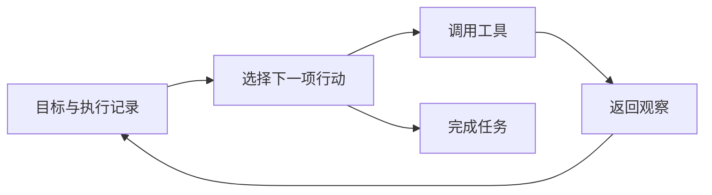

# 第 4 章　智能体经典范式构建

*Hello-Agents：从零开始构建智能体 · 章节学习笔记*

**原作**：Datawhale Hello-Agents 项目及贡献者  
**原文章节**：[第 4 章正文](https://github.com/datawhalechina/hello-agents/blob/36f583c233ea5cee4537ef93455702b55053af18/docs/chapter4/%E7%AC%AC%E5%9B%9B%E7%AB%A0%20%E6%99%BA%E8%83%BD%E4%BD%93%E7%BB%8F%E5%85%B8%E8%8C%83%E5%BC%8F%E6%9E%84%E5%BB%BA.md)  

---

<a id="introduction"></a>

## 引言

模型能够理解问题以后，系统还需要决定怎样推进工作。是先查一项信息再决定下一步，还是先列出计划？得到初稿以后，要不要再检查一轮？

本章把这些选择落实成三个可以对照的结构：ReAct、Plan-and-Solve 和 Reflection。它们的价值不在于名字，而在于分别解决了行动安排中的什么困难。

<a id="section-4-1"></a>

## 4.1　先准备可复用的基础组件

三种范式都需要调用模型。原文先封装 `HelloAgentsLLM`，把模型名称、服务地址、密钥和请求细节集中起来。这样，更换模型服务时，不必把所有控制逻辑一起修改。

配置从环境变量或本地配置文件读取，工具也通过统一入口登记。对于一个工具，名称要明确，描述要能说明用途，输入和输出则要便于程序检查。

这一层看起来平常，却决定了后续代码能否复用。若模型请求、工具执行和历史记录混在同一个长函数中，比较三种范式时就很难看出真正不同的部分。

<a id="section-4-1-1"></a>

### 4.1.1　客户端、工具和控制器的最小约定

客户端接收消息并返回模型输出；工具接收明确参数并返回实际结果；控制器决定何时调用二者，并保存过程。三者分开以后，可以独立替换模型或搜索服务，也可以用固定响应检查循环。

工具说明最好同时回答用途、输入、结果和失败含义。例如搜索工具不仅应告诉模型“可以搜索”，还要说明查询字段、返回条数及结果中包含的来源。说明越接近真实接口，模型越少需要猜测。

控制器则需要处理普通回答、工具调用与结束动作。若三种情况没有明确边界，一段含有函数名的说明文字就可能被误执行。原文用文本标记方便展示，工程实现还可以使用结构化输出。

<a id="section-4-2"></a>

## 4.2　ReAct：根据结果决定下一步

ReAct 将决策与行动交替安排。系统读取目标和已有结果，选择一个动作，执行以后再观察反馈，而不是预先确定全部路线。



本章用搜索手机信息说明这一过程。模型自身的知识可能过时，需要通过搜索补充。第一次查询不足时，还可以改变关键词，继续获取证据。

<a id="section-4-2-1"></a>

### 4.2.1　从工具说明到实际调用

搜索工具被登记到执行器中，工具清单进入提示。模型生成动作后，由程序解析名称和参数，再交给对应函数执行。

因此，ReAct 的关键并不是要求模型多写几段分析，而是让外部结果真实进入后续决策。工具报错、参数缺失和找不到结果，都应成为有区别的观察。

<a id="section-4-2-2"></a>

### 4.2.2　怎样排查一条不正常的轨迹

可以依次检查模型是否选错工具、动作是否解析成功、工具是否正常返回，以及返回内容有没有被遗漏。若循环总在重复同一次查询，还要看它是否意识到信息没有增加。

ReAct 适合需要探索的任务，但多轮模型与网络请求也会增加时间和费用。步数上限、超时和重复行动检测，应由控制程序维护。

<a id="section-4-2-3"></a>

### 4.2.3　一次搜索任务怎样逐步缩小问题

以原文的手机信息查询为例，第一次检索可能找到产品新闻，却缺少用户关心的具体参数。下一轮应该围绕这个缺口继续，而不是原样重复搜索。

| 阶段 | 已经知道什么 | 合理的下一步 |
| --- | --- | --- |
| 收到问题 | 需要某款产品的信息。 | 搜索产品与发布时间。 |
| 取得初步资料 | 找到名称，但参数不完整。 | 针对缺少的参数查询可靠来源。 |
| 资料相互矛盾 | 不同页面可能讨论不同版本。 | 核对地区、型号与日期。 |
| 关键条件齐全 | 有足够材料支持回答。 | 整理来源并停止查询。 |

这张表展示的是 ReAct 的决策逻辑，不对应当前某款手机的事实。每轮应围绕尚未解决的问题增加信息；达到回答条件后继续查询，也可能只是增加噪声和费用。

若结果一直不足，可以改变来源、澄清问题或说明限制。如何从观察中判断是否取得进展，是循环能否有效的关键。

<a id="section-4-3"></a>

## 4.3　Plan-and-Solve：先安排步骤，再逐步执行

当任务的结构比较清楚时，先制定计划可能更容易保持方向。Plan-and-Solve 将流程分成规划器（Planner）与执行器（Executor）：前者拆解问题，后者逐步完成并记录结果。

**示例 4.1　把应用题拆开**

原文给出的销量题可以按顺序处理：周一 15 个，周二是两倍得到 30 个，周三比周二少 5 个得到 25 个，最后合计 70 个。

这里真正值得观察的不是算术本身，而是第二步和第三步如何引用前面的结果。执行器需要同时知道原问题、整体计划、已完成步骤与当前步骤。

<a id="section-4-3-1"></a>

### 4.3.1　计划也是需要检查的数据

模型生成的计划应使用清楚的结构，例如一个步骤列表，避免执行程序猜测自然语言中的层次。程序还需要检查列表是否为空、步骤是否合理，以及任务能否在允许的范围内完成。

先规划有助于减少遗漏，却也可能把错误提前固定下来。原文的基础实现按计划执行；需要面对变化的应用，可以进一步加入失败检测与重新规划。不能认为只要有计划，系统就不会走偏。

<a id="section-4-3-2"></a>

### 4.3.2　执行历史需要怎样表示

计划可以保存成列表，每个步骤对应输入、状态和结果。执行器处理当前步骤时，应引用已经完成的结果，而不是要求模型重新猜测前面做了什么。

```json
{
  "step": 2,
  "description": "计算周二销量",
  "depends_on": [1],
  "status": "completed",
  "result": 30
}
```

这是对原文销量例子的状态化说明。第三步使用周二结果得到 25，最终汇总再取得三天数值。若第二步失败，后面的依赖步骤就不应被标记为已经完成。

计划还需要保持适当粒度。一个步骤太大，执行器仍然不知道如何推进；拆得太细，又会为很简单的计算增加多次调用。可以按“这一项是否有明确输入和可检查结果”判断拆分是否合适。

<a id="section-4-3-3"></a>

### 4.3.3　先规划与重新规划怎样衔接

原文基础版重在展示顺序执行。若任务依赖外部环境，可以在每步完成后检查计划的前提。发现来源不可用或约束改变时，再决定修改后续步骤，而不是抹掉全部历史重新开始。

保留已经确认的事实、标记失效部分，再生成剩余计划，通常更容易追踪。计划是推进任务的工具，也应当接受实际结果的修正。

<a id="section-4-4"></a>

## 4.4　Reflection：让初稿接受检查

Reflection 在初步执行之后增加评审与修改。系统生成一版结果，再从特定标准检查问题，最后结合反馈改写。

```text
任务 → 初稿 → 具体反馈 → 修改结果
                 ↑           │
                 └───────────┘
```

本章使用生成素数程序的例子，观察实现怎样从初始方案逐步优化。短期记忆保存各版代码和反馈，让后续修改知道已经尝试过什么。

<a id="section-4-4-1"></a>

### 4.4.1　有用的反馈应该是什么样

“代码可以更好”很难指导修改；“重复执行了相同计算，建议改用筛法，并检查小于 2 的输入”则具体得多。评审提示应指出检查维度，修改提示要同时保留原任务和反馈。

不过，模型给自己的好评不是独立证据。代码是否正确，应尽量结合运行结果和测试；事实是否成立，也需要来源支持。反复生成文字可能改善结果，也可能保留同一个误解。

对于生成素数程序，评审还可以拆成正确性和效率两类。正确性检查包括输入小于 2、上界本身为素数、是否误把 1 算进去；效率检查再看是否重复判断同一因子。

**示例 4.2　给修改过程一个具体依据**

```text
输入 1：预期没有素数。
输入 2：预期包含 2。
输入 20：预期为 2、3、5、7、11、13、17、19。
评审意见：先保持这些结果，再改进重复计算。
```

筛法通过已知较小素数排除其倍数，与对每个数从头试除不同。修改后仍要运行相同检查，不能因为换成更高级的算法名称，就认为程序已经正确。

反思记录因此应保存“发现了什么问题、依据是什么、怎样修改、修改后发生了什么”。只保留最后一版代码，会失去最有助于理解迭代的部分。

<a id="section-4-4-2"></a>

### 4.4.2　多检查一轮是否值得

每轮评审和修改都会增加调用与等待。对于需要快速回应的简单问题，成本未必合算；对于代码、报告等可以明确检查质量的产物，额外迭代更可能有价值。

结束条件也要具体，例如通过约定检查、没有新的可执行反馈，或达到迭代预算，避免一直修改下去。

<a id="section-4-4-3"></a>

### 4.4.3　怎样给迭代设置有意义的预算

假设初稿调用模型一次，每轮再进行一次评审与一次改写，完成三轮便需要七次调用。这只是一个常见结构的计算，还没有计入测试、检索与其他工具耗时。

预算可以按最大轮数设置，也可以与结果结合：通过约定检查后停止；同一条反馈反复出现且没有改进时停止；达到时间或费用上限时保存当前最好版本。

还应明确“最好”怎样判断。新版本可能语言更顺，却删除了必要信息；代码可能更短，却破坏了边界行为。对可检验条件保持一致，才能比较每次修改的实际收益。

<a id="section-4-5"></a>

## 4.5　怎样选择与组合三种范式

| 当前困难 | 可以先考虑的结构 | 需要留意 |
| --- | --- | --- |
| 信息不齐，下一步取决于查询结果 | ReAct | 循环与工具调用的成本。 |
| 任务能拆成较清楚的依赖步骤 | Plan-and-Solve | 初始计划可能遗漏或出错。 |
| 已有初稿，还需要提高质量 | Reflection | 评审是否有可靠依据。 |

三种结构可以组合。先制定整体计划，执行某一步时用 ReAct 查证，生成产物后再运行检查，往往比只选择一个名字更贴近实际需求。

<a id="section-4-5-1"></a>

### 4.5.1　从单一范式走向组合流程

设想要完成一份带资料来源的技术说明。可以先用规划器确定要回答的几个问题；对每个问题运行带工具的查询循环；草稿完成后，再检查引用是否支持结论和段落是否遗漏。

三种范式由此承担不同职责：计划保持覆盖范围，ReAct 处理信息缺口，Reflection 改进产物。共享状态则把它们连接起来，避免某一阶段修正了事实，下一阶段仍引用旧内容。

组合也需要有所节制。一个可以一次查询回答的问题，未必值得启动完整规划与多轮评审。先识别当前瓶颈，再增加对应结构，比把所有范式叠上去更容易知道改善来自哪里。

后面的低代码平台与框架，会把这些过程包装成节点、角色或组件。认识了这里的控制逻辑，再看那些封装就容易得多。

---

<a id="references"></a>

## 参考资料

1. 本章内容依据 Hello-Agents 的[第 4 章原文](https://github.com/datawhalechina/hello-agents/blob/36f583c233ea5cee4537ef93455702b55053af18/docs/chapter4/%E7%AC%AC%E5%9B%9B%E7%AB%A0%20%E6%99%BA%E8%83%BD%E4%BD%93%E7%BB%8F%E5%85%B8%E8%8C%83%E5%BC%8F%E6%9E%84%E5%BB%BA.md)整理，完整论述及其参考文献可从原文继续阅读。
2. 实现细节可对照原项目的[第 4 章配套代码](https://github.com/datawhalechina/hello-agents/tree/36f583c233ea5cee4537ef93455702b55053af18/code/chapter4)。正文中的简化流程用于解释设计，不代表这些代码已在本机运行验证。

---

**继续阅读**：[上一章：大语言模型基础](llm-foundations.md) · [全书目录](index.md) · [下一章：基于低代码平台的智能体搭建](low-code-platforms.md)
