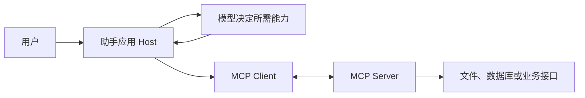

# 第 10 章　智能体通信协议

*Hello-Agents：从零开始构建智能体 · 章节学习笔记*

**原作**：Datawhale Hello-Agents 项目及贡献者  
**原文章节**：[第 10 章正文](https://github.com/datawhalechina/hello-agents/blob/36f583c233ea5cee4537ef93455702b55053af18/docs/chapter10/%E7%AC%AC%E5%8D%81%E7%AB%A0%20%E6%99%BA%E8%83%BD%E4%BD%93%E9%80%9A%E4%BF%A1%E5%8D%8F%E8%AE%AE.md)  

---

## 本章目录

- [引言](#introduction)
- [10.1　先区分我们在连接什么](#section-10-1)
  - [10.1.1　接口协议统一了什么，没有统一什么](#section-10-1-1)
- [10.2　MCP：把服务能力接到应用中](#section-10-2)
  - [10.2.1　连接、发现、调用、收取结果](#section-10-2-1)
  - [10.2.2　MCPTool 如何接入已有 Agent](#section-10-2-2)
  - [10.2.3　Tools、Resources 与 Prompts 怎样区分](#section-10-2-3)
  - [10.2.4　MCP 与 Function Calling 怎样接在一起](#section-10-2-4)
  - [10.2.5　本地进程与远程服务的生命周期](#section-10-2-5)
- [10.3　A2A：把一项工作交给另一个助手](#section-10-3)
  - [10.3.1　任务状态比一句回复更重要](#section-10-3-1)
  - [10.3.2　任务与产物为什么分别记录](#section-10-3-2)
  - [10.3.3　接待员怎样委托给专业助手](#section-10-3-3)
- [10.4　ANP：服务发现与网络身份](#section-10-4)
  - [10.4.1　发现、选择与执行是三个步骤](#section-10-4-1)
- [10.5　示例：把天气查询封装为 MCP 服务](#section-10-5)
  - [10.5.1　怎样检查一个天气服务是否可复用](#section-10-5-1)
- [参考资料](#references)

---

<a id="introduction"></a>

## 引言

如果每接入一个文件服务、数据库或远程助手，都要重写一套请求与响应代码，集成很快就会成为负担。通信协议试图约定双方怎样描述能力、提交请求和交换结果。

本章分别讨论工具连接、智能体协作和开放网络发现。它们有相近之处，但不能只因为都通过网络传递 JSON，就认为解决了同一个问题。

<a id="section-10-1"></a>

## 10.1　先区分我们在连接什么

| 协议 | 本章强调的用途 | 可以先问的问题 |
| --- | --- | --- |
| MCP | 应用访问工具、资源和有关上下文。 | 这个服务提供哪些能力，参数怎样传？ |
| A2A | 独立智能体之间交换任务与结果。 | 能否把任务交给对方，并跟踪完成状态？ |
| ANP | 面向开放网络的描述、身份与服务发现。 | 在网络里怎样找到合适的服务并识别它？ |

这个比较帮助理解重点，不意味着协议之间没有交集。具体规范仍在演进，本章的客户端和工具包装器也只是特定版本的实现。

协议统一通信方式，业务含义仍需说明。即使连接成功，价格字段究竟用元还是分、结果来自哪一天，仍然需要服务接口约定。

<a id="section-10-1-1"></a>

### 10.1.1　接口协议统一了什么，没有统一什么

协议可以约定消息结构、能力发现与错误表达，让不同系统使用共同方式交换信息。它通常不替应用决定任务目标，也不能自动理解服务的全部业务含义。

例如，两项地图服务都可以接入，但一个返回城市名称，另一个要求城市编码，中间仍需要参数与语义处理。更进一步，同样叫“查询价格”，也可能包含不同税费或日期范围。

因此，互操作应分层检查：连接能否建立、消息是否符合规范、能力是否匹配、业务结果能否正确使用。前两层通过后，后两层仍可能有问题。

<a id="section-10-2"></a>

## 10.2　MCP：把服务能力接到应用中

MCP 使用 Host、Client 和 Server 等角色。Host 是运行助手的应用，Client 负责与服务端建立协议连接，Server 对外提供工具或其他资源。



不是模型自己直接建立了协议连接。应用发现服务能力，将需要的描述提供给模型，再执行被选择的调用，最后把结果送回模型。

<a id="section-10-2-1"></a>

### 10.2.1　连接、发现、调用、收取结果

原文首先连接服务器，再列出可用工具，检查参数要求，随后提交工具名称和参数。这个顺序让客户端不必把所有能力预先写死。

标准输入输出适合本地进程连接，远程服务则通过相应 HTTP 传输方式接入。原文还展示内存、脚本等便于测试的连接入口；客户端封装中的多种配置，不应直接等同于同样数量的正式传输规范。

<a id="section-10-2-2"></a>

### 10.2.2　MCPTool 如何接入已有 Agent

HelloAgents 用 `MCPTool` 包装服务，并将服务公开的工具展开登记。对 Agent 而言，它们可以像普通工具一样被选择。

工具变多以后，应留意名称冲突、说明重复和参数类型。发现能力不等于获得任意操作权限，服务范围与凭证仍需由应用管理。

<a id="section-10-2-3"></a>

### 10.2.3　Tools、Resources 与 Prompts 怎样区分

原文介绍三类能力。Tools 执行操作，Resources 提供可读取内容，Prompts 提供复用的交互模板。它们帮助应用分别组织行动、资料与指引。

| 能力 | 可以怎样理解 | 文档助手中的例子 |
| --- | --- | --- |
| Tool | 执行带参数的功能。 | 按关键词搜索文档。 |
| Resource | 提供具有标识的内容。 | 读取一份已知手册。 |
| Prompt | 返回可复用的任务模板。 | 按统一结构解释一个接口。 |

实际宿主怎样向用户或模型开放这些能力，属于应用设计。发现一项资源后，还需要选择是否读取、读多少，以及怎样进入当前上下文。

<a id="section-10-2-4"></a>

### 10.2.4　MCP 与 Function Calling 怎样接在一起

Function Calling 主要帮助模型表达要用哪个函数、填写什么参数；MCP 则帮助应用与独立服务交换能力描述和调用结果。它们发生在相邻但不同的位置。

一个常见组合是：客户端取得 MCP 工具描述，应用将其转换成模型接受的工具格式，模型选择调用，应用再把请求交给 MCP 服务。结果回来以后，继续构造模型输入。

```text
服务描述 → 模型可见的工具说明 → 调用选择
    ↑                               ↓
服务结果 ← MCP 实际调用 ← 应用校验与转发
```

这种组合让同一服务能被不同宿主使用。模型提供商的响应格式仍可能不同，应用适配也仍然存在，只是不必为每个业务服务重新实现全部连接逻辑。

<a id="section-10-2-5"></a>

### 10.2.5　本地进程与远程服务的生命周期

本地连接要考虑进程怎样启动、工作目录和环境变量是什么，以及结束时怎样关闭。远程连接则涉及服务地址、认证、超时和网络中断。通信内容相同，运行责任并不相同。

工具自动展开后，还应保留服务来源，避免同名工具难以区分。调用结束时是否释放连接，也需要明确。协议使用得越多，连接管理越值得从业务逻辑中独立出来。

<a id="section-10-3"></a>

## 10.3　A2A：把一项工作交给另一个助手

一个工具通常提供明确操作，另一个智能体则可能自行安排一段工作。A2A 因而关注能力描述、消息、任务状态与产物（Artifact）等概念。

例如，接待员发现用户提出技术问题，可以交给技术专家；销售问题则交给销售顾问。调用方需要知道任务是否完成，若需要补充信息或发生失败，又该怎样继续。

<a id="section-10-3-1"></a>

### 10.3.1　任务状态比一句回复更重要

如果远端工作较长，只等待一段最终文本往往不够。任务标识、执行状态与产物，让调用方能区分正在处理、需要输入和已经完成等情况。

原文明确采用了简化封装与部分模拟来演示 A2A 思想。理解这些例子的通信关系有价值，但不能由此认定所有示例都已经通过完整协议的互操作验证。

A2A 也不强制应用采用一种唯一拓扑。系统可以直接协作，也可以安排协调者；是否存在单点故障，还取决于具体部署与恢复设计。

<a id="section-10-3-2"></a>

### 10.3.2　任务与产物为什么分别记录

任务记录目标、进度和当前状态，产物则是已经生成的报告、文件或其他输出。一项任务可能产生多个产物，也可能仍在执行而已经有部分结果。

例如，研究助手先完成资料列表，之后再生成报告。资料列表可以先作为阶段产物保存，但任务状态仍是未完成。调用方据此决定等待、补充输入或检查阶段结果。

若对方要求澄清，原任务标识有助于接续同一工作；若重新发送一条完全无关联请求，服务可能把它当作新任务再执行。能通信以后，还需要正确理解这种任务生命周期。

<a id="section-10-3-3"></a>

### 10.3.3　接待员怎样委托给专业助手

智能客服例子中，接待员首先判断请求类别，再把必要材料交给技术或销售助手。委托内容应包含原问题、已知条件和期望交付，而不只是一个被压缩到失去含义的标签。

收到结果后，接待员还要确认它是否回答了用户问题。若专家助手只返回一般说明，不能在汇总时改写成某项业务已经办理成功。分工后的结果同样需要验收。

<a id="section-10-4"></a>

## 10.4　ANP：服务发现与网络身份

网络里存在很多助手时，应用需要先知道谁提供了什么能力，再考虑如何选择。ANP 讨论服务描述、发现与去中心化标识（DID）等机制。

可以把它理解为给服务提供可识别的名片与查找方式。身份机制帮助确认通信对象，但单靠一个标识并不能保证对方结果正确，也不自动解决授权与业务信任。

本章的示例围绕注册、发现和选择服务展开，还用负载选择说明调度思路。应把这种教学注册表与完整的开放网络协议实现区分开，继续接入时再核对实际规范。

<a id="section-10-4-1"></a>

### 10.4.1　发现、选择与执行是三个步骤

服务发现回答“有哪些候选”，路由选择回答“这次交给谁”，执行才真正提交任务。可以根据能力、可用状态或其他约定筛选，但发现记录可能已经过时，需要处理不可达情况。

原文的轻量示例把这些概念具体化，便于观察注册和查询。它帮助理解架构，并不意味着本地注册表已经拥有开放网络中的所有身份与信任能力。

身份描述说明对象是谁，能力描述说明它声称能做什么，历史结果与验证则帮助判断这次是否做得好。这几项信息不能用其中一项完全替代。

<a id="section-10-5"></a>

## 10.5　示例：把天气查询封装为 MCP 服务

原文从一个天气函数出发，建立服务端，再用客户端测试。函数需要明确城市参数，返回清楚的结果，并区分无效输入、请求失败与正常天气。

**示例 10.1　从本地能力到独立服务**

```text
实现天气查询函数
  → 定义对外名称、说明和参数
  → 启动 MCP Server
  → 客户端发现并调用工具
  → 检查返回值与失败情况
  → 按需要整理部署与发布材料
```

发布平台帮助别人发现和启动服务，原文以 Smithery 为例说明配置文件、依赖与运行方式。上架本身不等于服务正确或可信，运行环境与访问范围仍需说明。

<a id="section-10-5-1"></a>

### 10.5.1　怎样检查一个天气服务是否可复用

先检查工具说明能否让调用者理解城市输入，再使用有效城市、缺失参数和服务异常等情况观察结果。返回天气时保留观测或预报时间，能够避免“查询成功但日期不对”的问题。

服务还应说明输出结构与错误类型。调用方可以据此区分输入问题、认证失败和暂时不可用，安排不同处理；如果全部返回同一句“发生错误”，下游就很难恢复。

发布材料则应让使用者能够重建同样运行方式，包括依赖、启动入口和配置位置。注册到目录与真正可运行之间，还有这段交付工作，这也解释了本章为什么同时介绍客户端、服务器与发布配置。

到这里，模型已经能够通过共同接口接入更多能力。下一章换一个方向：如果当前模型还不善于完成任务，能否通过训练改变它的行为？

---

<a id="references"></a>

## 参考资料

1. 本章内容依据 Hello-Agents 的[第 10 章原文](https://github.com/datawhalechina/hello-agents/blob/36f583c233ea5cee4537ef93455702b55053af18/docs/chapter10/%E7%AC%AC%E5%8D%81%E7%AB%A0%20%E6%99%BA%E8%83%BD%E4%BD%93%E9%80%9A%E4%BF%A1%E5%8D%8F%E8%AE%AE.md)整理，完整论述及其参考文献可从原文继续阅读。
2. 实现细节可对照原项目的[第 10 章配套代码](https://github.com/datawhalechina/hello-agents/tree/36f583c233ea5cee4537ef93455702b55053af18/code/chapter10)。正文中的简化流程用于解释设计，不代表这些代码已在本机运行验证。

---

**继续阅读**：[上一章：上下文工程](context-engineering.md) · [全书目录](index.md) · [下一章：Agentic-RL](agentic-rl.md)
