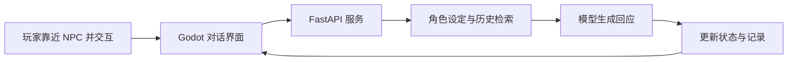

# 第 15 章　构建赛博小镇

*Hello-Agents：从零开始构建智能体 · 章节学习笔记*

**原作**：Datawhale Hello-Agents 项目及贡献者  
**原文章节**：[第 15 章正文](https://github.com/datawhalechina/hello-agents/blob/36f583c233ea5cee4537ef93455702b55053af18/docs/chapter15/%E7%AC%AC%E5%8D%81%E4%BA%94%E7%AB%A0%20%E6%9E%84%E5%BB%BA%E8%B5%9B%E5%8D%9A%E5%B0%8F%E9%95%87.md)  

---

## 本章目录

- [引言](#introduction)
- [15.1　游戏负责画面，后端负责智能体](#section-15-1)
  - [15.1.1　一次交互中有几种不同状态](#section-15-1-1)
- [15.2　同一套模型接口，怎样产生不同角色](#section-15-2)
  - [15.2.1　短期与长期记忆怎样配合](#section-15-2-1)
  - [15.2.2　角色设定怎样进入一次具体回应](#section-15-2-2)
  - [15.2.3　历史检索怎样帮助角色回忆](#section-15-2-3)
- [15.3　好感度怎样进入系统](#section-15-3)
  - [15.3.1　把生成判断与持久状态分开](#section-15-3-1)
  - [15.3.2　关系等级怎样映射成表达要求](#section-15-3-2)
  - [15.3.3　态度判断发生错误时怎么办](#section-15-3-3)
- [15.4　轻负载模式怎样减少重复调用](#section-15-4)
  - [15.4.1　即时对话与背景台词怎样分开调度](#section-15-4-1)
  - [15.4.2　背景相关性与真实协作有什么距离](#section-15-4-2)
- [15.5　Godot 场景怎样组织交互](#section-15-5)
  - [15.5.1　从移动到进入对话](#section-15-5-1)
  - [15.5.2　网络等待不能冻结画面](#section-15-5-2)
  - [15.5.3　场景实例与运行时状态怎样区分](#section-15-5-3)
  - [15.5.4　对话 UI 怎样处理等待与返回](#section-15-5-4)
- [15.6　后端需要管理的不只是台词](#section-15-6)
  - [15.6.1　怎样沿日志检查一次对话](#section-15-6-1)
- [参考资料](#references)

---

<a id="introduction"></a>

## 引言

如果游戏角色每次都说同一句台词，玩家很快就会摸清它的全部反应。换成语言模型之后，对话可以灵活得多；但角色要保持身份、记得先前互动，还不能让游戏画面一直等着网络请求。

赛博小镇用一个像素办公室把这些问题放在一起。我们可以从玩家按下交互键开始，沿着一次对话经过的组件，理解游戏与智能体怎样协同。

<a id="section-15-1"></a>

## 15.1　游戏负责画面，后端负责智能体

原文使用 Godot 构建二维场景，FastAPI 接收请求，HelloAgents 管理 NPC 的模型调用与记忆，再使用 SQLite 和 Qdrant 等组件保存有关数据。



前后端分开以后，游戏脚本不必直接处理模型服务配置，模型也不必逐帧控制角色移动。它们通过明确请求与结果合作。

<a id="section-15-1-1"></a>

### 15.1.1　一次交互中有几种不同状态

游戏侧保存玩家位置、当前交互对象和界面是否打开，后端保存角色忙碌与关系记录，模型调用则使用当前角色和相关历史。它们属于同一次体验，但并不自动共享同一块内存。

请求和响应负责同步必要信息。玩家切换对象时，界面应知道随后返回的回复来自谁；后端处理失败时，也应让游戏恢复可交互状态。这些连接决定自然语言能力能否形成顺畅体验。

把职责分开以后，也便于排查：角色移动异常先看游戏脚本，回答失去人物风格再看提示和历史，关系值没有更新则检查后端状态链路。

<a id="section-15-2"></a>

## 15.2　同一套模型接口，怎样产生不同角色

每个 NPC 有自己的标识、职业、性格、提示与记录。原文的三个角色分别偏向 Python 工程、产品设计与界面设计，帮助观察同一问题如何得到不同表达。

角色提示应说明知道什么、关注什么以及怎样说话。不过，身份设定只是输入约束，不会自动给模型增加真实专业资格，也不保证它不会偏离角色。

<a id="section-15-2-1"></a>

### 15.2.1　短期与长期记忆怎样配合

工作记忆保留近期对话，帮助理解“它”“刚才那件事”等指代；情景记忆保存历史，再在有关话题出现时检索。

一次回应可以结合角色提示、近期信息和相关历史，而不是把全部记录再次发送给模型。数据库里保存过，也不代表每次都检索得到，需要检查查询与选择过程。

扩展为多个玩家时，还需要按玩家与角色区分记录。某个 NPC 与一位玩家的经历，不应该误用在另一位玩家的对话里。

<a id="section-15-2-2"></a>

### 15.2.2　角色设定怎样进入一次具体回应

工程师、产品经理与设计师的区别，不应只存在于名字。提示可以分别规定关注问题、表达习惯和工作背景，再结合本轮玩家输入与已有关系状态。

例如，玩家讨论同一个项目，工程师可能先关心接口与实现，产品经理关注目标用户，设计师关注布局与使用过程。这是表达与关注点的分工，并不要求每个角色完全不知道其他领域。

角色当前状态也要一致。界面显示正在工作，台词却不断声称自己在休假，会破坏世界连贯性。可以将当前场景信息放进提示，而不是只在初始化时写一次人物简介。

<a id="section-15-2-3"></a>

### 15.2.3　历史检索怎样帮助角色回忆

用户问“上次那个项目怎么样”，近期上下文可能不足以识别对象。长期记录需要按角色与玩家过滤，再检索相关内容，必要时询问具体指代。

记录里还应区分玩家的设想与已经发生的事件。一次说“以后想一起开发游戏”，不能在后续变成“我们已经共同开发过游戏”。保存与引用历史时的这种身份区别，比单纯保留更多条数更重要。

记忆过多时，可以整理明确事实与未完成事项，并保留原始记录位置。角色拥有长期记忆，不等于每次生成都要读取全部历史。

<a id="section-15-3"></a>

## 15.3　好感度怎样进入系统

本章将关系程度划分为从陌生到挚友的几个等级。模型分析对话态度，程序按规则调整分数，再把当前等级转成下一次回复的风格要求。

```text
对话内容
  → 形成关系变化的判断
  → 程序更新有范围限制的分值
  → 查询新的关系等级
  → 在后续提示中调整表达方式
```

这种分值是一项游戏机制。它可以帮助产生不同互动风格，却不等于测出了真实情感，也不能由一条文本判断就确认玩家的实际意图。

<a id="section-15-3-1"></a>

### 15.3.1　把生成判断与持久状态分开

模型可以建议增加或减少，最终数值应由后端校验并写入。异常输出不应使分数超出范围，同一次请求重试也不宜重复计分。

这些是围绕原文机制继续完善时的重要检查点。角色台词可以灵活，影响后续行为的状态仍应有清楚规则。

<a id="section-15-3-2"></a>

### 15.3.2　关系等级怎样映射成表达要求

原文将分数分成五个整数区间：陌生 0–20、熟悉 21–40、友好 41–60、亲密 61–80、挚友 81–100。应用根据所在区间选择对应风格，再提供给模型。

| 设计层面 | 负责什么 | 可以怎样检查 |
| --- | --- | --- |
| 数值规则 | 分数怎样增加、减少与限制。 | 边界是否落入正确等级。 |
| 关系记录 | 哪位玩家与哪位 NPC 的状态。 | 不同对象是否相互影响。 |
| 提示策略 | 各等级怎样改变表达。 | 回复是否体现差别且仍保持角色。 |

关系变化以后，需要在后续请求中使用新状态。如果只更新数据库但不改变上下文，模型就看不到变化；如果只改提示而未保存，重新进入游戏又可能恢复旧状态。

<a id="section-15-3-3"></a>

### 15.3.3　态度判断发生错误时怎么办

模型可能误读玩笑、反讽或较短回复。关系值的调整可以保持有限幅度，并在解析失败时采用明确默认处理，而不是产生任意分数。

这属于游戏反馈设计。应结合实际对话检查是否出现用户难以理解的变化，而不是只确认分值接口能够返回数字。关系系统的可解释程度，也会影响玩家对互动的感受。

<a id="section-15-4"></a>

## 15.4　轻负载模式怎样减少重复调用

办公室里的背景台词不一定要逐个 NPC 单独请求。原文让模型一次生成多个角色的 JSON 内容，再分别显示，形成批量生成方式。

这种方法可以减少请求次数，也让同批台词拥有共同背景。不过，总费用还取决于输入输出长度与生成频率，不能简单按角色数量断言成本减少到固定比例。

玩家直接发起的对话，仍采用对应角色的独立处理。预先批量生成的相关台词，与多个自主智能体真实交换消息，是不同程度的协作，阅读效果时应加以区分。

<a id="section-15-4-1"></a>

### 15.4.1　即时对话与背景台词怎样分开调度

即时对话以当前玩家输入为中心，需要角色独立的记忆和及时回应。背景台词则可以按较低频率批量生成，再缓存在状态中供界面读取。

原文的后台过程定期生成多角色台词，游戏端再定时取得状态。这说明模型生成频率与画面更新频率可以不同；不必每一帧、每一次轮询都重新调用模型。

批量输出还要检查角色映射。某个角色缺少条目时，可以保留旧台词或清楚处理缺失，不能把另一人的话随意放到它头上。角色名称、内部标识与页面对象之间应保持对应。

<a id="section-15-4-2"></a>

### 15.4.2　背景相关性与真实协作有什么距离

同一提示生成的几段话可以提到相同主题，从而表现出场景连贯性。但它们未必经历各自的决策、消息交换与状态更新。

如果进一步实现 NPC 之间真正的任务协作，就需要明确消息发送者、接收者、可见信息和行动后果。批量台词是轻量表达方式，完整社交模拟则是另一层系统设计。

<a id="section-15-5"></a>

## 15.5　Godot 场景怎样组织交互

Godot 使用节点（Node）组成场景（Scene），场景又可以实例化到其他场景里。本章把 Main、Player、NPC 和 DialogueUI 分开，多个 NPC 使用同一模板再设置不同参数。

<a id="section-15-5-1"></a>

### 15.5.1　从移动到进入对话

玩家脚本处理移动、动画与碰撞；NPC 的交互区域检测玩家是否靠近；按下交互键后，对话界面打开，角色暂时进入交互状态。

角色巡逻和碰撞由游戏代码控制，语言生成由后端处理。把高频的移动控制交给每次都要联网的模型，并不是这个项目的工作方式。

<a id="section-15-5-2"></a>

### 15.5.2　网络等待不能冻结画面

API 客户端通过异步 HTTP 请求和信号传递结果。对话 UI 在等待时显示状态并限制重复发送，收到结果后再恢复输入。

主场景还会定时请求状态，更新背景气泡。轮询间隔决定变化多久显示一次，与逐帧仿真不同；角色切换或界面关闭后，也需要避免把旧请求的结果显示到错误对象上。

<a id="section-15-5-3"></a>

### 15.5.3　场景实例与运行时状态怎样区分

NPC 场景提供通用节点结构，实例再配置姓名、外观与角色标识。这样，修正交互区域或动画逻辑时，不必分别维护三份相似实现。

每个实例的运行状态仍应独立，例如自己的位置、是否正在对话和最近台词。共享模板提高复用，不表示不同实例应该共享全部可变数据。

<a id="section-15-5-4"></a>

### 15.5.4　对话 UI 怎样处理等待与返回

```text
玩家发起交互
  → 保存当前 NPC 标识，进入对话状态
  → 发送请求并显示等待
  → 收到对应结果或错误
  → 更新台词、关系提示与输入状态
  → 关闭时恢复游戏控制
```

等待时限制重复输入可以减少重复请求，但还要处理关闭窗口、离开范围或超时。旧响应回来以后，不能覆盖已经切换到的新 NPC。异步让画面继续运行，也要求明确维护这种时间顺序。

<a id="section-15-6"></a>

## 15.6　后端需要管理的不只是台词

FastAPI 路由连接 NPC 查询、对话和关系状态，状态管理器维护忙碌与动作等信息，日志帮助追踪每次交互。

当请求失败时，需要恢复等待和忙碌状态，否则角色可能一直无法交互。扩展多人场景时，还会涉及同时更新和数据归属，不能仅增加一个玩家名称就认为问题已经解决。

<a id="section-15-6-1"></a>

### 15.6.1　怎样沿日志检查一次对话

可以为一次请求关联玩家、NPC、开始时间、模型或工具状态及结束结果。出现“没有回复”时，就能区分前端未发出、后端未接收、模型失败或结果未显示。

原文同时写控制台与文件日志，方便即时观察和后续分析。应用继续扩展时，可以保留必要的关联信息，避免必须阅读所有历史台词才能找到一次故障。

最终检查也应覆盖玩家体验：移动与交互是否协调，记忆是否正确引用，好感度是否按规则变化，网络失败后是否能够继续。一个会生成台词的模型，只是这段完整交互中的一个组件。

本章成品主要展示角色、记忆、关系值和游戏交互的组合。更复杂的任务系统、独立社交与事件演化属于扩展方向，需要额外状态和评价。最后一章将回到共同问题：怎样把一个演示整理成别人也能接手的项目。

---

<a id="references"></a>

## 参考资料

1. 本章内容依据 Hello-Agents 的[第 15 章原文](https://github.com/datawhalechina/hello-agents/blob/36f583c233ea5cee4537ef93455702b55053af18/docs/chapter15/%E7%AC%AC%E5%8D%81%E4%BA%94%E7%AB%A0%20%E6%9E%84%E5%BB%BA%E8%B5%9B%E5%8D%9A%E5%B0%8F%E9%95%87.md)整理，完整论述及其参考文献可从原文继续阅读。
2. 实现细节可对照原项目的[第 15 章配套代码](https://github.com/datawhalechina/hello-agents/tree/36f583c233ea5cee4537ef93455702b55053af18/code/chapter15)。正文中的简化流程用于解释设计，不代表这些代码已在本机运行验证。

---

**继续阅读**：[上一章：自动化深度研究智能体](deep-research.md) · [全书目录](index.md) · [下一章：毕业设计：把应用交付给他人](project-delivery.md)
