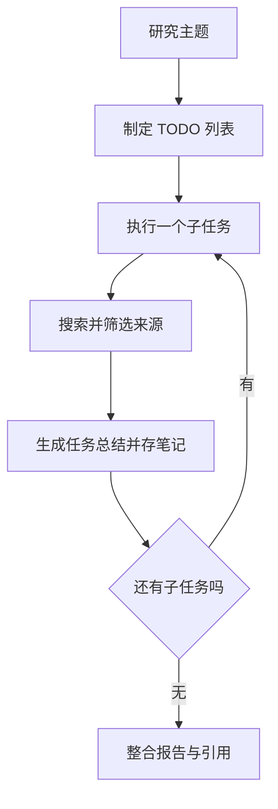

# 第 14 章　自动化深度研究智能体

*Hello-Agents：从零开始构建智能体 · 章节学习笔记*

**原作**：Datawhale Hello-Agents 项目及贡献者  
**原文章节**：[第 14 章正文](https://github.com/datawhalechina/hello-agents/blob/36f583c233ea5cee4537ef93455702b55053af18/docs/chapter14/%E7%AC%AC%E5%8D%81%E5%9B%9B%E7%AB%A0%20%E8%87%AA%E5%8A%A8%E5%8C%96%E6%B7%B1%E5%BA%A6%E7%A0%94%E7%A9%B6%E6%99%BA%E8%83%BD%E4%BD%93.md)  

---

## 本章目录

- [引言](#introduction)
- [14.1　把研究主题变成有限的工作](#section-14-1)
  - [14.1.1　深度研究与一次搜索的工作量有什么不同](#section-14-1-1)
- [14.2　TODO 不只是几个标题](#section-14-2)
  - [14.2.1　标题、意图与查询为什么都保留](#section-14-2-1)
  - [14.2.2　怎样判断规划是否覆盖了问题](#section-14-2-2)
- [14.3　三个角色与四个服务](#section-14-3)
  - [14.3.1　为什么扩展 ToolAwareSimpleAgent](#section-14-3-1)
  - [14.3.2　服务层怎样减轻角色的负担](#section-14-3-2)
  - [14.3.3　任务状态与工具事件怎样对应](#section-14-3-3)
- [14.4　搜索结果怎样成为可用证据](#section-14-4)
  - [14.4.1　摘要与原文之间还隔着一步](#section-14-4-1)
  - [14.4.2　来源如何进入任务总结](#section-14-4-2)
  - [14.4.3　遇到重复、矛盾与不足时分别处理](#section-14-4-3)
- [14.5　用 NoteTool 保存中间成果](#section-14-5)
  - [14.5.1　研究笔记怎样支持中断后的接续](#section-14-5-1)
- [14.6　让页面展示真实的研究阶段](#section-14-6)
  - [14.6.1　事件协议也需要一致](#section-14-6-1)
  - [14.6.2　SSE 中的一条事件究竟说明什么](#section-14-6-2)
  - [14.6.3　最终报告怎样从任务结果中长出来](#section-14-6-3)
- [参考资料](#references)

---

<a id="introduction"></a>

## 引言

研究一个主题时，第一轮搜索往往只会带来更多问题：基本定义是什么，有哪些不同方法，哪些资料值得相信？如果没有范围和记录，搜索很容易不断发散。

本章用一张可执行的待办列表组织研究。先规划子问题，再逐项搜索与总结，最后形成带来源的报告。页面同时展示任务状态，让用户看见工作正在怎样推进。

<a id="section-14-1"></a>

## 14.1　把研究主题变成有限的工作

原文采用 Vue 3、FastAPI 和 HelloAgents，连接搜索服务与模型。与旅行助手相比，重点从地点与日期，转向主题覆盖、材料整理和引用追踪。



这是一条由协调器安排的研究流水线。模型参与生成计划和总结，服务层负责顺序、查询和状态。它并不需要把所有控制权都交给模型。

<a id="section-14-1-1"></a>

### 14.1.1　深度研究与一次搜索的工作量有什么不同

一次搜索主要返回与查询相关的候选内容，研究则还要确定问题范围、比较材料、补足缺口并形成有依据的结论。本章把这些工作拆开，让不同阶段都能被观察。

例如，了解一个组织，不仅需要找到首页，还可能需要核对项目、活动和参与方式。各项资料可能来自不同日期，也可能只是转述。把它们简单串成一段长摘要，并不会自动形成完整研究。

因此，任务列表首先是控制范围的方式。它既帮助避免无止境发散，也给后续报告提供可检查的覆盖结构。

<a id="section-14-2"></a>

## 14.2　TODO 不只是几个标题

规划阶段生成子任务，每项保存标题（title）、意图（intent）和查询（query）。标题帮助阅读，意图说明这一项要解决什么，查询则用于取得资料。

**示例 14.1　研究一个组织**

```text
主题：了解 Datawhale
子任务一：组织定位与成立背景
子任务二：主要开源项目和学习活动
子任务三：协作方式及参与渠道
```

这是对原文主题的简化说明。任务数量应该帮助控制范围，而不是机械凑数；覆盖不足时需要补充，多个条目重复时则应合并。

计划使用结构化输出，程序仍需检查必需字段和内容。能解析 JSON，只表示格式可读，不表示规划已经全面。

<a id="section-14-2-1"></a>

### 14.2.1　标题、意图与查询为什么都保留

标题用于给人快速识别任务，意图约束这一项需要回答什么，查询只是取得资料的当前手段。搜索结果不合适时，可以换查询，但应保留原来的研究意图。

```json
{
  "title": "主要项目与学习活动",
  "intent": "了解该组织提供哪些学习资源与参与形式",
  "query": "Datawhale 开源项目 学习活动"
}
```

这是对原文主题的简化任务示意。若只保存查询，后面可能被搜索结果带偏；只保存标题，又不足以约束总结。三个字段共同帮助执行器理解这一项为什么存在。

<a id="section-14-2-2"></a>

### 14.2.2　怎样判断规划是否覆盖了问题

可以把用户要求与待办逐项对应。要求了解背景、方法和实际应用，计划却只安排了三种定义查询，即使条目数量符合限制，也没有覆盖目标。

子任务之间还要减少重复。如果两项都在寻找组织介绍，可以合并；若某项依赖前面定义，则在执行时保留这层关系。原文的线性流程提供清楚起点，进一步动态调整时也需要维护这些依赖。

<a id="section-14-3"></a>

## 14.3　三个角色与四个服务

本章分出研究规划、任务总结和报告撰写三个角色，分别处理不同阶段的语言任务。

| 组件 | 主要工作 |
| --- | --- |
| TODO Planner | 根据主题产生可执行子任务。 |
| Task Summarizer | 围绕当前子问题整理搜索材料。 |
| Report Writer | 合并各项总结，组织最终报告。 |
| 服务层 | 验证计划、调度搜索、准备输入、保存状态与汇总来源。 |

`PlanningService`、`SummarizationService`、`ReportingService` 和 `SearchService` 把编排与具体业务逻辑分开。尤其是搜索服务可以直接调工具，再将结果交给总结角色，并不要求每次都由模型自行发起搜索。

<a id="section-14-3-1"></a>

### 14.3.1　为什么扩展 ToolAwareSimpleAgent

原文在 SimpleAgent 上加入工具调用监听器，记录调用名称、参数和结果，供日志与进度展示使用。

监听发生过的调用，不等于已经判断调用是否正确。它首先解决可观察性，让开发者能够追踪错误发生在哪一环，再结合内容与任务判断质量。

<a id="section-14-3-2"></a>

### 14.3.2　服务层怎样减轻角色的负担

规划服务负责构造提示与验证任务字段，总结服务组织当前材料，报告服务合并各项产物，搜索服务处理后端选择与结果规范化。模型不必在每次生成时重新理解全部运行细节。

这种分离也方便测试。可以给总结服务一组固定搜索结果，观察提示与输出；再单独测试搜索服务是否正确去重。两部分都正常以后，再连接完整流程。

<a id="section-14-3-3"></a>

### 14.3.3　任务状态与工具事件怎样对应

任务开始、一次搜索完成、总结完成与报告生成，是不同粒度的事件。界面可以显示当前阶段，日志则保留更细的工具名称、参数和结果状态。

监听器使事件能够被记录，但应用还要把事件关联到对应任务。否则并行扩展后，用户只看到“搜索完成”，却不知道完成了哪一项。任务标识与事件时间可以提供这种关联。

失败时也应区分搜索失败和总结失败。前者需要恢复信息获取，后者可能需要检查模型输入或生成解析，不能一律重新执行全部研究。

<a id="section-14-4"></a>

## 14.4　搜索结果怎样成为可用证据

SearchTool 扩展多种后端，并统一返回标题、URL、摘要、使用后端与通知等信息。搜索服务再去重、限制过长内容，并将材料组织成适合总结的输入。

同一个 URL 重复出现，通常不应当成多份独立证据。不同网站转述同一消息，也未必构成交叉验证。需要时应继续追到原始资料，而不是只累计链接数量。

<a id="section-14-4-1"></a>

### 14.4.1　摘要与原文之间还隔着一步

搜索摘要便于筛选，但可能省略时间、条件和限制。最终报告中的重要判断，最好核对具体页面是否确实支持。生成内容带上引用，只是可追溯的起点。

原文的 TODO 执行提供有限、清楚的基础流程。更深入的研究还可以根据缺失证据追加问题、处理来源矛盾，但这些能力不能仅由“深度研究”这个名称推出。

<a id="section-14-4-2"></a>

### 14.4.2　来源如何进入任务总结

搜索条目至少保留标题、URL 和可用内容，再按当前意图组织。总结时，应把结论与支撑来源联系起来，而不是先生成一段话，最后随意补几个链接。

可以把证据链写成：某个原始来源提供事实，某项任务总结解释它与子问题的关系，报告再将这条总结放进整体论述。保留这条关系，才能在发现错误时知道哪些段落需要修改。

<a id="section-14-4-3"></a>

### 14.4.3　遇到重复、矛盾与不足时分别处理

重复资料主要需要去重，矛盾资料需要检查对象、日期和条件，不足资料则可能需要补充查询。它们都让报告不易完成，但不能用同一种截断操作解决。

若实际只取得搜索摘要，表述也应限制在摘要支持的范围。进一步读取原文是提高证据质量的方式，不能把没有读过的详细内容自动当成已验证。

<a id="section-14-5"></a>

## 14.5　用 NoteTool 保存中间成果

每个子任务的查询、材料和总结写成笔记，最终报告也保存在工作空间。这样可以查看阶段性结果，不必只保留最后一大段文字。

笔记有助于恢复，但写盘不自动等于实现完整断点续跑。若要中断后继续，还需要记录任务状态、完成标识，以及再次运行时怎样避免重复工作。

对于长研究，保留来源与判断之间的对应关系尤其重要。否则一轮又一轮压缩之后，报告可能还保留结论，却已经丢掉支持它的材料。

<a id="section-14-5-1"></a>

### 14.5.1　研究笔记怎样支持中断后的接续

任务笔记可以保留任务标识、意图、查询、已取得材料、总结和当前状态。仅保存最后总结，恢复时可能不知道它是否已经核验或是否还有未完成部分。

恢复前先检查笔记与本次主题是否匹配，再定位未完成任务。已经完成且仍有效的结果可以复用，失败或过时的部分再执行。这样，持久化才从“留下文件”进一步变成“能够接续工作”。

报告还可以单独保留生成版本与所用任务结果。如果后续替换某条来源，便能知道当前报告是否需要同步更新，而不是让笔记与页面长期显示不同结论。

<a id="section-14-6"></a>

## 14.6　让页面展示真实的研究阶段

本章用 SSE（Server-Sent Events）将进度从后端推送给前端。任务开始、完成、错误和最终报告等事件，可以驱动任务列表、日志和状态区域更新。

它与上一章的模拟进度不同：页面可以根据实际事件展示阶段，而不是单靠计时器猜测。但某项任务进行到一半时，仍未必有准确百分比；展示当前工作通常比编造精度更清楚。

<a id="section-14-6-1"></a>

### 14.6.1　事件协议也需要一致

前后端应约定端点、请求方式、事件类型与数据结构。原文存在不同的路由示意，实际运行时应以配套项目的路由实现为准，不能把各段片段直接混接。

断开连接、任务失败与正常结束，也需要分别处理。最终报告使用 Markdown 展示，并让引用可点击，用户才能从阅读结果继续回到材料。

<a id="section-14-6-2"></a>

### 14.6.2　SSE 中的一条事件究竟说明什么

事件流可以推送阶段、任务与数据。下面只是界面协议的说明性结构，不是配套项目必须采用的字段。

```json
{
  "event": "task_completed",
  "task_id": 2,
  "stage": "execution",
  "message": "当前子任务总结已保存"
}
```

收到这一事件，前端可以更新第二项任务，而不是把全部研究标记完成。只有最终结束事件，才对应整次流程结束。网络中断则需要单独显示，不能与正常结束混用。

<a id="section-14-6-3"></a>

### 14.6.3　最终报告怎样从任务结果中长出来

报告撰写阶段应重新检查结构：哪些背景先解释，哪些结果适合比较，重复内容怎样合并，尚无证据的部分怎样说明。它不是把每个子任务总结原样粘贴。

同时应保留引用与原始链接的一致关系。写得更顺畅的报告，如果改变了证据支持的强弱，仍然降低了研究质量。最终展示与来源核查应共同完成，而不只关注 Markdown 是否渲染成功。

从本章可以看到，研究质量与任务范围、来源处理和状态记录紧密相关。下一章则把同一组模型、记忆和通信能力放进一个持续交互的游戏场景。

---

<a id="references"></a>

## 参考资料

1. 本章内容依据 Hello-Agents 的[第 14 章原文](https://github.com/datawhalechina/hello-agents/blob/36f583c233ea5cee4537ef93455702b55053af18/docs/chapter14/%E7%AC%AC%E5%8D%81%E5%9B%9B%E7%AB%A0%20%E8%87%AA%E5%8A%A8%E5%8C%96%E6%B7%B1%E5%BA%A6%E7%A0%94%E7%A9%B6%E6%99%BA%E8%83%BD%E4%BD%93.md)整理，完整论述及其参考文献可从原文继续阅读。
2. 实现细节可对照原项目的[第 14 章配套代码](https://github.com/datawhalechina/hello-agents/tree/36f583c233ea5cee4537ef93455702b55053af18/code/chapter14)。正文中的简化流程用于解释设计，不代表这些代码已在本机运行验证。

---

**继续阅读**：[上一章：智能旅行助手](travel-assistant.md) · [全书目录](index.md) · [下一章：构建赛博小镇](cyber-town.md)
