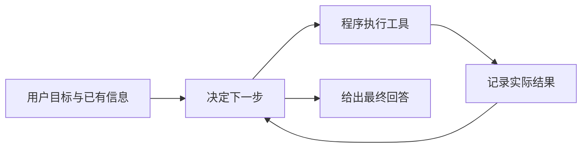

# 第 1 章　初识智能体

*Hello-Agents：从零开始构建智能体 · 章节学习笔记*

**原作**：Datawhale Hello-Agents 项目及贡献者  
**原文章节**：[第 1 章正文](https://github.com/datawhalechina/hello-agents/blob/36f583c233ea5cee4537ef93455702b55053af18/docs/chapter1/%E7%AC%AC%E4%B8%80%E7%AB%A0%20%E5%88%9D%E8%AF%86%E6%99%BA%E8%83%BD%E4%BD%93.md)  

---

## 本章目录

- [引言](#introduction)
- [1.1　从能够回答，到能够采取行动](#section-1-1)
  - [1.1.1　几种常见的决策方式](#section-1-1-1)
  - [1.1.2　反应速度与协作方式](#section-1-1-2)
  - [1.1.3　模型、智能体和应用分别负责什么](#section-1-1-3)
- [1.2　先把任务环境说明白](#section-1-2)
  - [1.2.1　环境特性怎样改变设计](#section-1-2-1)
  - [1.2.2　目标还需要变成可检查的条件](#section-1-2-2)
- [1.3　把决策与执行连接成循环](#section-1-3)
  - [1.3.1　观察怎样变成下一轮的输入](#section-1-3-1)
- [1.4　示例：一个小型旅行助手](#section-1-4)
  - [1.4.1　为什么要有循环上限](#section-1-4-1)
  - [1.4.2　工具字典为什么能够工作](#section-1-4-2)
  - [1.4.3　沿着失败结果追踪控制流程](#section-1-4-3)
- [1.5　固定工作流与自主协作](#section-1-5)
  - [1.5.1　开发者工具与自主协作者的区别](#section-1-5-1)
- [参考资料](#references)

---

<a id="introduction"></a>

## 引言

假设我们想请一个程序安排周末出游。它需要先查天气，再挑景点；如果天气不好，还得换个安排。让模型一次写出一份漂亮的攻略并不难，难的是让程序知道下一步该查什么，并根据查到的结果继续工作。

这一章从这个区别出发，介绍智能体的基本组成，再用一个小型旅行助手把各部分连接起来。先把这条工作链看清楚，后面的框架、记忆和多智能体协作就有了落脚点。

<a id="section-1-1"></a>

## 1.1　从能够回答，到能够采取行动

智能体（Agent）通过某种接口获取环境信息，再选择行动，推进自己的目标。摄像头可以是接口，用户输入和 API 返回值也可以；行动既可能是驱动机械臂，也可能是搜索网页、运行程序或生成一条回复。

这里值得留意的是，智能体需要决定接下来做什么。对于出游任务，发现缺少天气信息后，它可以先查询天气；收到降雨预报后，又能据此调整景点。这种根据反馈继续决策的过程，是本章的重点。

大语言模型为这类系统提供了一种灵活的决策组件。用户不必把每个步骤都写成菜单选项，可以直接提出较自然的要求。不过，模型的建议要通过程序执行，才能成为真正的工具调用。把一句话写成函数调用的样子，还没有完成任何查询。

<a id="section-1-1-1"></a>

### 1.1.1　几种常见的决策方式

从恒温器到旅行助手，智能体可以采用很不同的内部结构。

| 类型 | 决策时主要考虑什么 | 例子 |
| --- | --- | --- |
| 简单反射型 | 当前输入符合哪条条件？ | 温度过高就启动制冷。 |
| 基于模型的反射型 | 当前信息加上内部记录，说明环境处于什么状态？ | 目标暂时离开视野，仍维护对其位置的估计。 |
| 目标驱动型 | 哪些行动能到达目标？ | 根据地图寻找通向目的地的路线。 |
| 效用驱动型 | 能完成目标的几个选择中，哪个更好？ | 在时间、价格和舒适度之间比较路线。 |

学习能力可以加在这些结构之上。一个系统能够根据经验改进，不表示它就必须放弃规则；它也可能学习怎样更好地估计环境，或怎样给不同方案评分。

<a id="section-1-1-2"></a>

### 1.1.2　反应速度与协作方式

另一种分类关注时间。反应式系统尽快作出回应，规划式系统则先考虑后续步骤。实际应用常把二者结合：出现紧急情况时先及时处理，较长远的安排再交给规划模块。

还可以区分单智能体和多智能体。单智能体主要由一个决策主体推进任务；多智能体则让不同角色分工，并交换结果。角色变多以后，信息如何传递、任务由谁接手，会成为新的设计问题。

<a id="section-1-1-3"></a>

### 1.1.3　模型、智能体和应用分别负责什么

可以把旅行助手分成三层来观察。模型接收输入，生成回答或行动建议；智能体把一次次模型调用、工具结果和任务状态组织起来；应用再提供登录、页面、数据保存和部署等能力。我们在浏览器里看到的是整套应用，不能把每项功能都归给模型。

这一区分也解释了为什么换一个更强的模型，不一定能解决所有问题。若天气工具读错字段，问题在工具；若查询成功但结果没有进入下一次请求，问题在控制流程；若模型已经拿到正确数据却误解了用户要求，才需要重点查看模型输入和决策。

自主性也有范围。一个助手可以自主决定先查天气还是先搜景点，同时仍然只能调用应用开放的工具。哪些操作允许执行、哪些条件必须满足，是系统设计的一部分。自主选择步骤，与不受限制地操作，是不同概念。

再看“学习”：在一次会话里根据反馈调整推荐，可能只是更新了当前状态；把偏好存入数据库，是记忆；重新训练模型，才会改变其参数。三者都可能改善后续行为，但发生的位置不同。

<a id="section-1-2"></a>

## 1.2　先把任务环境说明白

设计旅行助手之前，我们最好先回答四个问题。它怎样才算做得好？它能看到哪些信息？它能执行哪些操作？有哪些事情会在它工作时发生变化？

PEAS 用四个方面描述任务环境：性能度量（Performance measure）、环境（Environment）、执行器（Actuators）和传感器（Sensors）。

| 要素 | 旅行助手中的含义 |
| --- | --- |
| 性能度量 | 行程是否符合预算和偏好，信息是否可靠，处理是否及时。 |
| 环境 | 城市、景点、天气、票务服务，以及用户的行程要求。 |
| 执行器 | 天气查询、景点搜索、路线查询等可执行工具。 |
| 传感器 | 用户输入、工具返回的结果，以及后续反馈。 |

这个环境通常是部分可观察的。一个接口返回的票价，不代表所有可选方案都已知。它还是动态的：查询期间，价格和库存可能变化；当前的选择，也会影响后面的安排。

因此，系统需要保存已经获得的信息，并接受新的观察，而不是假定第一次看到的结果永远有效。

<a id="section-1-2-1"></a>

### 1.2.1　环境特性怎样改变设计

PEAS 告诉我们任务由什么组成，环境分类则帮助判断需要哪种处理方式。以旅行助手为例，可以逐项检查。

| 环境问题 | 具体表现 | 对设计的影响 |
| --- | --- | --- |
| 是否完全可观察 | 一次搜索只返回部分景点。 | 保留已知信息，必要时继续查询。 |
| 结果是否确定 | 库存变化、接口超时、用户改变要求。 | 区分变化与故障，准备有限重试和替代路径。 |
| 决策是否相互影响 | 选定酒店位置会影响每天路线。 | 记录中间选择，检查后续安排是否仍匹配。 |
| 思考时环境会不会变化 | 热门时段可能在查询期间售罄。 | 使用信息时间，必要时重新确认。 |
| 是否存在其他行动者 | 其他用户也在预订。 | 不把一次查询结果当作长期保证。 |

部分可观察与随机性尤其容易混淆。没有看到全部航班，是信息不完整；相同查询的实际结果可能变化，是结果存在不确定性。增加一次查询可能改善前者，却不能让后者从此消失。

<a id="section-1-2-2"></a>

### 1.2.2　目标还需要变成可检查的条件

“帮我安排一次不错的旅行”很自然，却不足以作为完成标准。我们可以继续明确天数、预算、同行人、兴趣和可接受的交通时间，再用这些条件检查结果。

例如，用户要求两天、喜欢博物馆、每天不要安排太满。行程里出现三个真实景点，还不能说明任务成功；它们是否开放、路程是否合理、总时间是否超出两天，都关系到评价。性能度量因此应该围绕用户目标，而不只计算模型回答了多少字。

当条件冲突时，助手可以比较折中方案，也可以向用户询问。把这一点安排进流程，比让模型凭空猜出一个“最满意”的答案更容易验证。

<a id="section-1-3"></a>

## 1.3　把决策与执行连接成循环

本章用 Thought、Action、Observation 表示一次交互中的三个部分。可以把它们理解为下一步计划、准备执行的动作，以及动作产生的实际结果。



模型可以选择查天气，但真正发送请求的是 Python 函数。函数执行完以后，控制程序再把返回值交给模型。下一步依赖的是这个实际结果，而不是模型自行补写的查询结论。

保留清楚的行动记录，有助于调试。我们需要知道调用了哪个工具、传入什么参数、返回什么结果；简短的计划可以帮助阅读日志，但并不能单独证明判断正确。

<a id="section-1-3-1"></a>

### 1.3.1　观察怎样变成下一轮的输入

一次工具调用通常返回结构化数据。天气接口可能同时包含风速、湿度、观测时间和多个预测字段。控制程序不必把所有字段原样放进上下文，而应保留与任务有关的内容、来源及必要时间。

这里有两个步骤：先正确读懂工具返回，再决定向模型提供什么。字段选错会改变事实，删掉关键时间则可能让模型误用旧信息。因此，整理结果不是简单地把 JSON 转成一句话。

对话历史也应保留信息的身份。用户提出的是要求，模型给出的是建议，工具返回的是外部结果。若把三者混成同一种文本，后续模型容易把先前猜测当成已经查证的事实。

**示例 1.2　保留最小而清楚的任务状态**

```json
{
  "goal": "查询天气并推荐景点",
  "city": "北京",
  "weather_status": "pending",
  "attraction_status": "pending",
  "observations": []
}
```

这是帮助理解的状态示意。天气查询完成后，状态与观察共同更新；景点搜索再使用实际天气。即使不采用这份具体结构，也需要在某处保留相同含义的信息。

<a id="section-1-4"></a>

## 1.4　示例：一个小型旅行助手

原文的任务是查询北京当天的天气，再推荐适合的景点。程序主要由三部分组成：模型客户端、工具函数，以及控制循环。

天气工具 `get_weather(city)` 通过 `wttr.in` 获取数据；景点工具 `get_attraction(city, weather)` 使用 Tavily 搜索。控制程序将工具登记在字典中，根据模型输出的名称找到对应函数。

**示例 1.1　观察一次完整执行**

```text
用户：查询今天北京的天气，再推荐一个景点。
模型选择：调用天气工具。
工具返回：实际天气信息。
模型选择：把城市和天气传给景点工具。
工具返回：搜索结果。
模型选择：整理建议，结束本次任务。
```

这个例子很小，却已经包含工具选择、结果反馈和多步处理。模型客户端负责与兼容的模型服务通信；具体支持哪些消息和功能，仍由所用服务决定。

在阅读代码时，可以沿着一次调用追下去：模型输出怎样被解析，参数怎样进入函数，结果又怎样写回历史记录。原文采用文本格式与正则表达式，便于展示机制；更完整的实现还需要参数检查、异常处理和明确的结束条件。

<a id="section-1-4-1"></a>

### 1.4.1　为什么要有循环上限

如果工具持续失败，模型可能一直重试。设置最大步数能够限制调用次数，但还需要给网络请求设置超时，避免某一次调用长期阻塞。

工具失败时也应保留失败状态。没有查到实时信息，与已经确认某个事实，是不同的情况。最终回复需要反映这种区别。

<a id="section-1-4-2"></a>

### 1.4.2　工具字典为什么能够工作

Python 可以把函数作为值存入字典。模型给出工具名称后，程序按名称取得函数，再用参数调用。下面展示分发部分，模型请求与错误处理暂时省略。

```python
tools = {
    "get_weather": get_weather,
    "get_attraction": get_attraction,
}

action = {
    "tool": "get_weather",
    "arguments": {"city": "北京"},
}
function = tools[action["tool"]]
observation = function(**action["arguments"])
```

这里的函数必须由程序实际导入。仅在提示词中列出 `get_weather`，不会让 Python 自动获得这个名称。描述工具和注册工具是两个步骤：前者让模型知道有什么能力，后者让控制程序真的能够执行。

参数名也是接口的一部分。函数要求 `city`，模型却生成 `location`，即使二者对人来说意思接近，也可能导致调用失败。工具描述、解析结果和函数签名需要一致。

<a id="section-1-4-3"></a>

### 1.4.3　沿着失败结果追踪控制流程

天气查询失败后，控制程序应把失败作为观察，而不是继续使用一份不存在的天气。后续可以尝试恢复、说明限制，或询问用户是否接受一般性推荐。

搜索服务的认证失败又是另一种情况。它通常需要修正配置，原样重试不会增加信息。这个例子提醒我们：恢复策略应该看错误类别，不能把所有异常都处理成“再试一次”。

同样，`Finish` 表示模型选择结束本次任务，不是一个自动验收证明。控制程序若有明确完成条件，可以在结束前检查必要查询是否完成；否则至少要让最终回答反映哪些信息已确认、哪些仍未验证。

<a id="section-1-5"></a>

## 1.5　固定工作流与自主协作

本章最后把视角从一次小任务扩展到应用协作。智能体可以嵌入开发工具，帮助查询、编写和检查内容；也可以围绕更长的目标持续工作，主动决定中间步骤。

工作流（Workflow）由程序预先安排主要路线；Agent 则可以根据观察，动态选择下一步。两者可以结合。例如，资料整理由模型灵活处理，资金审批仍沿用固定流程。

<a id="section-1-5-1"></a>

### 1.5.1　开发者工具与自主协作者的区别

作为开发者工具时，智能体往往围绕一次较小操作工作：解释选中的代码、生成草稿、建议修改。用户持续决定方向，也容易及时纠正偏差。作为自主协作者时，用户交付较大的目标，系统需要自己安排更多步骤，保留进度并报告结果。

两种模式对状态管理的要求不同。短任务可以主要依赖当前输入，长任务则要记录已完成工作、关键决定和阻塞原因。协作方式改变了，不能仅靠把循环次数调大来扩展系统。

一种务实做法是先完成可观察的小循环，再逐步增加自主范围。每增加一类行动，就相应明确输入、反馈和结束条件。这样，后面出现的记忆、规划和评估，都能对应到一个已经理解的实际需要。

选择时先看任务。步骤清楚、变化很少的场景，固定流程往往更容易控制；必须不断查证、补充信息的任务，更能体现动态决策的价值。下一章会回到历史，看看这些设计思想是怎样逐步形成的。

---

<a id="references"></a>

## 参考资料

1. 本章内容依据 Hello-Agents 的[第 1 章原文](https://github.com/datawhalechina/hello-agents/blob/36f583c233ea5cee4537ef93455702b55053af18/docs/chapter1/%E7%AC%AC%E4%B8%80%E7%AB%A0%20%E5%88%9D%E8%AF%86%E6%99%BA%E8%83%BD%E4%BD%93.md)整理，完整论述及其参考文献可从原文继续阅读。
2. 实现细节可对照原项目的[第 1 章配套代码](https://github.com/datawhalechina/hello-agents/tree/36f583c233ea5cee4537ef93455702b55053af18/code/chapter1)。正文中的简化流程用于解释设计，不代表这些代码已在本机运行验证。

---

**继续阅读**：[全书目录](index.md) · [下一章：智能体发展史](history.md)
