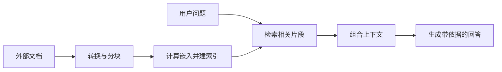

# 第 8 章　记忆与检索

*Hello-Agents：从零开始构建智能体 · 章节学习笔记*

**原作**：Datawhale Hello-Agents 项目及贡献者  
**原文章节**：[第 8 章正文](https://github.com/datawhalechina/hello-agents/blob/36f583c233ea5cee4537ef93455702b55053af18/docs/chapter8/%E7%AC%AC%E5%85%AB%E7%AB%A0%20%E8%AE%B0%E5%BF%86%E4%B8%8E%E6%A3%80%E7%B4%A2.md)  

---

<a id="introduction"></a>

## 引言

假设用户已经告诉助手自己喜欢历史文化，下一次推荐时却还要重新说明；或者文档已经上传，模型回答时仍只依赖旧知识。两种情况都与“信息怎样保留并再次使用”有关，却需要不同处理。

本章将记忆和检索增强生成分别封装成工具。前者关注交互中积累了什么，后者帮助从外部材料里找到当前问题需要的内容。

<a id="section-8-1"></a>

## 8.1　记忆与 RAG 分别补上什么

模型请求可以使用对话历史，但普通调用不会自动保存全部经历。应用需要决定哪些信息留下来，怎样检索，又在什么时候把它们提供给模型。

记忆系统记录偏好、事件和已有经验；RAG（Retrieval-Augmented Generation，检索增强生成）则从文档等外部知识中取得材料，再辅助回答。两者都涉及检索，但信息来源与管理目标不完全相同。

例如，“用户上次问过哪个概念”属于交互记录；“上传教材怎样解释这个概念”来自外部文档。把二者结合，才可能既接得上对话，又能引用具体资料。

<a id="section-8-1-1"></a>

### 8.1.1　信息保存在哪里，决定了怎样再次使用

参数知识来自模型训练，当前上下文来自这次请求，外部记忆来自应用保存的记录。RAG 的文档索引又提供另一类可查询材料。这几种位置都能影响回答，但更新方式不同。

用户告诉助手一个新偏好，应用可以保存并在下次检索，不需要重新训练模型。一本教材修订以后，则需要更新文档与索引。若只是把新资料留在磁盘上，既未检索也未放进上下文，模型并不会自动获得它。

因此，记忆不是单一的“保存聊天”功能，而是一组写入、归属、检索和使用规则。设计时需要沿着信息再次出现的路径反向检查。

<a id="section-8-2"></a>

## 8.2　记忆需要添加，也需要整理和遗忘

本章借用认知科学中的分类帮助设计软件。这里是一种工程组织方式，不要求软件完全复制人类记忆。

| 本章实现的记忆类型 | 主要保存什么 | 例子 |
| --- | --- | --- |
| 工作记忆 | 当前任务中临时使用的信息。 | 本次讨论的主题、最近的步骤。 |
| 情景记忆 | 发生过的事件及背景。 | 某次查询、一次任务的结果。 |
| 语义记忆 | 整理后的事实与概念。 | 用户确认的偏好、概念笔记。 |
| 感知记忆 | 多模态输入及有关特征。 | 文档、图像等材料的记录与表示。 |

工作记忆适合快速访问，也可以设置失效时间；长期信息需要持久化。保存时还应记录用户或会话归属、来源、时间和重要程度，否则取回一段文字后，系统可能不知道它属于谁、是否已经过时。

<a id="section-8-2-1"></a>

### 8.2.1　MemoryTool 与 MemoryManager

`MemoryTool` 提供应用侧的操作入口，接收添加、检索和管理请求；`MemoryManager` 协调不同类型的记忆；具体存储再由下层实现。

原文使用 Qdrant、Neo4j、SQLite 等不同后端，分别支持向量、关系和结构化记录。应用应按任务选择需要的组件，而不必因为教程展示了多个数据库，就把它们全都启用。

记忆还需要整合、更新与遗忘。用户修正预算后，旧值不能一直与新值并列使用；一次未经确认的推测，也不应自动变成长期事实。

<a id="section-8-2-2"></a>

### 8.2.2　四类记忆为什么使用不同存储

工作记忆主要用于当前处理，内存访问快，也方便按时间清理。情景记忆关注事件及其发生背景，适合同时保存结构化字段和向量表示；原文用 SQLite 与 Qdrant 配合进行过滤和相似检索。

语义记忆进一步整理实体与关系，结合图存储表达概念连接。查询“某人参与了哪些项目”，就不仅是寻找词面相近的句子，也涉及关系。原文使用 Neo4j 与向量存储组合展示这种设计。

感知记忆处理不同模态。文本、图像与音频的编码器及维度可能不同，需要区分集合与检索方式。把它们都叫作向量，并不意味着可以在同一空间中直接比较；跨模态检索依赖适当的共同表示。

<a id="section-8-2-3"></a>

### 8.2.3　记忆条目不应只有正文

可以为一条记忆保留以下信息，帮助之后决定能否使用：

```json
{
  "content": "用户更喜欢历史文化景点",
  "user_id": "example_user",
  "session_id": "example_session",
  "source": "用户明确表达",
  "status": "confirmed"
}
```

这是信息组织的示意，具体字段可按实现调整。来源说明它是用户表达还是模型推测，归属避免跨用户混用，状态则有助于处理待确认与过时记录。

检索时可以先限定用户与任务范围，再比较内容相关性；整合时更新冲突值，遗忘时删除过期或无用记录。这样，取回更多内容才不容易反而增加矛盾。

<a id="section-8-3"></a>

## 8.3　RAG 有两条不同的工作流程

第一条流程在准备文档时发生，第二条在用户提问时发生。把这两条分开，便容易理解为什么上传文件和提出问题不是同一项操作。



<a id="section-8-3-1"></a>

### 8.3.1　先把文档整理成可检索的片段

本章用 MarkItDown 统一处理不同文档格式，再利用 Markdown 等结构分块。片段过大，会混入无关信息；片段过小，又可能切断完整含义。适度保留标题和相邻内容，有助于理解片段背景。

随后用嵌入模型得到向量，连同原文、位置和来源一起存储。更换嵌入模型后，通常需要检查已有索引是否仍匹配，不能把不同表示随意混用。

分块还需要保留文档层次。标题、段落和表格可能承担不同作用；若一个表头被切走，剩下数字就难以解释。按结构切分与保留少量重叠，分别帮助维持语义与边界连续性。

每个片段最好带来源文件与位置。后续回答可以引用具体章节，开发者也能回到原文检查解析是否正确。如果只存向量而没有原文和位置，即使检索成功，也不方便验证。

转换后还可以先抽查少量页面：扫描 PDF 的文字是否识别、列表是否混乱、图片内容是否需要额外处理。文档工具支持某种格式，不表示其中所有视觉信息都已经被理解。

<a id="section-8-3-2"></a>

### 8.3.2　再根据问题取回材料

提问时，检索器找到相近片段，系统筛选并组合内容，最后将其交给生成模型。`RAGTool` 把这些步骤放在共同入口后面。

相似度高不等于答案一定存在。用户问“去年与今年的变化”，只取回今年的一段文字，就不足以比较。检索与生成应分别检查：有没有找到必要证据，回答有没有超出证据。

<a id="section-8-3-3"></a>

### 8.3.3　相似检索究竟返回了什么

嵌入模型把问题与片段表示成向量，再按相似度取回候选。这种分数帮助排序，却不是“片段内容为真”的概率，也不是“它一定回答了问题”的保证。

用户问一个概念的限制时，定义段落可能非常相似，但缺少限制条件。可以取回相邻段落，或让检索查询更明确，再判断材料是否覆盖所需方面。

检索结果数量也有取舍。太少可能遗漏，太多会把无关内容带入生成。调试时可以先检查排在前面的候选，再结合问题集选择数量与阈值，而不是只观察最后回复。

<a id="section-8-4"></a>

## 8.4　查询写法不一致时怎么办

用户的表述与文档用词常常不同。原文介绍多查询扩展（MQE）和假设文档嵌入（HyDE），从不同方向改善匹配。

MQE 为同一个问题生成几种表述，分别检索后合并。例如，“如何开始学 Python”可以扩展为入门路线、基础学习等查询。不过，扩展也可能偏离原意，需要保留原问题并去重筛选。

HyDE 先生成一段假设性的回答或文档，用它的表示来寻找真实资料。这段文字只是检索辅助，不能当作已经核实的证据。真正支持最终回答的，仍应是取回的可靠材料。

这些方法会增加模型和检索开销。是否有帮助，需要在自己的问题集上测量，不宜把某个示例的提升比例当作所有文档的固定效果。

<a id="section-8-4-1"></a>

### 8.4.1　查询扩展怎样合并结果

多查询扩展为同一目标提供几种表达，每种表达各自检索，再按来源与片段标识去重。若四个查询各取五个片段，合并前最多可能有二十个候选，但大量重复并不罕见。

最终还需要选择与预算控制。扩展查询是增加召回的一种方式，不代表每个候选都应直接进入上下文。原问题也要保留，以免几轮改写后偏离用户意图。

<a id="section-8-4-2"></a>

### 8.4.2　HyDE 为什么先写一段假设材料

较短问题与较长文档可能有不同表达形式。HyDE 先生成一段可能相关的说明，再用这段说明的嵌入寻找真实材料，希望缩小这种差别。

但假设文本可能包含错误，因此它只承担检索辅助的角色。正确的后续过程是取回真实片段，再根据它们回答；不能把假设段落自身当作引用来源。

把普通向量检索、查询扩展和 HyDE 放在同一批问题上比较，可以观察哪些问题实际受益。不同策略增加的是不同计算，应该同时记录质量与费用。

<a id="section-8-5"></a>

## 8.5　示例：一个能保留学习记录的文档助手

原文用 Happy-LLM 的 PDF 构建 `PDFLearningAssistant`，并通过 Gradio 提供交互界面。加载文档时执行转换和建库，提问时检索相关片段，再记录问答与学习笔记。

**示例 8.1　从第一次提问到后续回顾**

```text
上传教材并建立索引
  → 询问某个概念
  → 检索并生成回答，保留参考来源
  → 记录个人笔记
  → 后续检索学习经历，生成回顾与统计
```

这个例子把两类信息接起来：教材内容保存在知识库中，用户的学习活动进入记忆。统计次数只能说明发生过哪些操作；回答是否正确，仍需回到文档核对。

<a id="section-8-5-1"></a>

### 8.5.1　文档问答助手怎样形成学习回顾

一次学习过程至少有两条记录：问答中用到了哪些文档片段，以及用户形成了什么个人笔记。前者支持核查知识依据，后者帮助回顾理解与疑问。

例如，用户先问预训练，随后问“它与微调有什么不同”，助手需要从近期上下文理解“它”，再检索相关材料。用户确认的一条总结可以进入笔记，后续回顾则组合有关问答和笔记，而不是只统计提问次数。

若更换文档版本，回顾中还应保留原来源，避免把旧教材结论直接写成当前资料。这个案例由此把文档处理、记忆归属与检索质量连接成一个完整使用过程。

接下来还有一个问题：即使已经找到许多相关材料，也不能全部放进每次请求。下一章将讨论如何选择并组织真正要交给模型的上下文。

---

<a id="references"></a>

## 参考资料

1. 本章内容依据 Hello-Agents 的[第 8 章原文](https://github.com/datawhalechina/hello-agents/blob/36f583c233ea5cee4537ef93455702b55053af18/docs/chapter8/%E7%AC%AC%E5%85%AB%E7%AB%A0%20%E8%AE%B0%E5%BF%86%E4%B8%8E%E6%A3%80%E7%B4%A2.md)整理，完整论述及其参考文献可从原文继续阅读。
2. 实现细节可对照原项目的[第 8 章配套代码](https://github.com/datawhalechina/hello-agents/tree/36f583c233ea5cee4537ef93455702b55053af18/code/chapter8)。正文中的简化流程用于解释设计，不代表这些代码已在本机运行验证。

---

**继续阅读**：[上一章：构建你的智能体框架](build-your-own-framework.md) · [全书目录](index.md) · [下一章：上下文工程](context-engineering.md)
