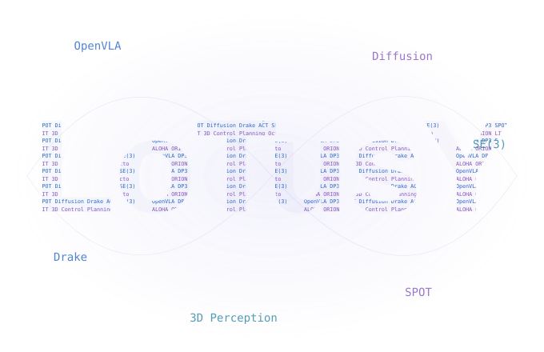
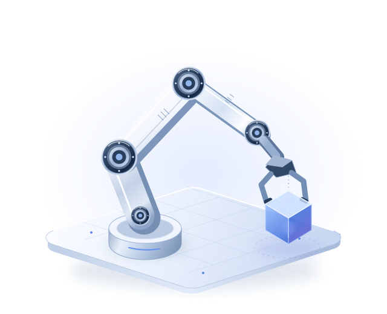

LOTUSY / NOTES & IDEAS

# 让好奇心， 走得更远。

从读懂一篇论文，到让机器人迈出一步。 记录学习的轨迹，也连接每一个新的发现。

[探索笔记 →](papers/index.md){ .md-button .md-button--primary }
[关于我 ↗](about.md){ .quiet-link }

南京大学 · 软件工程 / 具身智能 · 机器人学习

RESEARCH ATLAS<button class="atlas-motion" type="button" aria-label="暂停研究星图动画" aria-pressed="false" hidden>Ⅱ暂停动画</button>

<canvas class="atlas-canvas" aria-hidden="true"></canvas>
01 / PERCEPTION
02 / REPRESENTATION
03 / ACTION

从感知世界，到生成行动。OBSERVE → LEARN → ACT

完整中文译稿 · 课程翻译

## Robotic Manipulation 现在，用中文读。 { #_2 }

MIT《Robotic Manipulation》 从感知、规划到控制，理解机器人与世界的交互。

[打开中文讲义 →](translations/robotic-manipulation/index.md){ .md-button .md-button--primary }
[浏览课程目录](translations/robotic-manipulation/preface.md#all-chapters){ .quiet-link }

RUSS TEDRAKE · 12 章正文与 5 篇附录

PERCEPTIONPLANNINGCONTROL

THE COLLECTION<h2>沿着兴趣，找到一条线索。</h2>
理解方法，补齐基础，把想法付诸实践。

<a class="topic-card" href="papers/">01 / RESEARCH↗<h3>论文阅读</h3>
从 ALOHA、DP3 到 OpenVLA，拆解机器人策略的任务、方法与边界。
具身智能 · 论文精读 →</a>
<a class="topic-card" href="deep-learning/">02 / FOUNDATIONS∑<h3>理论基础</h3>
用数学推导和代码，串起回归、神经网络、正则化与注意力机制。
深度学习 · 数学直觉 →</a>
<a class="topic-card" href="engineering/">03 / PRACTICE⌘<h3>工程实践</h3>
记录 Tensor 的细节、开发中的问题，以及从想法到实现的过程。
PyTorch · 开发手记 →</a>

一点点理解，一点点构建。LEARN. BUILD. UNDERSTAND.

