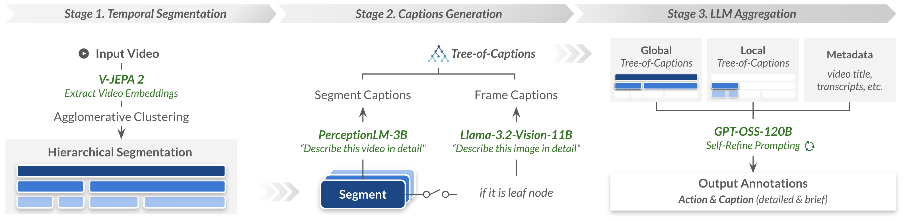
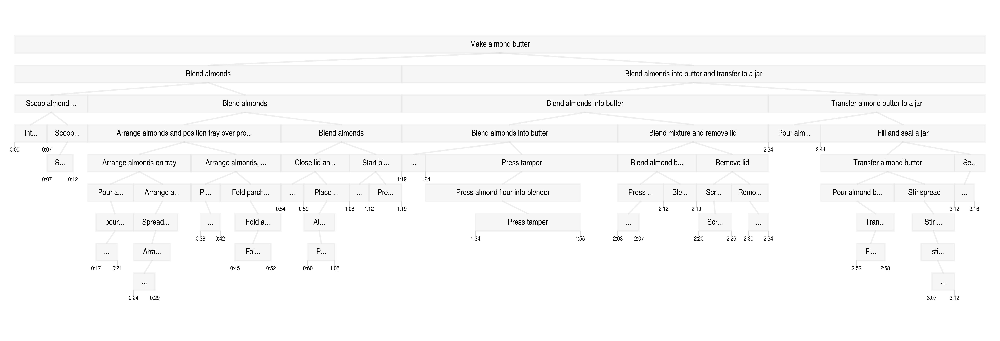
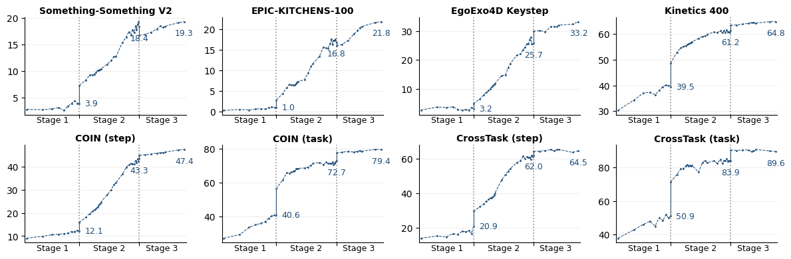
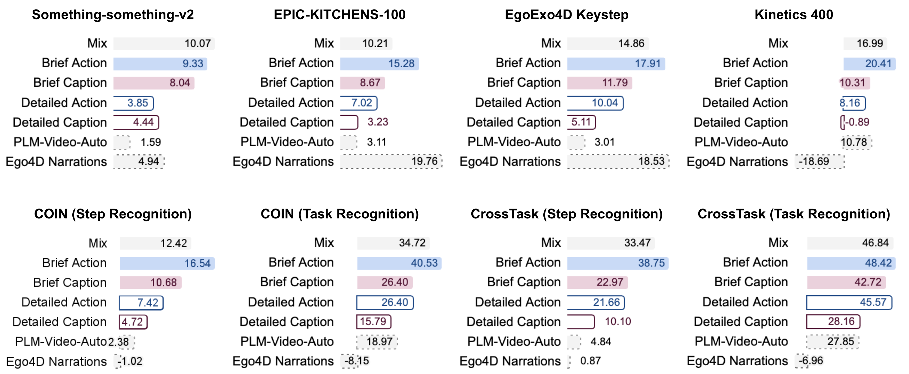
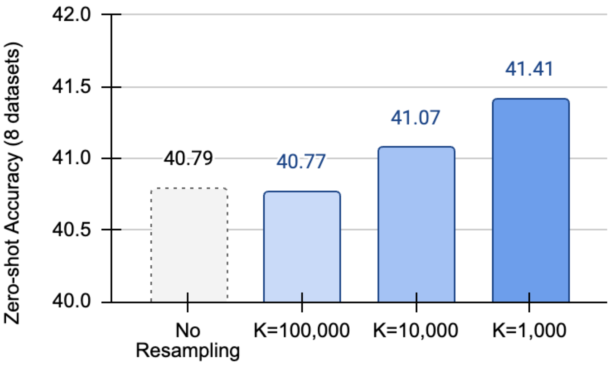

# 2026 Action100M（arXiv）

# Action100M: A Large-scale Video Action Dataset

**作者与机构**：Delong Chen、Tejaswi Kasarla、Yejin Bang、Mustafa Shukor、Willy Chung、Jade Yu、Allen Bolourchi、Théo Moutakanni、Pascale Fung；作者来自 **Meta FAIR、香港科技大学、阿姆斯特丹大学、索邦大学**。

**发表信息**：2026 年 arXiv 预印本，[arXiv:2601.10592v1](https://arxiv.org/abs/2601.10592v1)，发布于 **2026 年 1 月 15 日**。本文依据本地这一版本的主文和附录整理，不将预印本视为正式会议录用。

**原文与数据**：[本地 PDF](../assets/papers/Action100M.pdf) · [官方项目与使用示例](https://github.com/facebookresearch/Action100M) · [数据预览](https://huggingface.co/datasets/facebook/action100m-preview)

# 1. 研究意义

## a. 研究背景：所描述的场景、背景

理解一张图片里“有什么”，与理解一段视频里“发生了什么动作”，需要不同的监督。看到碗、面粉和搅拌器，不等于知道操作者正在倒入面粉、搅拌混合物，还是把做好的面糊转移到容器里。动作理解需要同时识别执行者、交互对象、状态变化和时间范围。

现有图文数据规模很大，但动作数据往往集中在烹饪、装配等少数场景，类别和时间粒度也不统一。人工逐段标注成本高；直接把字幕当动作标签，又会遇到解说与画面不同步、介绍未来步骤、遗漏可见细节等问题。Action100M 因而研究：**如何把互联网教学视频转化为大规模、开放词表、具有时间层次的动作监督。**

它的主体贡献是一套数据生成流水线及其产物：约 120 万条源视频经过层次分段、视觉描述和语言模型聚合，生成约 1.47 亿条片段级标注。作者再训练 VL-JEPA，检验这些标注能否改善零样本动作识别与文本到视频检索。这里的 action 是视频中的动作语义，不是机器人关节命令或控制轨迹。

## b. 问题及挑战：核心、重要、未解决的问题是什么

- **动作存在多种时间尺度。** “制作杏仁酱”可以展开为烘烤、搅打、装罐，也能进一步拆成开盖、按压搅拌棒等短动作；只给整段视频一个标签，或按固定长度切片，都难以同时保留这些层次。
- **动作监督需要以当前可见内容为依据。** 标题和解说能提供任务背景，却可能谈到尚未发生的动作；视觉模型生成的描述也可能包含猜测，需要汇集局部证据并检查冲突。
- **亿级标注需要控制推理成本。** 直接让大型多模态推理模型反复观看每个片段代价很高，流水线必须区分视觉证据提取与后续语义推理。
- **条目多不代表动作均衡。** “对镜头说话”“搅拌”等高频描述可能挤占训练预算，同一视频的父子片段还共享时间范围；需要区分节点数量、语义多样性和有效样本分布。

# 2. 研究现状

## a. 领域的现状：针对上述问题及挑战，当前有哪些方法和技术

按照数据来源与标注方式，可以把相关工作分为三类。

**人工动作与步骤数据。** COIN、CrossTask、YouCook2 等提供任务或步骤监督，受控采集的 Breakfast、Assembly101 以及第一视角数据进一步强调细粒度过程。它们能给出较明确的动作定义，但人工采集与标注限制了规模，任务类别也常较固定。

**依赖字幕或元数据的大规模视频文本数据。** HowTo100M 等利用互联网教学视频与解说建立对应关系，适合扩大覆盖范围，但说话内容未必就是当前画面中的动作。

**视觉模型生成的描述数据。** PerceptionLM、PE Video、PLM-Video-Auto 等借助模型生成更丰富的视觉文本；不过单片段单描述仍不容易表达“整个任务—步骤—短动作”的包含关系。Action100M 结合大规模来源与多尺度结构，用同一视频内的分层证据生成动作和描述。

## b. 问题的现状：上述技术还缺少什么

一个关键缺口是**规模、视觉依据与时间层次难以兼得**。固定词表方便评估，却限制动作表达；自由描述更丰富，却可能只描述静态外观，或者把整段任务的背景误写成局部动作。Action100M 不只要求生成更多文字，而是先组织时间结构，再让模型明确每段的动作、执行者和场景描述。

# 3. 技术路线

## a. 问题与技术映射：针对上述问题，采用了哪些技术手段

| 问题 | 对应技术 | 形成的监督 |
| --- | --- | --- |
| 动作时长和抽象层次不同 | V-JEPA 2 表征与相邻约束的层次聚类 | 多尺度时间片段树 |
| 单帧细节与时序变化互补 | 图像、视频两类 caption 模型 | Tree-of-Captions |
| 多份描述存在噪声与冲突 | GPT-OSS-120B 聚合、三轮 Self-Refine | 五字段结构化标注 |
| 高频动作和重复描述占据训练预算 | 文本去重、语义聚类与重采样 | 更均衡的训练样本 |

图中先用视觉模型提取证据，再把证据转成文本，最后由较强的推理模型进行文本聚合。高成本推理集中在最后一步，不需要让推理模型直接反复处理整段视频。

## b. 技术详述：对每个技术方法进行详细介绍

**第一步：用视觉变化建立层次时间片段。** 每四个原始帧采样一帧，使用 V-JEPA 2 ViT-g-384 提取表征。每个窗口包含 64 个采样帧，以 8 个采样帧为步长滑动；窗口内先做空间平均池化，再将重叠窗口中属于同一帧的表征平均，获得整段视频的逐帧特征。

随后做层次凝聚聚类。时间连接约束只允许相邻区间合并，Ward linkage 则倾向于减小合并后的段内方差。由短片段逐步合并成长步骤，形成父节点包含子节点的树；这一阶段保留时长大于 0.5 秒的节点。它不是把视频切成一套互不重叠的 clip：同一时刻可以属于不同层级的多个片段，**1.47 亿节点不能直接理解为 1.47 亿个独立动作。**

**第二步：用互补视觉描述构建 Tree-of-Captions。** 对最细的叶节点，取中点帧交给 Llama-3.2-Vision-11B，记录物体、姿态和场景细节；对较高层的片段，均匀采样 32 帧，以 320×320 分辨率输入 Perception-LM-3B，描述时序内容。两类模型最多生成 1024 tokens 的描述，可在单张 V100 32GB 上执行。

这样，较长步骤的描述可以与下方局部画面互相对照。例如，顶层判断是“制作杏仁酱”，下面可能包括“搅打杏仁”“转移到罐子”等步骤。图 3 展示的树来自同一源视频，横向是时间，纵向是粒度；标签是模型生成结果，并非人工定义好的任务分解。

**第三步：聚合证据并反复检查结构化标注。** GPT-OSS-120B 接收当前节点、按深度优先组织的子节点描述，以及有限深度的全局树信息、标题、简介和 ASR。每个节点独立处理，先生成草稿，再结合原始上下文进行两轮检查，共三轮 Self-Refine，修正矛盾、事实错误和缺乏支持的内容。

| 字段 | 表达什么 | 与其他字段的区别 |
| --- | --- | --- |
| `action.brief` | 简短动作短语 | 突出“做什么” |
| `action.detailed` | 更详细的动作说明 | 补充动作如何进行 |
| `action.actor` | 动作执行者 | 区分人、动物或其他执行主体 |
| `summary.brief` | 简短片段描述 | 概括可见场景与事件 |
| `summary.detailed` | 详细片段描述 | 保留更多上下文与视觉细节 |

提示词要求以当前片段可见的内容为依据，全局信息只用于消歧；没有可见动作时使用 `N/A`。这些都是**自动生成的伪标签**，Self-Refine 提供的是降低噪声的机制，不是无幻觉保证。

原文说明此聚合阶段丢弃短于 4 秒的节点，但数据分析又报告 64% 的片段处于 0–3 秒。官方数据格式允许较短节点的 `gpt` 字段为空，这提示树节点与完整聚合结果需要区分；然而 v1 没有充分说明各项统计具体覆盖哪一集合，本文不把所有节点都视为具备完整五字段标注。

**第四步：用 VL-JEPA 检验数据是否有用。** 本文使用已有 VL-JEPA 架构：V-JEPA 2 提取视频表征，模型预测文本编码器对应的目标嵌入，通过 InfoNCE 学习视频与文本的对齐，使匹配的片段和描述更接近，支持开放词表分类与检索。论文主要贡献是数据及其构建方法，并没有在这里重新提出一套机器人动作预测网络。

**补充策略：语义重采样。** 作者先对简短动作文本做哈希去重，再用 EmbeddingGemma-300M 编码文本，以 k-means 将相近动作聚成语义簇；按簇均衡采样，得到用于消融的 10M 动作训练集。较粗的语义簇能把不同表述的相似动作放到一起，减少高频表达对训练预算的占用。这改变的是采样分布，并不自动校正标注错误。

## c. 创新之处：你认为最关键的技术是什么

我认为关键是**把“动作监督的生成”组织成具有时间层次的证据聚合**。视觉编码器负责找变化，描述模型负责提供局部证据，语言推理模型负责把不同粒度的信息整理成明确字段。这样既能保留“任务—步骤—短动作”的联系，又避免只靠一条字幕或一次视觉问答决定标签。

不过，树来自特征聚类，未必等于人类理解的最优任务分解；父子节点共享内容也会增加冗余。它更适合作为可扩展的数据组织方法，而不是已经验证的因果任务图。

# 4. 实验分析

## a. 实验数据：论文中使用了哪些实验数据

数据来源是 HowTo100M 的互联网教学视频，覆盖烹饪、家居、手工和日常技能等内容。下面区分源视频、层次节点与文本规模，数字来自论文第 4 节。

| 统计对象 | 论文报告的规模 | 阅读时需要注意 |
| --- | ---: | --- |
| 源视频 | 1,199,096 条，约 14.6 年时长 | 做过人脸模糊处理，主要是教学内容 |
| 层次片段标注 | 147,092,653 条 | 跨层时间范围嵌套，不是独立采集的同等数量视频 |
| 四类文本合计 | 约 21.27B 英文词 | 包括简短／详细动作与简短／详细描述 |
| 标注与树的存储 | 约 205 GB | 包含元数据与 Tree-of-Captions，不包含原始视频体积 |
| 分段与描述计算 | 约 1.3M V100 GPU 小时 | 与下一行硬件不同，不直接当作同类算力相加 |
| 语言模型聚合计算 | 约 0.3M H100/H200 GPU 小时 | 全自动仍需要较高生成成本 |

Action100M 的名字表示“亿级”数量级，不是精确 100M。按 [官方项目说明](https://github.com/facebookresearch/Action100M)，截至本次阅读核查，Hugging Face 提供的是完整数据约 **10% 的 preview**，不能把预览发布范围与论文统计规模混为一谈。

**识别与检索分开评估。** 动作识别使用八项 Top-1 指标，实际来自六个数据集：SSv2、EPIC-KITCHENS-100、EgoExo4D Keysteps、Kinetics-400、COIN、CrossTask；后两者各有步骤识别（SR）与整体任务识别（TR）。文本到视频检索则在 MSR-VTT、ActivityNet、DiDeMo、MSVD、YouCook2、PVD-Bench、Dream-1K 和 VDC-1K 上报告 Recall@1。这里没有机器人仿真或真机操作实验。

训练分为三阶段，配置来自 Table 2：

| 阶段 | 视觉编码器 | 每次输入帧数 | 训练数据 | Batch Size | 迭代数 |
| --- | --- | ---: | --- | ---: | ---: |
| Stage 1 | 冻结 | 1 | DataComp-1B、YFCC-100M 图文 | 24,576 | 100k |
| Stage 2 | 冻结 | 8 | Action100M 视频与文本 | 12,288 | 60k |
| Stage 3 | 解冻 | 32 | Action100M 视频与文本 | 3,072×4 梯度累积 | 10k |

Stage 2 混合四类文本，详细动作与详细描述的采样减半，并使用 PLM-3B 对这些片段直接生成的动作和描述。Stage 3 同时增大帧数、解冻编码器，并将学习率从 5e-5 降到 1e-5。Table 3 的累计 Samples Seen 约为 2.4B、3.1B、3.3B，表示训练中累计看到的样本次数，不能当作独立视频数量；初始化模型本身也已有预训练。

## b. 对比实验：与其他算法对比，突出数值的变化

以下来自 Table 3，单位均为 %。两列平均值分别对应各自八项评测，不能把它们合成一个指标。

| 模型 | 平均动作识别 Top-1 | 平均视频检索 Recall@1 |
| --- | ---: | ---: |
| CLIP ViT-L | 30.7 | 35.3 |
| SigLIP2 ViT-g | 39.8 | 47.5 |
| PE-Core ViT-G | 44.7 | 58.1 |
| VL-JEPA Stage 1 | 21.5 | 32.6 |
| VL-JEPA Stage 2 | 48.0 | 59.5 |
| VL-JEPA Stage 3 | 52.5 | 63.7 |

最终 VL-JEPA 相比 PE-Core ViT-G，平均识别高 **7.8 个百分点**，平均检索高 **5.6 个百分点**。从自身训练过程看，图文 Stage 1 到视频 Stage 2 的平均识别从 21.5% 升至 48.0%；Stage 3 再到 52.5%。这支持视频动作数据的价值，但三个阶段还改变了输入形式和可训练参数，不能把所有增益都单独归因于标注流水线。

图中每阶段的横轴按该阶段训练进度展开，不表示独立视频种类持续增加；同一数据集可被重复采样。图注将最后阶段重复写作 Stage 2，结合正文和 Table 2，应理解为 Stage 3。

**优势集中在细粒度动作和步骤理解，并非每项都领先。** 例如 VL-JEPA 在 SSv2、EK100、EgoExo4D 上分别为 19.3%、21.8%、33.2%，PE-Core ViT-G 分别为 9.0%、6.4%、13.6%；但 Kinetics-400 上则是 64.8% 对 76.4%，COIN 整体任务识别为 79.4% 对 86.0%，CrossTask 整体任务识别为 89.6% 对 97.2%。检索中，MSR-VTT 和 MSVD 也仍落后于该 PE-Core。

另外，最终 VL-JEPA 使用 32 帧输入，而表中其他模型为 8 帧；架构、分辨率、初始化和训练数据亦有差异。Table 3 支持论文报告的平均性能优势，但不是严格的同算力或同数据对照。

## c. 消融实验：与自己对比，突出数值的变化

**标注类型与数据来源。** Figure 9 中，模型从相同 Stage 1 checkpoint 出发，继续训练 20k 步、累计 20.48M 样本。下表摘取图中标出的数字，表示相对 Stage 1 的识别准确率增量，单位为百分点，**不是最终准确率**。

| 训练标注 | SSv2 增量 | EK100 增量 | EgoExo4D 增量 |
| --- | ---: | ---: | ---: |
| 混合标注 Mix | +10.07 | +10.21 | +14.86 |
| 简短动作 Brief Action | +9.33 | +15.28 | +17.91 |
| 详细动作 Detailed Action | +3.85 | +7.02 | +10.04 |
| 详细描述 Detailed Caption | +4.44 | +3.23 | +5.11 |
| PLM-Video-Auto | +1.59 | +3.11 | +3.01 |
| Ego4D Narrations | +4.94 | +19.76 | +18.53 |

简短动作标签对动作识别很有效，更多文字不必然更好；但 SSv2 上 Mix 仍高于 Brief Action，不能概括为“只用最短标签总是最佳”。Ego4D 对 EK100 和 EgoExo4D 的收益较大，SSv2 上提高 4.94 点，但 Kinetics-400 上下降 18.69 点（见图中对应子图），说明数据的领域匹配与跨域覆盖都很重要。

这些对照验证了标注输出的下游价值，但没有分别隔离时间树、Self-Refine 轮数和各教师模型的贡献，因此不能据此为每个模块分配独立增益。

**语义重采样。** Figure 10 使用 10M 动作训练集，从同一 Stage 1 初始化训练 10k 步、累计 10.24M 样本；下表是八项动作识别的平均准确率，数字取自图中标注。

| 采样方式 | 平均 Top-1 | 相对不重采样 |
| --- | ---: | ---: |
| 不重采样 | 40.79% | — |
| 100,000 个语义簇 | 40.77% | −0.02 点 |
| 10,000 个语义簇 | 41.07% | +0.28 点 |
| 1,000 个语义簇 | 41.41% | +0.62 点 |

较粗的聚类在该设置下更有效，但不是所有重采样都改善结果。论文未报告这组差异的多随机种子误差条，不能把 0.62 点直接当作统计显著性结论，也不能推断完整模型一定有同样收益。

## d. 实验总结

实验支持两个层面的判断：其一，Action100M 能用于训练具有较强零样本动作理解与检索能力的 VL-JEPA；其二，相同初始化和训练预算下，标注类型、数据领域与采样分布都会影响结果。对数据引擎最值得借鉴的是把“生成得更多”与“生成什么、如何抽样”一起评估。

本文没有报告机器人操作成功率、动作轨迹误差或闭环恢复能力。因此，Action100M 对具身学习、世界模型与规划的帮助是值得探索的方向，不能写成这些应用已经得到验证。

# 5. 不足之处

1. **自动标注准确率主要由下游效果间接支持。** 多层视觉描述和 Self-Refine 仍可能继承教师模型的幻觉，或把解说中的动作错误地绑定到当前片段。本文未给出系统性的人工逐项准确率审计；下游识别较好，不意味着每个时间边界和每条详细描述都正确。
2. **节点规模不能代替独立语义多样性。** 父子片段共享画面，动作短语也大量重复。附录 B 报告 7.58M 个重复文本组覆盖 141.8M 个实例；这是文本重复，不能直接等同于视频重复，却说明采样与去重是使用数据时的重要环节。
3. **教学视频存在领域和呈现方式偏向。** 烹饪、DIY、家居技能较突出，讲解、演示和镜头切换也未必反映连续真实操作。开放词表表示标签不被固定类别表限制，不等于所有动作、视角和环境都被均衡覆盖。
4. **部分统计口径需要进一步解释。** 除了“聚合丢弃短于 4 秒节点”与“64% 片段在 0–3 秒”的关系，Table 1 的平均文本长度也与第 4 节明确标作词数的统计不同。本文据第 4 节记录总体词数，不把这些口径不清的数字强行合并。
5. **泛化与效率结论仍有比较边界。** 主结果同时受到初始化、输入帧数、编码器训练状态等影响；附录的语义空间重合图也不等于完整的训练／测试视频去重报告。进一步研究需要核对来源重叠，并在匹配数据和计算预算下比较。
6. **复现成本与发布范围影响实际使用。** 自动流水线消耗了较高 GPU 预算，论文完整规模与公开 preview 不相同。官方项目注明数据采用 **FAIR Noncommercial Research License**；使用数据时应核对[官方许可与发布说明](https://github.com/facebookresearch/Action100M)，而不能因其可下载就视为无限制使用。

# 6. 基于本文扩展到的其他论文

1. [HowTo100M: Learning a Text-Video Embedding by Watching Hundred Million Narrated Video Clips](https://openaccess.thecvf.com/content_ICCV_2019/html/Miech_HowTo100M_Learning_a_Text-Video_Embedding_by_Watching_Hundred_Million_Narrated_ICCV_2019_paper.html)，ICCV 2019。

    Action100M 沿用教学视频来源，但重新建立视觉依据更强、带时间层次的标注。可以对照研究：相同源视频上，ASR 监督与视觉聚合监督分别保留了什么、遗漏了什么。

2. [VL-JEPA: Joint Embedding Predictive Architecture for Vision-Language](https://arxiv.org/abs/2512.10942)，2025 年预印本。

    它提供本文使用的视频—文本嵌入学习架构。继续阅读时应区分数据贡献与模型贡献：Action100M 说明怎样获得监督，VL-JEPA 说明怎样利用监督学习可检索、可分类的表示。

3. [Planning with Reasoning using Vision Language World Model](https://arxiv.org/abs/2509.02722)，2025 年预印本。

    Action100M 的流水线是在该工作的数据生成过程上扩展而来。可以进一步检查层次动作文本怎样参与世界状态变化和规划；但后续应用的实验不能倒推为 Action100M 本文已经验证的能力。

4. [RoboTok](robotok.md) 与 [SPOT](spot.md)。

    三者都使用人类视频，却提供不同层面的信息：Action100M 组织动作语义与时间层次，RoboTok 检索三维手部运动相似的示范，SPOT 利用物体位姿轨迹连接示范与执行。一个可研究的组合是先用动作语义筛选片段，再用运动或几何表示核对执行相关性；这仍是本文之外的设想。
