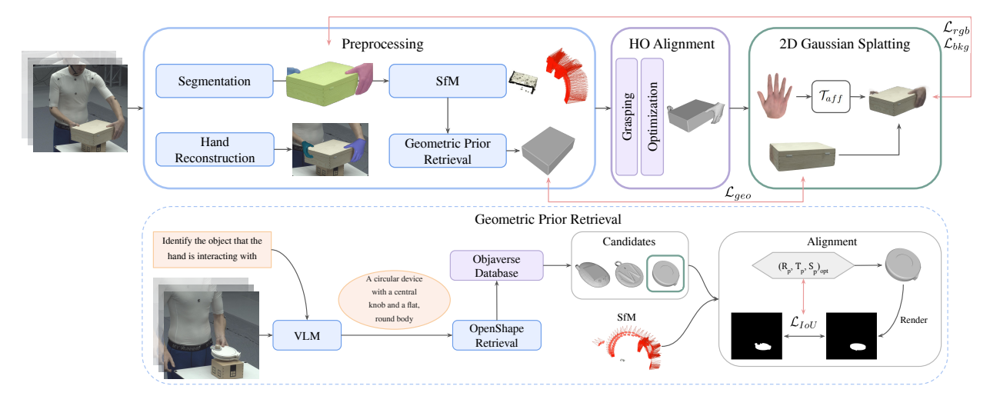
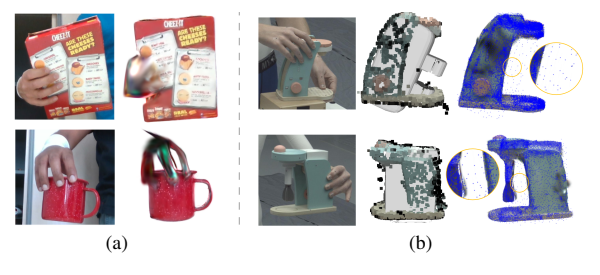

# 2026 GHOST（CVPR Findings）

# GHOST: Fast Category-agnostic Hand-Object Interaction Reconstruction from RGB Videos using Gaussian Splatting

**作者与机构**：Ahmed Tawfik Aboukhadra、Marcel Rogge、Nadia Robertini、Abdalla Arafa、Jameel Malik、Ahmed Elhayek、Didier Stricker；作者来自 **RPTU、DFKI-AV Kaiserslautern、UPM Saudi Arabia、NUST-SEECS Pakistan**。

**发表信息**：作者[项目页](https://ataboukhadra.github.io/ghost/)标注为 **CVPR Findings 2026**，注意区别于 CVPR 主会。本文的技术与实验整理依据本地 PDF，即 [arXiv:2603.18912v1](https://arxiv.org/abs/2603.18912v1)，发布于 **2026 年 3 月 19 日**，包含主文与补充材料。

**原文与实现**：[本地原文 PDF](../assets/papers/GHOST.pdf) · [官方代码](https://github.com/ATAboukhadra/GHOST)

# 1. 研究意义

## a. 研究背景：所描述的场景、背景

GHOST（Gaussian Hand-Object SplaTting）研究如何从一段单目 RGB 视频中，重建人手与物体交互的三维形状、相对位置和外观。例如，一个人用双手搬动盒子，或者握住电钻并转动它：系统不仅需要恢复手指姿态，还需要恢复被手掌遮挡的物体表面，并让三维中的手真正贴近物体，而不是悬空或者出现明显错位。

二维图像中“看起来握住了物体”，不代表三维重建中的接触关系正确。单目条件下，手和物体可能以不同尺度被重建，沿相机深度方向也可能存在偏差。这样的结果即使从原始视角看起来合理，换一个视角后仍会暴露手物分离、表面缺失等问题。

论文因此同时关注三个目标：**三维手物关系可信、物体表面尽量完整、重建外观可以从新视角渲染。** 手部表示还应随姿态变化而运动，形成可驱动的 Gaussian 手部模型。这些能力可用于 AR/VR、动作捕捉，以及机器人学习中的人类演示感知。

与 SPOT 的位置不同，GHOST 的输出是**交互重建结果**，不是机器人动作或者操作策略。它没有训练机器人控制器，也没有报告机器人任务成功率。把重建用于机器人学习，需要另行解决动作表示、运动重定向、可达性和执行控制。

## b. 问题及挑战：核心、重要、未解决的问题是什么

- **遮挡使物体表面缺少观测。** 手掌与手指会长期挡住物体，物体自身也有背面和凹陷。仅依赖可见像素的重建容易留下孔洞；若把“物体掩码之外”一概判为背景，还可能错误删除实际存在、但被手遮住的部分。

- **单目尺度与深度歧义破坏接触。** SfM 恢复的物体点云与 HaMeR 估计的手部网格来自不同流程，两者尺度和全局位置并不天然一致。单独优化二维外观，无法充分约束三维中的接触。

- **物体形状多样，不能预先为每个实例提供精确模板。** 固定类别或预扫描模板的方法适用范围有限。但没有精确模板时，如何补全未见表面又成为难题。GHOST 使用从通用三维数据库检索的近似形状作为先验，而不是假定已经知道目标物体的精确模型。

- **手是非刚性的，初始化还会抖动。** 遮挡会使逐帧手部预测出现异常姿态和位置跳变。若直接将这些结果用于 Gaussian 绑定与渲染，后续优化可能把错误的几何当成基础。

- **逐视频重建成本高。** 既有方法需要长时间优化，限制了大规模处理人类视频的实用性。GHOST 希望显著缩短优化时间，但其“快”是相对已有离线重建方法而言，并不等于实时在线重建。

# 2. 研究现状

## a. 领域的现状：针对上述问题及挑战，当前有哪些方法和技术，着重一个技术分类

可以沿“如何表示物体”和“如何处理手物关系”理解相关技术。

| 技术路线 | 代表方法 | 主要思路 | 与 GHOST 的关系 |
| --- | --- | --- | --- |
| 物体模板与网格优化 | Hasson 等方法、gSDF | 利用已知物体形状，结合接触、轮廓或光度约束恢复姿态 | 精确模板有帮助，但难覆盖未知物体 |
| 学习通用形状表示 | THOR-Net、ShapeGraformer | 用共享拓扑或图网络表达不同物体 | 尝试摆脱固定类别模板；输入与监督条件需分别比较 |
| 隐式场重建 | HOLD | 从视频联合恢复可分离的手和物体隐式表示 | 类别无关，但逐序列优化昂贵 |
| Gaussian 交互重建 | BIGS | 用 3D Gaussians 表示双手和未知物体，结合生成先验补全遮挡区域 | 显式表示方便渲染，但仍存在对齐与优化成本问题 |
| 参数网格驱动的 Gaussian 模型 | GaussianAvatars 等 | 将 Gaussians 绑定到参数化网格，以网格变形驱动外观 | 为 GHOST 的可驱动手部表示提供基础 |

表中的 ShapeGraformer 采用单张深度图，因此不能与单目 RGB 视频方法混为同一种输入设置；这里将其列为通用形状表示的相关路线。

另一条基础技术线是单目手部重建，如 HaMeR、HandOccNet、WiLoR 等。它们解决“图像中的手如何变成三维网格”，但单独使用手部重建网络，并不能保证物体尺度、手物接触和被遮挡物体的完整性。

GHOST 将这些问题拆开处理：利用现有模型取得分割和初始手部几何，再显式优化手物对齐，最后通过 2D Gaussian Splatting 恢复外观与表面。它是组合多种预训练工具和几何约束的逐视频优化流程。

## b. 问题的现状：针对以上技术，这些技术有哪些不足之处

**已知模板的方法受物体覆盖范围约束。** 如果需要事先扫描电钻或者只支持训练集中的固定模型，就难以处理普通视频里新的工具、包装和日用品。

**类别无关不代表完全不需要先验。** HOLD 使用手部模型和视频几何，BIGS 引入生成先验；GHOST 则使用 MANO 手模型与可选的检索物体先验。因此，“category-agnostic”应理解为不局限于预先指定的小型物体类别或实例模板集合，而不是没有结构假设和外部数据。

**渲染正确与几何正确不是同一个目标。** 只用光度损失拟合输入视角，可能获得不错的二维图像，却留下尺度错误、手物错位和看不到的孔洞。GHOST 因而分别加入抓握对齐、遮挡处理和先验几何约束。

**Gaussian 表示也不自动消除计算瓶颈。** BIGS 已经采用 Gaussian Splatting，但本文表 3 的优化时间仍为 13 小时。GHOST 的速度改善来自整体表示和优化设计，不能简单解释为“把 NeRF 换成 Gaussian 就足够了”。

# 3. 技术路线

## a. 问题与技术映射：针对上述问题，采用了哪些技术手段

整体流程分为**预处理 → 手物对齐 → Gaussian 重建**三个阶段。

*原文图 2：上方是完整流程；下方展示文本描述、Objaverse 候选检索和轮廓对齐。图片截取自原文，版权归原作者。*

| 要解决的问题 | 技术手段 | 产生的中间结果 |
| --- | --- | --- |
| 找出视频中的手和物体 | SAM2 分割与跟踪；RTMPose 检测手部区域 | 每帧物体、左手、右手掩码 |
| 恢复物体几何与相对视角 | HLoc + COLMAP 或 VGGSfM | 相机参数与稀疏物体点云 |
| 补充未观测到的物体形状 | 文本描述 + OpenShape + Objaverse 检索与对齐 | 对齐后的近似物体几何先验 |
| 初始化并稳定手部姿态 | HaMeR + MANO，异常帧剔除与插值 | 连贯的手部网格与关节 |
| 修正手物位置和尺度 | 抓握检测 + 接触、重投影、时序损失 | 手部平移与物体全局尺度 |
| 恢复物体外观与遮挡表面 | 2D Gaussians + 手感知背景损失 + 几何一致性损失 | 物体 Gaussian 表示 |
| 生成可驱动手部外观 | 将 Gaussians 绑定到 MANO 面片并优化 | 可随网格变形的手部 Gaussian 模型 |

## b. 技术详述：对每个技术方法进行详细介绍

### ① 预处理：从 RGB 视频获得分割、物体几何与手部初始化

输入为 $T$ 帧单目 RGB 视频 $\{I_t\}_{t=1}^{T}$。SAM2 跟踪物体，得到逐帧掩码 $M_t^o$，再在物体区域进行 SfM，估计相机内参 $K$、相对相机位姿 $(R_t^c,T_t^c)$ 和稀疏物体点云 $P_{\mathrm{sfm}}$。

这里使用视频中物体与相机的相对视角变化来恢复几何。它需要可用的特征匹配和足够的视角信息，不能把“输入只有 RGB”理解成任何拍摄方式都能可靠重建。

手部方面，RTMPose 提供检测框，HaMeR 预测 MANO 的姿态 $\theta_t$、形状 $\beta_t$ 和全局方向等参数，得到左右手网格和关节。SAM2 同时跟踪手部掩码，并根据检测框裁掉前臂。

为处理遮挡引起的异常，论文检查相邻帧的姿态、方向与平移跳变，以及形状异常、检测置信度、检测框面积和双手重叠情况。异常预测被剔除后，用平移的线性插值、旋转的球面插值等方式补齐。补充材料图 10a 展示了这种处理对手部初始化的改善。

该流程并非完全没有人工输入。补充材料图 8a 使用种子像素初始化手与物体的 SAM2 分割；文本描述也可以直接由用户提供。应将它理解为借助现有模型和少量提示完成预处理，而不是无需提示的端到端模型。

### ② 几何先验检索：用类似物体补充看不到的表面

首先从少量视频帧获得物体文本描述，可使用 InternVL，也可直接输入“盒子”等描述。OpenShape 将文本与 Objaverse 中的物体模型映射到共同特征空间，通过最近邻搜索返回 $k$ 个候选网格。

候选不一定与视频中的实例完全相同，也没有统一的方向和尺度。论文对每个候选优化旋转 $R_p$、平移 $T_p$ 和三维缩放 $S_p$，使投影后的轮廓尽量匹配物体掩码。按原文式（1），目标可以写为：

$$
\mathcal{L}_{\mathrm{IoU}}
=1-\operatorname{IoU}\!\left(
\Pi_t\!\left([R_p\mid T_p][S_p\cdot O_p]\right),
M_t^o
\right).
$$

其中 $\Pi_t$ 表示在第 $t$ 帧的投影，IoU 比较的是候选渲染轮廓与分割掩码。最终选取损失最小的对齐候选作为先验 $O$；顶点过少时，在表面补采样。

**先验的作用是提供合理形状约束，而不是提供真实不可见表面的测量。** 若检索到的杯子把手、包装厚度或者工具轮廓与真实实例不同，补全就可能引入偏差。后续实验也只在取得高质量先验的序列上使用几何一致性损失。

### ③ 抓握检测与手物对齐：先解决尺度和接触关系

HaMeR 手网格与 SfM 物体点云可能存在尺度和位置不一致，因此 GHOST 优化每帧手部全局平移 $T_t^h$ 和物体全局尺度 $S_o$。优化后的尺度也应用于 SfM 点云和相机平移，使它们保持一致。

论文通过运动方向判断哪只手参与抓握：计算物体中心和手部在相邻帧间的平移变化，投影到 $x,y$ 平面，再比较归一化方向的余弦相似度：

$$
c_h=\widehat{\Delta T^o_{xy}}\cdot
\widehat{\Delta T^h_{xy}}.
$$

若双手的分数均超过 $\tau_{\mathrm{sim}}=0.5$，标记为双手抓握；否则取相似度更高的手作为交互手。直观上，抓住盒子搬动时，手与盒子的平移方向应接近。

这是一种运动启发式，而不是接触力传感器或完整接触识别模型。纯旋转、物体近乎静止、双手共同运动但并未实际接触等情况，仍需要额外判断。

随后联合使用三个损失：

- **接触损失 $\mathcal{L}_{\mathrm{contact}}$**：在抓握帧中，计算交互手网格与缩放、变换后的物体先验之间的 Chamfer Distance，促进二者靠近；双手抓握时，两只手都参与。
- **二维重投影损失 $\mathcal{L}_{\mathrm{proj}}$**：约束平移后的三维手部关节投影接近 HaMeR 的二维关节预测，避免为满足三维接触而破坏二维位置。小检测框对应的不可靠预测会被排除。
- **时序损失 $\mathcal{L}_{\mathrm{temp}}$**：惩罚相邻帧手部平移的变化，减少位置跳动。

原文式（5）—（6）为：

$$
\mathcal{L}_{\mathrm{temp}}
=\frac{1}{T-1}\sum_{t=1}^{T-1}
\left\|T_{t+1}^h-T_t^h\right\|_2^2,
$$

$$
\mathcal{L}_{\mathrm{align}}
=10^3\mathcal{L}_{\mathrm{contact}}
+10^{-1}\mathcal{L}_{\mathrm{proj}}
+10\mathcal{L}_{\mathrm{temp}}.
$$

这里将原文总损失 $\mathcal{L}$ 标为 $\mathcal{L}_{\mathrm{align}}$，以区别于后续 Gaussian 优化。本文中的“物理一致”主要体现为这种几何对齐与接触改善；该损失不是摩擦、接触力或碰撞动力学求解器，也没有给出严格的不穿透保证。

### ④ 物体重建：使用 2D Gaussian 圆盘表示表面

2D Gaussian Splatting 中的“2D”指**位于三维空间中、具有方向的二维 Gaussian 圆盘**，不是二维图片贴片。物体由一组中心、旋转、二维尺度、不透明度和球谐颜色参数表示：

$$
\mathcal{G}_o=\{c_o,r_o,s_o,\alpha_o,\mathrm{SH}_o\}.
$$

通过可微光栅化渲染 RGB，再使用包含 $L_1$ 和 D-SSIM 的光度损失拟合输入图像。物体阶段允许增密和剪枝，调整 Gaussian 数量。

GHOST 在这一基础上增加两个针对手物交互的约束。

**手感知背景损失 $\mathcal{L}_{\mathrm{bkg},h}$。** 传统背景损失会抑制物体掩码之外的 Gaussians，但手挡住物体时，那些区域并不一定是背景。GHOST 将物体掩码与双手掩码合并，避免把手覆盖的物体部分直接删掉。

这不是把手部像素当成真实物体纹理，而是在背景判定时为可能被遮挡的区域保留余地。其有效性依赖跨帧可见性变化：当手换位置或视角变化后，真正的背景应被其他帧排除。若手始终覆盖同一区域，这个假设可能不成立。

**几何一致性损失 $\mathcal{L}_{\mathrm{geo}}$。** 一方面，不允许 Gaussian 中心离先验表面过远；另一方面，不允许先验表面离最近的 Gaussian 中心过远，从而填补孔洞。

为明确原文式（8）中的双向距离，定义 $C$ 为 Gaussian 中心集合，$d(x,A)=\min_{a\in A}\|x-a\|_2$。按原文文字解释，可将两个逐点惩罚写为：

$$
\ell_{\mathrm{out}}(c)
=\left[\max\!\left(0,d(c,O)-\tau_{\mathrm{out}}\right)\right]^2,
$$

$$
\ell_{\mathrm{fill}}(o)
=\left[\max\!\left(0,d(o,C)-\tau_{\mathrm{fill}}\right)\right]^2.
$$

将逐点项汇总得到 $\mathcal{L}_{\mathrm{out}}$ 与 $\mathcal{L}_{\mathrm{fill}}$ 后，使用：

$$
\mathcal{L}_{\mathrm{geo}}
=5\left(\mathcal{L}_{\mathrm{out}}
+\mathcal{L}_{\mathrm{fill}}\right).
$$

以上是对原文紧凑记号的解释性展开，没有额外指定原文未明确写出的求和或平均方式。两个方向分别对应“不要漂离先验”和“不要让先验表面出现未覆盖的空洞”。阈值决定约束的强度，但先验错误时，强约束也可能把 Gaussians 拉向错误位置。

### ⑤ 手部重建：将 Gaussians 绑定到 MANO 面片

手会随关节姿态发生形变，不能直接当作刚性物体。GHOST 借鉴 GaussianAvatars，在规范姿态的 MANO 网格上，为每个三角面片绑定 $m$ 个 Gaussians。

每一帧根据对应面片在规范姿态和变形姿态下的局部基，建立局部仿射映射；Gaussian 中心随面片变形移动，方向通过仿射变换的极分解提取。这样，改变 MANO 姿态就可以带动 Gaussian 手部外观，而无需逐帧重新建立一套无关联的点。

论文使用的 MANO 网格含 **778 个顶点、1538 个面片**。取 $m=55$ 时，每只手约有 $1538\times55=84{,}590$ 个 Gaussians，即约 8.4 万个。

优化顺序是**先训练物体，再加载已经训练的物体表示优化手部**。手部阶段优化 Gaussian 尺度、不透明度和球谐颜色，以及手部平移；中心和旋转由网格驱动，保持固定的绑定关系。手物组合阶段关闭 Gaussian 增密和剪枝。

因此，虽然整套系统生成联合手物场景，其优化并不是所有几何、姿态和外观参数始终同时自由更新。手部形变仍主要依赖初始化和处理后的 MANO 网格。

### ⑥ 优化设置

补充材料附录 B 给出以下设置，便于理解逐序列成本：

| 阶段 | 优化器 | 学习率 | 迭代次数 |
| --- | --- | --- | --- |
| 候选几何先验对齐 | AdamW | $10^{-2}$ | 1500 |
| 手物尺度与平移对齐 | Adam | 0.05 | 500 |
| 物体 Gaussian 重建 | Adam | 补充材料未统一列出 | 30,000 |
| 手物组合中的手部优化 | Adam | 补充材料未统一列出 | 30,000 |

这些是论文配置，不能据此推断每一段输入视频都耗时完全相同，也不能将一小时的报告时间直接当作包含全部预处理的端到端运行时间。

## c. 创新之处：你认为的上述方法中，最关键的技术是什么

我认为关键是**把“缺少观测”和“手物关系错误”分成不同问题，再用不同约束解决**。

几何检索回答“被挡住的部分可能长什么样”；手感知背景损失回答“哪些不可见区域不应该被删除”；抓握对齐回答“手与物体在三维中应该如何靠近”。三者互补，仅靠更快的 Gaussian 渲染并不能替代这些约束。

其中，手感知背景损失尤其直接：它纠正了“物体掩码之外都是背景”这一不适合交互场景的假设。几何先验则为遮挡补全提供结构，但也引入了检索和对齐误差。论文的价值因此同时包含一套有效的设计，以及明确的先验依赖与失败条件。

# 4. 实验分析

## a. 实验数据：论文中使用了哪些实验数据

| 数据来源 | 论文中的使用方式 | 可以支持的结论 |
| --- | --- | --- |
| ARCTIC Bi-CAIR | 9 段双手与不同物体交互的视频；进行三维、二维与消融评估 | 双手场景中的交互对齐和重建性能 |
| HO3D | 评估严重手部遮挡下的物体重建和二维渲染；补充图 11 对 5 段序列分析几何损失 | 在所选序列上的表现和先验效果 |
| 自采集 GoPro 视频 | 主文列出 Drill、Book 两段序列，用于定性展示 | 对基准之外视频的示例性适用性 |

这里以所读 PDF 为准，不把后续代码仓库扩展的数据规模回填为论文实验规模。主文没有完整列出 HO3D 二维指标使用的所有序列及汇总权重，因此不能将表 3 解读为整个 HO3D 数据集的全量统一评测。

三维指标遵循 HOLD 发布的 ARCTIC Bi-CAIR 协议：

- **Root-aligned MPJPE**：在手根对齐后计算关节位置误差，单位 **mm**；因此它本身不衡量手部全局平移是否正确。
- **$CD_r$、$CD_l$、$CD_h$**：以右手或左手根为参考评估物体，$CD_h$ 为两者平均，反映相对位置、尺度和表面误差，不做额外刚性对齐。
- **$CD_{\mathrm{ICP}}$**：先使用 ICP 对齐预测与真实物体，再计算 Chamfer 指标，侧重对齐后的物体表面质量。它与 $CD_h$ 的评估目的不同。
- **$F_{10\mathrm{mm}}$、$F_{5\mathrm{mm}}$**：表 2 报告对应距离阈值下的 F-score，越高越好。

论文表 1、表 2 将 **CD 指标的单位统一标为 $\mathrm{cm}^2$**，这里保留这一口径，不能将其数值直接称为“平均误差多少厘米”。二维评估使用 PSNR、SSIM、LPIPS。

速度比较使用**单张 NVIDIA RTX A6000、含 300 帧的 ARCTIC 双手交互序列**。报告的是优化时间；正文没有分阶段列出所有预处理成本，也没有报告机器人执行实验。

## b. 对比实验：与其他算法对比，突出数值的变化

### ① 三维交互与手部误差：GHOST 的主要优势是相对对齐

下表来自原文表 2。MPJPE 单位为 mm，CD 单位为 $\mathrm{cm}^2$，均越低越好。

| 方法 | MPJPE 双手均值 | MPJPE 左手 | MPJPE 右手 | $CD_r$ | $CD_l$ | $CD_h$ |
| --- | ---: | ---: | ---: | ---: | ---: | ---: |
| HOLD | 25.91 | 27.13 | 24.70 | 123.54 | 105.92 | 114.73 |
| BIGS | 24.49 | **24.63** | 24.35 | 31.28 | 46.11 | 38.69 |
| GHOST | **24.07** | 25.42 | **22.71** | **13.40** | **23.41** | **18.40** |

相较 BIGS，$CD_h$ 从 **38.69 降到 18.40**，绝对下降 **20.29 $\mathrm{cm}^2$**，按该指标计算约下降 **52.4%**；相较 HOLD 约下降 **84.0%**。这是最明显的改进，支持手物相对对齐得到改善。

双手平均 MPJPE 相较 BIGS 仅下降 **0.42 mm**，约 **1.7%**；左手误差反而从 24.63 增加到 25.42 mm。不能把结果描述为“两只手的所有误差都更低”。

### ② 物体表面重建：GHOST 没有全面超过 BIGS

仍来自原文表 2，$CD_{\mathrm{ICP}}$ 越低越好，F-score 越高越好。

| 方法 | $CD_{\mathrm{ICP}}$（$\mathrm{cm}^2$） | $F_{10\mathrm{mm}}$（%） | $F_{5\mathrm{mm}}$（%） |
| --- | ---: | ---: | ---: |
| HOLD | 2.07 | 63.92 | 37.13 |
| BIGS | **1.36** | **81.78** | **56.41** |
| GHOST | 2.26 | 60.88 | 34.67 |

GHOST 的 $CD_{\mathrm{ICP}}$ 高于两个基线，F-score 也低于两个基线。相比 BIGS，$F_{10\mathrm{mm}}$ 下降 **20.90 个百分点**，$F_{5\mathrm{mm}}$ 下降 **21.74 个百分点**。

这说明**相对接触与尺度更合理，不等于对齐后的物体表面更准确**。检索先验可以补孔洞，但近似形状也可能降低细节准确性。这是对表格结果的解释，并非论文已经用独立实验确认的唯一原因。

### ③ 二维渲染：ARCTIC 与 HO3D 的优势不同

下表来自原文表 3。PSNR 单位为 dB；PSNR、SSIM 越高越好，LPIPS 越低越好。

| 数据 | 方法 | PSNR | SSIM | LPIPS |
| --- | --- | ---: | ---: | ---: |
| ARCTIC | HOLD | 12.83 | 0.66 | 0.32 |
| ARCTIC | BIGS | 24.87 | **0.96** | 0.05 |
| ARCTIC | GHOST | **25.93** | 0.88 | **0.02** |
| HO3D | HOLD | 16.20 | 0.74 | 0.21 |
| HO3D | BIGS | **24.51** | **0.92** | 0.07 |
| HO3D | GHOST | 21.37 | 0.75 | **0.03** |

ARCTIC 上，相较 BIGS，GHOST 的 PSNR 提高 **1.06 dB**，LPIPS 降低 **0.03**，但 SSIM 降低 **0.08**。HO3D 上，GHOST 的 LPIPS 降低 **0.04**，但 PSNR 低 **3.14 dB**，SSIM 低 **0.17**。

因此，原文“更好的渲染质量”应按指标和数据集理解。GHOST 对 HOLD 的提升较稳定，但对 BIGS 并不是所有二维指标都占优。

### ④ 优化时间：显著加速，但仍是离线重建

| 方法 | 原文表 3 的优化时间 | 相对 GHOST 的耗时 |
| --- | ---: | ---: |
| HOLD | 16 h | 16 倍 |
| BIGS | 13 h | 13 倍 |
| GHOST | **1 h** | 1 倍 |

按表中取整时间，GHOST 相比 BIGS 约 **13 倍加速**、耗时减少约 **92.3%**；相比 HOLD 约 **16 倍加速**。这些结果属于上述 GPU 与序列设置，不能推导出实时帧率，也不能保证任意序列具有相同比例的加速。

## c. 消融实验：与自己对比，突出数值的变化

### ① SfM 与几何一致性损失：性能依赖初始化和阈值

下表完整整理自原文表 1。$\tau_{\mathrm{fill}}$ 单位是 **mm**，$\tau_{\mathrm{out}}$ 单位是 **cm**，CD 指标单位是 $\mathrm{cm}^2$；“—”表示论文未报告，不代表零。

| SfM | 使用 $\mathcal{L}_{\mathrm{geo}}$ | $\tau_{\mathrm{fill}}$ | $\tau_{\mathrm{out}}$ | $CD_h$ ↓ | $CD_{\mathrm{ICP}}$ ↓ |
| --- | --- | ---: | ---: | ---: | ---: |
| HLoc + COLMAP | 否 | — | — | — | 8.18 |
| HLoc + COLMAP | 是 | — | — | — | 4.86 |
| VGGSfM | 否 | — | — | 18.32 | 2.78 |
| VGGSfM | 是 | 1.0 | 5.0 | **18.21** | 3.66 |
| VGGSfM | 是 | 0.1 | 2.0 | 18.42 | 2.33 |
| VGGSfM | 是 | 0.01 | 2.0 | 18.37 | 2.83 |
| VGGSfM | 是 | 0.01 | 7.0 | 18.40 | **2.26** |

不加几何损失时，使用 VGGSfM 的 $CD_{\mathrm{ICP}}$ 为 2.78，低于 HLoc 配置的 8.18；论文据此说明 SfM 对下游结果有很大影响。但 VGGSfM 在 HO3D 和自采视频上没有表现出同样稳定的优势，不能得出“一律换成 VGGSfM 最好”的结论。

HLoc 配置加几何损失后，$CD_{\mathrm{ICP}}$ 从 **8.18 降至 4.86**，约下降 **40.6%**。VGGSfM 最后一行配置从无损失的 **2.78 降至 2.26**，约下降 **18.7%**；不过 $CD_h$ 从 18.32 增至 18.40。

还有些阈值配置会使表面指标恶化，例如 1.0 mm / 5.0 cm 配置的 $CD_{\mathrm{ICP}}$ 为 3.66。**先验和几何损失不是无条件有效，不同评价目标也未必同步改善。**

### ② 遮挡处理、先验补全与手部初始化

原文图 3a 对比有无手感知背景损失：引入该项后，被手指遮挡的物体区域不再轻易出现手指形孔洞。原文图 5 展示几何损失使 Gaussian 中心更贴近先验并补齐缺失区域。

补充材料图 11 在 **5 段 HO3D 序列**上对比有无 $\mathcal{L}_{\mathrm{geo}}$，正文指出其中 **3 段**的 $CD_r$ 改善；图中没有逐项数字标注，不把目测柱高写成精确数值。

补充图 10a 展示异常帧处理后的手部网格更稳定。但论文未给出完整的“去掉接触损失、去掉重投影、去掉时序、去掉异常帧处理”独立数值消融矩阵，因此不能为这些组件分别编造误差下降幅度。

### ③ 每个手部面片的 Gaussian 数量

原文图 7 的横轴标出 $m=6,15,28,55$，还展示一个更高密度但未标出具体横轴数值的点。在固定 **30,000 次**手部阶段训练迭代下，$m=55$ 表现最好，继续增加密度并没有继续提高渲染质量。

论文将其解释为：更大的参数集合在固定迭代预算下更难充分拟合。这支持在其设置中选择约 8.4 万个 Gaussians/手，但不支持把 55 当作所有视频、所有计算预算下的通用最优值。曲线没有标注精确数值，本文仅保留趋势判断。

## d. 实验总结

实验最强的证据是：**在 ARCTIC 的报告设置中，GHOST 显著降低手物相对几何误差，并大幅缩短逐序列优化时间。** ARCTIC 的 PSNR、两个数据集的 LPIPS 也优于表中基线。

同时应保留三个边界：物体 ICP 对齐后的几何指标没有全面领先；SSIM 和 HO3D 的 PSNR 不如 BIGS；先验损失和 SfM 的收益依赖数据及参数。论文支持的是速度、交互对齐与部分渲染指标上的取舍，而不是在所有重建目标上统一胜出。

# 5. 不足之处

**① 几何先验可能检索错误，也可能对齐错误。** 文字语义相似不保证实例形状一致。先验若存在错误把手、厚度或轮廓，几何损失可能把原本合理的 Gaussian 中心拉到错误位置。补充材料图 9、图 12b 给出了这类例子，正文也明确只在高质量先验可用时使用该项。

**② 手感知背景损失依赖跨帧可见性变化。** 若手从头到尾一直覆盖同一个区域，系统可能无法区分“真正的物体”与“被手掩码放行的非物体区域”，从而在手部区域生成多余 Gaussians。补充图 12a 展示了这一失败情况。

*原文补充图 12：（a）接触区域不变时，手感知背景损失可能保留多余 Gaussians；（b）先验对齐不准时，几何损失可能把中心拉向错误区域。图片版权归原作者。*

**③ “接触合理”仍是几何层面的改善。** 抓握检测依赖平移方向，接触损失使用几何距离；没有显式恢复接触力、摩擦或稳定抓握条件。纯旋转、静止抓持、滑动接触等场景值得单独验证。这个方向是阅读后的分析，论文没有提供完整的针对性实验。

**④ 对预处理有较强依赖。** SAM2 掩码、SfM、HaMeR、检索先验和异常帧阈值的误差都会影响后续结果。插值可减少孤立抖动，但不能保证长时间遮挡下的手指姿态正确；手部 Gaussian 优化也不能任意修正网格形变。

**⑤ 刚性物体假设限制任务范围。** 主流程将物体建模为统一的刚性几何。论文把可变形物体和关节物体列为未来工作，因此不能声称当前方法已完整支持布料变形或开合物体的关节运动。

**⑥ 完整性和真实性之间仍有取舍。** 补齐一个合理表面，不等于恢复真实的未见表面。表 2 的物体表面指标不如 BIGS，也提示应分别评价可见区域、不可见区域、细小结构和接触关系，不能仅靠视觉效果判断几何准确性。

**⑦ 速度与泛化的证据范围有限。** 一小时优化仍不是实时，且未给出完整预处理分解；ARCTIC 只有 9 段评估视频，自采视频主要是定性例子，没有跨物体、跨操作者、跨拍摄条件的大规模统计，也没有给出置信区间。

**⑧ 机器人应用仍需后续验证。** 论文没有证明重建的接触和外观改善能直接提高模仿学习成功率。若用于人类演示迁移，还需要把三维信息变成机器人可执行轨迹，并验证重定向、遮挡跟踪与闭环控制。

# 6. 基于本文扩展到的其他论文

## ① HOLD：类别无关手物重建的隐式表示路线

[HOLD: Category-agnostic 3D Reconstruction of Interacting Hands and Objects from Video](https://openaccess.thecvf.com/content/CVPR2024/html/Fan_HOLD_Category-agnostic_3D_Reconstruction_of_Interacting_Hands_and_Objects_from_CVPR_2024_paper.html)，**CVPR 2024**。

HOLD 从单目交互视频联合重建手与物体，采用可分离的关节化隐式表示，不要求预扫描物体模板。阅读它有助于理解 GHOST 继承的视频几何流程，以及为什么手物约束不能只依赖二维拟合。

建议比较两者的表示、接触约束和逐序列优化成本，特别注意“输入无需三维手物标注”与“完全不使用预训练模型先验”是不同概念。

## ② BIGS：双手 Gaussian 重建与生成先验

[BIGS: Bimanual Category-agnostic Interaction Reconstruction from Monocular Videos via 3D Gaussian Splatting](https://openaccess.thecvf.com/content/CVPR2025/html/On_BIGS_Bimanual_Category-agnostic_Interaction_Reconstruction_from_Monocular_Videos_via_3D_CVPR_2025_paper.html)，**CVPR 2025**。

BIGS 是最直接的比较对象：用 3D Gaussians 表示双手和未知物体，通过预训练扩散模型的 SDS 损失补充未见部分，并考虑手物对齐。GHOST 则采用 2D Gaussians、检索几何先验及针对遮挡的损失。

值得比较的是“生成式补全”和“检索式几何约束”的代价与偏差。本文所有 BIGS 对比数值均取自 **GHOST 表 2、表 3**，不与 BIGS 原文中可能不同的评估行混合。

## ③ 2D Gaussian Splatting：理解表面圆盘表示

[2D Gaussian Splatting for Geometrically Accurate Radiance Fields](https://arxiv.org/abs/2403.17888)，**SIGGRAPH 2024**。

该工作以三维空间中的有向 Gaussian 圆盘建模表面，强调多视角几何一致性。它有助于理解 GHOST 为什么使用二维尺度、表面方向和可微渲染，以及 2DGS 与体积式 3DGS 的表示差异。

需要注意：2DGS 是基础表面表示，GHOST 的抓握检测、手感知背景处理与检索先验并不由 2DGS 自动提供。

## ④ SPOT：从交互感知走向物体轨迹策略

[SPOT 阅读笔记](spot.md)研究从人类演示学习物体位姿轨迹，并将预测轨迹转换为机器人执行。它与 GHOST 的研究阶段不同：GHOST 关注如何从视频获得几何可信的手物表示，SPOT 关注如何从演示中的物体运动学习操作策略。

一种后续研究设想是，用更好的视频重建增强演示轨迹与接触标注，再评估是否能改善物体轨迹学习。但 GHOST 的单目尺度恢复、先验误差和离线成本，以及 SPOT 的观测与执行要求，都需要另行解决。**这只是阅读后的延伸方向，两个方法的现有实验没有证明这种组合有效。**
