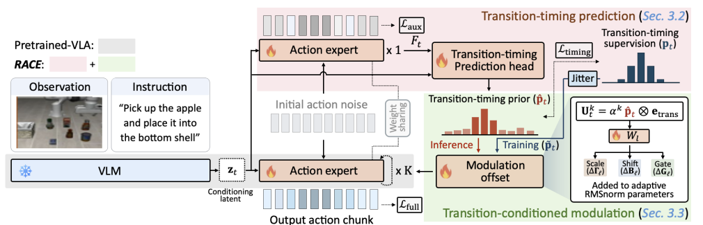
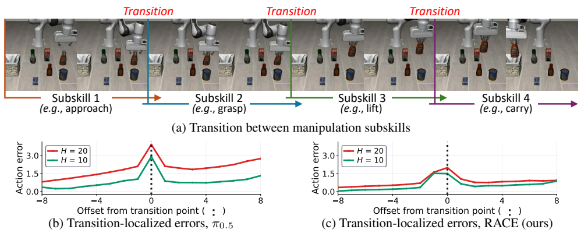

# 2026 RACE（Preprint）

# When to Switch: Reliable Action-Chunk Extension for Vision-Language-Action Models

**作者与机构**：Seonghoon Yu、Dongwon Kim、HyungRok Jung、Yoonjae Baek、Byung-kwan Lee、Suha Kwak、Jeany Son；作者来自 **KAIST、GIST、NVIDIA、POSTECH**。

**发表信息**：[arXiv:2610.05719v1](https://arxiv.org/abs/2610.05719v1)，发布于 **2026 年 10 月 5 日**，原文标注为 **Preprint**。本文依据本地 PDF 的主文与附录整理，不将其标为已经录用的会议论文。

**原文与实现**：[本地原文 PDF](../assets/papers/RACE.pdf) · [官方仓库与机器人演示](https://github.com/Seonghoon-Yu/RACE-VLA)。截至本文整理时，官方 README 标注代码将发布，仓库已有演示，但不能据此声称训练代码和权重已经完整公开。

# 1. 研究意义

## a. 研究背景：所描述的场景、背景

RACE（Reliable Action-Chunk Extension）研究如何让视觉语言动作模型（VLA）更可靠地执行长动作片段。

VLA 通常根据图像、机器人状态及语言指令产生动作。模型较大时，一次推理需要时间。如果机器人已经执行完上一批动作、下一批动作却尚未生成，就会停下来等待，形成反复启动、暂停的 stop-and-go 运动。

Action chunking 通过一次预测多个连续动作缓解这一问题。例如，一次预测接近物体、闭合夹爪、抬起物体的一段动作，比每个控制步都调用模型更省推理。但片段越长，机器人越久不能根据新观测修正动作，执行误差也更容易积累。

论文进一步观察到：长片段中的误差不只随预测距离逐渐增加，还会集中在**子技能切换点**，例如从“接近”切换到“抓握”、从“抓握”切换到“抬起”。如果夹爪闭合晚了几步，后面的抬起动作即使方向正确，也可能没有真正抓住物体。

因此，RACE 在动作生成前预测片段内“什么时候应该切换”，再把这一信息注入生成过程，使模型能够在更少的策略调用下维持较好的成功率。它关注的是**片段内部的切换时机**，不是用自然语言输出一套新的任务规划。

## b. 问题及挑战：核心、重要、未解决的问题是什么

- **推理延迟与执行连续性之间存在冲突。** 频繁重规划提供更及时的反馈，但增加策略调用和等待；少调用模型可以减少等待，却要求模型可靠地预测更远的动作。

- **长片段跨越技能边界时更难预测。** 平移中的小偏差和“何时闭合夹爪、何时开始抬起”的错误具有不同结构。只把预测长度加大，可能在这些边界产生更明显的误差峰值。

- **演示没有人工子技能标签。** 数据通常有图像和动作，却没有逐帧注明“接近结束、抓握开始”。需要从动作序列自动提取训练信号，同时容忍检测边界的不确定性。

- **推理时无法访问未来演示动作。** 训练可以从完整轨迹提取切换点，部署时只能根据当前观测和模型特征预测。因此标签生成与在线预测必须分开，不能把真实未来边界泄漏到推理中。

- **附加模块不能抵消减少调用的收益。** 为预测切换时机再完整运行一次大型 VLM 或多步动作生成，可能使单次调用变得更慢。RACE 复用 VLM 缓存，仅增加一步辅助动作前向和预测头。

- **切换建模不能替代环境反馈。** 即使时机预测更准，长时间开环执行仍可能因物体滑动、环境变化和执行偏差失败。论文目标是缓解长片段的一类误差，不是消除全部开环漂移。

# 2. 研究现状

## a. 领域的现状：针对上述问题及挑战，当前有哪些方法和技术，着重一个技术分类

可以按“减少一次调用的成本”“减少调用次数”“让等待与执行重叠”区分效率方法，再看技能结构如何参与策略学习。

| 技术路线 | 代表方法 | 核心思路 | 与 RACE 的区别或联系 |
| --- | --- | --- | --- |
| 连续动作片段生成 | ACT、Diffusion Policy、$\pi_{0.5}$ | 一次预测多个连续动作 | 提供基本生成机制，但长片段可靠性仍需处理 |
| 自适应执行长度 | AutoHorizon、PACE | 根据可靠性或阶段边界，只执行预测片段的一部分 | 主要决定何时提前重规划；RACE 改善片段内动作以支持更长执行 |
| 强化学习优化效率 | PolicyTrim | 用强化学习优化任务执行与策略调用 | 需要在线 rollout 和额外训练成本 |
| 异步执行 | Real-Time Chunking、VLASH | 执行当前动作时生成下一片段 | 隐藏推理延迟，与片段可靠性改善互补 |
| 单次推理加速 | token pruning、Latent Bridge、VLA-Cache | 减少视觉 token 或复用计算 | 降低每次调用成本，与减少调用次数是不同方向 |
| 显式子技能结构 | CoTPC、阶段或进度条件策略 | 从演示提取阶段、子目标或进度信息 | RACE 使用片段内切换位置的软分数，不需要预测子技能类别 |

RACE 的主要实现建立在 $\pi_{0.5}$ 的 flow-matching 动作专家上。附录另外研究 GR00T-N1.6 与 OpenVLA-OFT，因此其思想并非只评估在一个骨干上，但不同生成架构需要不同注入方式。

## b. 问题的现状：针对以上技术，这些技术有哪些不足之处

**直接扩展片段，可能只获得速度收益却损失可靠性。** 模型需要在没有中间反馈的情况下预测更远，接近、抓握、抬起等阶段的边界可能错位。普通同长度微调是论文最重要的控制基线。

**提前截断可以规避风险，却没有直接修复边界附近的动作。** PACE 等方法在可能的阶段边界附近缩短执行区间；RACE 则训练动作专家理解这些边界，并在生成时提供切换先验。这是不同的干预位置，不代表自适应重规划没有价值。

**异步执行并非在所有设置下都能完全隐藏延迟。** 若剩余动作的执行时间短于下一次调用延迟，机器人仍会停下来。更长片段提供更大的执行缓冲，但需要先保证这些动作足够可靠。

**单次推理更快，不等于调用次数更少。** token pruning 或缓存降低每次调用开销；RACE 的额外辅助前向反而会略微增加单次延迟，其整体收益来自更长执行区间。这两种效率来源需要分别测量。

**阶段语义与切换时机是不同监督目标。** RACE 不需要知道某一段叫“抓握”还是“抬起”，它学习的是动作片段各位置接近切换边界的程度。原文图 7 的子技能名称只用于示意，不用于训练。

# 3. 技术路线

## a. 问题与技术映射：针对上述问题，采用了哪些技术手段

整体流程是**自动提取切换标签 → 一步辅助前向预测切换先验 → 使用先验调制完整动作生成**。

*原文图 3：冻结的 VLM 提取缓存特征；辅助动作前向预测切换先验，完整去噪从同一噪声重新开始。图片截取自原文，版权归原作者。*

| 问题 | 技术手段 | 作用位置 |
| --- | --- | --- |
| 没有人工技能边界 | 对演示动作使用 PELT 变点检测 | 离线标签生成 |
| 检测点存在偏差，切换可能跨越数步 | 将硬边界转为邻域 Gaussian 软标签 | 时机预测监督 |
| 仅视觉语义不足以定位未来动作切换 | 融合 VLM 缓存和一步辅助动作特征 | 切换预测头 |
| 动作专家缺少切换结构 | 切换 BCE 损失反传到动作专家 | 表示学习 |
| 不同动作位置、去噪步骤需不同先验强度 | token-wise 自适应归一化偏移与逐步可学习门控 | 完整动作生成 |
| 训练初期预测先验不准 | teacher forcing 和时机抖动 | 训练条件构造 |
| 附加推理开销需受控 | 复用 VLM 缓存，只增加一步辅助动作前向 | 每次策略调用 |

## b. 技术详述：对每个技术方法进行详细介绍

### ① 区分预测长度、执行长度和去噪步骤

记预测片段长度为 $H$，每次调用执行的长度为 $H_{\mathrm{exec}}$，去噪步骤数为 $K$。这三个量不是一回事。

论文仿真中的 RACE 和同配方微调模型使用 $H=H_{\mathrm{exec}}$，即预测并执行完整片段。官方 $\pi_{0.5}$ 基线则预测 10 个动作、执行前 5 个。

真实机器人采用异步 Real-Time Chunking，使用 $H=2H_{\mathrm{exec}}$。其中 $H_{\mathrm{exec}}$ 是**配置的重规划间隔**：执行前半片段后请求下一片段，后半片段用来覆盖推理延迟。新片段到达时，会跳过对应已流逝时间的前部动作，所以实际每次调用执行的数量不总是恰好等于这个配置值。

本节先解释主实现的 flow-matching 生成，采用 $K=10$。

### ② 从演示动作提取切换点，并生成软标签

每个仿真动作包含位姿增量与夹爪命令。论文对位姿增量取一阶差分，角度差规约到 $[-\pi,\pi)$，并加入夹爪命令作为输入信号；随后在每条演示内部，逐维标准化，避免平移、旋转、夹爪量纲差异主导变点检测。

PELT 在标准化序列中寻找分段边界。其目标是各段代价与新增变点惩罚之和：

$$
\min_{\mathcal{C}}\left[
\sum_{i=0}^{m}
\operatorname{cost}(\tilde a_{c_i:c_{i+1}})
+\beta m
\right],
$$

其中 $\mathcal{C}=\{c_1,\ldots,c_m\}$，每个 $c_i$ 是新段的起点，序列末端边界不计为切换标签。段代价使用 Gaussian 核，主设置为 $\beta=4$；核带宽使用每条演示的距离中位数启发式。

PELT 得到的点只是**动作动力学变化的伪标签**，不等于人工标注的完整语义技能边界。论文使用 VLABench 的脚本生成器边界验证其相关性，但这些参考边界只用于评价，不作为训练输入。

对动作位置 $t+j$，令 $d_{t+j}$ 为它到最近切换点的距离。按照附录式（10），软目标为：

$$
p_{t+j}
=\exp\left(-\frac{d_{t+j}^{2}}{2\sigma_p^{2}}\right),
\qquad \sigma_p=1.
$$

距离超过 $R=3$ 步的分数置零，因此每个切换点最多影响 7 个位置。超过演示结尾的动作位置用最后动作补齐，但切换分数设为零。

这种标签不是整个片段只能有一个“正确切换索引”的分类。$\mathbf p_t\in[0,1]^H$ 为每个动作位置提供分数，允许一个片段包含多个切换点。

### ③ 一步辅助动作前向：获取与未来动作位置对应的特征

每次策略调用先缓存观测与语言特征：

$$
z_t=\operatorname{VLM}(o_t,\ell).
$$

然后采样初始噪声 $A_t^0\sim\mathcal N(0,I)$。在尚未注入切换先验时，动作专家进行一次辅助去噪前向，取得最终层动作 token 隐藏状态：

$$
F_t=(f_t,\ldots,f_{t+H-1})
\in\mathbb R^{H\times d_a}.
$$

这些特征既依赖当前场景和指令，又与未来片段中各动作位置对应。辅助前向的速度场还接受 $\mathcal L_{\mathrm{aux}}$ 监督，使这次前向具有动作预测意义。

**辅助结果不作为完整生成的第一步继续向后执行。** 它用于预测先验；完整去噪随后从同一个 $A_t^0$ 重新开始。推理时，先验只预测一次，不在每个去噪步骤重新预测。

### ④ 预测头：融合场景语义与粗动作信息

预测头先把动作特征投影到 VLM 最终层缓存特征 $\hat z_t$ 的维度，再用 cross-attention 融合观测上下文，用 self-attention 建模片段内部关系：

$$
\hat F_t=F_tW_f,
$$

$$
\bar F_t
=\hat F_t+
\operatorname{CrossAttn}(\hat F_t,\hat z_t,\hat z_t),
$$

$$
\tilde F_t
=\bar F_t+\operatorname{SelfAttn}(\bar F_t),
\qquad
\hat{\mathbf p}_t
=\operatorname{sigmoid}(\tilde F_tw_p).
$$

输出 $\hat{\mathbf p}_t\in[0,1]^H$ 表示各位置接近切换点的程度。原文主实现给出 $d_a=1024$、$d_z=256$。

预测头使用 $\operatorname{BCE}(\hat{\mathbf p}_t,\mathbf p_t)$ 训练。该损失不仅训练预测头，还通过 $F_t$ **反向传播到动作专家**，使它的内部表示更关注即将发生的切换；主实验冻结 VLM。

### ⑤ 条件动作生成：对每个动作 token 注入时机信息

第 $k$ 个去噪步骤构造切换特征：

$$
U_t^k
=\alpha^k\hat{\mathbf p}_t\otimes e_{\mathrm{trans}}
\in\mathbb R^{H\times d_a}.
$$

$e_{\mathrm{trans}}$ 是可学习切换 embedding，$\otimes$ 是外积，$\alpha^k\in(0,1)$ 是该去噪步骤的 sigmoid 门控，初始化为 0.5。

每层将 $U_t^k$ 映射为 adaptive RMSNorm 的 scale、shift 和 residual gate 偏移：

$$
[\Delta\Gamma_\ell,\Delta B_\ell,\Delta G_\ell]
=U_t^kW_\ell.
$$

这些偏移加在原动作专家的调制参数上，使不同动作位置得到不同条件。其作用可以写为：

$$
\tilde X_\ell
=(1+\Gamma_\ell)\odot\operatorname{RMSNorm}(X_\ell)
+B_\ell,
$$

$$
X_{\ell+1}
=X_\ell+G_\ell\odot
\operatorname{Module}_\ell(\tilde X_\ell).
$$

这里 $\operatorname{Module}_\ell$ 为 attention 或 feed-forward 模块。$W_\ell$ 零初始化且无 bias，因此训练初始保持原模型调制；若先验为零，额外偏移也为零。

完整生成按照原文式（1）更新：

$$
A_t^k=A_t^{k-1}
+\frac{1}{K}v_\theta
\left(A_t^{k-1},z_t,\alpha^k\hat{\mathbf p}_t\right),
\qquad k=1,\ldots,K.
$$

上式按主文省略 flow time；附录算法 2 明确第 $k$ 步输入时间为 $(k-1)/K$。最终输出 $A_t^K$。

直观上，“即将抓握”的动作位置在每一步生成中获得边界提示，但模型仍根据观测决定实际动作，并不是机械地在先验峰值处强制切换。附录中先验移动一步，生成的夹爪切换平均只移动约四分之一步，也体现了这种共同决定关系。

### ⑥ 训练：时机监督与动作生成共同优化

训练目标为：

$$
\mathcal L
=\mathcal L_{\mathrm{full}}
+0.1\mathcal L_{\mathrm{aux}}
+0.05\mathcal L_{\mathrm{timing}}.
$$

若 $\epsilon$ 是初始噪声、$A_t$ 是真实动作，完整训练前向采样连续 flow time $s$，构造 $A_t^s=(1-s)\epsilon+sA_t$，回归速度目标 $A_t-\epsilon$。辅助前向则在 $s=0$、无调制条件下回归同一目标。训练不是每个样本都运行完整的 10 步推理循环。

完整训练前向使用软标签 $\mathbf p_t$，而非当前预测 $\hat{\mathbf p}_t$，即 teacher forcing；同时以 0.5 的概率将条件标签随机偏移一步，提高对不准先验的容忍。预测头 BCE 的监督目标保持原标签不变。

因此需要区分：

- **训练条件**：抖动后的目标 $\tilde{\mathbf p}_t$。
- **预测头监督**：未抖动的 $\mathbf p_t$。
- **部署条件**：在线预测的 $\hat{\mathbf p}_t$。

连续训练时间 $s$ 使用所在区间对应的门控 $\alpha^k$；推理则在离散去噪步骤中分别使用各门控。

### ⑦ 参数与训练成本

仿真主设置使用 4 张 RTX A6000、全局 batch size 64、AdamW 和余弦学习率，从 $5\times10^{-5}$ 衰减至 $5\times10^{-6}$。VLABench 后训练 40K 步，其余仿真基准为 20K 步。

附录表 16 中，VLABench 的普通微调为 **693M 可训练参数、28 小时**，RACE 为 **811M、36 小时**。所以“轻量后训练”是相对完整 VLM 更新或高成本强化学习而言，不能把 RACE 说成无需训练或仅训练一个很小的预测头：动作专家也会更新，增加的可训练参数约为 118M。

## c. 创新之处：你认为的上述方法中，最关键的技术是什么

我认为关键是把“长片段不可靠”进一步定位为**片段内部切换时机难以预测**，再同时从训练表示和生成条件两方面处理。

仅附加一次动作损失，改进很小；仅让动作专家接受切换监督，不注入先验，也已经有效；显式条件生成又带来额外收益。这个区分使 RACE 的论证比“增加一个模块后平均成功率提高”更具体。

第二个有价值的设计是**先用一次共享动作专家的辅助前向获得动作位置特征，再复用同一 VLM 缓存进行完整生成**。它让时机预测具有动作上下文，同时把额外推理控制在主测量设置的约 4%。

这里的“什么时候切换”仍由当前观测推断，不能等同于执行中的事件触发闭环。RACE 改善的是预测动作片段，不是额外安装一个实时接触监测器。

# 4. 实验分析

## a. 实验数据：论文中使用了哪些实验数据

按照附录 E.5 与 E.1：

| 数据或平台 | 训练数据 | 评估规模与口径 |
| --- | --- | --- |
| VLABench | 10 个任务，每任务 500 条脚本演示，共 5000 条 | 每任务、每 track 50 次，共 2500 次；先平均任务再平均 5 个 track |
| RoboCasa-H50 | 25 个厨房任务，每任务 50 条人类遥操作演示，共 1250 条 | 每任务 50 次，共 1250 次；8 个类别的整体均值按任务数加权 |
| LIBERO | Spatial、Object、Goal、Long 共 40 个任务，每任务 50 条演示，共 2000 条 | 每任务 50 次，共 2000 次；报告各 suite 与整体均值 |
| AgileX PiPER 真实机械臂 | 一项碗到盘子的抓取放置任务，30 条演示 | 每方法 50 次，使用相同的一组初始摆放 |

真实平台是带夹爪的 6 自由度 PiPER，使用腕部相机和前方相机，30 Hz 采集与执行。真实动作训练使用相对片段起始状态的关节位移，夹爪为绝对命令，部署前转换回绝对关节目标；不能把仿真的末端位姿增量设置直接套到真实机器人上。

论文主要指标是：

- **SR**：完整任务成功率。
- **PS**：VLABench 已完成子任务的比例，允许区分部分完成与全部成功。
- **Spd**：每段任务累计策略推理时间相对基线的加速，**不包含仿真器执行时间**。
- **Time、Idle**：真实机器人任务完成时间与未接收到新动作命令的总空闲时间，均仅对成功试次求平均。

按附录式（11），仿真速度指标为：

$$
\operatorname{Spd}_\theta
=\frac{\ell_{\pi_{0.5}}\bar N_{\pi_{0.5}}}
{\ell_\theta\bar N_\theta},
$$

其中 $\ell$ 为单次调用延迟，$\bar N$ 为平均调用次数；主比较在被比较模型与基线**共同成功**的任务上计算。不能把 Spd 写成机器人端到端任务速度。附录另检验了所有试次等统计集合，但其数值与主表口径不同。

原文动作误差分析使用演示状态上的归一化 7 维动作 MSE，不是在实际 rollout 状态上获得的真实最优动作误差。这一限制会影响对失败成因的解释。

## b. 对比实验：与其他算法对比，突出数值的变化

### ① 同长度比较：平均成功率稳定优于普通微调

以下汇总原文表 1、表 2、附录表 9。成功率单位为 %，Spd 相对各基准的官方 $\pi_{0.5}$ 基线。

| 基准 | $H_{\mathrm{exec}}$ | 普通微调 SR | RACE SR | 增益（百分点） | 微调 Spd | RACE Spd |
| --- | ---: | ---: | ---: | ---: | ---: | ---: |
| VLABench | 10 | 32.2 | **34.4** | +2.2 | 2.01× | 1.92× |
| VLABench | 15 | 30.0 | **33.4** | +3.4 | 2.83× | 2.71× |
| VLABench | 20 | 28.1 | **33.0** | +4.9 | 3.82× | 3.68× |
| RoboCasa-H50 | 10 | 65.0 | **66.8** | +1.8 | 1.96× | 1.91× |
| RoboCasa-H50 | 15 | 64.2 | **67.3** | +3.1 | 2.94× | 2.91× |
| RoboCasa-H50 | 20 | 60.8 | **64.0** | +3.2 | 3.84× | 3.77× |
| LIBERO | 10 | 97.10 | **98.65** | +1.55 | 1.98× | 1.95× |
| LIBERO | 15 | 96.95 | **98.35** | +1.40 | 2.96× | 2.86× |
| LIBERO | 20 | 94.35 | **96.70** | +2.35 | 3.91× | 3.78× |

这是最直接的控制比较：训练配方与长度对齐后，RACE 改善平均成功率，但同长度下的累计推理加速略小于普通微调，因为它有额外前向开销。

VLABench 官方基线为 **24.6%**。RACE 执行 20 个动作时为 **33.0%**，比基线高 **8.4 个百分点**，但与同长度微调相比的净增益是 **4.9 个百分点**，两种比较不能混用。

RoboCasa-H50 官方基线为 **60.4%**，RACE 的 20 动作设置为 **64.0%**。LIBERO 官方基线为 **96.96%**，RACE 的 20 动作设置为 **96.70%**，略低 **0.26 个百分点**；不能说四倍执行长度在所有基准都超过原基线。

改善也不是每个类别都成立。例如 VLABench 的 10 动作设置中，commonsense SR 为 23.2%，低于微调的 24.0%；RoboCasa 的 20 动作设置中，Stove 为 34.0%，低于微调的 38.0%。表中结论是平均表现。

### ② 与其他 VLA 和效率方法比较

VLABench 表 1 中，RACE 的 10 动作设置达到 **34.4% SR、49.3% PS、1.92× Spd**。ACoT-VLA 的 20 动作设置为 **33.1% SR、52.8% PS、2.36× Spd**。RACE 的 SR 更高，但 PS 和 Spd 在这两个不同长度设置中并不占优。

在相同 20 动作设置下，RACE 为 **33.0% SR、47.8% PS、3.68× Spd**：SR 与 ACoT-VLA 的 33.1% 相近，PS 更低，推理加速更高。这比“全面超过所有方法”更准确。

RoboCasa-H50 的 20 动作 RACE 为 **64.0% SR、3.77× Spd**；PACE 为 **64.2% SR、1.63× Spd**，平均执行 8.11 个动作。此处 RACE 成功率略低，但累计推理加速约为 PACE 的 2.31 倍。

LIBERO 的 10 动作 RACE 为 **98.65% SR、1.95× Spd**，高于表中 PolicyTrim 的 **97.10% SR**；但 PolicyTrim 的 Spd 为 **4.85×**，并且它分别训练四个 suite 的策略。不能声称 RACE 在该表中具有最高速度。

附录 B.1 明确部分 LIBERO 基线成功率取自各原论文，Spd 则在作者设置中测量；这不是所有方法都由作者在同一完整训练流程下重新复现的比较。

### ③ 单次延迟与训练成本：收益来自减少调用

原文附录表 15，在单张 RTX A6000 上：

| 方法 | 单次延迟 | 相对基线 |
| --- | ---: | ---: |
| $\pi_{0.5}$ | 84.3 ms | 1.00× |
| ACoT-VLA | 120.6 ms | 1.43× |
| RACE | 87.6 ms | 1.04× |

RACE 增加 **3.3 ms**，约 **3.9%**；其中一步辅助前向约 3.0 ms，预测头约 0.3 ms。因此它没有降低单次推理延迟。

附录表 17 在 LIBERO 上报告 RACE 训练 **17 小时**，普通微调 **14 小时**；PolicyTrim 每个 suite **457 小时**，四个 suite 总计 **1828 小时是估算值**。这说明各方法的训练预算不同，但不能把预算差异当作严格等预算算法比较。

### ④ 真实机器人：空闲减少约 5 倍，成功率优于同长度微调

原文表 6，每方法 50 次：

| 方法 | 配置 $H_{\mathrm{exec}}$ | SR | 成功次数 | Time | Idle |
| --- | ---: | ---: | ---: | ---: | ---: |
| $\pi_{0.5}$ 微调 | 5 | 36% | 18/50 | 12.6 s | 2.11 s |
| $\pi_{0.5}$ 微调 | 20 | 48% | 24/50 | **11.6 s** | **0.40 s** |
| RACE | 20 | **66%** | **33/50** | 11.8 s | 0.41 s |

成功次数根据 50 次试验与表中成功率换算。三种方法都使用异步执行，长片段设置预测 $H=40$，短片段设置预测 $H=10$。

相较短片段微调，RACE 的 Idle 从 2.11 s 降至 0.41 s，约缩短 **5.15 倍**、减少 **80.6%**；Time 从 12.6 s 降至 11.8 s，仅减少约 **6.3%**。不能将 5 倍理解为任务完成速度。

相较同长度微调，RACE 成功率提高 **18 个百分点**，但 Time 多 0.2 s、Idle 多 0.01 s。因此减少等待主要是**扩展片段**的作用，RACE 的额外价值是提高长片段的可靠性。

附录表 28 报告真实部署的单次总延迟为 **271 / 285 / 372 ms**，包含相机采集、网络与服务端；RACE 当时未使用 CUDA graphs，服务器开销更高。这组值不能与表 15 的纯模型基准延迟混在一起。

20 动作设置下，执行缓冲足够覆盖调用延迟，首次调用后的暂停约为零，剩余 Idle 主要来自启动与控制循环。论文结果依赖具体相机、网络和控制频率，并非所有部署都只需 20 动作即可消除中途等待。

## c. 消融实验：与自己对比，突出数值的变化

除另行说明，以下消融均为 **VLABench、$H_{\mathrm{exec}}=20$**，SR 单位为 %。

### ① 表示监督与条件生成：两者贡献可区分

原文表 3：

| 配置 | $\mathcal L_{\mathrm{full}}$ | $\mathcal L_{\mathrm{aux}}$ | $\mathcal L_{\mathrm{timing}}$ | SR |
| --- | --- | --- | --- | ---: |
| 普通微调 | 是 | 否 | 否 | 28.1 |
| 仅增加辅助动作监督，无预测头 | 是 | 是 | 否 | 28.4 |
| 有预测头，先验不注入动作生成 | 是 | 否 | 是 | 30.6 |
| 有预测头与条件生成，无辅助动作监督 | 是 | 否 | 是 | 32.4 |
| 完整 RACE | 是 | 是 | 是 | **33.0** |

有预测头的配置始终进行辅助前向；不使用 $\mathcal L_{\mathrm{aux}}$ 只是不给它单独的动作去噪监督，不能写成“取消辅助前向”。

单加辅助动作监督只提高 **0.3 个百分点**。切换监督使动作专家表征受益，达到 30.6%；再注入条件达到 32.4%；辅助动作监督进一步提高到 33.0%。这是顺序消融的增益，不应当作各组件在任意组合中都独立可加的效果。

### ② 标签与输入来源：随机边界不能替代有意义的结构

原文表 4：

| 比较因素 | 配置 | SR |
| --- | --- | ---: |
| 标签来源 | 随机切换 | 28.5 |
| 标签来源 | 速度谷值 | 31.2 |
| 标签来源 | PELT | **33.0** |
| 预测头输入 | 仅 VLM 特征 | 31.6 |
| 预测头输入 | 仅动作特征 | 32.5 |
| 预测头输入 | 两者融合 | **33.0** |

随机标签的调制偏移范数约为 0.30–0.35，而 PELT 为 3.67–4.12，模型倾向忽略无信息先验。速度谷值的偏移更大，却没有获得更高 SR，因此调制强度大并不直接等于效果好。

附录表 8 在额外生成、未用于训练的 **300 条 VLABench 演示**上对照脚本生成器参考边界，允许 $\pm3$ 步偏差：PELT precision / recall 为 **0.82 / 0.70**，速度谷值为 **0.40 / 0.21**，随机标签为 **0.30 / 0.28**。这是按切换统计、跨 episode 汇总且不做一对一匹配的评价，不等于逐帧分类准确率。

### ③ 推理时扰动先验：时机位置确实影响执行

原文表 5，保持训练后模型不变：

| 推理先验 | SR |
| --- | ---: |
| 随机峰值 | 23.5 |
| 全零，取消额外调制 | 31.8 |
| 预测先验 | **33.0** |
| 预测先验提前一步 | 30.2 |
| 预测先验推迟一步 | 30.7 |

全零先验仍优于普通微调的 28.1%，与训练阶段已学到切换结构相符；在线条件本身又带来 **1.2 个百分点**。错移一步比取消调制更差，说明模型依赖先验的具体位置，而不是只需要“额外多一个输入”。

这里的全零推理是对**完整训练模型**的干预，与表 3 中重新训练“无条件生成”模型不是同一实验。

### ④ 门控、软标签与训练条件

附录表 19–22：

| 因素 | 对照配置 SR | 采用配置 SR | 结论 |
| --- | ---: | ---: | --- |
| 逐去噪步门控 | 固定 $\alpha^k=1$：30.7 | 可学习：33.0 | 提高 2.3 个百分点 |
| 标签形状 | 硬标签：32.3 | 软标签：33.0 | 提高 0.7 个百分点 |
| teacher forcing | 不使用：32.9 | 使用：33.0 | 主评估差异很小 |
| 时机抖动 | 不使用：32.8 | 使用：33.0 | 主评估差异很小，较大先验偏移下更稳健 |
| PELT 惩罚 $\beta$ | $\beta=2$：33.1；$\beta=8$：32.8 | $\beta=4$：33.0 | 所测范围内较稳定 |

图 5c 显示训练后的门控在较早去噪步更强；图 6 显示 RACE 的相邻动作 token 在切换点较早形成特征差异。它们支持结构解释，但不是对所有去噪模型都成立的理论保证。

### ⑤ 扩展极限、骨干泛化和冻结策略

附录表 10，RACE 在 VLABench 的执行长度从 **10 → 20 → 30 → 40** 时，SR 为 **34.4 → 33.0 → 28.5 → 24.0%**，Spd 为 **1.92 → 3.68 → 5.11 → 6.82×**。40 动作设置已低于官方基线 24.6%，说明收益不是随长度一直增长。

附录表 14：GR00T-N1.6 在 16 动作设置中，RACE **99.3%**，高于微调 **98.4%** 和 8 动作原基线 **98.1%**。OpenVLA-OFT 在 16 动作设置中，RACE **96.5%**，高于微调 **96.1%**，却低于原基线 **97.1%**。对非去噪回归架构的收益较小，而且需要改为两次动作 token 前向和 RMSNorm 注入，不能直接照搬逐去噪步门控。

附录表 11、表 12 中，联合更新 VLM 将 SR 从 **33.0 提升至 38.9%**，但训练从 **36 增至 96 小时**，每 GPU 峰值显存从 **18 增至 40 GB**。主实验冻结 VLM 是成本选择，并非方法只能冻结 VLM。

## d. 实验总结

RACE 的主要证据链是：演示状态上的动作误差集中在切换附近；自动边界比随机标签更有效；切换监督和条件生成分别贡献；移动先验会改变夹爪切换并降低任务成功率；最终在多个基准及真实任务中改善同长度微调。

*原文图 2：切换点附近出现误差峰，长片段更明显；RACE 降低这些峰值。误差在演示状态上测量，图片版权归原作者。*

附录表 18 对 VLABench 的 20 动作 RACE 进行了 **3 个训练随机种子**，平均 SR 为 **33.3±0.5%（均值±标准差）**。同长度微调只训练一次，因此不能把这一表解释为所有基线和消融都完成了多种子显著性检验。

附录表 27 在 held-out 演示上，夹爪在正确时刻 $\pm1$ 步内切换的比例从 **86.9% 提升至 91.5%**，配对差异的 95% bootstrap 区间为 **[1.9, 7.1] 个百分点**；精确单步命中率差异的区间 **[-1.2, 7.6]** 包含零。应区分邻域切换改善与精确时刻改善的统计证据。

总体上，论文支持**以少量额外单次开销，换取更可靠的长片段和更少的调用**。真实机器人“少等待”和“长片段成功率更高”有证据，但没有显示相较同长度微调更快完成任务。

# 5. 不足之处

**① 伪标签并非完整的真实技能边界。** PELT 检测动作分布变化，可能漏掉静止中的语义切换，或把动态变化当成边界。脚本边界验证只在 VLABench 上进行，其他人类演示基准没有相同参考标签。

**② 切换预测仍有漏检，长片段上更明显。** 附录表 23 中，held-out、20 动作设置的单峰定位在 $\pm1$ 步内准确率只有 **50.6%**；多峰定位在 $\pm3$ 步内 precision **94.1%**，recall **58.1%**。高精度并不等于覆盖所有切换，两种定位指标也不能混为一谈。

**③ 预测评估主要发生在演示状态。** 论文没有在任意 rollout 状态上提供真实正确动作或边界标签。误差峰及变点相关性支持研究动机，但不足以将所有执行失败归因于切换时机。附录表 31 还说明，匹配片段位置与局部动作变化后，切换误差仍高于对照，但并未完全消除混杂因素。

**④ 长开环执行的漂移和反应延迟仍然存在。** 40 动作设置已退化，模型也不能在片段内凭新增观测立即修正意外变化。若用于需要快速反应的接触操作，应另行评估反馈频率、紧急重规划和执行监测；这些不是当前切换先验自动提供的能力。

**⑤ 对生成架构与部署实现有依赖。** 逐步调制适合迭代去噪；OpenVLA-OFT 的收益更小。真实实现没有 CUDA graphs 时，RACE 延迟高于纯模型基准中的约 4% 开销，需要分别报告算法额外计算与系统实现成本。

**⑥ 真实验证范围较窄。** 只有一项抓取放置任务、30 条训练演示、每方法 50 次评估，尚不能推导出复杂装配、双臂协作或多任务真实部署效果。成功试次的时间均值也对应不同的成功集合，不能视作所有试次上严格配对的完成时间比较。

**⑦ 比较预算和统计覆盖不完全相同。** 部分 LIBERO 成功率来自他文，PolicyTrim 分 suite 训练且使用强化学习，ACoT-VLA 更新范围与 batch 不同；只有部分设置提供多种子或配对置信区间。应把这些条件与平均分数一起阅读。

**⑧ 后续复现仍受代码发布状态限制。** 官方仓库在本文整理时提供演示并注明代码待发布，论文虽然有训练、推理伪代码和详细附录，但未完成本地复现。此处结果均是原文报告值，不是本博客重新训练得到的结果。

# 6. 基于本文扩展到的其他论文

## ① $\pi_{0.5}$：理解 RACE 的预训练骨干

[$\pi_{0.5}$: a Vision-Language-Action Model with Open-World Generalization](https://arxiv.org/abs/2504.16054)。

该工作提供 RACE 主实验所用的 VLA 基础。阅读时可以关注 VLM 上下文、连续动作专家和预训练知识如何进入控制。RACE 的贡献是在已有骨干上后训练切换结构，不是从零建立新的通用视觉语言模型。

## ② Real-Time Chunking：理解异步缓冲和新片段衔接

[Real-Time Execution of Action Chunking Flow Policies](https://arxiv.org/abs/2506.07339)。

该工作研究在机器人执行时生成下一动作片段，并利用已有执行计划约束后续生成。它帮助解释 RACE 真实实验为何预测长度是配置重规划间隔的两倍，以及为何需要跳过延迟期间已流逝的动作。

异步执行处理“推理与执行如何重叠”，RACE 处理“长片段如何更可靠”。二者组合也不能消除首次推理和所有系统开销。

## ③ PACE：切换附近提前重规划的另一条路线

[PACE: Phase-Aware Chunk Execution for Robot Policies with Action Chunking](https://arxiv.org/abs/2606.00537)。

PACE 从预测动作的速度曲线中寻找阶段边界，在测试时选择执行长度，不需要重新训练策略。与 RACE 的主要区别是：PACE 利用边界控制重规划，RACE 用边界监督和先验改善动作生成。

后续可研究把 RACE 的切换置信度用于自适应执行长度，在不确定时及时获取新观测。但这是阅读后的组合设想，原文没有证明该组合比各自单独使用更有效。

## ④ CoTPC：无监督子技能发现与预测控制

[Chain-of-Thought Predictive Control](https://proceedings.mlr.press/v235/jia24c.html)，**ICML 2024**。

CoTPC 从演示发现子技能分解，将边界观测形成的子目标链用于预测控制。RACE 借鉴动作变点发现，但其条件是片段内逐位置的时机分数，而不是完整的子目标链。

两者共同提示：机器人策略可以利用演示中的阶段结构；需要进一步区分“预测下一子目标”“预测当前阶段”和“预测未来片段内切换时机”，这些监督对象不是同一问题。
