
ROBOTIC MANIPULATION / 中文译稿 / 05

# 第 5 章　箱内抓取

*Robotic Manipulation: Perception, Planning, and Control*

**原著作者** [Russ Tedrake](http://people.csail.mit.edu/russt/)

**原文最后修改日期** 2026 年 10 月 11 日

**原文版权** © Russ Tedrake, 2020–2026

**对照阅读** [原文 PDF](pdfs/bin-picking-original.pdf) · [在线原文](https://manipulation.mit.edu/clutter.html)

## 本章目录

- [5.1　生成随机杂乱场景](#section1)
    - [5.1.1　让物体落下来](#section1.1)
- [5.2　摩擦接触下的静力平衡](#section2)
    - [5.2.1　空间力](#spatial_force)
    - [5.2.2　碰撞几何](#section2.2)
    - [5.2.3　碰撞刚体之间的接触力](#section2.3)
    - [5.2.4　接触坐标系](#section2.4)
    - [5.2.5　库仑摩擦锥](#section2.5)
    - [5.2.6　把静力平衡写成优化问题](#section2.6)
- [5.3　接触仿真](#section3)
- [5.4　基于模型的抓取选择](#section4)
    - [5.4.1　接触力旋量锥](#section4.1)
    - [5.4.2　共线对跖抓取](#antipodal)
- [5.5　从点云选择抓取](#section5)
    - [5.5.1　点云预处理](#section5.1)
    - [5.5.2　估计法线与局部曲率](#section5.2)
    - [5.5.3　评价一个候选抓取](#grasp_candidates)
    - [5.5.4　生成候选抓取](#grasp_sampler)
- [5.6　容易出问题的情况](#section6)
- [5.7　任务层编程](#task)
    - [5.7.1　状态机与行为树](#section7.1)
    - [5.7.2　任务规划](#section7.2)
    - [5.7.3　大语言模型](#section7.3)
    - [5.7.4　清理杂物的简单状态机](#section7.4)
- [5.8　把各部分连接起来](#section8)
- [5.9　练习](#exercises)
- [参考文献](#references)

---

本章先考虑最简单的箱内抓取：一个箱子装满随机物体，机器人只需把它们搬到另一个箱子。不关心物体是什么，也不要求在另一个箱子里的摆放位置，但希望方法能较好地适用于各种物体。这恰好是机器人学习的方便试验场：机器人可以日夜在两个箱子之间来回搬运，偶尔增减物体以提高多样性。在仿真中就更容易了！

箱内抓取在物流等行业很有价值，实际需求也可能更细致，例如只抓取某一类物体，或放到指定位置以完成装箱。我们先从基本情况开始。

## 5.1　生成随机杂乱场景

要测试各种箱内抓取情况，先得能生成多样的仿真场景。怎样把箱子装满物体？此前都在 `Context` 中仔细设置每个物体的初始位置，但这种办法难以大规模使用。

### 5.1.1　让物体落下来

现实中，我们大概会把随机物体直接倒进箱子。仿真也可以这样做。只要初始条件和时间步长合理，多体仿真就应当较忠实地遵循物理规律；但若初始化 `Context` 时让多个物体占据同一片空间，物理问题就不明确了。最简单、最常见的办法，是随机生成一定数量、随机位姿的物体，并错开它们的初始高度，保证起始时互不穿透。

多数先进多体仿真器的演示中，都能看到大量物体下落。这些演示有时有些误导：让很多物体从远处看起来落得像样，并不难；放大细看却常有异常。我们关心的不是下落过程，而是物体落稳后的状态，用它作为操作系统的初始条件。

#### 示例 5.1　二维泡沫砖堆

先看二维情况。我在 plant 中放入很多块熟悉的红色泡沫砖。虽然可以利用二维物理写专门优化的仿真器，这里仍用完整三维仿真，只是通过平面关节将每块砖与世界连接。平面关节有三个自由度，这里选为 $x$、$z$、$\theta$，把物体限制在 $xz$ 平面内。

在 `Context` 中，把每个物体的初始水平位置和转角设为均匀随机分布，并将初始高度每隔 0.1 m 错开。仿真一秒多，砖块就能落稳，得到我们想要的“初始条件”。

**运行示例**：[在 Colab 中打开](https://colab.research.google.com/github/RussTedrake/manipulation/blob/master/book/clutter/clutter.ipynb)

▶ [打开原文交互内容或视频](https://manipulation.mit.edu/data/falling_bricks_2d.html?height=240px)

[点击观看动画。](https://manipulation.mit.edu/data/falling_bricks_2d.html)

换成其他随机物体也一样。下面仍用同一段代码，只把砖块换为从部分 YCB 物体中随机抽取的模型，见 [参考文献 1](#Calli17)。即使物体形状有点滑稽，也能看到[中心极限定理](https://en.wikipedia.org/wiki/Central_limit_theorem)在起作用，这让我觉得很有趣。

#### 示例 5.2　把箱子装满杂物

同样的方法也适用于三维。三维均匀随机朝向的生成稍复杂，不过 Drake 提供 `UniformlyRandomRotationMatrix`，也有四元数和 roll–pitch–yaw 版本，替我们完成这项工作。

**运行示例**：[在 Colab 中打开](https://colab.research.google.com/github/RussTedrake/manipulation/blob/master/book/clutter/falling_things.ipynb)

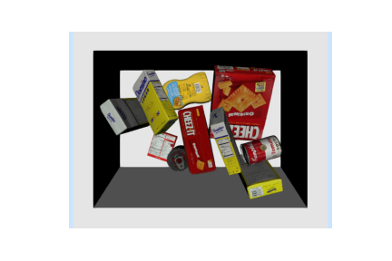

注意，箱子其实是特别容易随机生成的场景。要随机生成厨房，就不能把冰箱、烤面包机和凳子从独立同分布的随机位姿往下扔了。这时，设计合理的分布会有趣得多，见 [参考文献 2](#Izatt20)；后面还会讨论生成式场景模型。

## 5.2　摩擦接触下的静力平衡

上面的例子概念简单，物理引擎内部却做了很多工作。先从最容易理解的情况开始：所有物体落稳之后的静力学。

这里不完整展开多体动力学和仿真，相关笔记[可以在这里阅读](http://underactuated.mit.edu/multibody.html)。需要知道的是，熟悉的 $f=ma$ 用广义位置 $q$、广义速度 $v$ 表达后，会变成：

$$
M(q)\dot{v} + C(q,v)v = \tau_g(q) + \sum_i
    J^T_i(q)F^{c_i}.
$$

 我们已经理解 $q$、$v$。左侧是“质量乘加速度”的推广，包含质量矩阵 $M$ 和科里奥利项 $C$；右侧是广义力之和，$\tau_g(q)$ 表示重力，$F^{c_i}$ 是第 $i$ 处接触产生的空间力。$J_i(q)$ 是第 $i$ 个接触 雅可比矩阵，把广义速度映射为第 $i$ 个接触坐标系的空间速度。

我们想找这些微分方程稳定的稳态解，作为仿真的初始条件。稳态时 $v=\dot{v}=0$，方程左侧全部为零，只剩力平衡方程：

$$
\tau_g(q) =
    - \sum_i J^T_i(q) F^{c_i}.
$$

### 5.2.1　空间力

继续之前，先明确力的记号和空间代数。通常把力视为作用在刚体某点上的三维向量，分量为 $x$、$y$、$z$。更一般地，用六维向量表示[空间力](https://drake.mit.edu/doxygen_cxx/group__multibody__spatial__vectors.html)，采用 monogram 记法：

$$
F^{B_p}_{{\text{name}},C} = \begin{bmatrix}
      \tau^{B_p}_{\text{name},C} \\ f^{B_p}_{\text{name},C} \end{bmatrix} \quad
      \text{ or, if you prefer } \quad \left[F^{B_p}_{\text{name}}\right]_C =
      \begin{bmatrix} \left[\tau^{B_p}_{\text{name}}\right]_C \\
      \left[f^{B_p}_{\text{name}}\right]_C \end{bmatrix}.
$$

 $F^{B_p}_{\text{name},C}$ 是作用在点或坐标系原点 $B_p$、在坐标系 $C$ 下表达的具名空间力。Drake 推荐带括号的写法，但在笔记中我觉得略显冗长。力的名称可省略；表达坐标系未写明时，默认世界坐标系。特别是力的记号，建议在作用点 $B_p$ 中注明承受力的刚体 $B$，因为经常会遇到大小相等、方向相反的作用力。在代码中写作 `Fname_Bp_C`。

和空间速度一样，空间力包含旋转、平移两部分。$\tau^{B_p}_C \in \mathbb{R}^3$ 是力矩，作用于刚体 $B$ 的点 $p$，在坐标系 $C$ 下表达；$f^{B_p}_C \in \mathbb{R}^3$ 是平移力，也就是笛卡尔力。空间力也常称为 [力旋量（wrench）](https://en.wikipedia.org/wiki/Screw_theory#Wrench)。如果觉得“力还有旋转分量”有些奇怪，可以这样理解：接触点上也许只有笛卡尔力，但我们经常需要把多个作用在不同位置的力，汇总到同一坐标系中。把一个力的作用点换到刚体上另一点时，等效作用就需要同时包含力和力矩。

空间力同样满足空间代数规则：

- 作用于同一刚体、在同一坐标系下表达的空间力可以相加，例如：
  
    $$
    F^{B_p}_{\text{total},C}
              = \sum_i F^{B_p}_{i,C} .
    $$
  
  

- 把作用点从 $B_p$ 移到 $B_q$，需要使用叉积：
  
    

    $$
    f^{B_q}_C
              = f^{B_p}_C, \qquad \tau^{B_q}_C = \tau^{B_p}_C + {}^{B_q}p^{B_p}_C
              \times f^{B_p}_C.
       \tag{5.1}
    $$
  
  

- 和其他空间向量一样，可用旋转改变表达坐标系：
  
    $$
    f^{B_p}_D = {}^DR^C
              f^{B_p}_C, \qquad \tau^{B_p}_D = {}^DR^C
              \tau^{B_p}_C.
    $$
  
  

### 5.2.2　碰撞几何

有了这些记号，接下来要理解接触力从哪里来。

机器人几何引擎，例如 Drake 的 `SceneGraph`，会区分几何在仿真中的不同[角色](https://drake.mit.edu/doxygen_cxx/group__geometry__roles.html)。[机器人描述文件](http://sdformat.org/spec)通常区分[视觉](http://sdformat.org/spec?ver=1.8&elem=link)与[碰撞](http://sdformat.org/spec?ver=1.8&elem=collision)几何。每个刚体可以关联多个碰撞几何，它们承担“proximity”角色。碰撞几何通常比用于显示和感知仿真的视觉几何简单：可以是更低面数的网格，也可以直接用长方体、球、圆柱等近似。这有助于提高物理引擎的速度和稳健性。

#### 示例 5.3　查看碰撞几何

Drake 的 `ModelVisualizer` 工具能把显示几何和碰撞几何都发布到 MeshCat，参见[多体仿真建模教程](https://drake.mit.edu/tutorials/authoring_multibody_simulation.html)。它既适合设计新模型，也能帮助理解已有模型的接触几何。

前面查看各种机器人模型时，已经用过这个工具。现在再试试：在 MeshCat 控件中找到 `Scene > drake > proximity`，勾选复选框，显示 proximity 角色的几何。

**运行示例**：[在 Colab 中打开](https://colab.research.google.com/github/RussTedrake/manipulation/blob/master/book/robot/inspector.ipynb)

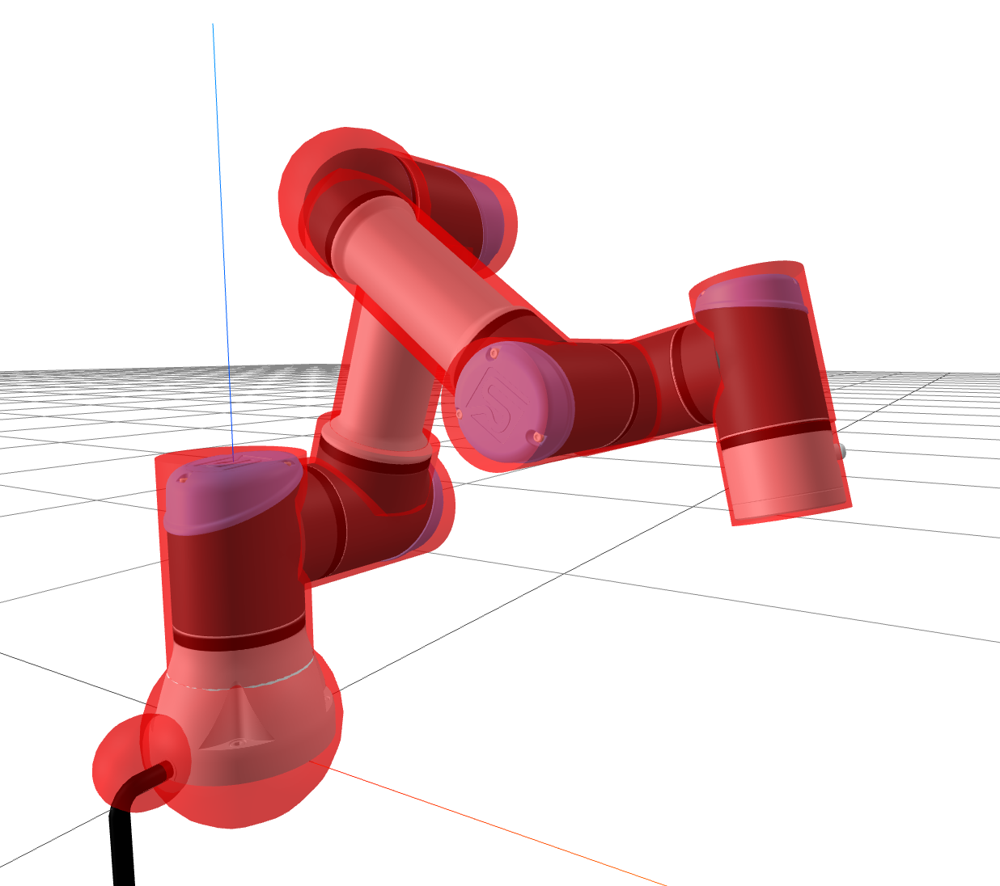

**图 5.1**：UR3e 的视觉几何与碰撞几何。

SceneGraph 还支持[碰撞过滤器](https://drake.mit.edu/doxygen_cxx/classdrake_1_1geometry_1_1_collision_filter_declaration.html)。例如，可以指定 iiwa 第 5 连杆不与第 4、6 连杆碰撞。忽略这些碰撞既加快计算，也方便简化连杆的碰撞模型。否则，要用球和圆柱精确近似第 4、5 连杆，并确保它们在所有可行关节角下都不重叠，会非常困难。默认碰撞过滤设置通常已经够用，需要时也可调整。

所以，接触力 $f^{c_i}$ 从哪里来？凡是未被过滤的碰撞几何对，都可能产生大小相等、方向相反的接触空间力。在 `SceneGraph` 中，[`GetCollisionCandidates`](https://drake.mit.edu/doxygen_cxx/classdrake_1_1geometry_1_1_scene_graph_inspector.html#a79b84ada25718e2a38fd2d13adb4d839) 方法返回所有这些接触。下面把每个碰撞对的两个刚体称为“刚体 A”和“刚体 B”。

### 5.2.3　碰撞刚体之间的接触力

理想数学模型中，两个物体不会占据同一空间，但数值积分的仿真很难完全避免穿透。多数仿真器把两个相接触或重叠物体之间的作用，近似为一个或多个接触点上的笛卡尔力。不要低估这一步的难度！

代码要正确处理大量几何情况，开源工具在这里出现错误十分常见。下面的简单界面也能说明：用单点笛卡尔力概括两个深度穿透物体的作用，非常危险。移动物体时，会遇到许多不连续变化；这也是刚体仿真有时突然“炸开”的原因。改用多个接触点看似自然，一些仿真器也这样做，但若算法只依赖当前几何位形，要让相邻时间步的接触点选择保持一致，并不容易。

Drake 擅长复杂接触仿真的一项关键改进，是摆脱了点接触模型。启用 [Drake 的 hydroelastic 接触](https://drake.mit.edu/doxygen_cxx/group__hydroelastic__user__guide.html) 后，两个穿透刚体之间的空间力，来自对“hydroelastic 表面”的积分，它推广了接触斑的概念，见 [参考文献 3](#Elandt19)。截至原文写作时，Drake 仍需手动启用 hydroelastic，见 [hydroelastic 教程](https://drake.mit.edu/tutorials/hydroelastic_contact_basics.html)；我正在逐步把本书示例都改为这种模型。

#### 示例 5.4　查看接触力

我做了一个简单界面，可以选择任意两种基本几何体，让它们相互穿透，并查看计算得到的 hydroelastic 接触信息。

**运行示例**：[在 Colab 中打开](https://colab.research.google.com/github/RussTedrake/manipulation/blob/master/book/clutter/contact_inspector.ipynb)

### 5.2.4　接触坐标系

还需要确定空间力的大小、方向，为此先指定力所使用的接触坐标系。例如，[可以用](https://drake.mit.edu/doxygen_cxx/classdrake_1_1multibody_1_1_point_pair_contact_info.html) $C_B$ 表示刚体 $B$ 上的接触坐标系，力作用在其原点。

虽然我强烈推荐仿真使用 hydroelastic，解释原理时仍先用点接触模型。碰撞引擎给出一些接触点后，该怎样定义坐标系？

约定 $z$ 轴正方向与接触法线一致，正的法向力阻止穿透。法线的定义也要谨慎，例如长方体角点的法线是什么？取两个物体之间符号距离函数的[次](https://en.wikipedia.org/wiki/Subderivative)梯度，能得到可靠、也适用于广义坐标的定义。接触坐标系的 $x$、$y$ 轴，可取切平面内任意一组正交基。更多图示和说明见 [这里](https://underactuated.csail.mit.edu/multibody.html#contact)。

#### 示例 5.5　半平面上的砖块

用泡沫砖放在地上的简单例子，逐步理清这些细节。地面焊接到世界，没有自由度，所以可以忽略作用于地面的力，只看砖块。

接触点和接触坐标系在哪里？如果只用长方体之间的碰撞几何，面与面接触时，接触力位置并不唯一；三维中更是如此，三个力就可能足够。先假设引擎选择砖块两端角点作为两个接触点。使用点接触模型时，我们有时会[在长方体八个角上添加小球碰撞几何](https://manipulation.mit.edu/data/foam_brick_contact_geometry.html)，帮助引擎稳定选择接触点；hydroelastic 不需要这么做。下图把两个接触坐标系标为 $C_1$、$C_2$。

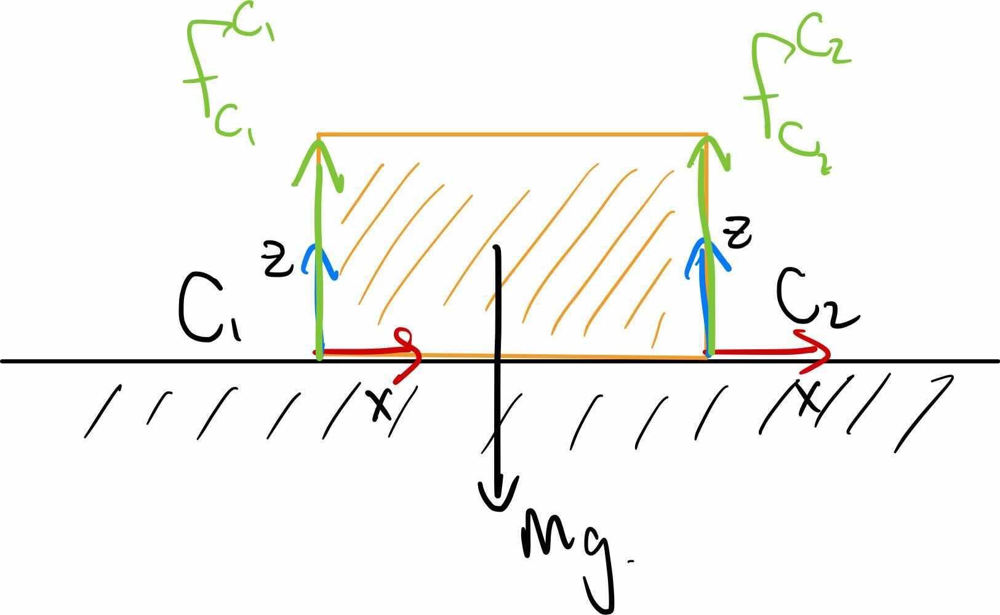

静力平衡要求砖块上的力与力矩都平衡。这里考虑三个力：$F_{g}, F_1,$、$F_2$，分别用重力、接触 1、接触 2 的缩写命名。重力自然应在世界坐标系下表达，作用于质心：

$$
F_{g, W}^B = \begin{bmatrix} 0, 0, 0, 0, 0, -mg
      \end{bmatrix}^T.
$$

。接触力则适合在接触坐标系下表达，例如 

$$
f_{1, C_1,z}^{B_{c_1}} \ge
      0,
$$

，因为接触力不能把地面往上拉。写平衡方程时，要用空间代数，把各空间力变换到同一表达坐标系、同一作用点。

例如，先改变接触力 1 的表达坐标系：

$$
F_{1,B}^{B_{c_1}} = {}^B R^{C_1}
      F_{1,C_{1}}^{B_{c_1}}.
$$

，再移动作用点：

$$
f_{1,B}^B = f_{1,B}^{B_{c_1}}, \qquad \tau_{1,B}^B =
      \tau_{1,B}^{B_{C_1}} + {}^Bp_B^{B_{C_1}} \times f_{1,B}^{B_{c_1}}.
$$

。现在可以写力平衡：

$$
F_{1,B}^B + F_{2,B}^B + F_{g,B}^B
      = 0,
$$

 三维有六个方程，二维只有三个。平移分量给出 

$$
f_{1,B}^B + f_{2,B}^B =
      \begin{bmatrix}0 \\ 0 \\ mg\end{bmatrix},
$$

；而 $y$ 中的力矩分量说明：若质心到两接触点的距离相等，则 $f_{1,B_z}$、$f_{2,B_z}$ 也必须相等。

水平力目前只知道要彼此平衡，接下来进一步分析。

### 5.2.5　库仑摩擦锥

接触力的规则逐渐清楚了。首先不能隔空施力，用 $\phi_i(q)$ 表示位形 $q$ 下两个物体之间的距离，有 

$$
\phi(q) > 0 \Rightarrow f^{c_i} = 0.
$$

。其次，法向力只能阻止穿透，不能把物体拉到一起：

$$
f^{c_i}_{C_z} \ge 0.
$$

。刚性接触模型求满足非穿透约束的最小法向力，称为最小约束原理；柔性接触模型则将力定义为穿透深度和速度的函数。

 

切向力来自摩擦。最常用的是库仑摩擦模型：

$$
\sqrt{{f^{c_i}_{C_x}}^2 + {f^{c_i}_{C_y}}^2} \le \mu f^{c_i}_{C_z},
$$

，其中 $\mu$ 为非负摩擦系数。通常分别定义静摩擦系数 $\mu_{static}$，用于切向速度为零的情况，以及动摩擦系数 $\mu_{dynamic}$，用于切向速度非零的情况。库仑模型选择摩擦锥内使能量耗散最大的切向接触力。

这些约束共同定义了允许接触力的一个[锥](https://en.wikipedia.org/wiki/Convex_cone)，也就是著名的“摩擦锥”，后面会经常用到。

把力写成一个集合似乎有点奇怪：现实最终只会施加一个力，怎么会施加整组力？摩擦锥描述的是可能的范围。库仑模型中，实际选取的力会在接触 x–y 平面内阻止相对运动；若锥内没有任何力能完全阻止，就发生滑动，此时取耗散最大的力。圆锥形摩擦锥中，它与滑动速度方向相反。虽然实际只选一个力，分析整个集合仍有意义，因为它告诉我们摩擦能完全抵抗哪些外力。例如，如果锥内存在恰好抵消重力的力，砖块就能保持不动。

#### 示例 5.6　倾斜半平面上的砖块

把前面的桌面倾斜，水平力就重要了。先不看方程，凭直觉想想：两端角点的接触力大小还一样吗？还是低处的角点更大？

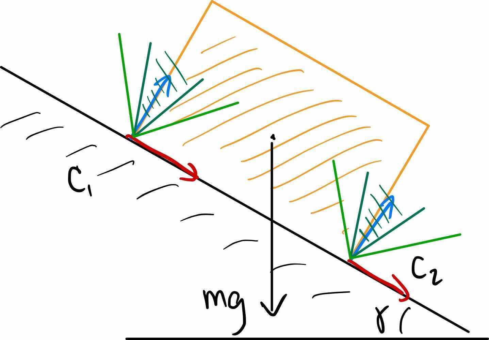

图中接触坐标系已经旋转，$z$ 轴仍与接触法线对齐。深、浅绿色表示两种摩擦系数对应的摩擦锥。较小的 $\mu$，即深绿色锥，不包含竖直方向，因此无法完全抵消重力；砖块会滑动，这个位形不存在静力平衡。

把静摩擦系数提高到浅绿色锥的范围，就能找到平衡接触力。本题要存在平衡，确实需要一定摩擦，详见[练习](https://manipulation.mit.edu/#static_equilibrium)。此外，质心沿竖直方向投影到斜面上的点，必须位于两个接触点之间，否则砖块会绕下方边缘翻倒。这也能从力、力矩平衡看出来。假设质心在砖块中心，长度 $l$、高度 $h$，将力的作用点和表达坐标系都选为刚体坐标系 B：

$$
\begin{gathered} f^{B}_{1, B_x} + f^{B}_{2, B_x} =
      -mg\sin\gamma \\ f^{B}_{1,B_z}  + f^{B}_{2,B_z} = mg\cos\gamma \\ -h
      f^{B}_{1,B_x} + l f^{B}_{1,B_z} = h f^{B}_{2,B_x} + l f^{B}_{2, B_z} \\
      f^{B}_{1, B_z} \ge 0, \quad f^{B}_{2, B_z} \ge 0 \\ |f^{B}_{1, B_x}| \le
      \mu f^{B}_{1, B_z}, \quad |f^{B}_{2, B_x}| \le \mu f^{B}_{2, B_z}
      \end{gathered}
$$

所以两接触力究竟是否相等？把第一个方程代入第三个，得到：

$$
f^{B}_{2, B_z}
      = f^{B}_{1, B_z} + \frac{mgh}{l}\sin\gamma.
$$

### 5.2.6　把静力平衡写成优化问题

除了让物体随机下落，也许可以用优化直接求已达静力平衡的初始条件。Drake 的 [`StaticEquilbriumProblem`](https://drake.mit.edu/doxygen_cxx/classdrake_1_1multibody_1_1_static_equilibrium_problem.html) 把上面的约束收集为：

$$
\begin{aligned} \operatorname{find}_q \quad \text{subject to} \quad& \tau_g(q) = - \sum_i
    J^T_i(q) f^{c_i} & \\ & f^{c_i}_{C_z} \ge 0 & \forall i, \\ &
    |f^{c_i}_{C_{x,y}}|_2 \le \mu f^{c_i}_{C_z} & \forall i, \\ & \phi_i(q)
    \ge 0 & \forall i, \\ & \phi(q) = 0 \textbf{ or } f^{c_i}_{C_z} = 0
    &\forall i, \\ & \text{joint limits}.\end{aligned}
$$

 这是非线性优化，包含上一章讨论的非凸非穿透约束。倒数第二个“或”约束尤其有趣：$x \ge 0, y \ge 0, x =0 \textbf{ or } y = 0$ 这类约束称为互补约束，常写成 $x \ge 0, y \ge 0,
    xy = 0$。将等式松弛为 $0 \le \phi(q) f^{c_i}_{C_z} \le
    \text{tol}$，能给优化器提供可用的梯度，使求解更容易，代价是允许少量隔空作用力。

还可以方便地加入其他代价和约束。例如初始化时，可让目标函数鼓励 $q$ 靠近最初在构型空间采样的位形。

#### 示例 5.7　高高的砖塔

这个方法效果如何呢？

 

## 5.3　接触仿真

静力平衡展示了接触仿真的一些难点。当机器人或场景中的物体开始运动，问题就更有意思了！

（原文此节后续内容尚待补充。）

## 5.4　基于模型的抓取选择

什么是好的抓取？机器人领域已经研究了几十年，早期重点是让可能具有灵巧操作能力的手与已知物体交互。[参考文献 4](#Prattichizzo08) 是一篇很好的综述，这里只介绍几个关键思路。

如果抓取的目标是让物体在手中保持稳定，那么一种“好抓取”的定义，就是能够抵抗施加在物体上的“对抗性”力旋量扰动。

### 5.4.1　接触力旋量锥

前面用摩擦锥描述摩擦为抵抗运动能产生的力。用于抓取规划时，将锥内各力取反，就得到接触点能抵抗的全部“对抗性”力。要了解多个接触点共同抵抗物体运动的能力，还需把它们的作用加起来。好在空间力的代数规则，不仅适用于单个向量，也能推广到整个空间力集合。

这里的集合是凸锥，采用常见的 $\mathcal{K}$ 表示六维力旋量锥。具体地，$\mathcal{K}^{B_p}_{\text{name}, C}$ 是 $F^{B_p}_{\text{name}, C}$ 对应的可能空间力锥。例如，点接触模型的库仑摩擦锥，不包含扭转摩擦，在接触坐标系中为：

$$
\mathcal{K}^C_C = \left\{ \begin{bmatrix} 0 \\ 0 \\ 0 \\
      f^{C}_{C_x} \\ f^C_{C_y} \\ f^C_{C_z} \end{bmatrix} : \sqrt{
      \left(f^{C}_{C_x}\right)^2 + \left(f^{C}_{C_y}\right)^2 } \le \mu
      f^C_{C_z} \right\}.
$$

空间力的代数规则可直接用于力旋量锥：

- 同一点作用、同一坐标系表达的力旋量锥相加，应得到这样一个集合：从每个锥各选一个元素，将它们相加，收集所有可能结果。这个集合运算称为[Minkowski 和](https://en.wikipedia.org/wiki/Minkowski_addition)，记作 $\oplus$，例如：
  
    $$
    \mathcal{K}^{B_p}_{\text{total},C}=
                \mathcal{K}^{B_p}_{0,C} \oplus \mathcal{K}^{B_p}_{1,C} \oplus
                \cdots
    $$
  
  

- 将力旋量锥的作用坐标系从 $B_p$ 移到 $B_q$，是对锥的线性运算。为强调这一点，把 [式 5.1](#equation-eq-spatial_force_shift) 写成矩阵形式：
  
    $$
    \mathcal{K}^{B_q}_C = \begin{bmatrix}
                I_{3 \times 3} & \left[ {}^{B_q}p^{B_p}_C \right]_\times \\ 0_{3
                \times 3} & I_{3 \times 3} \end{bmatrix}
                \mathcal{K}^{B_p}_C,
    $$
  
    ，其中 $[p]_{\times}$ 是叉积对应的反对称矩阵。

- 可以用旋转改变表达坐标系：
  
    $$
    \mathcal{K}^{B_p}_D = \begin{bmatrix} {}^DR^C
                & 0_{3 \times 3} \\ 0_{3 \times 3} & {}^DR^C \end{bmatrix}
                \mathcal{K}^{B_p}_C.
    $$
  
  

#### 示例 5.8　接触力旋量锥的可视化

我做了一个简单交互演示，帮助理解力旋量锥。空间中固定一个箱子，只考虑接触力，不画重力，并在接触点和刚体中心分别显示摩擦锥。为方便解释，本例特意关闭 hydroelastic，每个碰撞对只用一个接触点计算作用力。

有一个重要限制：力旋量锥位于 $\mathbb{R}^6$，但只能画 $\mathbb{R}^3$ 中的锥。因此采用常见做法，将六维锥投影为两个三维锥：平移部分在接触点用绿色、在刚体坐标系用红色；旋转部分在刚体坐标系用蓝色。这样可能有些误导，因为不能从两个投影集合中各自独立选取元素。

**运行示例**：[在 Colab 中打开](https://colab.research.google.com/github/RussTedrake/manipulation/blob/master/book/clutter/contact_wrench.ipynb)

下面是单个接触点的力旋量锥，展示两种接触位置：

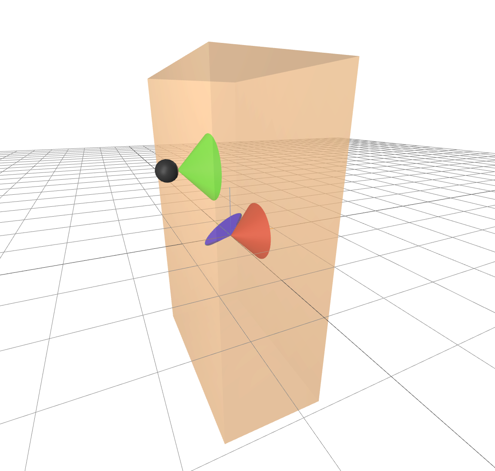

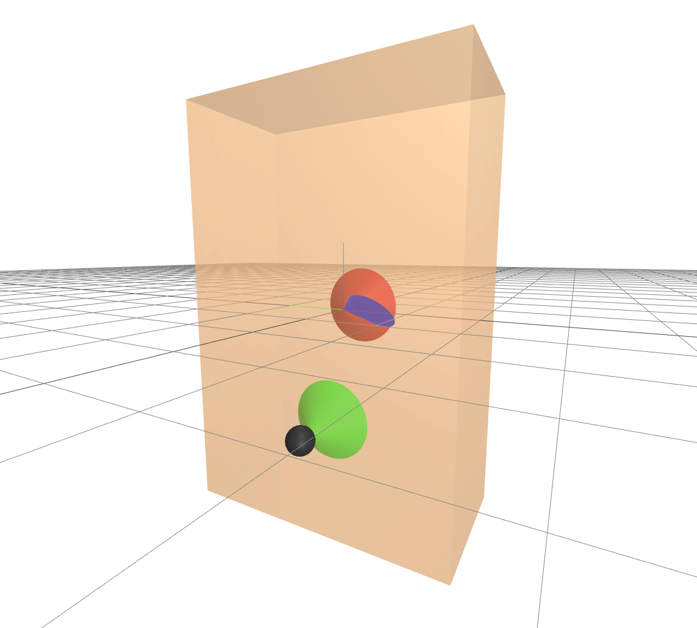

应该马上能看出，旋转部分是低维的：叉积使其中所有向量都垂直于 ${}^Bp^C$。最好亲自运行 notebook，观察三维交互图。

下面是两个正对着的接触点的力旋量锥：

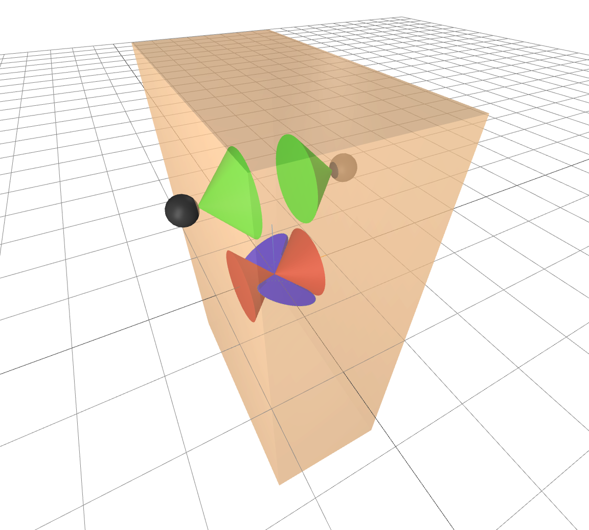

虽然每个旋转锥都是低维的，它们张成的空间却不同。通过 Minkowski 和共同作用，看起来似乎能抵抗施加在刚体坐标系处的所有纯力矩。这个直觉有一定道理，但此处六维锥投影成两个三维锥的误导就显现了：仍有一些力旋量无法抵抗。若把锥画在两个接触点的中点，就会看到它不包含沿两点连线施加的力矩。没有扭转摩擦时，仅靠这两个接触点，无法抵抗绕该轴的力矩。

实际仿真中的夹爪使用 hydroelastic，能模拟接触斑和扭转摩擦，因此可以抵抗这条轴上的力矩。具体能抵抗多大，与夹爪挤压物体的力度成正比。

把各接触力旋量锥变换到共同坐标系，再相加，就得到所有接触能够共同施加的力旋量集合，即接触力旋量锥。经典抓取评价认为，锥越大，能抵抗的扰动力旋量越多，抓取越好。如果锥覆盖整个 $\mathbb{R}^6$，就称这些接触实现了力封闭（force closure），见 [参考文献 4](#Prattichizzo08)。

力旋量锥的空间代数是线性的，因此也很适合纳入优化，例见 [参考文献 5](#Dai16)。

### 5.4.2　共线对跖抓取

上述分析自然导向基于模型的抓取规划：优化接触位置，使力旋量锥尽量大。不过，本章希望尽可能少地假定物体信息，暂不在物体模型表面搜索最优抓取点。即便如此，模型分析仍为未知物体提供了很好的启发式。

对于双指夹爪，一个扩大接触力旋量锥的好办法，是寻找共线的“对跖”抓取点。对跖指两处接触法线，即接触坐标系的 $z$ 轴，方向正好相反；共线则要求它们与两接触点之间的连线重合。前面的双指可视化表明，这是一个相当有效的启发式。下面会看到，即使几乎不了解物体，也能使用它。

## 5.5　从点云选择抓取

与其先识别箱中物体、估计位姿，不如直接在未分割的点云上寻找可抓取区域。这类几何方法实际效果可以很好，还能在仿真中用来训练深度学习抓取系统，使其用于真实世界，甚至处理不完整视野和遮挡，见 [参考文献 6](#tenPas17)、[参考文献 7](#Mahler17)、[参考文献 8](#Zeng18)。

### 5.5.1　点云预处理

为了看清箱内情况，需要多台 RGB-D 相机，本章示例每个箱子用三台。相机也会看到箱子、其他相机和工作空间中的杂物，因此要将多路点云合成一个只包含感兴趣区域的点云。

首先裁剪点云，删除感兴趣区域外的点。这里把区域定义为已知箱子位置正上方、与坐标轴对齐的包围盒。

后面许多抓取策略需要点云“法线”，即估计底层表面法向的单位向量。最好先在各台相机的点云上估计法线，利用相机位置判断方向，再合并点云。

真实环境中，合并点云需要准确的相机标定，还要处理不干净的深度回波。上一章的方法都相关，因为合并也是点云配准。仿真中若深度完美、相机位置已知，就可以省掉配准，直接拼接各点云。

最后，原始点云通常比抓取规划所需密得多。常见下采样方法是使用[体素](https://en.wikipedia.org/wiki/Voxel)网格，即三维规则立方体，每个体素只保留一个代表点，参见 [Open3D 的体素化说明](http://www.open3d.org/docs/latest/tutorial/Advanced/voxelization.html)。点云通常只占三维空间中很少的体素，所以采用稀疏数据结构。对有噪声的点云，体素化也能起到滤波作用。

#### 示例 5.9　芥末酱瓶的点云

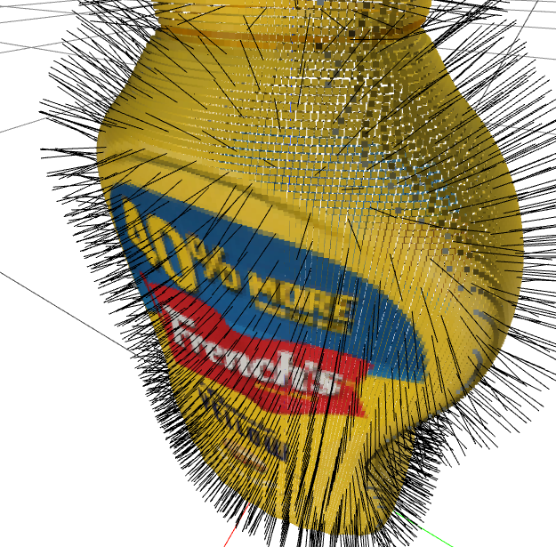

**运行示例**：[在 Colab 中打开](https://colab.research.google.com/github/RussTedrake/manipulation/blob/master/book/clutter/point_cloud_processing.ipynb)

场景中三台相机对着 YCB 芥末酱瓶。先取各路点云，`DepthImageToPointCloud` 已将它们转换到世界坐标系，再裁剪掉其他相机的几何，估计法线，合并，最后下采样。顺序很重要！

所有点云都已发送到 MeshCat，不过其中不少默认隐藏。用下拉菜单逐一开关，确认理解每一步的作用。如果不想运行代码，也可以直接查看[MeshCat 输出](https://manipulation.mit.edu/data/mustard_bottle_point_clouds.html)。

### 5.5.2　估计法线与局部曲率

下面的抓取策略依赖场景的局部几何，包括法线方向和曲率。从点云估计这些量，是很好的点云处理练习，也代表了许多类似算法。

考虑对一组点做最小二乘平面拟合，见 [参考文献 9](#Shakarji98)。三维平面可以用位置 $p$ 和单位法向量 $n$ 描述。点 $p^i$ 到平面的距离为内积绝对值 $\left| (p^i - p)^T n \right|.$，所以优化问题为：

$$
\min_{p, n} \quad \sum_{i=1}^N
      \left| (p^i - p)^T n \right|^2, \quad \text{subject to} \quad |n| = 1.
$$

 对拉格朗日函数关于 $p$ 求梯度并令其为零，得到 

$$
p^* = \frac{1}{N} \sum_{i=1}^N p^i.
$$

。代回目标，可写成 

$$
\min_n n^T W
      n, \quad \text{subject to} \quad |n|=1, \quad \text{where } W = \left[ \sum_i  (p^i
      - p^*) (p^i - p^*)^T \right].
$$

。几何上，目标是以原点为中心的二次曲面，约束为单位球面；最优解就是数据矩阵 $W$ 最小特征值对应的单位特征向量。若 $n$ 最优，反向法线 $-n$ 也同样最优。先任选一个，再在后处理时翻转，保证法线朝向相机原点。

更有意思的是，第二、第三个特征值和特征向量也提供局部几何信息。$W$ 对称，特征向量相互正交，构成点云局部基。最小特征值对应法线；最大特征值对应曲率最小的方向，因为沿该方向的内积平方最大。这对抓取规划很有用；[参考文献 6](#tenPas17) 及更早的一些工作，就把它作为生成候选抓取的主要启发式。

估计点云表面的局部曲率时，可以用快速最近邻查询找到附近若干点，再拟合平面。直接处理深度图时，人们常跳过最近邻查询，用像素相邻近似点云相邻。对每个点重复这个过程即可。

刚开始经常处理点云时，我以为，对稠密点云的每个点都做这种计算，肯定无法用于在线感知。结果我错了！多年前，它就已经常用于实时感知回路。与如今大规模神经网络消耗的 [浮点运算次数（FLOPs）](https://en.wikipedia.org/wiki/FLOPS) 相比，这些运算更是不算什么。

#### 示例 5.10　芥末酱瓶的法线与局部曲率

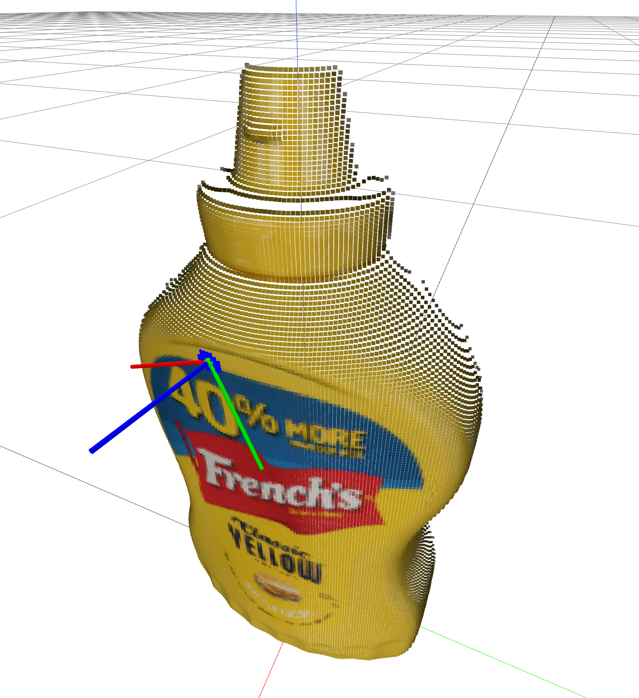

**运行示例**：[在 Colab 中打开](https://colab.research.google.com/github/RussTedrake/manipulation/blob/master/book/clutter/normal_estimation.ipynb)

我实现了基本的最小二乘表面估计：绿色是查询点，蓝色是近邻，局部拟合结果用 RGB$\Leftrightarrow$XYZ 坐标系表示。拖动查询点，看看各轴如何与法线和局部曲率方向对应。

想进一步读这类算法，我没有特别理想的参考。不过，Radu Rusu 是 PCL 的主要作者，见 [参考文献 10](#Rusu11)，他的博士论文很好地整理了 2010 年前后的点云算法，见 [参考文献 11](#Rusu10)。

### 5.5.3　评价一个候选抓取

点云处理完，就可以规划抓取了。分两步：先定义评价候选抓取的代价函数，再讨论如何找低代价候选。

按照前面的模型分析，抓起物体，或夹爪闭合时碰巧夹住的东西，至少需要接触力抵抗其重力旋量。夹爪沿自身 $x$ 轴闭合，但要避免物体滑落，接触摩擦锥内还必须存在抵抗重力的力。我们不知道物体重力旋量，也受手指形状限制，因此一个合理策略是在点云表面找共线对跖点，并与夹爪 $x$ 轴对齐。真实点云很难有完美对跖点，但找法线近乎相反的区域，就是不错的抓取策略。

#### 示例 5.11　为候选抓取打分

橡胶指尖和物体都会变形，实际接触更接近接触斑，而非单点。因此，寻找法线方向合适的点片更合理。具体写法很多；这里先将场景点云变换到候选夹爪坐标系，仅保留指尖之间包围盒内的点，在 MeshCat 中标为红色。代价第一项，根据各点法线与夹爪 $x$ 轴的对齐程度给奖励：

$$
\text{cost} = -\sum_i (n^i_{G_x})^2,
$$

，其中 $n^i_{G_x}$ 是裁剪后第 $i$ 个点的法线在夹爪坐标系下的 $x$ 分量。

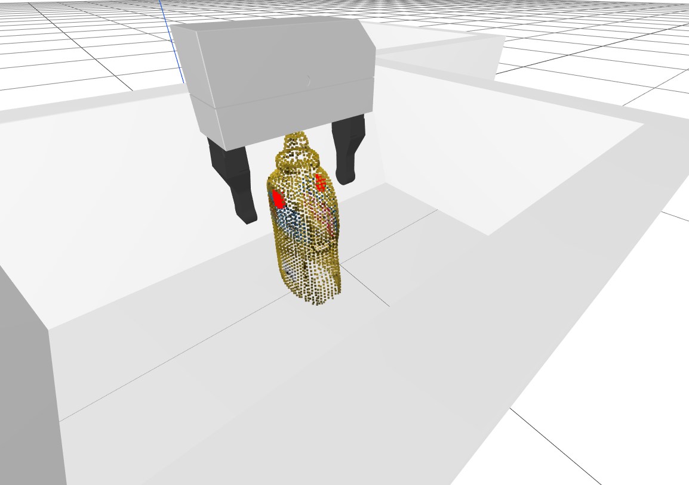

好抓取还要考虑其他因素。机械臂运动学有限，伸入箱子时，可能更喜欢某些有利的夹爪朝向。因此，代码还惩罚夹爪偏离竖直方向：奖励世界 $-z$ 方向向量 $[0, 0, -1]$ 与夹爪 $y$ 轴变换到世界后的点积：

$$
\text{cost} \mathrel{{+}{=}} -\alpha
        \begin{bmatrix} 0 & 0 &-1\end{bmatrix}R^G \begin{bmatrix}0 \\ 1 \\
        0\end{bmatrix} = \alpha R^G_{3,2},
$$

。其中 $\alpha$ 是相对权重，$R^G_{3,2}$ 是旋转矩阵第三行第二列元素。

最后检查夹爪是否与箱子或点云碰撞，碰撞时直接返回无穷大代价。notebook 实现了这些项，并提供滑块，便于移动夹爪、观察代价变化。

**运行示例**：[在 Colab 中打开](https://colab.research.google.com/github/RussTedrake/manipulation/blob/master/book/clutter/grasp_selection.ipynb)

### 5.5.4　生成候选抓取

已有代价函数，输入场景点云、环境模型，例如箱子位置，就能评价候选位姿 $X^G$。现在希望求：在满足碰撞约束时，使代价最小的 $X^G$。

可惜，目标和约束都高度非凸，优化很难。更麻烦的是，大多数 $X^G$ 下对跖项为零，因为随机 $X^G$ 往往根本没把任何点放到两指之间。所以文献通常不用常规数学规划求解器，而采用随机采样，并利用启发式产生合理样本。

例如 [参考文献 6](#tenPas17) 利用局部曲率提出候选，使点云法线指向掌心、手指沿最大曲率方向。沿法线移动夹爪，直到手指不再碰撞，还可对附近位置采样。我们准备了[一道练习](https://manipulation.mit.edu/#gpg)帮助探索。不过，对 YCB 物体，这未必最好：许多物体是盒子，局部曲率提供不了多少信息。

另一个办法是先找对跖点对，再采样与之对齐的夹爪位姿。许多三维库支持对体素点云做射线投射，因此可随机选点，沿其法线反方向向点云内部发射射线。如果命中体素的法线足够对跖，且距离小于夹爪宽度，就得到了合理点对。

#### 示例 5.12　生成候选抓取

示例采用比射线投射更简单的方法：随机选一个点，以竖直朝向为起点采样夹爪方向，使夹爪 $x$ 轴与该点法线对齐。然后主要依靠评分中的对跖项来筛出好抓取。

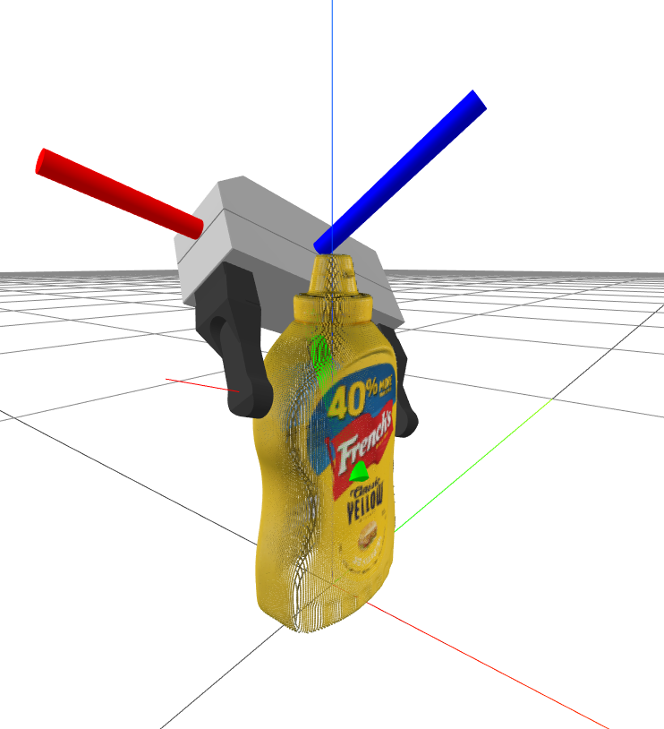

还有一个调整：找到指尖之间的点后，沿夹爪 $x$ 轴向外移动手，使这些点在夹爪坐标系中居中。这样能减少闭合时把物体碰倒的情况。

就这些！采样少量候选，画出代价最低的几个。多运行几次，会发现效果其实不错。每次运行都会重新仿真物体下落；真正的抓取评价很快。

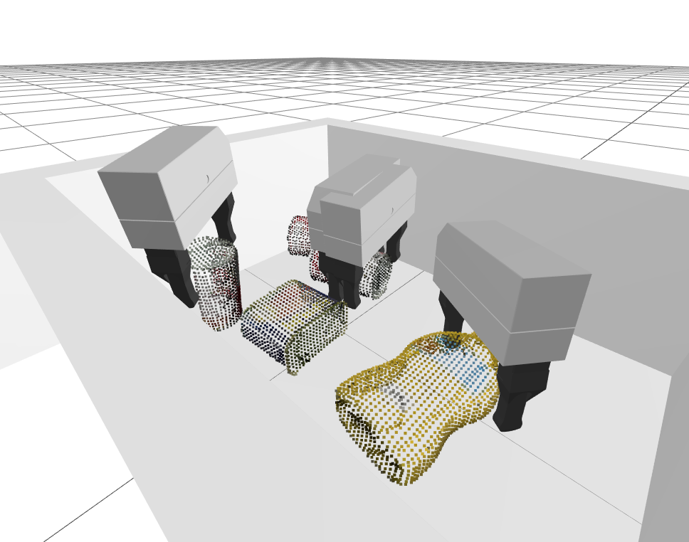

**运行示例**：[在 Colab 中打开](https://colab.research.google.com/github/RussTedrake/manipulation/blob/master/book/clutter/grasp_selection.ipynb)

## 5.6　容易出问题的情况

试试前面的评分，会发现一些不足。有些可以通过增加代价项，用启发式轻松改善，例如加入预抓取位姿的碰撞检查。

还有些场景光靠抓取解决不了。物体紧挨箱角时，夹爪可能无法绕到两侧而不碰到物体或箱壁。上述策略始终将采样法线与夹爪 $x$ 对齐，因此不会尝试只夹盒子角点；是否应该这样夹也不明确，尤其我们的夹爪比较大。在 TRI，我们加了简单的推移策略：如果水槽里还有点云，却找不到可行抓取，就把手伸下去，将对应区域推向箱子中央。这常常很有效！

一些缺点很难靠纯几何补救，根源在于系统没有“物体”的概念。例如，两个物体靠近时，常一次抓起两个。对较重物体，靠近质心抓取更有利于在摩擦锥内抵抗重力；但这里的策略可能只夹住重锤柄的最末端。

我不认为问题一定是点云信息不足，即使没有颜色。给你看同样的点云，你多半不会犯这些错误。此时学习抓取评价函数就可能有用。不需要通用人工智能，仅仅记住以前在哪里抓失败过，就足以明显改善启发式。

## 5.7　任务层编程

我们大多习惯[过程式编程](https://hackr.io/blog/procedural-programming)：程序顺序执行，调用函数，经过 if 分支和 for、while 循环。高层机器人程序也很容易写成“只要第一个箱子里还有物体，就抓起并搬到第二个箱子……”这样当然没错。但作为机器人框架的一部分，高层程序必须在运行时与其他模块通信，包括以 100 Hz 甚至 1 kHz 运行的低层控制器。怎样编写任务层行为，让它与高速控制顺畅结合？

大体可以分为三类：

- 在独立线程中运行过程式代码，通过消息、事件与机器人或仿真主线程中的模块通信。ROS 这样的多进程消息传递体系常采用这种方式。

- 直接写任务策略，例如有限状态机（FSM）或行为树，在机器人、仿真循环中逐次执行。

- 任务规划器根据规则，将任务行为串联起来，实现长期目标：
  
  - 最简单时，规划器输出一个计划，由主循环执行，就像前面执行夹爪轨迹一样。
  
  - 如果能在线运行，持续根据新传感器信息调整、重新规划，就可直接放进主循环。
  
  - 还有一些规划器能把计划“编译”为策略，例如 FSM。[这里是一个经典例子](https://en.wikipedia.org/wiki/Linear_temporal_logic_to_B%C3%BCchi_automaton)。
  
  
  
  

 各有适用场景，研究者也各有所好。Rod Brooks 在《Elephants Don't Play Chess》等文章中反对任务层规划，见 [参考文献 12](#Brooks90)、[参考文献 13](#Brooks91)、[参考文献 14](#Brooks91a)，让我印象很深。他的包容架构明显属于任务策略，可看作行为树的先驱，并通过早期 Roomba 吸尘机器人证明了实用性。规划研究者则会说：复杂任务不可能让人手写覆盖所有情况的策略，真正能扩展的是规划。他们也用信念空间规划、任务与运动联合规划等方法，回应了符号落地和模型需求方面的早期批评；后面会继续讨论。

### 5.7.1　状态机与行为树

### 5.7.2　任务规划

任务规划主要基于搜索，人工智能中这条路线历史很长。STRIPS，见 [参考文献 15](#Fikes71)，是最早、最著名的表示和算法之一，用初始状态、目标状态，以及带前置条件和效果的动作描述问题。时序逻辑，如 LTL、MTL、STL，可以表达随时间变化的复杂目标与约束，例如“事件 B 后最终必须发生 A”。规划领域定义语言（PDDL），见 [参考文献 16](#Aeronautiques98)、[参考文献 17](#Haslum19)，扩展了 STRIPS，加入变量类型、条件效果、量词乃至时序逻辑，并成为长期、影响广泛的[ICAPS 规划竞赛](https://www.icaps-conference.org/competitions/)所用的描述语言。这些比赛催生了 GraphPlan [参考文献 18](#Blum97)、HSP [参考文献 19](#Bonet01)、Fast-Forward [参考文献 20](#Hoffmann01)、FastDownward [参考文献 21](#Helmert06) 等高效算法，展示了启发式搜索的力量，并充分利用描述的对象结构进行因子分解，构造强有力的启发式。

### 5.7.3　大语言模型

2022 年末，随着大语言模型（LLM）兴起，任务“规划”出现了新路线。很快人们就发现，GPT-4 等强模型仅凭简短自然语言描述，就能生成相当复杂的计划。通过精心设计提示词，可以让模型选择机器人确实能执行的动作；它们尤其擅长写 Python。借助 Python，甚至可以让模型[生成策略](https://code-as-policies.github.io/)，而不只是计划，见 [参考文献 22](#Liang23)。截至原文写作时，将相机、传感器观察到的环境自动转为自然语言提示仍是挑战，不过似乎只是时间问题。据说逐步发布的 [GPT-4V(ision)](https://openai.com/research/gpt-4v-system-card) 在这方面表现很好。

大家大致认同，语言模型让简单规划变得异常容易。传统搜索规划器可能钻描述中遗漏要求、约束的空子，LLM 却能用“常识”补上空白，给出合理计划。当前模型在需要多步推理的长期任务上仍有限制，但巧妙的提示设计已经能带来令人印象深刻的结果，见 [参考文献 23](#Yao23)。

### 5.7.4　清理杂物的简单状态机

对于当前系统框架中的清理任务，第二种方式就很合适：用简单状态机直接编写任务层策略。

#### 示例 5.13　清理杂物的简单状态机

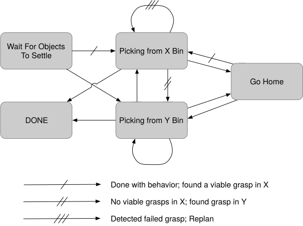

## 5.8　把各部分连接起来

先把抓取选择算法封装为一个系统：读取三台相机的点云，完成包括法线估计在内的预处理，再随机采样，将选中的抓取位姿放到输出端口。

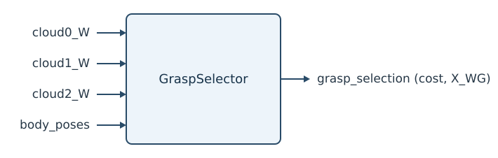

这个系统会实例化两次，分别处理位于 X 轴正方向和 y 轴负方向的箱子。由于 Drake 系统框架采用拉取式架构，只有下游求输出端口值时，才会执行这项相对昂贵的采样。

本例的核心是 `Planner` 系统：实现基本状态机，调用规划函数，把计划存入 `Context`，再在输出端口计算当前计划值。

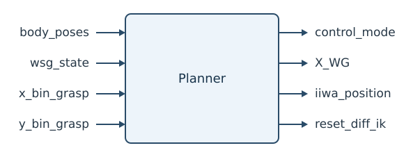

系统需要足够的输入、输出端口，将相关信息送入规划器，并向下游控制器发送指令。

### 示例 5.14　清理杂物：完整演示

**运行示例**：[在 Colab 中打开](https://colab.research.google.com/github/RussTedrake/manipulation/blob/master/book/clutter/clutter_clearing.ipynb)

## 5.9　练习

### 练习 5.1　判断静力平衡

本题采用库仑摩擦模型，满足 $|f_t|
        \le \mu f_n$。也就是说，在所需摩擦力不超过 $\mu f_n$ 时，它足以阻止运动；超过后则有 $|f_t| = \mu f_n$。

1. 质量 $m$ 的箱子位于倾角 $\theta$ 的斜面上，接触摩擦系数为 $\mu$：
   
   
    
   
   
   
   
    。给定倾角 $\theta$，箱子不下滑所需的最小摩擦系数是多少？重力加速度记为 $g$。

考虑平地上的三个均匀实心球，半径 $r$、质量 $m$，球之间、球与地面的摩擦系数均为 $\mu$。对下面各个位形，是否存在某些 $\mu\in[0,1]$、$m > 0$、$r > 0$，使球处于静力平衡？解释原因。所有刚体都必须同时满足力和力矩平衡。

我们提供 [对应 notebook](https://colab.research.google.com/github/RussTedrake/manipulation/blob/master/book/clutter/exercises/static_equilibrium.ipynb)，便于建立直觉、检查答案。它允许设置球的位形，再用 [StaticEquilibriumProblem](https://drake.mit.edu/doxygen_cxx/classdrake_1_1multibody_1_1_static_equilibrium_problem.html) 求静力平衡。可以借助它观察，但每个答案都需要物理解释，例如画各球的受力图，写出力与力矩能否相加为零的方程。这基本就是 StaticEquilibriumProblem 所检查的内容。

1. 球竖直叠放：
   
   
    
   
   
   
   
   

2. 一个球放在另一个球上，但有偏移：
   
   
    
   
   
   
   
   

3. 球堆成金字塔：
   
   
    
   
   
   
   
   

4. 球堆成金字塔，但下方两球相距 $d$：
   
   
    
   
   
   
   
   

最后，再回答有关这个类的概念问题：

1. 为什么系统的初始猜测会影响结果？提示：这是哪一类优化问题？

2. 查看 Drake 的 [StaticEquilibriumProblem](https://drake.mit.edu/doxygen_cxx/classdrake_1_1multibody_1_1_static_equilibrium_problem.html) 文档，其中列出了求平衡时使用的约束。受力图能帮助回答其中哪两项？

### 练习 5.2　从深度图估计法线

本题考察另一种法线估计方法：利用深度图已有的空间结构，避免最近邻计算。所有工作都在 [对应 notebook](https://colab.research.google.com/github/RussTedrake/manipulation/blob/master/book/clutter/exercises/normal_estimation_depth.ipynb) 中完成，具体包括：

1. 从数学上分析，如何利用深度图中相邻点构造的数据矩阵，计算表面法线。

2. 实现直接从深度图估计法线的方法，不计算最近邻。

3. 分析在哪些场景下，这种方法的效果不如最近邻方法。

### 练习 5.3　解析求解对跖抓取

前面用采样寻找对跖抓取。如果知道物体表面的方程，能否解析求解？本题将用符号微分和 MathematicalProgram，分析并实现一种在构造时就保证正确的对跖点搜索方法。所有工作都在 [对应 notebook](https://colab.research.google.com/github/RussTedrake/manipulation/blob/master/book/clutter/exercises/analytic_antipodal_grasps.ipynb) 中完成，具体包括：

1. 证明对跖点是定义在该形状上的某个能量函数的驻点。

2. 证明反过来不成立。

3. 用 MathematicalProgram 实现对跖点搜索。

4. 分析能量函数的 Hessian，以及它与对跖抓取类型的关系。

### 练习 5.4　生成候选抓取

本章 notebook 用对跖启发式生成候选。本题改为考察局部曲率方法，类似 [参考文献 6](#tenPas17) 中的方案。题目以编程为主，全部在 [对应 notebook](https://colab.research.google.com/github/RussTedrake/manipulation/blob/master/book/clutter/exercises/grasp_candidate.ipynb) 中完成。

### 练习 5.5　行为树

先回顾行为树术语。行为树以模块化、可响应环境变化的方式切换任务。它是一棵有根有向树，内部节点管理控制流，叶节点执行动作或检查条件。例如，“抓球”是动作，可以成功或失败；“手是否为空？”是条件，为真则成功，为假则失败。每个节点会被定期触发，再触发子节点，并根据子节点状态返回成功、失败或运行中。

这里只考虑两种控制流节点。**顺序节点**（$\rightarrow$）：从左到右执行子行为，任一失败就返回失败，任一仍运行就返回运行中；可把它理解为各子行为之间的“与”。**回退节点**（?）：也依次执行，但任一子行为成功就返回成功，可理解为“或”。

下图展示符号：顺序节点用方框中的箭头，回退节点用方框中的问号，动作放在方框内，条件放在椭圆内。

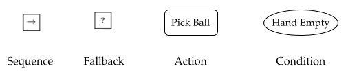

考虑一个简单任务：机器人找到球，抓起，再放入箱子。高层行为树可以写成：

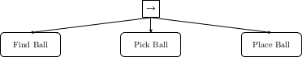

确认这棵小树表达了任务，再展开其中的“抓球”行为：

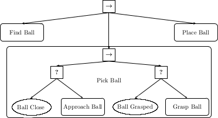

先看左支。如果球已经很近，“Ball Close?” 条件成功；否则执行“Approach ball”，使球靠近。所以这部分保证球已经很近，或者通过接近动作变得很近。再看右支：如果球已经抓住，“Ball Grasped?” 成功；否则执行“Grasp Ball”。继续展开，完整行为树为：

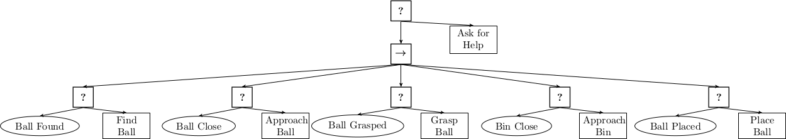

**图 5.2**：抓球并放置任务的行为树

这里还增加了求助行为：机器人完成不了任务时，可以请好心的人帮忙。花几分钟沿树走一遍，确认它确实实现了预期。

1. 我们说行为树能及时响应变化，来检验一下。机器人执行[这棵行为树](https://manipulation.mit.edu/#behaviorTree)，正在“Approach Bin”时，有人把球打落。球滚到一个仍可见、但很远的位置。按树的逻辑，哪个条件会失败，因此又会执行哪个动作？

2. 有限状态机（FSM）是另一种计算模型，由状态、转移和事件构成。抓球任务也可用下面的 FSM 表达：
   
    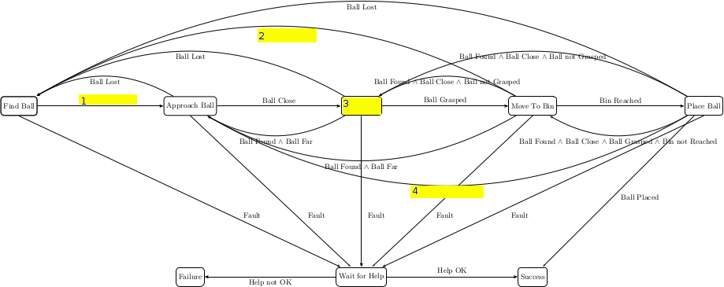
   
   
   
    。其中留下了四处状态或转移，请补齐，使其行为与行为树相同。

从这个简单任务就能看出，FSM 虽然常很直观，却也容易迅速变得复杂。

1. 接下来，用行为树表达本章和课堂中的箱内抓取。只要箱 1 没空，就选择可行抓取、执行，并把夹住的物体搬到箱 2。如果箱 1 还有物体，却找不到可行抓取，假设可以执行摇箱动作，随机改变物体配置，希望出现新机会。
   
    条件如下：
   
   - 箱 1 是否为空？
   
   - 是否存在可行抓取？
   
   - 是否已选定抓取？
   
   - 抓住的物体是否位于箱 2 上方？
   
   - 是否已抓住物体？
   
   - 物体是否已放入箱 2？
   
   
   
   
   
       动作如下：
   
   - 把抓住的物体放入箱 2
   
   - 抓取物体
   
   - 选择抓取
   
   - 随机重排箱内物体
   
   - 把抓住的物体移到箱 2 上方
   
   
   
   
   
       请结合这些条件、动作，以及顺序和回退节点，画出实现任务的行为树。下面提供了一个草稿，但有多处错误，例如缺分支，或控制流节点、动作、条件的类型不对：
   
       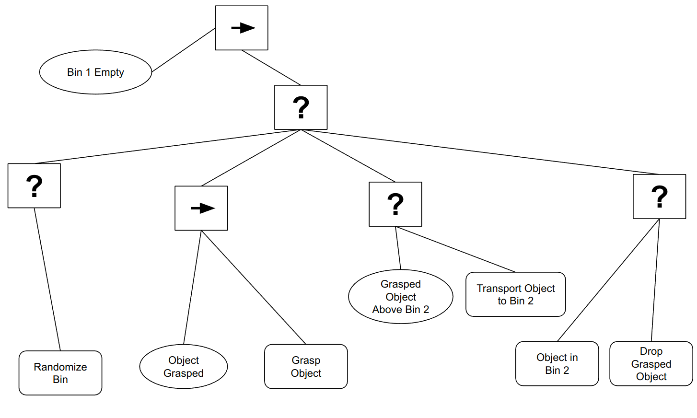
   
   
   
   
   
       找出全部问题，画出修正后的树。

行为树的模块化来自可复用的动作、条件代码，再通过树组合。例如，(c) 中的“选择抓取”可以用本章对跖抓取算法实现，“把抓住的物体移到箱 2 上方”则可以用第 3 章的抓取与放置工具。

资料来源：本题 (a)、(b) 的场景与插图受 [参考文献 24](#Colledanchise18) 中材料启发。

### 练习 5.6　采样对跖抓取

本题用自己的姓名首字母模型练习对跖抓取采样，探索如何通过射线投射寻找作为抓取基础的对跖点对。所有工作都在 [对应 notebook](https://colab.research.google.com/github/RussTedrake/manipulation/blob/master/book/clutter/exercises/6_grasp_initials.ipynb) 中完成，具体包括：

1. 从网格采样对跖点对。

2. 按抓取启发式筛选点对。

3. 利用这些启发式，在场景中操作自定义网格。

## 参考文献

1.  Berk Calli and Arjun Singh and James Bruce and Aaron Walsman and Kurt Konolige and Siddhartha Srinivasa and Pieter Abbeel and Aaron M Dollar , "Yale-CMU-Berkeley dataset for robotic manipulation research" , The International Journal of Robotics Research , vol. 36, no. 3, pp. 261--268, 2017 .

2.  Gregory Izatt and Russ Tedrake , "Generative Modeling of Environments with Scene Grammars and Variational Inference" , Proceedings of the 2020 IEEE International Conference on Robotics and Automation (ICRA) , 2020 .
    [文献链接](http://groups.csail.mit.edu/robotics-center/public_papers/Izatt20.pdf)

3.  Ryan Elandt and Evan Drumwright and Michael Sherman and Andy Ruina , "A pressure field model for fast, robust approximation of net contact force and moment between nominally rigid objects" , 
    , pp. 8238-8245, 11, 2019 .

4.  Domenico Prattichizzo and Jeffrey C Trinkle , "Grasping" , Springer Handbook of Robotics , pp. 671-700, 2008 .

5.  Hongkai Dai , "Robust multi-contact dynamical motion planning using contact wrench set" , 
    PhD thesis, Massachusetts Institute of Technology, 2016 .
    [文献链接](http://groups.csail.mit.edu/robotics-center/public_papers/Dai16.pdf)

6.  Andreas ten Pas and Marcus Gualtieri and Kate Saenko and Robert Platt , "Grasp pose detection in point clouds" , The International Journal of Robotics Research , vol. 36, no. 13-14, pp. 1455--1473, 2017 .

7.  Jeffrey Mahler and Jacky Liang and Sherdil Niyaz and Michael Laskey and Richard Doan and Xinyu Liu and Juan Aparicio Ojea and Ken Goldberg , "Dex-net 2.0: Deep learning to plan robust grasps with synthetic point clouds and analytic grasp metrics" , arXiv preprint arXiv:1703.09312 , 2017 .

8.  Andy Zeng and Shuran Song and Kuan-Ting Yu and Elliott Donlon and Francois R Hogan and Maria Bauza and Daolin Ma and Orion Taylor and Melody Liu and Eudald Romo and others , "Robotic pick-and-place of novel objects in clutter with multi-affordance grasping and cross-domain image matching" , 2018 IEEE international conference on robotics and automation (ICRA) , pp. 1--8, 2018 .

9.  Craig M Shakarji , "Least-squares fitting algorithms of the NIST algorithm testing system" , Journal of research of the National Institute of Standards and Technology , vol. 103, no. 6, pp. 633, 1998 .

10.  Radu Bogdan Rusu and Steve Cousins , "3D is here: Point Cloud Library (PCL)" , Proceedings of the IEEE International Conference on Robotics and Automation (ICRA) , May 9-13, 2011 .

11.  Radu Bogdan Rusu , "Semantic 3D Object Maps for Everyday Manipulation in Human Living Environments" , 
    PhD thesis, Institut für Informatik der Technischen Universität München, 2010 .

12.  R. A. Brooks , "Elephants Don't Play Chess" , Robotics and Autonomous Systems , vol. 6, pp. 3--15,, 1990 .

13.  Rodney A. Brooks , "Intelligence Without Reason" , 
    , no. 1293, April, 1991 .

14.  Rodney A. Brooks , "Intelligence without representation" , Artificial Intelligence , vol. 47, pp. 139-159, 1991 .

15.  Richard E Fikes and Nils J Nilsson , "STRIPS: A new approach to the application of theorem proving to problem solving" , Artificial intelligence , vol. 2, no. 3-4, pp. 189--208, 1971 .

16.  Constructions Aeronautiques and Adele Howe and Craig Knoblock and ISI Drew McDermott and Ashwin Ram and Manuela Veloso and Daniel Weld and David Wilkins SRI and Anthony Barrett and Dave Christianson and others , "PDDL| the planning domain definition language" , Technical Report, Tech. Rep. , 1998 .

17.  Patrik Haslum and Nir Lipovetzky and Daniele Magazzeni and Christian Muise and Ronald Brachman and Francesca Rossi and Peter Stone , "An introduction to the planning domain definition language" , Springer
    , vol. 13, 2019 .

18.  Avrim L Blum and Merrick L Furst , "Fast planning through planning graph analysis" , Artificial intelligence , vol. 90, no. 1-2, pp. 281--300, 1997 .

19.  Blai Bonet and Héctor Geffner , "Planning as heuristic search" , Artificial Intelligence , vol. 129, no. 1-2, pp. 5--33, 2001 .

20.  Jörg Hoffmann , "FF: The fast-forward planning system" , AI magazine , vol. 22, no. 3, pp. 57--57, 2001 .

21.  Malte Helmert , "The fast downward planning system" , Journal of Artificial Intelligence Research , vol. 26, pp. 191--246, 2006 .

22.  Jacky Liang and Wenlong Huang and Fei Xia and Peng Xu and Karol Hausman and Brian Ichter and Pete Florence and Andy Zeng , "Code as policies: Language model programs for embodied control" , 2023 IEEE International Conference on Robotics and Automation (ICRA) , pp. 9493--9500, 2023 .

23.  Shunyu Yao and Dian Yu and Jeffrey Zhao and Izhak Shafran and Thomas L Griffiths and Yuan Cao and Karthik Narasimhan , "Tree of thoughts: Deliberate problem solving with large language models" , arXiv preprint arXiv:2305.10601 , 2023 .

24.  Michele Colledanchise and Petter Ogren , "Behavior trees in robotics and AI: An introduction" , CRC Press
    , 2018 .

---

**继续阅读**：[上一章：基于几何的位姿估计（中文）](pose-estimation.md) · [全书目录与前言（中文）](preface.md) · [下一章：运动规划（中文）](motion-planning.md)  
[无障碍访问](https://accessibility.mit.edu/) · © Russ Tedrake, 2026
