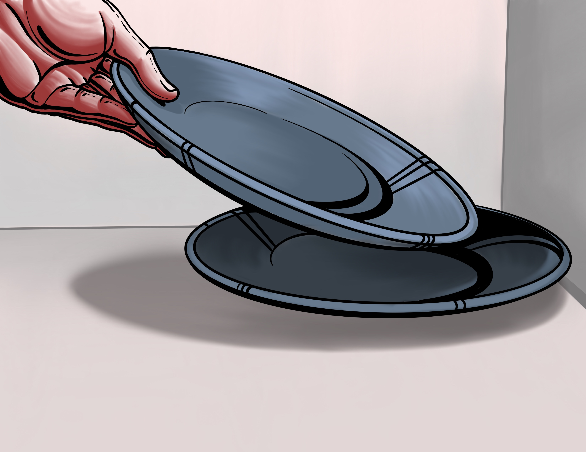

ROBOTIC MANIPULATION / 中文译稿 / 01

# 第 1 章　引言

*Robotic Manipulation: Perception, Planning, and Control*

**原著作者** [Russ Tedrake](http://people.csail.mit.edu/russt/)

**原文最后修改日期** 2026 年 9 月 13 日

**原文版权** © Russ Tedrake, 2020–2026

**对照阅读** [原文 PDF](pdfs/introduction-original.pdf) · [第 1 章在线原文](https://manipulation.mit.edu/intro.html)

[如何引用讲义、使用批注和提供反馈](https://manipulation.mit.edu/misc.html)

---

## 本章目录

- [引言](#introduction)
- [1.1　操作不止于抓取与放置](#section-1-1)
- [1.2　开放世界中的操作](#section-1-2)
- [1.3　仿真](#section-1-3)
- [1.4　这份讲义是交互式的](#section-1-4)
- [1.5　基于模型的设计与分析](#section-1-5)
- [1.6　讲义的组织方式](#section-1-6)
- [1.7　练习](#section-1-7)
- [参考文献](#references)

---

## 引言

我们不妨先想一想，人类的双手究竟有多灵巧。把餐具放进洗碗机、切菜、叠衣服，这些在我们看来再平常不过的事，对机器人来说却依然十分困难，至今仍是机器人研究的前沿课题。

*取放盘子的动作示意。插图：Reed Alspach。*

就拿从水槽里的一摞盘子中取出一个、再放进洗碗机这件事来说。首先，你得看出水槽里有盘子，还要判断能不能伸手拿到。伸手过去时，往往还得绕开水槽边缘和其他餐具。

要把盘子真正拿起来，动作可能还要更巧妙一些：先翘起盘子的一边，让它顺着手指，再沿着水槽或其他餐具滑动，直到能稳妥地握住。往上提时，你大概又会尽量避免盘子碰到水槽。这就需要对盘子的大小和轮廓有一定的把握。不过在我看来，如今的机器人其实有些过于害怕碰撞。

把盘子放进洗碗机，也有不少讲究。你可能以为，人会先将盘子与碗架上的分隔条对齐，再把它滑进去。但我觉得，人往往会采用更聪明的办法：稍微松开握着盘子的手，让盘子斜着靠过去，有意碰到分隔条的一侧，再借着接触，让盘子在放下时自行转到正确的位置。

这个办法巧妙之处在于，虽然最终放置的位置必须准确，我们却不必从头到尾都精确控制盘子的位置和朝向。

**图 1.2**：机器人从可能堆有杂乱餐具的水槽中取出盘子。左侧为仿真，右侧为实际操作。示例来自丰田研究院的机器人操作团队。
▶ [观看原文视频](https://s3.amazonaws.com/media-p.slid.es/videos/1350152/TpzT02Cy/plate_pickup.mp4)

这些任务为何如此棘手？一个可能的原因是，它们需要综合运用许多领域的技术，而这些领域过去往往各自发展。要同时精通它们并不容易。与机器人建图、导航、腿式运动等重要研究方向相比，操作任务中最有意思的问题，尤其依赖感知、规划与控制的密切配合。

感知既要识别物体与周围环境的局部几何结构，也要理解眼前的场景中有哪些操作可以进行。前者属于**几何感知**，后者属于**语义感知**。

规划则要考虑任务受到哪些运动学和动力学约束。例如，怎样才能让一条刚性的七自由度机械臂伸进抽屉？此外，还有更高层的任务规划：要把牛奶倒进杯子，得先打开冰箱，拿出瓶子，拧开瓶盖，再倒牛奶……做完以后，可能还要把东西放回去。

底层问题通常适合用实数来描述，高层问题则更多涉及逻辑判断和离散表示。再往底层看，我们的手会直接或借助工具与外界接触、分离、施力，并迅速而自如地在黏着和滑动两种摩擦状态之间切换。仅从动力学与控制的角度看，这些过程就已经包含了大量复杂而困难的问题。

可见，接下来值得讨论的内容还有很多。

---

## 1.1　操作不止于抓取与放置

机器人操作的应用十分广泛。从一个料箱中拿起物体，再放进另一个料箱，就是典型的“抓取与放置”（pick-and-place）任务，也是机器人操作的重要应用。在工厂里，只要零件经过仔细筛选和安排，机器人早在几十年前就能完成这类工作。

近几年，新一代抓取与放置系统开始用深度学习进行感知，已经能够较好地应对更多种类的物体。如果对放置位置和朝向的精度要求不高，效果尤其突出。这些系统既可以使用传统机械手，也可以使用吸盘等专用末端执行器。许多时候，即使没有准确掌握物体的形状、位姿、质量和摩擦特性，任务也能顺利完成。

不过，这份讲义讨论的操作，范围要比抓取与放置广得多。前面设想的洗碗机场景，也许可以算作更复杂的抓取与放置，但它对感知、规划和控制的要求已经明显提高。更不用说，人类双手能完成的任务远不止这些；我们也希望机器人很快能具备这样的本领。

如果想看看双手究竟能完成哪些任务，我推荐了解一下[南安普顿手功能评估程序（Southampton Hand Assessment Procedure，SHAP）](https://web.archive.org/web/20200222023924/http://www.shap.ecs.soton.ac.uk/index.php)。其中收录了一组我很喜欢的任务示例，最初是为了通过实验评估假肢手的功能。Matt Mason 在 2018 年综述论文的开篇，也对“操作”给出了一个涵盖面广、颇有启发性的定义。[参考文献 1](#reference-1)

还要注意，今天的操作研究，与 20 世纪八九十年代已经大不相同。当时，研究者主要从抓取的角度理解操作，并在这一方向上取得了许多精彩的奠基性成果。例如，在能够稳定抓住物体的前提下，研究多指机械手的运动学和动力学。直到现在，我有时还会听到有人把“抓取”（grasping）与“操作”几乎当作同一回事。

但今天的操作研究，以及这份讲义所关注的问题，都远远超出了抓取的范畴。扣衬衫纽扣时，仅用“抓取”就能说清双手在做什么吗？做沙拉时呢？在吐司上涂花生酱时呢？

## 1.2　开放世界中的操作

也许正因为人类做这些事如此熟练，我们对机器人的表现和鲁棒性才会抱有很高的期望。机器人能在实验室里可靠地把某一套餐盘放进洗碗机，还远远不够。我们希望，不管水槽里放的是哪种盘子，它基本都能处理；换到另一间厨房，即使布局、光照等条件不同，它也照样能工作。

在复杂的操作系统中，物理过程、感知、规划和控制共同构成闭环。要保证这样的系统具有鲁棒性，并验证这一点，本就十分困难。可我们又该怎样测试，才能覆盖世界上的每一间厨房呢？

现实世界的变化是无穷的，我们永远不可能见过所有可能的厨房。这就是所谓的“开放世界”（open-world）或“开放域”（open-domain）问题；这类说法最早因[电子游戏](https://en.wikipedia.org/wiki/Open_world)而广为人知。研究操作时，既要对具体问题作严谨的分析，又要顾及现实世界的多样性和复杂性。兼顾这两点并不容易，却很重要。

有意思的是，开放世界中任务的多样性，也可能反过来让问题更容易解决。机器人大数据时代才刚刚开始，其影响之大不言而喻。不过，我认为其中还有更深一层的原因。

例如，在一些规划和控制的优化问题中，如果只考虑很有限的情形，就可能出现许多只适用于这些情形的奇特解，使求解过程陷入局部极小值。如果要求控制器适应丰富得多的场景，这些解就可能被排除，优化目标的形态也可能变得简单得多。当然，这个想法究竟在多大程度上成立，还需要严谨的研究。

## 1.3　仿真

机器人操作研究正在迎来黄金时代，另一个原因是：近来，相关软件工具有了长足进步。

我还记得，大约在 2015 年，我曾和博士生们讨论能否用仿真研究操作。当时，他们已经很擅长通过仿真为行走机器人开发控制系统，却总是说：“操作可没法在仿真里研究。”这话并非没有道理。行走机器人通常只通过少量接触点与地面交互，而操作任务中的接触力学要复杂得多，仿真起来也困难得多。

更大的障碍是感知。操作离不开感知，而当时普遍的看法是，相机仿真还不够逼真，难以用于有实际意义的研究。

但变化来得很快。过去几年，机器人和计算机视觉领域迅速引入了电子游戏级别的渲染技术。越来越多的研究者开始认同：游戏引擎已经能够足够准确地模拟相机，不仅可以用来测试感知系统，甚至可以在仿真中训练感知系统，再让它到真实世界中工作。

这着实令人惊讶。此前，我们一直担心在仿真中训练的深度学习感知系统，会依赖仿真图像中特有的细节来简化任务。

接触仿真的质量和性能也有了显著改善。要让多体接触仿真既可靠又高效，必须处理复杂的几何查询和刚性微分方程，其中还涉及测度微分方程。相关支配方程的数学表述和数值求解方法，仍有从根本上改进的余地；不过，现有求解器已经足以在实际研究中发挥重要作用。

## 1.4　这份讲义是交互式的

有了仿真工具和免费的在线交互式计算资源，我希望这份讲义能让你获得传统教材之外的学习体验。每章都配有可运行的代码示例：你既可以在 [Google Colab](https://colab.research.google.com) 中运行，也可以安装到自己的计算机上运行，具体方法见[附录](https://manipulation.mit.edu/drake.html)。

这些示例使用开源库 Drake。大约从 2013 年起，我开始把我们的研究代码整理出来，供更多人使用，Drake 也一直是我投入心力的项目。全部代码都已开源，你想钻研多深，就可以钻研多深。

Mortimer Adler 有一句名言：

> 阅读一本好书，应当是你与作者之间的一场对话。

除了交互式图形和代码，你还可以直接在讲义上高亮文字、发表评论或提出问题。欢迎试一试，不过请先读读[批注礼仪](https://manipulation.mit.edu/misc.html#annotation)的说明。

Adler 认为，好的文字能让阅读成为一场跨越时空的对话。也许我是在借技术之便：即使文笔达不到他所期待的水平，我依然可以通过这些工具与你交流。他还建议读者在书上做批注。[参考文献 2](#reference-2) 你可以打印讲义，使用更新较少的 [PDF 版本](https://github.com/RussTedrake/manipulation/releases)，也可以用网站上的批注工具给自己留下私人笔记。

代码示例按章节整理在 notebook 中。点击示例旁的“Open in Colab”按钮，打开 notebook，再按顺序运行各个单元格即可。第一个代码单元格会在 Colab 中安装所需的软件包；如果在本地运行，这个单元格不会做任何事情。正文中的示例与 notebook 中的小节一一对应，阅读时可以对照使用。

### 示例 1.1　二维遥操作

先不急着研究自主操作。我们先用一个小例子，熟悉一下如何在在线 Jupyter Notebook 中研究机器人操作。

运行示例后，会弹出一个三维可视化窗口。打开其中的“Controls”（控制）菜单，就能看到几个滑块。拖动滑块，便可以控制机器人的末端执行器移动。不妨动手试试。

**运行示例**：[在 Colab 中打开](https://colab.research.google.com/github/RussTedrake/manipulation/blob/master/book/intro/intro.ipynb)

### 示例 1.2　三维遥操作

前一个示例先从二维可视化和控制入手，因为二维的情况更容易理解。不过，底层仿真一直是在完整的三维空间中运行的。运行第二个示例，就能看到它的三维效果。

**运行示例**：[在 Colab 中打开](https://colab.research.google.com/github/RussTedrake/manipulation/blob/master/book/intro/intro.ipynb)

## 1.5　基于模型的设计与分析

仿真技术的进步，使我们即便没有实体机器人，也能认真研究机器人操作。但仅仅能够仿真机器人的动力学、传感器、执行器和周围环境，还不足以支撑这份讲义要讨论的全部内容。今天的操作研究，还需要用到大量先进的感知、规划和控制算法。

因此，这份讲义不仅要介绍这些算法，还要回答一个重要问题：怎样把它们有条理地组合起来，避免系统的复杂性失去控制？

许多读者应该都熟悉 [ROS（Robot Operating System，机器人操作系统）](http://ros.org)。在我看来，ROS 是过去几十年机器人领域最重要的成果之一。借助它，不同领域的专家可以把自己的成果封装为模块化组件，供其他人使用。

这些组件就是 ROS 软件包。只要约定好通过网络发送和接收哪些消息，即使用不同的编程语言编写，甚至运行在不同的操作系统上，软件包之间也能协同工作。

ROS 降低了研究机器人操作的入门门槛，但它还不能完全满足我的教学目标：帮助读者清楚地理解操作问题。模块化的思路很好，我们也会沿用。不过，Drake 对组件还有进一步的要求：每个组件都要以统一的方式声明状态、参数和时序语义。这样，我们才能更清楚地理解各个系统之间复杂的关系。

这种做法也很实用。有了可以重复运行、结果确定的仿真，就能调试整套操作系统，即使仿真中含有随机因素也不例外。这项能力十分宝贵，在机器人领域却出人意料地少见。

接下来，我们将以 Drake 中的系统（Systems）为基本单元，把多个系统按需要连接成系统框图（Diagrams）。系统框图一直是控制领域常用的建模方法。如果你用过 Simulink、LabView 或 Modelica，对这种做法应该不会陌生。这些工具把基于框图的设计方法称为“基于模型的设计”（model-based design）。

### 示例 1.3　系统框图

前面的示例虽然由你遥操作机器人，没有配备自主操作系统，但背后同样是许多组件协同工作的结果。在 Drake 中，任何系统都可以直接在 notebook 里显示为框图；由多个系统组成的框图，本身也仍然是一个系统。

**交互图**：[打开原文的交互系统框图](https://people.csail.mit.edu/russt/uploads/manip_station.html)

这张图可以交互操作。试着放大、点击各个模块，看看这个框架如何把复杂的内部细节封装起来。例如，你可以展开 `iiwa_controller` 模块，查看它的内部结构。

想进一步了解 Drake 的系统框架，可以从 [Drake 官网](http://drake.mit.edu)上的“Modeling Dynamical Systems”（动力系统建模）教程开始。

坦率地说，并不是所有人都喜欢这个框架。有些人希望尽快把代码写出来，不觉得花时间声明状态变量等信息有什么好处。第一次编写新系统时，你也可能觉得这些要求有些繁琐。

但我之所以提倡这样严谨的做法，恰恰是因为我们想更快地构建复杂系统。我相信，要让开放世界中的操作系统更加成熟，首先得让组成它的基本组件更加成熟。

## 1.6　讲义的组织方式

后续章节将围绕组成操作系统的各个组件展开。许多组件都有深厚的研究基础，背后涉及计算机视觉、动力学、控制等领域的大量文献。为了让读者不至于淹没在这些材料中，我会着重介绍各个领域里与操作最相关的思想，用尽量统一、连贯的方式加以讲解，并提供进一步阅读的线索。要知道，单是统一这些领域使用的符号，就已经不容易了。

接下来的几章会先介绍必要的基础知识：我们要仿真的机器人硬件、仿真时需要了解的一些细节，以及后文经常用到的几何与运动学知识。

此后的内容会交替讨论感知、规划与控制，并逐步加深，而不是把三个主题各自讲完，再进入下一个。第一部分只介绍搭建一个基本操作系统所需的知识，让它能够抓取和放置已知、单独摆放的物体。

之后，每一章都会从已有系统的局限出发：它现在还做不到什么？学完这一章，我们希望它又能做到什么？沿着这样的思路，就能理解为什么需要学习接下来的内容。

欢迎提出意见，也别忘了动手体验讲义中的交互内容。

---

## 1.7　练习

### 练习 1.1　熟悉 Drake

Drake 是一个成熟、功能强大的软件库，能够支持许多先进的机器人应用。想了解它为什么被开发出来，可以读读[这篇博客文章](https://medium.com/toyotaresearch/drake-model-based-design-in-the-age-of-robotics-and-machine-learning-59938c985515)。它的文档很丰富，关键是知道该到哪里查。

1. 浏览 [Drake 教程](https://github.com/RobotLocomotion/drake/tree/master/tutorials)，其中的内容还在不断增加，Drake 官网也提供了入口。阅读 `dynamical_systems` 教程：在仿真 `SimpleContinuousTimeSystem` 时，初始条件 $x(0)$ 设成了多少？
2. Drake 最详尽的文档是类和函数的参考文档。无论用 C++ 还是 Python 开发，我通常都会打开 [C++ Doxygen 文档](https://drake.mit.edu/doxygen_cxx/index.html)。[Python 文档](https://drake.mit.edu/pydrake/index.html)大多由它自动生成，整理得没有那么细致，因此我一般只在 Python 接口与 C++ 不同时才去查阅。

   请在 C++ Doxygen 文档中搜索“Spatial Vectors”（空间向量）：代码中用哪些 ASCII 字符表示角加速度？
3. Drake 是开源的，没有把算法藏在黑箱里。想知道某个算法如何实现，或某个函数该怎样使用，都可以直接查看源代码。现在还可以在浏览器中[使用 VS Code 浏览代码](https://github1s.com/RobotLocomotion/drake)。请查看[“拟合值迭代”（fitted value iteration）的单元测试](https://github1s.com/RobotLocomotion/drake/blob/HEAD/bindings/pydrake/systems/test/controllers_test.py)：其中的 `convergence_tol` 设成了多少？

使用 Drake 遇到问题时，可以在 [Stack Overflow 上提问](https://stackoverflow.com/questions/tagged/drake)，并加上 `drake` 标签。那里的 Drake 开发者社区人数更多，往往能比课程工作人员更快地给出答复，也可能提供更好的答案。公开提问还能留下可供检索的记录，帮助后来遇到同样问题的人，让 Drake 更容易使用。

### 练习 1.2　Drake 系统基础

本练习带你熟悉 Drake 基于框图的系统框架，了解 `LeafSystem`、`Diagram`、`Context` 和 `Simulator` 等核心概念。你将用这个框架从头实现一个自定义动力系统。所有操作都在[这个 notebook](https://colab.research.google.com/github/RussTedrake/manipulation/blob/master/book/intro/exercises/02_drake_systems_fundamentals.ipynb)中完成。

你需要完成以下步骤：

1. 为倒立摆实现一个自定义 `LeafSystem`。
2. 创建各个系统，连接成用于仿真的 `Diagram`。
3. 使用 Drake 内置工具运行仿真。

### 练习 1.3　物理仿真与机器人加载

接着上一道练习，你将学习如何搭建包含机器人和自定义模型的场景。具体来说，你会从 [Drake 模型数据库](https://github.com/RobotLocomotion/models)加载 Kuka iiwa 机器人，再从头编写 `SDF` 文件，创建自己的物体模型。

完成后，你会看到姓名首字母形状的物体落在自己搭建的桌子上，旁边还有一台七自由度的 Kuka iiwa 机器人。所有操作都在[这个 notebook](https://colab.research.google.com/github/RussTedrake/manipulation/blob/master/book/intro/exercises/03_physics_simulation_and_robots.ipynb)中完成。

你需要完成以下步骤：

1. 使用 `Parser` 和 `MultibodyPlant`，将 Kuka iiwa14 机器人加载到 `Diagram` 中。
2. 用 `LeafSystem` 实现一个简单的比例控制器，计算关节力矩，使机器人到达期望的关节构型。
3. 编写 `SDF` 文件定义桌子，再用给定的字母生成 API，生成姓名首字母的 `SDF` 模型。
4. 将机器人、桌子和字母模型组合起来，运行仿真。

### 练习 1.4　HardwareStation 与高级场景

上一道练习需要手动搭建仿真：先创建 `DiagramBuilder`，添加 `MultibodyPlant` 和 `SceneGraph`，再加载机器人，把各个部分连接起来。本练习则会教你使用 `HardwareStation`，配合 `YAML` 配置文件中的模型指令（model directives），用更少的代码完成同样的工作。所有操作都在[这个 notebook](https://colab.research.google.com/github/RussTedrake/manipulation/blob/master/book/intro/exercises/04_hardwarestation_and_scenarios.ipynb)中完成。

你需要完成以下步骤：

1. 使用 `HardwareStation` 和场景指令，搭建一个包含两台 iiwa14 机器人的场景。
2. 将自定义的桌子和字母模型加载到 `HardwareStation` 中。
3. 从 Drake 模型仓库选取预定义物体，添加到 `HardwareStation` 中。

---

## 参考文献

1. Matthew T. Mason，《走向机器人操作》（“Toward robotic manipulation”），*Annual Review of Control, Robotics, and Autonomous Systems*（《控制、机器人与自主系统年度评论》），第 1 卷，第 1–28 页，2018 年。

2. Mortimer J. Adler，《如何在书上做批注》（“How to Mark a Book”），*The Saturday Review of Literature*（《星期六文学评论》），1941 年 7 月 6 日。[原文链接](<http://www.maebrussell.com/Articles%20and%20Notes/How%20To%20Mark%20A%20Book.html>)

---

**继续阅读**：[全书目录与前言（中文）](preface.md) · [下一章：先给你准备一个机器人（英文）](https://manipulation.mit.edu/robot.html)
[无障碍访问](https://accessibility.mit.edu/) · © Russ Tedrake, 2026
