
ROBOTIC MANIPULATION / 中文译稿 / 08

# 第 8 章　机械臂控制

*Robotic Manipulation: Perception, Planning, and Control*

**原著作者** [Russ Tedrake](http://people.csail.mit.edu/russt/)

**原文最后修改日期** 2026 年 10 月 11 日

**原文版权** © Russ Tedrake, 2020–2026

**对照阅读** [原文 PDF](pdfs/manipulator-control-original.pdf) · [在线原文](https://manipulation.mit.edu/force.html)

## 本章目录

- [8.1　机械臂控制工具箱](#toolbox)
- [8.2　先把机器人看作质点](#section2)
    - [8.2.1　轨迹跟踪](#section2.1)
    - [8.2.2　直接力控制](#section2.2)
    - [8.2.3　间接力控制](#section2.3)
    - [8.2.4　位置与力混合控制](#section2.4)
- [8.3　一般情况：机械臂动力学方程](#section3)
    - [8.3.1　轨迹跟踪](#section3.1)
    - [8.3.2　关节刚度控制](#section3.2)
    - [8.3.3　笛卡尔刚度与操作空间控制](#section3.3)
    - [8.3.4　iiwa 的一些实现细节](#section3.4)
- [8.4　把各部分连接起来](#section4)
- [8.5　轴孔插装](#section5)
- [8.6　练习](#section6)
- [参考文献](#references)

---

前几章已经建立起初步工具箱：感知单个物体或杂物堆，规划抓取，再移动机械臂执行。最近还学习了生成平滑关节轨迹，让机器人快速从一次抓取移到下一次。期望轨迹越接近机器人的动力学极限，执行它的控制方法也就需要更精细。

操作远不只是抓取！即使箱内抓取，我们也已见过只靠抓取不够的情况。想象从机器人相机里看到这样的场景：

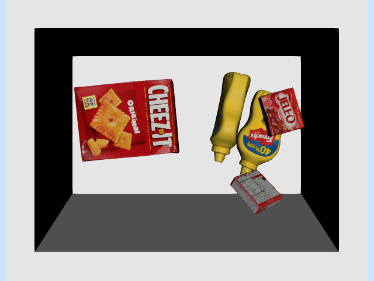

用双指夹爪，究竟怎样拿起这盒 Cheez-It 饼干？我知道有人会觉得吸盘轻而易举，但光靠吸附也解决不了所有问题。

▶ [打开原文交互内容或视频](https://www.youtube.com/embed/XqRczI4Fepk?mute=1&rel=0)

[点击观看视频。](https://www.youtube.com/embed/XqRczI4Fepk)

**图 8.1**：我请女儿用从厨房找来的“双指夹爪”试试类似任务。这样的行为，该怎么编程呢？

非抓取操作（nonprehensile manipulation）就是不先抓住物体的操作，人类经常这样做。推一把太大、抓不住的办公椅，很容易理解。仔细观察还会发现，滑动、借助环境接触等策略，即使抓住物体时也常用，只是在非抓取任务中更明显。

此前以运动学为主，还缺少对力的讨论。本章不仅介绍轨迹跟踪，也介绍主动考虑接触力的控制方法。希望读完后，你会认同：我们确实能想出令人满意的办法，把这盒饼干翻起来！

## 8.1　机械臂控制工具箱

这里的机械臂控制，指把较高层的指令，例如期望关节位置、速度或空间力，转换为电机指令。本章假设能直接给定广义力；对转动关节，就是关节力矩。这些控制器只考虑机器人本身，不考虑环境中的物体，因此单独不能完成有意义的任务。但它们提供更高层抽象，方便构建其余控制系统。

这些低层控制通常运行在机械臂或控制柜固件中。使用硬件时，要理解原理和参数设置；仿真时，则需要自己实现它们，才能模拟机器人。

Drake 提供多种[机械臂控制实现](https://drake.mit.edu/doxygen_cxx/group__control__systems.html)，本章会逐一介绍与机械臂最相关的几种：

[API 文档](https://drake.mit.edu/doxygen_cxx/classdrake_1_1systems_1_1controllers_1_1_pid_controller.html)

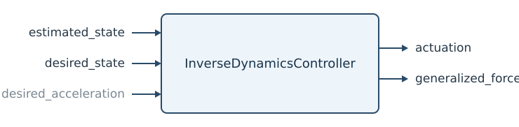

[API 文档](https://drake.mit.edu/doxygen_cxx/classdrake_1_1systems_1_1controllers_1_1_inverse_dynamics_controller.html)

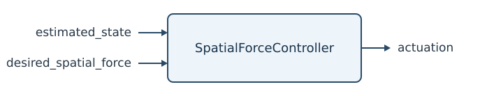

[API 文档](https://github.com/RobotLocomotion/drake/pull/18272)

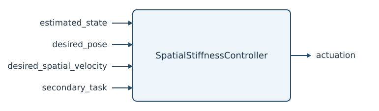

希望读完后，你能理解它们的基本原理和差别。

## 8.2　先把机器人看作质点

面对复杂问题，仍先找尽可能简单、又不失关键机制的模型。翻盒例子先限制在二维平面，既可去掉箱子的两侧，方便看内部，也减少自由度。给盒子加 `PlanarJoint`，避免浮动基座的四元数坐标。手也简化为“点手指”，画成小球，两个输入直接作用于质点的 $x$、$z$ 方向。

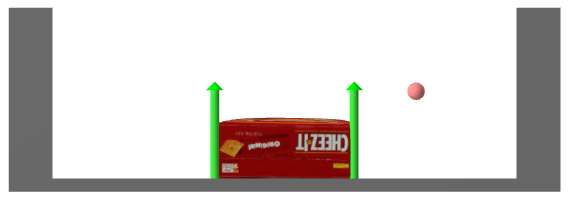

**图 8.2**：二维简化模型：点手指、饼干盒与箱子。绿色箭头表示接触力。

本章始终区分两个动力学模型。完整仿真模型包含手指、盒子和箱子，共五自由度：盒子 $x, z, \theta$，手指 $x, z$。控制器模型只含手指的两自由度，并承受未建模接触力。它特意设计得很简单：

$$
\begin{bmatrix}m & 0 \\ 0 & m \end{bmatrix} \dot{v} = m
    \begin{bmatrix}\ddot{x} \\ \ddot{z} \end{bmatrix} = \tau_g +
    \begin{bmatrix} u_x \\ u_z \end{bmatrix} + f^{F_c},
$$

。其中 $m$ 是质量，$\tau_g$ 是重力“力矩”，此处即 $\tau_g =
    [0, -mg]^T$；$u$ 是控制输入，$f^{F_c}$ 是作用于手指 $F$ 的点 $c$ 上的笛卡尔接触力。

本章大量使用[空间力记号](bin-picking.md#spatial_force)。上式 $f^{F_c}$ 表示作用于手指 $F$、点 $c$ 上的力；同一个接触对盒子 $B$、点 $c$ 的作用记为 $f^{B_c}$。自然有 $f^{F_c} = - f^{B_c}$，因为它们大小相等、方向相反。不仔细区分，后面很容易弄错正负号。

### 8.2.1　轨迹跟踪

接触盒子前，先学会让手指在空中运动。假设通过优化等方法已得到漂亮的期望轨迹 $q_d(t)$，且 $q_d(t)$ 二阶可微。要跟踪它，应发送怎样的广义力指令？

最常见的起点是比例—积分—微分（PID）控制，讨论[位置控制机器人](robot.md#position-controlled)时已见过。[PidController](https://drake.mit.edu/doxygen_cxx/classdrake_1_1systems_1_1controllers_1_1_pid_controller.html) 使用：

$$
u(t) = K_p (q_d(t) - q(t)) + K_d (\dot{q}_d(t) -
      \dot{q}(t)) + K_i \int_0^t (q_d(t) - q(t)) dt,
$$

，其中 $K_p$、$K_d$、$K_i$ 分别是位置、速度和积分增益。它们常为对角矩阵，使各关节独立控制。操作任务通常不使用积分项，取 $K_i = 0$：如果机器人顶住墙，无法达到 $q(t) == q_d(t)$，积分会不断累积，指令越发越大，直到触发故障。

PD 很有效，几乎不需要动力学知识；但这也限制性能。若知道动力学，就能跟踪得更好。点手指的 $z$ 方向在 PD 下的闭环动力学为：

$$
m \ddot{z} = -mg + k_p (z_d - z) + k_d (\dot{z}_d -
      \dot{z}).
$$

。给定正弦轨迹 $z_d(t)$，并在 $z$、$\dot{z}$ 上稍偏离轨迹启动，结果为：

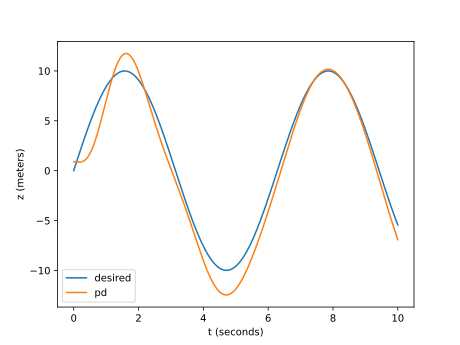

。实际运动虽跟着期望走，仍有持续误差。甚至期望是常数 $\dot{z}_d = 0$，也会有稳态误差 $\tilde{z} = z_d - z$。直观地令 $\dot{z} = \ddot{z}
      = 0$，得 

$$
\tilde{z} = z_d - z = \frac{1}{k_p}mg.
$$

：此时 PD 恢复力刚好抵消重力，没有剩余作用继续消除误差。

从方程可见，把重力信息告诉控制器就会更好，这叫重力补偿。重力补偿加 PD，在 Drake 中作为 [JointStiffnessController](https://github.com/RobotLocomotion/drake/pull/18272) 提供：

$$
u = -\tau_g + K_p (q_d - q) + K_d (\dot{q}_d - \dot{q}).
$$

。原因后面会解释。点手指 $z$ 方向的闭环动力学为 

$$
m
      \ddot{z} = k_p (z_d - z) + k_d (\dot{z}_d - \dot{z}).
$$

，没有稳态误差，跟踪也改善了：

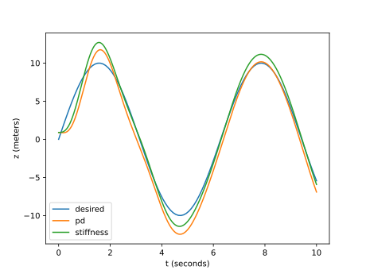

复杂轨迹仍有误差。还有一个已知、尚未用上的信息：$\ddot{q}_d(t)$。将控制律稍改写为：

$$
u = -\tau_g +
      m\left[\ddot{q}_d + K_p (q_d - q) + K_d (\dot{q}_d - \dot{q}) \right].
$$

，其一般形式在 Drake 中是 [InverseDynamicsController](https://drake.mit.edu/doxygen_cxx/classdrake_1_1systems_1_1controllers_1_1_inverse_dynamics_controller.html)。两点变化：加入加速度前馈，并让 PD 项乘以质量。于是闭环误差动力学简化为：

$$
\ddot{\tilde{z}} + k_d \dot{\tilde{z}} + k_p
      \tilde{z} = 0,
$$

，就是熟悉的质量—弹簧—阻尼模型。合理选 $k_p$、$k_d$，误差便良好地收敛到零，跟踪效果最好：

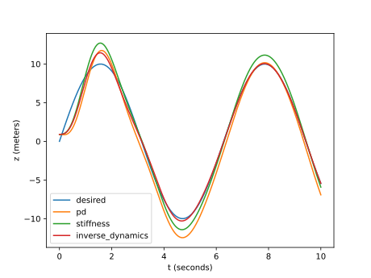

#### 示例 8.1　质点轨迹跟踪

这些绘图代码都放在 notebook 中，可以自行调整试试。

**运行示例**：[在 Colab 中打开](https://colab.research.google.com/github/RussTedrake/manipulation/blob/master/book/force/force.ipynb)

### 8.2.2　直接力控制

接触发生后，问题更有意思了。本例中手指碰到盒子，此时目标可能不只是位置、速度、加速度，还包括施加给盒子的交互力。

最简单地，先完全不调节手指位置，低层控制器只接收期望接触力，再产生广义力输入，使实际接触力尽量匹配。

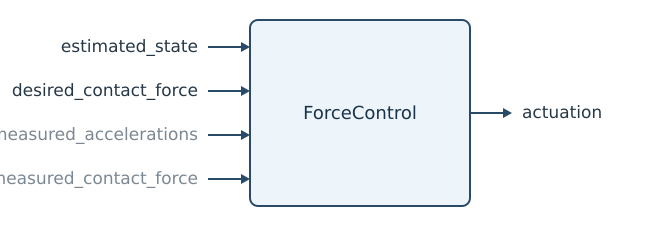

需要哪些信息？当然需要期望接触力 $f^{F_c}_{desired}$，一般也需要机器人状态，虽然此处质点动力学与状态无关。另外还要满足以下之一：测量加速度，但我们尽量避免，因为测量常很噪；假设加速度为零；或者测接触力，通过反馈调节。

先假设已经接触盒子，加速度近似为零。对动作较慢的许多操作任务，这并不离谱。动力学简化为 

$$
f^{F_c} = - mg - u.
$$

，力控制器只需 $u = -mg -
      f^{F_c}_{desired}.$。注意只需知道机器人质量，不需要盒子质量。

未接触时怎样？这时不能忽略加速度，相同控制导致 $m\dot{v} = - f^{F_c}_{desired}.$。其实并不坏，反而是力控制很有吸引力的特性：想要的力没有出现时，接触点就沿期望力的反方向加速。局部来看，这往往能让尚未接触的机器人主动靠到物体上。

#### 示例 8.2　给定恒定力

完整仿真同时包含未接触、接触，以及涉及碰撞动力学的过渡。把点手指放在盒子旁，请求盒子给手指一个恒定水平接触力。下图画出不同恒定力指令下，手指的 $x$ 轨迹。

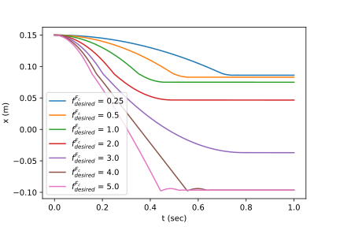

**图 8.3**：不同恒定期望力下，手指水平位置随时间变化。

所有严格为正的期望力，都使手指匀加速，直到在 $x=0.089$ 撞到盒子。$f^{F_c}_{desired}$ 很小时，盒子几乎不动；$f^{F_c}_{desired}$ 中等时，碰撞使盒子开始动，但摩擦最终让盒子和手指停下；较大时，手指持续推盒子，直到碰到另一侧箱壁。

**运行示例**：[在 Colab 中打开](https://colab.research.google.com/github/RussTedrake/manipulation/blob/master/book/force/force.ipynb)

这意味着，只要发力指令，就能几乎不依赖盒子几何建立良好接触。感知只需保证起始位置沿直线前进能碰到盒子。

腿足机器人研究者也喜欢力控制。支持力控制的步行机器人，可在摆腿阶段用类似位置控制，让脚大致到预期落点；落地时再切换力控制。这样能明显降低精确地形感知的要求。

#### 示例 8.3　基于力的翻盒策略

一个简单方案是：接触后，用手指的力对盒子左下角产生力矩，使其转动；同时约束接触力，避免该角点滑动。

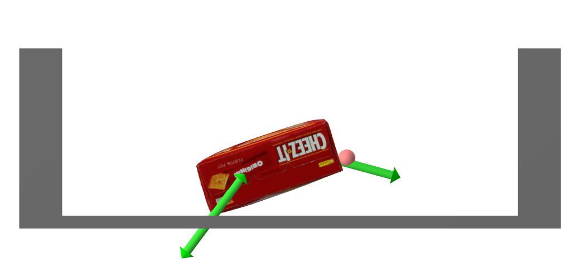

**图 8.4**：翻起盒子。[点击这里](https://manipulation.mit.edu/data/force_flip_up.html)观看下面控制器的动画。也值得亲自运行代码，因为还能看到接触力！

这些要求很自然地用力表达，仍只需很少盒子信息。接触力施加后，手指位置会自然变化。我很难想出同样稳健的高增益位置控制方案；它恐怕需要更多几何乃至质量假设。

将上述策略写成盒子受力。$C$ 是手指与盒子的接触坐标系，法线垂直表面、指向盒内；$A$ 是盒子左下角与箱子的接触坐标系，法线沿世界 $z$ 正向竖直朝上。

$$
{}^BR^C =
        R_y(-\frac{\pi}{2}), \qquad {}^WR^A = I,
$$

 其中 $R_y(\theta)$ 是绕 y 轴旋转 $\theta$。还有作用于质心 com 的重力：

$$
f^{B_{com}}_{gravity,W} = mg.
$$

。这里大量用到[前面介绍](bin-picking.md#spatial_force)的空间力记号和代数。

摩擦锥给出力的线性不等式约束：

$$
\begin{gathered} f^{B_C}_{\text{finger}, C_z}
        \ge 0, \qquad |f^{B_C}_{\text{finger}, C_x}| \le \hat\mu_C
        f^{B_C}_{\text{finger}, C_z}, \\ f^{B_A}_{\text{ground}, A_z} \ge 0,
        \qquad |f^{B_A}_{\text{ground}, A_x}| \le \hat\mu_A
        f^{B_A}_{\text{ground}, A_z}.\end{gathered}
$$

。确认理解这些记号。我们要在约束内把盒子翻起。

绕 $A$ 转动，需要看关于 $A$ 的总力矩：

$$
\tau^{B_A}_{total,W} = \tau^{B_A}_{gravity,
        W} + \tau^{B_A}_{ground, W} + \tau^{B_A}_{finger, W},
$$

。但 $\tau^{B_A}_{ground, W} = 0$，因为力臂为零。我希望尽量少假设盒子质量、几何，因此不精确调节力矩，而写成 

$$
\tau^{B_A}_{total,W_y} =
        \tau^{B_A}_{finger,W_y} + \text{unknown terms}.
$$

。面对未建模项，可以反馈盒子角度 $\theta$，即 ${}^WR^B$ 的 $y$ 分量：

$$
\tau^{B_A}_{finger_d,W_y} =
        \text{PID}(\theta_d, \theta), \qquad {}^WR^B(\theta) = R_y(\theta),
$$

。$\theta_{d}$ 简写期望角度，$\text{PID}$ 简写简单 PID 项。注意 $\tau^{B_A}_{finger,W_y} \propto f^{B_C}_{finger,
        C_x},$ 中的常系数只依赖 ${}^B\hat{p}^C;$，实际上与 $\hat\theta.$ 无关。

在摩擦锥约束下实现期望 PID，可用约束最小二乘：

$$
\begin{aligned}\min_{f^{B_C}_{finger,C}, \, f^{B_A}_{ground,A}} \quad&
        \left| \tau^{B_A}_{finger,W_y} - \text{PID}(\theta_d, \hat\theta)
        \right|^2,\\ \text{subject to} \quad & f^{B_C}_{\text{finger}, C_z} \ge 0, \qquad
        |f^{B_C}_{\text{finger}, C_x}| \le \hat\mu_C f^{B_C}_{\text{finger},
        C_z}, \\ & f^{B_A}_{\text{ground}, A_z} \ge 0, \qquad
        |f^{B_A}_{\text{ground}, A_x}| \le \hat\mu_A f^{B_A}_{\text{ground},
        A_z}, \\ & f^{B_A}_{\text{ground}, A} + \hat{f}^{B_A}_{gravity, A} +
        f^{B_A}_{finger, A} = 0.\end{aligned}
$$

。最后一行虽包含空间代数，给定 $\hat\theta$ 后仍是线性约束。实现假设如下：

- 有盒子朝向的近似 $\hat\theta$，可由点云法线，甚至手指轨迹估计。

- 有墙与盒子之间静摩擦系数 $\hat\mu_A$、手指与盒子之间静摩擦系数 $\hat\mu_C$ 的保守估计，以及手指相对角点的位置和盒子质量 $\hat{m}.$ 的近似。

。请试着改变估计精度，看看能放宽到什么程度。你会发现，方法对盒子质量、几何误差相当稳健。

**运行示例**：[在 Colab 中打开](https://colab.research.google.com/github/RussTedrake/manipulation/blob/master/book/force/force.ipynb)

本例有两层控制：低层接收期望接触力，发机器人指令以实现它；高层观察盒子朝向，决定向低层请求什么力。

这并不是唯一或最优的翻盒策略。我只是想说明，有些难用其他方式表达的控制，写成力就很自然！

### 8.2.3　间接力控制

另一种思路很漂亮：不直接指定接触力，而把机器人控制成一个简单机械系统，使其按期望方式响应外力。Ken Salisbury 的刚度控制 [参考文献 1](#Salisbury80)，以及 Neville Hogan 的阻抗控制 [参考文献 2](#Hogan85a)、[参考文献 3](#Hogan85b)、[参考文献 4](#Hogan85c)，都在重要的系列论文中阐述了这种理念。

想象你推 iiwa 的末端。只知道机器人参数，不必知道环境，就能让它像一个简单质量—弹簧—阻尼系统那样反作用于你。不是用一系列位置指令强行移动末端，而是移动柔软虚拟弹簧的平衡点，也可调刚度，让弹簧产生需要的接触力。

它也有利于保证面对未建模接触时仍稳定：如果机器人和环境都是耗散系统，整体就能稳定。借助无源性理论，或更一般的端口 Hamilton 系统，即使复杂系统也能这样分析，见 [参考文献 5](#Duindam09)。

点手指很适合理解间接力控制。原动力学为 

$$
m\begin{bmatrix}\ddot{x} \\ \ddot{z} \end{bmatrix} = mg
      + u + f^{F_c}.
$$

，可以使它变成无源的质量—弹簧—阻尼系统：

$$
m
      \begin{bmatrix}\ddot{x} \\ \ddot{z} \end{bmatrix} + b \begin{bmatrix}
      \dot{x} \\ \dot{z} \end{bmatrix} + k \begin{bmatrix} x - x_d \\ z - z_d
      \end{bmatrix} = f^{F_c},
$$

，弹簧平衡点在 $(x_d,
      z_d).$。控制律很容易推出：点手指中就是熟悉的 PD，再加抵消重力的前馈项。

严格说，只调整刚度、阻尼，通常叫刚度控制，是阻抗控制的子集。还可改变等效质量，这才是完整阻抗控制。不过，据我了解，多数机器人控制专家认为，改变质量带来的额外感知、带宽和复杂度，通常不值得。

间接力控制文献有许多术语和实现细节，实际应用必须弄清。方案取决于是否有力传感器、能否直接下发力或力矩；性能也很依赖控制带宽和传感器质量。更全面的综述与一些有趣早期视频见 [参考文献 6](#Villani08)，较早的清晰论述见 [参考文献 7](#Whitney87)。

#### 示例 8.4　刚度控制遥操作

我没有提供直接力控制的遥操作界面，它会很难用。但移动虚拟弹簧平衡点来控制机器人，就很自然。试着移动盒子，甚至把它翻起。

**运行示例**：[在 Colab 中打开](https://colab.research.google.com/github/RussTedrake/manipulation/blob/master/book/force/force.ipynb)

为了直观，箱子和盒子略透明，并用橙色画出滑块控制的虚拟手指或夹爪。

用间接力控制，还能构造另一种翻盒策略。在箱子中央翻盒，要仔细控制左下角摩擦锥；另一办法不需要如此精确的力：先推到角落，再翻起。

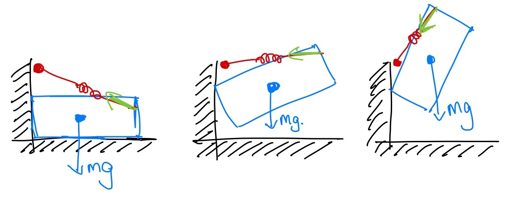

想象一根绷紧橡皮筋，连接手指与墙边、略高于盒子左上角的点。橡皮筋产生力矩，盒子像摆一样绕上角转动。到某个时刻，上角开始滑动，但同一橡皮筋继续让手指从上角向下推，完成动作。

如果改成估计滑动时刻、再重新规划的控制器，事情会麻烦得多。这里只用机器人模型，将接触点行为塑造成另一动力系统，就能完成这一切！

#### 示例 8.5　基于刚度控制的翻盒策略

控制器简单得不能再简单：先让虚拟手指沿轨迹移到墙前，推盒子靠墙，建立支撑接触力；再把虚拟手指，即橡皮筋另一端，沿墙上移一点，剩下交给力学。

**运行示例**：[在 Colab 中打开](https://colab.research.google.com/github/RussTedrake/manipulation/blob/master/book/force/force.ipynb)

此前让手指在 $x$、$z$ 两方向像独立的质量—弹簧—阻尼系统，刚度 $k$、阻尼 $b$ 还都相同。一般可用矩阵，分别记作 $K_p$、$K_d$：

$$
m
      \begin{bmatrix}\ddot{x} \\ \ddot{z} \end{bmatrix} + K_d \begin{bmatrix}
      \dot{x} \\ \dot{z} \end{bmatrix} + K_p \begin{bmatrix} x - x_d \\ z - z_d
      \end{bmatrix} = f^{F_c}.
$$

。为了明确坐标系，注意点手指有 ${}^Wp^F = \begin{bmatrix}
      x, z\end{bmatrix}^T,$，同式可写为 

$$
m\,{}^W\dot{v}^F + K_d \, {}^Wv^F +
      K_p\left({}^Wp^F - {}^Wp^{F_d}\right) = f^F.
$$

。有时在另一坐标系 $A$ 中表达刚度、阻尼更方便：

$$
\begin{aligned} m\,{}^W\dot{v}^F + {}^W R^A K_d \,
      {}^Wv^F_A + {}^WR^W K_p\left({}^Wp^F_A - {}^Wp^{F_d}_A\right) =& \\
      m\,{}^W\dot{v}^F + {}^W R^A K_d {}^A R^W\, {}^Wv^F + {}^WR^A K_p {}^A
      R^W\left(\,{}^Wp^F - {}^Wp^{F_d}\right) =& \, f^F.\end{aligned}
$$

### 8.2.4　位置与力混合控制

有些任务需要一个方向控力，另一个方向控位置。经典例子是擦拭、抛光：法向关心压力，切向用位置反馈跟踪轨迹。点手指最简单可在 $z$ 控力、$x$ 控位置：

$$
u =
      -mg + \begin{bmatrix} k_p (x_d - x) + k_d (\dot{x}_d - \dot{x}) \\
      -f^F_{desired, W_z} \end{bmatrix}.
$$

。如果要在接触坐标系 $C$ 等其他坐标系表达，可用 

$$
u = -mg + {}^WR^C \begin{bmatrix} k_p (p^{F_d}_{C_x} -
      p^{F}_{C_x}) + k_d (v^{F_d}_{C_x} - v^F_{C_x}) \\ -f^{F}_{desired,
      C_z}\end{bmatrix}. 
 \tag{8.1}
$$

。法向控力不仅控制压得多重，也能容忍表面法线估计误差。位置控制若法线估错，可能一边离墙、一边压得过重；力控制则允许法向位置自然调整到产生所需压力的位置，从而跟随墙面。

▶ [打开原文交互内容或视频](https://www.youtube.com/embed/PngdQGEUi7w?mute=1&rel=0)

[点击观看视频。](https://www.youtube.com/embed/PngdQGEUi7w)

**图 8.5**：位置与力混合控制的例子。机器人要压得足够重，让手指与书不滑，又要足够轻，让书能在桌面滑。这自然适合在世界 $z$ 方向控力；而在 $x,y$ 平面移动夹爪和书，更适合控位置。[练习](https://manipulation.mit.edu/#hybrid_book_push)中可进一步探索。

位置或力不必二选一。可以同时施加刚度、阻抗形式的位置指令和前馈力：

$$
u =
      -mg + K_p (p^{F_d} - p^{F}) + K_d (v^{F_d} - v^{F}) -
      f^{F}_{\text{feedforward}}.
$$

。它比式（[式 8.1](#equation-eq-position-or-force)）更一般，适当选择 $K_p$、$K_d$、$f^F_{feedforward}.$ 就能实现明确的分方向模式。后面会看到，这很像 iiwa 等力矩控制机器人的接口。

## 8.3　一般情况：机械臂动力学方程

浮动手指、夹爪帮助理解基本概念，现在把这些策略落实为能发给机械臂的关节指令。

全驱动机械臂的方程具有明确结构：

$$
M(q)\ddot{q} + C(q,\dot{q})\dot{q} = \tau_g(q) + u + \sum_i
    J^T_i(q)f^{c_i}.
 \tag{8.2}
$$

。左侧推广了质量乘加速度，包含质量矩阵 $M$、科里奥利项 $C$；右侧是广义力之和：重力 $\tau_g(q)$，电机力矩 $u$，以及第 $i$ 处接触笛卡尔力 $f^{c_i}$，其中 $J_i(q)$ 是第 $i$ 个接触 雅可比矩阵。前面随机物体落入箱子时简要介绍过，更多笔记[见这里](http://underactuated.mit.edu/multibody.html)。下文假设机器人固定在桌上，没有浮动关节，所以使用 $\dot{q}$、$\ddot{q}$，代替 $v$、$\dot{v}$。

### 8.3.1　轨迹跟踪

暂时忽略接触项：

$$
M(q)\ddot{q} +
      C(q,\dot{q})\dot{q} = \tau_g(q) + u.
$$

。仿真的正动力学已知关节力矩 $u$ 和 $q,
      \dot{q}$，求加速度 $\ddot{q}$；控制用的逆动力学则已知 $\ddot{q}$ 和 $q, \dot{q}$，求 $u$。其系统图为：

[API 文档](https://drake.mit.edu/doxygen_cxx/classdrake_1_1systems_1_1controllers_1_1_inverse_dynamics.html)

它实现：

$$
u = M(q)\ddot{q}_d +
      C(q,\dot{q})\dot{q} - \tau_g(q),
$$

，闭环得到 $M(q)\ddot{q} = M(q)\ddot{q}_d.$。由于 $M(q)$ 可逆，就有 $\ddot{q} = \ddot{q}_d$。

实际中，接触力存在，动力学参数和状态 $q$、$\dot{q}$ 也只是估计。因此选择加速度指令时要考虑误差。跟踪期望关节轨迹 $q_0(t)$ 时，不应只二次求导并给定 $\ddot{q}_0(t)$，还可用：

$$
\ddot{q}_d = \ddot{q}_0(t) + K_p(q_0(t) - q) +
      K_d(\dot{q}_0(t) - \dot{q}).
$$

，也可加入积分增益。

因此，`System` 还增加一个期望状态输入端口：

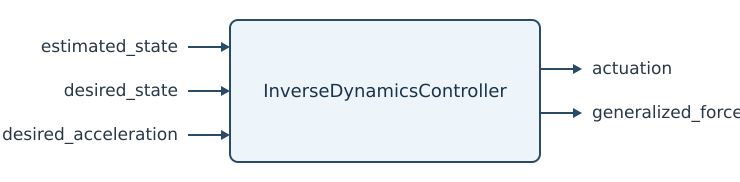

[API 文档](https://drake.mit.edu/doxygen_cxx/classdrake_1_1systems_1_1controllers_1_1_inverse_dynamics_controller.html)

逆动力学控制在文献中也叫计算力矩控制，甚至前馈加反馈线性化控制，见 [参考文献 8](#Lynch17)（第 11.4.1.3 节）。

**补充说明**：想一想：关节刚度控制与逆动力学控制有什么区别？

 关节刚度控制取 $\tau_{ff} = 0$ 时，闭环为：

$$
M(q)\ddot{q} +
      C(q,\dot{q})\dot{q} + K_p(q - q_d) + K_d(\dot{q} - \dot{q}_d) =
      \tau_{ext},
$$

，其中 $\tau_{ext}$ 汇总接触等未建模力；逆动力学控制的闭环则为 

$$
\ddot{q} + K_p(q - q_d) + K_d(\dot{q} -
      \dot{q}_d) = M^{-1}(q) \tau_{ext}.
$$

。所以后者以加速度、而非力为单位写反馈，相当于把惯性矩阵塑造成对角矩阵。

硬件上能多准确地抵消动力学，取决于参数 $\hat{M}(q)$、$\hat{C}(q,\dot{q})$ 的估计。刚度控制则只抵消重力，也可能补偿摩擦，不改变惯性，却已能达到许多目标性能。

 

### 8.3.2　关节刚度控制

我们最常通过 iiwa 的关节阻抗模式控制它，[参考文献 9](#Ott08)、[参考文献 10](#Albu-Schaffer07) 介绍得很好。从用户角度，可把它看作关节空间刚度控制：

$$
u = -\tau_g(q) +
      K_p(q_d - q) + K_d(\dot{q}_d - \dot{q}) + \tau_{ff},
$$

，其中 $K_p, K_d$ 是正对角矩阵，$\tau_{ff}$ 是前馈力矩。实际还有关节摩擦补偿，见 [参考文献 11](#Albu-Schaffer01)，这里为简洁省略。控制器确实也改变惯性，因此叫阻抗而非仅刚度控制，但只改变转子惯性，用户不能设置；所以用户仍应按刚度控制理解。

**补充说明**：想一想：传统 PD 位置控制与关节刚度控制有什么区别？

 代数差别很小：PD 通常是 

$$
u=K_p(q_d-q) +
      K_d(\dot{q}_d - \dot{q}),
$$

，刚度控制是 

$$
u = -\tau_g(q)
      + K_p(q_d-q) + K_d(\dot{q}_d - \dot{q}).
$$

，多了抵消重力、摩擦等已知模型项的部分。这需要估计模型与力矩控制。iiwa 有这样的模型，但多数大减速比机械臂未必有可信模型。小小改动却影响很大：稳态位置不再依赖误差产生所需力矩，因此可以大幅降低增益，让响应柔顺，同时在没有外力矩时仍跟踪良好。

### 8.3.3　笛卡尔刚度与操作空间控制

更接近点手指的办法，是让机器人在世界坐标系下像简单动力系统。先选末端坐标系 $E$，最好原点位于预期接触点。根据[运动学](pick-and-place.md#kinematics)、[微分运动学](pick-and-place.md#jacobian)，正运动学为：

$$
p^E =
      f_{kin}(q), \qquad v^E = \dot{p}^E = J(q) \dot{q}, \qquad a^E =
      \ddot{p}^E = J(q)\ddot{q} + \dot{J}(q)
      \dot{q}.
 \tag{8.3}
$$

。二阶导数虽然此前没写过，用链式法则即可。这里只讨论笛卡尔位置；朝向也能考虑，但三维旋转刚度的定义需要谨慎，例如 [参考文献 12](#Suh22)。

机械臂控制的一个重要思路，是直接在 $E$ 下写机器人动力学。将关节力矩参数化为作用于刚体 $B$、点 $E$ 的平移力 $f^{B_E}_u$：$u = J^T(q) f^{B_E}_u$，来自[虚功原理](https://ocw.mit.edu/courses/mechanical-engineering/2-12-introduction-to-robotics-fall-2005/lecture-notes/chapter6.pdf)。将其与机械臂方程（[式 8.2](#equation-eq-manipulator)）代入运动学式（[式 8.3](#equation-eq-kinematics)），并假设所有外部接触只发生在 $E$，得：

$$
M_E(q) \ddot{p}^E + C_E(q,\dot{q})\dot{q} = f^{B_E}_g(q)
      + f^{B_E}_u + f^{B_E}_{ext} ,
 \tag{8.4}
$$

，其中 

$$
M_E(q) = (J M^{-1} J^T)^{-1}, \qquad C_E(q,\dot{q}) = M_E \left(J
      M^{-1} C - \dot{J} \right), \qquad f^{B_E}_g(q) = M_E J M^{-1} \tau_g.
$$

。再施加类似关节空间的控制律：

$$
f^{B_E}_u = -f^{B_E}_g(q) + K_p(p^{E_d} - p^E) +
      K_d(\dot{p}^{E_d} - \dot{p}^E),
$$

，即可得到末端期望闭环动力学：

$$
M_E(q) \ddot{p}^E +
      C_E(q,\dot{q})\dot{q} + K_p(p^{E} - p^{E_d}) + K_d(\dot{p}^{E} -
      \dot{p}^{E_d}) = f^{B_E}_{ext}.
$$

。于是推末端时，整个机器人协调运动，让你感觉在推弹簧—阻尼系统。很漂亮！

如果 $J(q)$ 不满秩，例如自由度多于末端控制维数，还需类似地[稳定 雅可比矩阵 的零空间](pick-and-place.md#joint_centering)。现在控制的是力矩而非速度，自然对应于在末端任务零空间内工作的关节回中 PD：

$$
u = J^Tf^{B_E}_u + P[K_{p,joint} (q_0 - q) - K_{d,joint}\dot{q}].
$$

。$P$ 是动力学一致的零空间投影，见 [参考文献 13](#Khatib87)。微分 IK 使用速度控制的零空间，这里则必须使用加速度层面的零空间。

这种指定任务空间动力学、让次要关节目标在零空间中工作的方式，由 [参考文献 13](#Khatib87) 发展，称为操作空间控制。可以进一步组合有优先级的任务、关节空间目标，把低优先级放进主要任务零空间。和关节回中微分 IK 一样，也能用最小二乘优化理解。

### 8.3.4　iiwa 的一些实现细节

[参考文献 9](#Ott08)、[参考文献 10](#Albu-Schaffer07) 详细解释了低层阻抗控制实现。作者特别在执行器坐标、而非关节坐标中实现阻抗；两者之间有弹性传动。我猜其中有不少细微原因，但他们着重证明，这种实现能给出真正的无源性保证。

iiwa 也有笛卡尔阻抗模式。需要高性能末端刚度控制时，当然应该用它：内部更新比网络 API 快得多，许多细节也经过认真处理。但实际我们不用，因为切换关节、笛卡尔阻抗必须停止机器人；甚至改刚度或末端位置坐标系 $C$，也得停机，令人无奈。所以留在关节阻抗模式，需要时通过 $\tau_{ff}$ 下发笛卡尔力。想了解驱动细节，可看 [Franka Control Interface](https://frankarobotics.github.io/docs/libfranka/docs/overview.html) 文档，比较容易找到、阅读，功能也与 iiwa 类似。

还会看到，`HardwareStation` 中 `IiwaDriver` 的接口接收期望关节位置，却不接收期望速度，因为 iiwa 根本不允许我们直接发送期望关节速度。我们认为它对位置指令做数值微分得到速度，因此引入几个控制周期的延迟，有时还有[非单调行为](https://github.com/RobotLocomotion/drake/issues/11955#issuecomment-524467883)。我猜限制外部速度指令，是为了维持论文的无源性论证，也可能为了 API 更简单、安全，防止用户给出互不一致的位置、速度，即速度并非位置的时间导数。

补偿重力时，还可在示教器中一次性设置夹爪的集中惯性参数，运动中不能改。抓起物体，甚至移动手指后，重力变化都不会被控制器补偿。

Drake 的 JointStiffnessController 最接近 iiwa 实际控制，但仿真常用 InverseDynamicsController，原因有些微妙：数值性质更好。相同物理刚度下，其微分方程的数值刚性较弱，可以使用更大积分步长。真实 iiwa 常用 [800., 600, 600, 600, 400, 200, 200] N·m/rad 的关节刚度；直接以此仿真，需要较小步长。

## 8.4　把各部分连接起来

## 8.5　轴孔插装

源自机器人装配的经典力控制问题，是在很小运动学公差下配合两零件。最干净、著名的例子，就是把圆轴插入圆孔。如果[轴是方的、孔是圆的](https://en.wikipedia.org/wiki/Square_peg_in_a_round_hole)，我也帮不了你。有意思的是，20 世纪 70 年代末、80 年代初，大量相关研究来自 MIT 与 Draper 实验室。

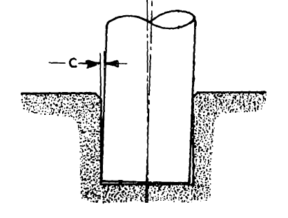

 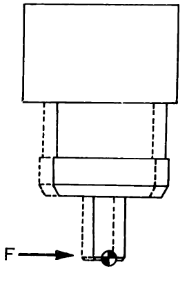

 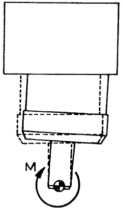

**图 8.6**：左：运动学公差为 $c$ 的轴孔插装。中：希望对接触力产生的响应。右：希望对接触力矩产生的响应。图片转载自 [参考文献 14](#Drake78)，略去部分符号。

许多插装任务允许在零件或孔口加小[倒角](https://en.wikipedia.org/wiki/Chamfer_(geometry))，配合水平方向柔顺，就能修正小位置误差。朝向误差更有意思：轻微偏斜就可能卡住，此时库仑模型中的摩擦力很大且不确定，必须避免。接触处允许旋转柔顺，就能减少卡死。你应该能看出，为什么这很适合力控制！

关键是旋转刚度要产生绕零件、接触处的转动，而非绕夹爪。刚度控制可实现，但公差极小时，感知、带宽成了限制。力控制领域一个特别精彩的发现，是用巧妙机械机构完全被动地实现远心柔顺（Remote Center Compliance，RCC），无需传感器，理想上带宽无限，见 [参考文献 14](#Drake78)！

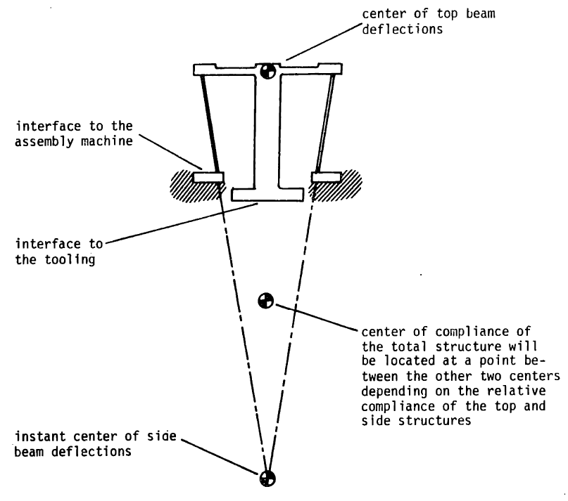

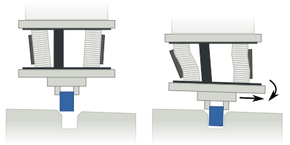

**图 8.7**：被动远心柔顺装置。左：[参考文献 14](#Drake78) 的概念示意。右：机械实现，图片作者 [Arne Nordmann（2008）](https://en.wikipedia.org/wiki/Remote_Center_Compliance)。产品例子见 [这里](https://www.ati-ia.com/products/compliance/Compensator_main.aspx)，精彩的早期视频见 [这里](https://www.youtube.com/watch?v=qFTUFHGGZIg)。

轴孔插装不仅催生重要的力学、控制思想，也影响了运动规划，见 [参考文献 15](#Lozano-Perez84)。这些理念适用于许多可借柔顺接触完成的任务，例如开门、使用工具等。

## 8.6　练习

### 练习 8.1　力与位置控制

给定如下质点动力学：

$$
m\ddot{x} = u + f^{F_c}
$$

其中 $x$ 是位置，$u$ 是输入力，$f^{F_c}$ 是环境施加于点 ${F}$、作用点为 $c$ 的接触力。为同时控制机器人位置和力，提出：

$$
u = \underbrace{k_p(x_d-x) - k_d\dot{x}}_{\text{feedback force for position control}} - \underbrace{f^{F_c}_{desired}}_{\text{feedforward force}}
$$

定义系统误差为：

$$
e = (x - x_d)^2 + (f^{F_c} - f^{F_c}_{desired})^2
$$

1. 考虑自由空间，即 $f^{F_c}=0$，希望施加非零期望力 $f^{F_c}_{desired} \neq 0$，同时将位置调到零 $x_d = 0$。证明不可能同时实现两个零误差。可以令 $\dot{x}=0,\ddot{x}=0$，根据动力学、控制律、期望位置与力，分析稳态误差。

2. 再考虑机器人与位于 $x_d = 0$ 的墙发生刚性接触，期望力非零 $f^{F_c}_{desired} > 0$。分析稳态误差，证明此时可达到零误差。

### 练习 8.2　翻起盒子

考虑前面[示例](https://manipulation.mit.edu/#force_flip_up)的初始阶段，此时 $\theta\approx 0$。$B$ 是盒子，$A$ 是转动支点，$C$ 是手指与盒子 $B$ 的接触点。假设力仍近似沿坐标轴，但地面接触只作用于支点 $A$。

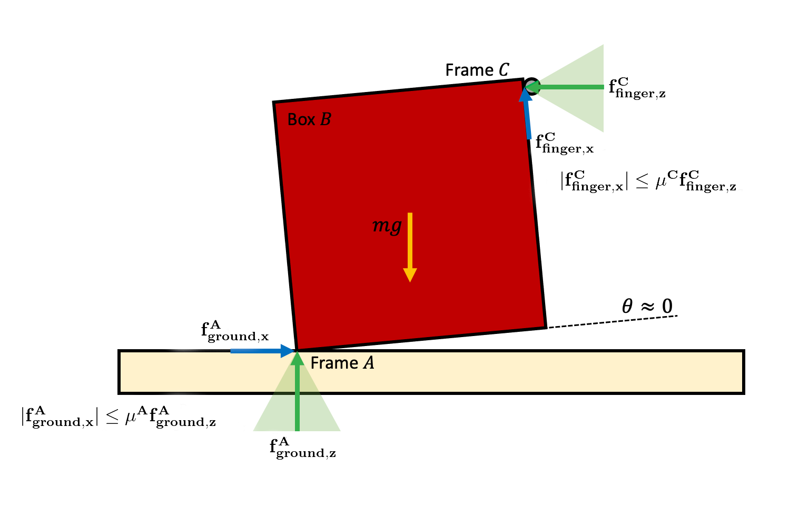

1. 推力不足，即 $f^{C}_{finger,z}$ 太小时，无法产生足够摩擦 $f^{C}_{finger,x}$ 抵抗重力。对支点 $A$ 求力矩和，得到 $\tau^{A}_{\text{total}, y}$，据此推导法向力 $f^{C}_{finger,z}$ 的下界，用 $m,g,$、$\mu^C$ 表示。可假设盒子为正方形，重力力臂是 C 点力臂的一半。

2. 推得太大，即 $f^{C}_{finger,z}$ 太大，支点会向左滑。先用水平力平衡求 $f^{C}_{finger, z}$ 上界，再用 y 方向力平衡得到含 $f^{C}_{finger,z}$ 的等式。结合两方向平衡关系和 (a) 的力矩下界，求法向力 $f^{C}_{finger,z}$ 的上界，用 $m,g,$、$\mu^A$ 表示。假设 $\mu^A < 1$，且已得到正的 $\tau^{A}_{\text{total},y}.$。

3. 结合上下界，推导动作可行时 $\mu^A,\mu^C$ 必须满足的关系。如果 $\mu^A\approx 0.25$，木材与金属接触，$\mu^C$ 至少多大？如果 $\mu^A=1$，混凝土与橡胶接触呢？

### 练习 8.3　力与位置混合控制

本题分析并实现混合控制器拖动书本，就像课堂的[这段视频](https://www.youtube.com/watch?v=PngdQGEUi7w&ab_channel=JiajiZhou)。所有工作都在 [对应 notebook](https://colab.research.google.com/github/RussTedrake/manipulation/blob/master/book/force/exercises/hybrid_force_position.ipynb) 中完成，具体包括：

1. 分析动作可行的条件。

2. 实现完成动作的控制律。

### 练习 8.4　轴孔插装控制

本题探索轴孔插装，通过两种刚度控制器理解间接力控制。所有工作都在 [对应 notebook](https://colab.research.google.com/github/RussTedrake/manipulation/blob/master/book/force/exercises/04_peg_in_hole.ipynb) 中完成，具体包括：

1. 为浮动轴实现刚度控制，此时构型空间与任务空间相同。

2. 为完整平面 iiwa 实现操作空间刚度控制。

## 参考文献

1. K. Salisbury , "Active stiffness control of a manipulator in Cartesian coordinates" , Proc. of the 19th IEEE Conference on Decision and Control , 1980 .

2. Neville Hogan , "Impedance Control: An Approach to Manipulation. Part I - Theory" , Journal of Dynamic Systems, Measurement and Control , vol. 107, pp. 1--7, Mar, 1985 .

3. Neville Hogan , "Impedance Control: An Approach to Manipulation. Part II - Implementation" , Journal of Dynamic Systems, Measurement and Control , vol. 107, pp. 8--16, Mar, 1985 .

4. Neville Hogan , "Impedance Control: An Approach to Manipulation. Part III - Applications" , Journal of Dynamic Systems, Measurement and Control , vol. 107, pp. 17--24, Mar, 1985 .

5. "Modeling and Control of Complex Physical Systems: The Port-Hamiltonian Approach" , Springer-Verlag
, 2009 .

6. Luigi Villani and J De Schutterm , "9" , in: Force Control, Springer Handbook of Robotics , 2008 .

7. Daniel E Whitney , "Historical perspective and state of the art in robot force control" , The International Journal of Robotics Research , vol. 6, no. 1, pp. 3--14, 1987 .

8. Kevin M Lynch and Frank C Park , "Modern Robotics" , Cambridge University Press
, 2017 .

9. Christian Ott and Alin Albu-Schaffer and Andreas Kugi and Gerd Hirzinger , "On the passivity-based impedance control of flexible joint robots" , IEEE Transactions on Robotics , vol. 24, no. 2, pp. 416--429, 2008 .

10. Alin Albu-Schaffer and Christian Ott and Gerd Hirzinger , "A unified passivity-based control framework for position, torque and impedance control of flexible joint robots" , The international journal of robotics research , vol. 26, no. 1, pp. 23--39, 2007 .

11. Alin Albu-Schaffer and Gerd Hirzinger , "A globally stable state feedback controller for flexible joint robots" , Advanced Robotics , vol. 15, no. 8, pp. 799--814, 2001 .

12. H.J. Terry Suh and Naveen Kuppuswamy and Tao Pang and Paul Mitiguy and Alex Alspach and Russ Tedrake , "SEED: Series Elastic End Effectors in 6D for Visuotactile Tool Use" , Under review , 2022 .
[文献链接](http://groups.csail.mit.edu/robotics-center/public_papers/Suh22.pdf)

13. Oussama Khatib , "A Unified Approach for Motion and Force Control of Robot Manipulators: The Operational Space Formulation" , IEEE Journal of Robotics and Automation , vol. 3, no. 1, pp. 43-53, February, 1987 .

14. Samuel Hunt Drake , "Using compliance in lieu of sensory feedback for automatic assembly." , 
PhD thesis, Massachusetts Institute of Technology, 1978 .

15. Tomas Lozano-Perez and Matthew Mason and Russell Taylor , "Automatic synthesis of fine-motion strategies for robots" , The International Journal of Robotics Research , vol. 3, no. 1, pp. 3--24, 1984 .

---

**继续阅读**：[上一节（中文）](mobile-manipulation.md) · [全书目录与前言（中文）](preface.md) · [下一节（中文）](object-detection.md)
