<div class="reader-kicker">ROBOTIC MANIPULATION / 中文译稿 / 06</div>

# 第 6 章　运动规划

*Robotic Manipulation: Perception, Planning, and Control*

<div class="translation-meta" markdown>
**原著作者** [Russ Tedrake](http://people.csail.mit.edu/russt/)

**原文最后修改日期** 2026 年 10 月 11 日

**原文版权** © Russ Tedrake, 2020–2026

**对照阅读** [原文 PDF](pdfs/motion-planning-original.pdf) · [在线原文](https://manipulation.mit.edu/trajectories.html)
</div>

## 本章目录

- [6.1　逆运动学](#section1)
    - [6.1.1　从末端位姿求关节角](#section1.1)
    - [6.1.2　把 IK 写成约束优化](#section1.2)
    - [6.1.3　全局逆运动学](#section1.3)
    - [6.1.4　逆运动学与微分逆运动学如何选](#section1.4)
    - [6.1.5　用 IK 规划抓取](#section1.5)
- [6.2　运动学轨迹优化](#section2)
    - [6.2.1　轨迹参数化](#section2.1)
    - [6.2.2　优化算法](#section2.2)
- [6.3　基于采样的运动规划](#section3)
    - [6.3.1　快速扩展随机树（RRT）](#section3.1)
    - [6.3.2　概率路线图（PRM）](#section3.2)
    - [6.3.3　后处理](#section3.3)
    - [6.3.4　采样规划的实际使用](#section3.4)
- [6.4　基于凸集图（GCS）的运动规划](#gcs)
    - [6.4.1　凸集图](#section4.1)
    - [6.4.2　GCS 运动学轨迹优化](#section4.2)
    - [6.4.3　无碰撞构型空间的凸分解](#iris)
    - [6.4.4　GcsTrajOpt 示例](#section4.4)
    - [6.4.5　变体与扩展](#section4.5)
- [6.5　时间最优路径参数化](#topp)
- [6.6　练习](#section6)
- [参考文献](#references)

---

我们的工具箱还缺几项基本能力。本章将探索一些强大的运动学轨迹规划方法。

写到这里才介绍运动规划，我甚至有点得意。像箱内抓取那样，用简单脚本指定夹爪位姿，就已经能解决很多有趣的问题。但以下情况仍需要更自动化的方案：

1. 环境更杂乱时，简单脚本难写，除了夹爪，还需考虑机械臂与环境的碰撞。

2. 移动操作中，机械臂安装在移动底盘上，需要适应不同环境。即使几何不复杂，每次伸手时的场景也可能不同，仍需自动规划，哪怕规划很简单。

3. 机器人若整天在已知简单环境中工作，优化反复执行的轨迹通常很值得，往往能明显加快操作。

如果运行过[清理杂物演示](bin-picking.md#clutter_clearing)，就会发现运动规划失败是当前方案的主要瓶颈：夹爪或物体有时会撞相机、箱子，忽略关节角的微分 IK 也可能让机器人折到不合适的姿态。本章将改进这些问题！

先说明一个观点。操作中的运动规划往往特别强调避碰。虽然我也研究过这个方向，却并不喜欢把问题全都定义为无碰撞规划。我觉得机器人总体上太怕碰到环境，因为碰到后仍容易出问题。人类每次伸手，甚至在密集杂物中伸手，未必都在求复杂的几何问题；我怀疑我们其实并不擅长。我更希望机器人即使用粗略计划，也能穿过杂乱环境，不怕偶然接触，并在接触发生后继续完成任务。

<a id="section1"></a>

## 6.1　逆运动学

本章要规划运动轨迹，但只要真正理解逆运动学，轨迹规划所需的大部分基础也就具备了。

[正运动学](pick-and-place.md#kinematics)给出从关节角到夹爪位姿等量的非线性映射：$X^G = f_{kin}(q)$。逆运动学（IK）自然像是在求逆映射 $q
    = f^{-1}_{kin}(X^G).$。不过，和微分 IK 一样，我更愿意把它理解为：在丰富的代价和约束下寻找关节角。运动学约束的种类确实非常丰富。

例如，[评价箱内抓取候选](bin-picking.md#grasp_candidates)时，夹爪相对于对跖抓取的朝向只是软偏好。若直接指定完整六自由度位姿，再求精确满足它的关节角，反而把问题限制得过紧。实际问题很少只有末端位姿约束，通常还包含关节空间的代价、约束，例如关节限位，以及笛卡尔空间的非穿透等约束。

▶ [打开原文交互内容或视频](https://www.youtube.com/embed/m1rv4d_zUCY)

[点击观看视频。](https://www.youtube.com/embed/m1rv4d_zUCY)

**图 6.1**：我们研究人形机器人时，大量使用丰富的 IK 描述。上面视频展示交互式 IK，用来研究怎样把大机器人塞进小小的 Polaris 车里。[另一个视频](https://www.youtube.com/watch?v=E_CVq0lWfSc)展示同一工具用于 Valkyrie：除了末端位姿，还加入关节回中目标和静态稳定约束，见 [参考文献 1](#Fallon14)、[参考文献 2](#Marion16)。

<a id="section1.1"></a>

### 6.1.1　从末端位姿求关节角

IK 如此重要，相关文献当然很多；其解法的深入、完整程度可能更令人惊讶。正运动学 $f_{kin}$ 虽非线性，却有很强的结构。除少数情况，例如[螺旋关节](https://www.hindawi.com/journals/mpe/2016/1761968/fig4/)外，决定机器人笛卡尔位置可行性的方程实际上都是多项式。“那运动学方程里的正弦、余弦呢？”三角函数是在关联关节角与笛卡尔坐标时出现的。在 $\mathbb{R}^3$ 中，同一刚体上两点 $A$、$B$ 的距离平方 $\|p^A - p^B\|^2,$ 是常数；关节则是相邻刚体位置之间的多项式约束，例如两个连接点在空间中重合。[参考文献 3](#Wampler11) 给出了很好的综述。

研究多项式方程解的学科是代数几何。运动学理论、符号算法和数值算法已有深厚积累。即使[四杆机构](https://en.wikipedia.org/wiki/Four-bar_linkage)、[Stewart–Gough 平台](https://en.wikipedia.org/wiki/Stewart_platform)这样的复杂拓扑，也可以计算解的数量，或分析连续解流形。例如 [参考文献 3](#Wampler11) 介绍基于同伦方法的数值代数几何工具，在困难运动学问题上效果令人印象深刻。

代数几何方法传统上侧重离线全局分析，通常不是为控制回路中的快速实时 IK 设计。六、七自由度机械臂的常用实时工具是 IKFast，见 [参考文献 4](#Diankov10) 第 4.1 节，它因高效开源实现而流行。它不追求完整性，而通过近似快速、稳健地解决较“容易”的运动学问题。多数六自由度串联机械臂的六自由度位姿约束具有闭式解，对应有限组关节位形；七自由度时，则在六自由度求解器外，再对多出的一个自由度采样。

显式解值得了解：它们揭示方程结构，也可能足够快，能嵌入更复杂的方法。但它们不能直接支持前面倡导的丰富描述，特别是约束由等式变为不等式时。对此，我们转向优化。

<a id="section1.2"></a>

### 6.1.2　把 IK 写成约束优化

与其写成 

$$
q = f^{-1}_{kin}(X^G),
$$

，不如求：

$$
\begin{aligned}
      \min_q & \quad |q - q_0|^2, \\ \text{subject to} &\quad X^G = f_{kin}(q),
      \end{aligned}
$$

，其中 $q_0$ 是舒适的标称关节位置。直接写逆映射并不严谨，因为解可能有多个、无穷多个，也可能没有。优化形式更明确：若多个关节位形都实现相同末端位置，就选最接近标称值的那个。更大的价值，是可以继续加入丰富的代价和约束。

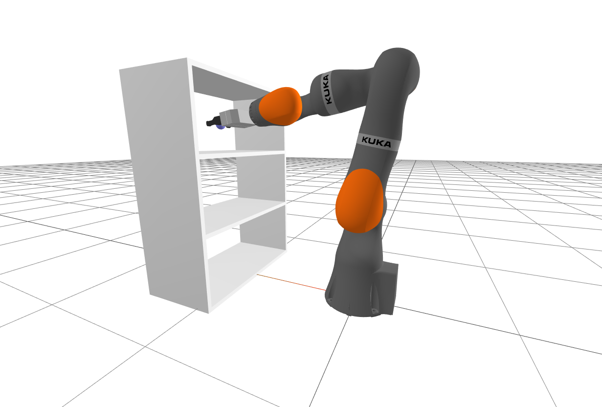

**图 6.2**：更丰富的 IK 问题：求关节角 $q$，让机器人伸进架子抓取物体，同时避免碰撞。

我们[已经讨论过](pick-and-place.md#diff_ik_w_constraints)把微分 IK 写成优化：先用运动学 雅可比矩阵 的伪逆，再转为最小二乘，并加入避免奇异位形、关节限位、关节速度限值，乃至避碰的约束。有些约束对位形 $q$ 高度非线性、非凸；但微分 IK 只求标称位形附近的小变化 $\Delta q$，因此线性或凸近似很合理。

现在直接求完整的非线性、非凸问题，不再限制只能对初始 $q$ 做小变化。计算难得多，但 SNOPT 等强大的非线性求解器通常仍能求解，甚至达到交互速度。不过没有保证：求解器返回“不可行”时，也可能实际存在解。

两类问题密切相关。事实上，可以把微分 IK 看作完整非线性问题的一步投影梯度下降，或一步[序列二次规划（SQP）](https://en.wikipedia.org/wiki/Sequential_quadratic_programming)。

Drake 的 [InverseKinematics](https://drake.mit.edu/doxygen_cxx/classdrake_1_1multibody_1_1_inverse_kinematics.html) 类，方便将常见运动学、多体约束组装进 `MathematicalProgram`。看看它提供的约束：两个刚体的相对位置、朝向，两物体距离至少多大以避免穿透，或至多多大等。我希望你用这种方式理解 IK：一个可包含丰富代价、约束的逆问题。

<a id="example-1"></a>

<a id="example1"></a>

#### 示例 6.1　交互式 IK

尽管问题非凸，计算约束也不便宜，通常仍可达到交互速度。章内 notebook 准备了几个例子。

**运行示例**：[在 Colab 中打开](https://colab.research.google.com/github/RussTedrake/manipulation/blob/master/book/trajectories/trajectories.ipynb)

第一个用滑块控制期望末端位姿。这是适合显式解的简单 IK，但这里仍用完整非线性引擎，并包含关节限位。它看起来与最初遥操作抓红砖的例子类似；微分 IK 也很适合。

第二个在机器人正前方放障碍物，突出两者区别。两种形式都支持避碰，所以都不让机械臂撞柱子。但目标从柱子一侧移到另一侧时，完整 IK 可以跳到绕柱子另一侧的新解；微分 IK 不能跨过这个跳变，会留在原侧以避免碰撞。

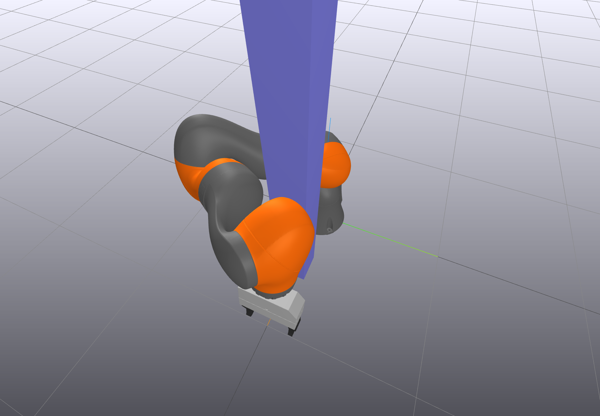

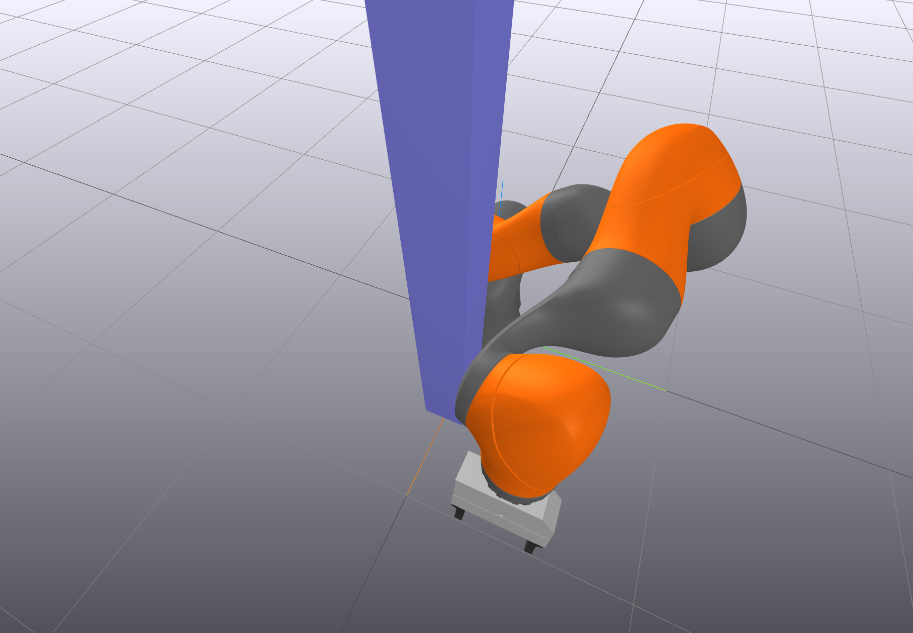

**图 6.3**：期望末端位置沿 $y$ 正方向移动时，IK 能找到从柱子另一侧绕过去的新解。

能力越强，使用时越要认真。IK 工具箱允许复杂优化，但能否成功，也取决于代价和约束选得是否合适。我的基本建议是：

1. 目标尽量简单。我通常只用 $q$ 的关节回中二次代价。把本应作为约束的项改成惩罚代价，会带来大量烦琐的权重调节。

2. 只加必要约束，让可行位形集合尽量大。例如不需要完全固定夹爪朝向，就不要固定。

 下面用例子解释第二点。

<a id="example-2"></a>

<a id="example2"></a>

#### 示例 6.2　抓住圆柱

用 IK 抓圆柱，也可以想成扶手。如果沿圆柱哪里抓、绕轴以什么朝向抓都无所谓，就只写最少的必要约束。

notebook 实现了一个版本，滑块控制圆柱位姿，观察 IK 如何配置机器人。特别是沿 $\pm y$ 移动圆柱时，机器人不会立即跟随，直到夹爪到圆柱末端才动。很不错！

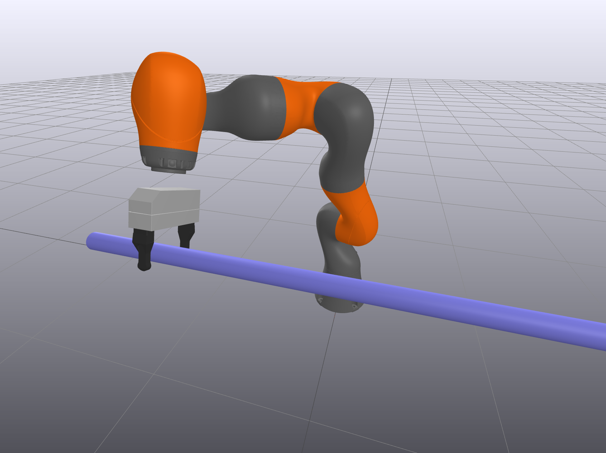

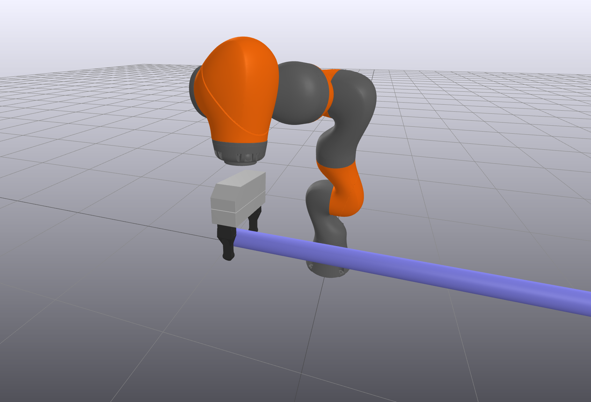

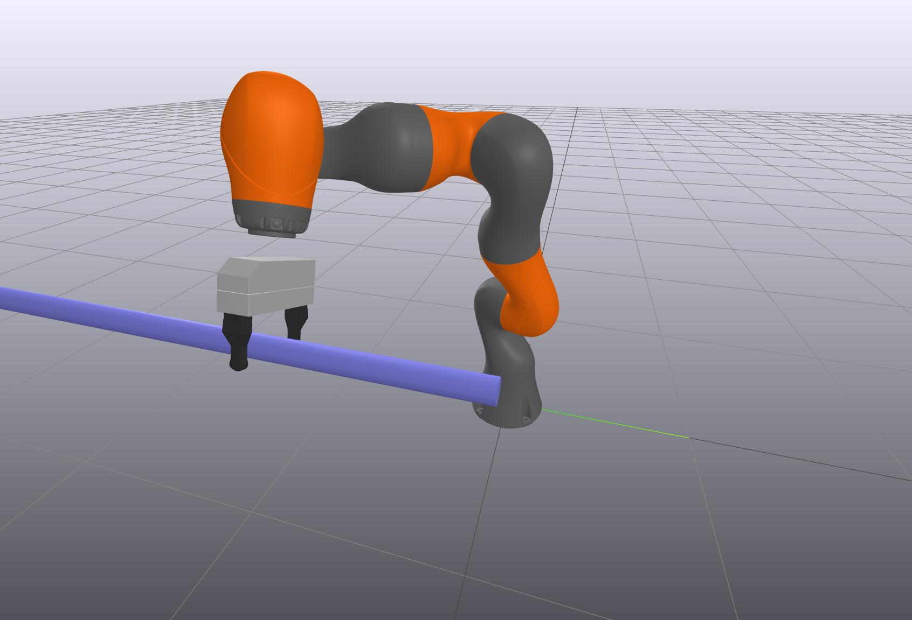

约束写法不止一种，我采用：

```python
ik.AddPositionConstraint(
    frameB=gripper_frame, p_BQ=[0, 0.1, -0.02],
    frameA=cylinder_frame, p_AQ_lower=[0, 0, -0.5], p_AQ_upper=[0, 0, 0.5])
ik.AddPositionConstraint(
    frameB=gripper_frame, p_BQ=[0, 0.1, 0.02], 
    frameA=cylinder_frame, p_AQ_lower=[0, 0, -0.5], p_AQ_upper=[0, 0, 0.5])
```


 在夹爪坐标系中定义两个点，对应 `AddPositionConstraint` 方法中的 ${}^Bp^{Q}$。回顾[夹爪坐标系](pick-and-place.md#grasp_frames)：$[0, .1, 0]$ 正好位于两夹指垫之间。确认自己理解 $[0,.1,-0.02]$、$[0,.1,0.02]$ 的位置。约束要求两点都落在圆柱中心线段上，简洁地限定位置，同时放开绕圆柱轴的朝向。

**运行示例**：[在 Colab 中打开](https://colab.research.google.com/github/RussTedrake/manipulation/blob/master/book/trajectories/trajectories.ipynb)

IK 已有丰富约束语言，涉及机器人运动学和机器人、环境几何，例如最小距离。来看看优化器实际上要解怎样的几何谜题。

<a id="example-3"></a>

<a id="example3"></a>

#### 示例 6.3　构型空间可视化

回到 iiwa 伸进架子抓球。主要约束是：球心位于夹爪中心，以及机械臂避开架子。为绘图，我固定其中三个关节，只留下与 $x-z$ 平面运动对应的三个。

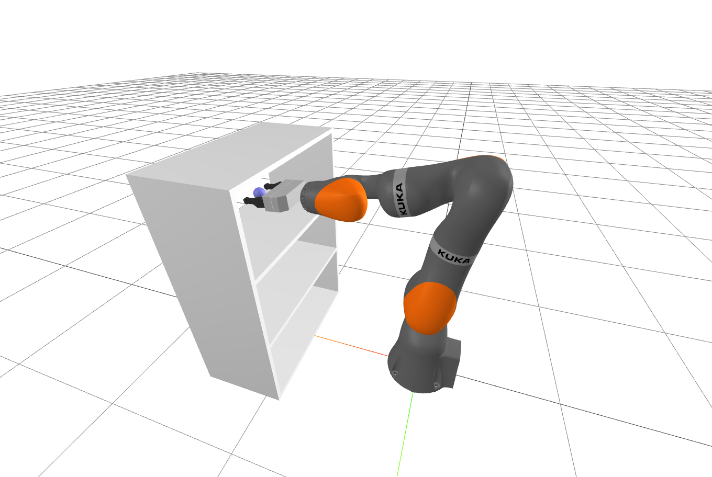

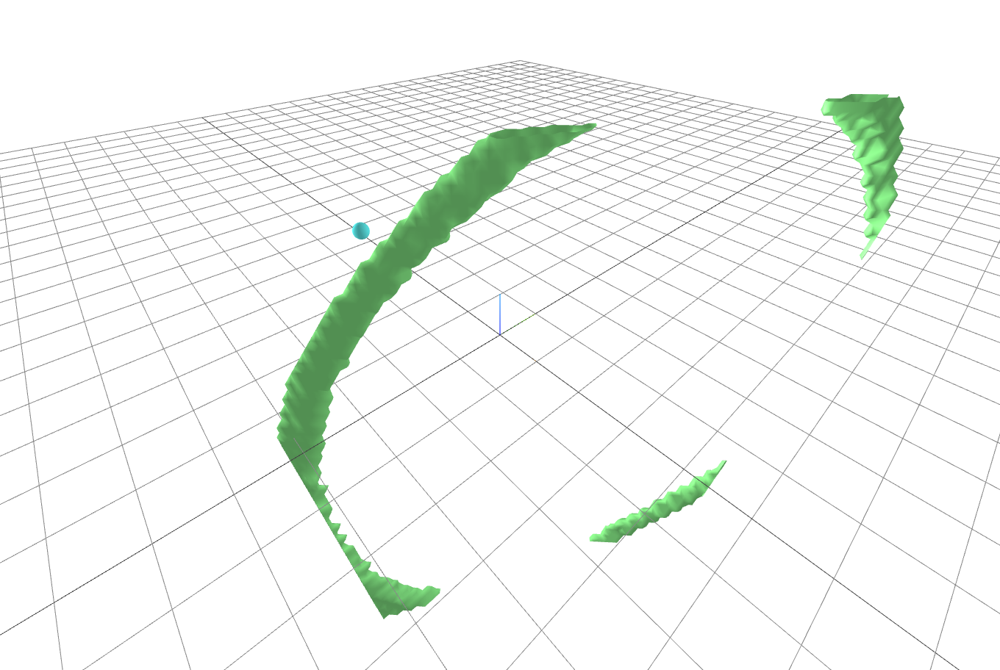

**图 6.4**：右图显示构型空间中的“抓住球”约束，图的 x、y、z 轴对应平面化 iiwa 的三个关节角。

在三个关节角上取稠密网格，满足约束记 1，否则记 0，再用 marching cubes 提取构型空间几何近似。“抓球”约束得到右侧绿色形状，并被关节限位截断。避碰约束复杂得多，最好打开[三维可视化](https://manipulation.mit.edu/data/iiwa_shelves_configuration_space.html)，亲自转动看看。挺吓人的！

**运行示例**：[在 Colab 中打开](https://colab.research.google.com/github/RussTedrake/manipulation/blob/master/book/trajectories/trajectories.ipynb)

<a id="example-4"></a>

<a id="example4"></a>

#### 示例 6.4　IK 优化问题的可视化

我还画了优化曲面，帮助理解问题。先看[这里](https://manipulation.mit.edu/data/shelf_ik_prog_zoom.html)，它只显示返回解附近的一小片区域。通过 MeshCat 控件开关各个代价、约束，确认理解。

按前面的建议，绿色代价曲面只含关节回中的二次项。约束可行处为蓝色，不可行处为红色：

- 关节限位是简单包围盒约束。为避免图形过于拥挤，只画红色不可行区域。

- 位置约束有 $x$、$y$、$z$ 三个分量。由于机械臂只在 $x-z$ 平面运动，$y$ 约束自然满足，全部为蓝色。另两项乍看全红，但关掉 $y$ 后，会看到各自两条细蓝带，这就是严格位置约束的可行部分。

- 最小距离，也就是避碰约束最令人印象深刻，甚至有点吓人。前面只看可行空间，这里把距离画成实值函数，便能看到求解器面对的优化曲面。

 所有蓝色区域的交集，就是前面构型空间的可行集合。notebook 给出全部绘图代码及具体代价、约束。

**运行示例**：[在 Colab 中打开](https://colab.research.google.com/github/RussTedrake/manipulation/blob/master/book/trajectories/trajectories.ipynb)

再看看[完整优化曲面](https://manipulation.mit.edu/data/shelf_ik_prog.html)：曲面相同，但范围覆盖关节限位内的全部角度。SNOPT 等非线性优化器有时确实很厉害！

<a id="section1.3"></a>

### 6.1.3　全局逆运动学

恰好六自由度、无其他约束的 IK 可以有闭式解。丰富约束下的广义 IK 则是非线性优化，实践效果不错，却可能陷入局部极小值，甚至漏掉可行解。如果不要求交互速度，能否更稳健地解这个丰富的问题，最好还能保证全局最优？

这个问题很实际。许多离线 IK 没有严格时限，例如生成神经网络训练数据，或检查设计中的工作空间是否都能到达。下面一些运动规划方法，也会把计算分为离线构建和快速在线查询。

经验上，通用全局非线性求解器，例如混合整数非线性规划（MINLP）或 [可满足性模理论（SMT）](https://en.wikipedia.org/wiki/Satisfiability_modulo_theories) 求解器中的区间算术，通常难以扩展到完整机械臂。不过，稍微限制允许的代价、约束类型，就能取得进展。

Drake 的 [GlobalInverseKinematics](https://drake.mit.edu/doxygen_cxx/classdrake_1_1multibody_1_1_global_inverse_kinematics.html) 实现了 [参考文献 5](#Dai17) 的混合整数凸优化方法，通常几秒可解，完整带约束双臂问题也远不到一分钟。[参考文献 6](#Trutman22) 则用半定规划松弛层次，解决只含末端位姿和关节限位的较窄问题；若能进一步支持更丰富约束，会很值得研究。

<a id="section1.4"></a>

### 6.1.4　逆运动学与微分逆运动学如何选

IK 求较全局的问题，但不保证成功，代价、约束稍变，也不保证 $q$ 只变一点，可能向机器人发出很大的 $\Delta q$ 指令。确实需要全局求解时用 IK，下一节的轨迹优化则自然将其扩展为真实 $q$ 轨迹。微分 IK 很适合增量运动，例如末端空间有平滑指令，只需在关节空间跟踪。

<a id="section1.5"></a>

### 6.1.5　用 IK 规划抓取

最初采样[抓取选择](bin-picking.md#grasp_sampling)时，奖励夹爪从上方抓取，这只是希望机器人处于舒适位形的粗略替代，有时还很差。自然的改进是：为每个候选求 IK，直接用关节回中代价评价，代替末端朝向代价。IK 不可行，就拒绝该样本。

优化视角还带来一个漂亮扩展，也通向轨迹规划。如果不但要从杂物中抓起，还要仔细放进杂物中，好抓取就应同时有利于抓取和放置。可将 $q_{pick}$、$q_{place}$ 都作为决策变量，加入 ${}^OX^{G_{pick}} = {}^OX^{G_{place}}$ 约束，再保留其他丰富代价和约束。在 [TRI 的餐具装载项目](pose-estimation.md#tri_dishloading) 中，这非常重要：从水槽抓杯子、放入洗碗机架，都高度受限，联合优化才能找到成功抓取。

<a id="section2"></a>

## 6.2　运动学轨迹优化

理解优化式 IK 后，轨迹优化也就容易理解了。不再分别求多个 IK，而是一次联合求解一串关节角。更进一步，将轨迹写为 $q_\alpha(t)$，用参数向量 $\alpha$ 表示。简单扩展为：

<a id="equation-eq-vel_limits"></a>

$$
\begin{aligned} \min_{\alpha,T} &
    \quad T, \\ \text{subject to} &\quad X^{G_{start}} = f_{kin}(q_\alpha(0)),\\ & \quad
    X^{G_{goal}} = f_{kin}(q_\alpha(T)), \\ & \quad \forall t , \quad
    \left|\dot{q}_\alpha(t)\right| \le v_{max} . \end{aligned}
 \tag{6.1}
$$

 即“寻找 $t \in [0, T]$ 的轨迹 $q_\alpha(t)$，让夹爪用最短时间从起点到终点”。

最后一个方程（[式 6.1](#equation-eq-vel_limits)）是速度限值，也是唯一阻止机器人瞬间从起点跳到终点的条件。除此之外，几乎就是联合求两个 IK；只是梯度从对 $q$ 求导，改为对 $\alpha$ 求导，用链式法则即可。

<a id="section2.1"></a>

### 6.2.1　轨迹参数化

怎样用参数向量 $\alpha$ 表示轨迹 $q(t)$？如今很容易想到神经网络：输入 $t$，输出 $q$，$\alpha$ 表示权重和偏置，网络就是 $q_\alpha(t)$。当然可行，但对于这种单标量输入，通常使用更简单、稀疏的多项式参数化。

多项式参数化方式很多。例如动态运动规划中，[直接配点法](https://underactuated.csail.mit.edu/trajopt.html#direct_collocation)用[分段三次多项式](https://drake.mit.edu/doxygen_cxx/classdrake_1_1trajectories_1_1_piecewise_polynomial.html)描述状态轨迹，[伪谱法](https://underactuated.csail.mit.edu/trajopt.html#pseudo-spectral)使用 Lagrange 多项式。基函数的选择，是为了利用各自性质。动态规划尤其关注动力学积分精度，确保满足动态约束。

全驱动机械臂的运动规划通常较少担心动力学可行性，主要关心运动学。[B 样条轨迹](https://drake.mit.edu/doxygen_cxx/classdrake_1_1trajectories_1_1_bspline_trajectory.html)具有几项特别好用的性质：

- B 样条的导数仍是 B 样条，次数降低一阶，系数与原系数线性相关。

- 基函数非负且稀疏，使称为“控制点”的系数具有清晰几何意义。

- 整条轨迹始终位于当前有效控制点的凸包内；有效指该处对应基函数非零。

 综合起来，可以用有限参数优化轨迹，并借助凸包性质，仅用线性约束就保证关节位置和各阶导数限值$\forall t\in [0,T]$成立。多数其他多项式基要获得这种保证，成本高得多。

[B 样条](https://en.wikipedia.org/wiki/B-spline)与[Bézier 曲线](https://en.wikipedia.org/wiki/B%C3%A9zier_curve)密切相关。不过，B-spline 的 B 实际指 basis，也就是“基”，真的没开玩笑；“[Bézier 样条](https://en.wikipedia.org/wiki/Composite_B%C3%A9zier_curve)”则稍有不同。

<a id="section2.2"></a>

### 6.2.2　优化算法

Drake 默认的 [`KinematicTrajectoryOptimization`](https://drake.mit.edu/doxygen_cxx/classdrake_1_1planning_1_1trajectory__optimization_1_1_kinematic_trajectory_optimization.html) 类，用 B 样条表示 $s \in [0,1]$ 上的路径 $r(s)$，并增加一个标量决策变量，表示持续时间 $T$。最终通过时间缩放得到轨迹：$q(t) = r(t/T).$。这很适合未知持续时间的问题，且仍能利用凸包性质。速度约束仍然线性；加速度及更高阶导数约束变为非线性，但一旦满足，仍保证限值$\forall t \in [0, T].$成立。

`KinematicTrajectoryOptimization` 使用 Drake 的 `MathematicalProgram`，默认会根据已安装求解器选择合适的方法。只有凸代价、约束时，交给凸优化求解器；但通常会加入非凸的[运动学代价和约束](https://drake.mit.edu/doxygen_cxx/group__solver__evaluators.html)，所以多半仍用 SQP 求解器 SNOPT。也欢迎尝试其他求解器。

轨迹优化中很重要的一项是 [MinimumDistanceLowerBoundConstraint](https://drake.mit.edu/doxygen_cxx/classdrake_1_1multibody_1_1_minimum_distance_lower_bound_constraint.html)：所有潜在碰撞对的最小距离大于零，就避免了碰撞。不过，它只能在路径的离散样本 $s_i \in [0,1]$ 处强制满足，并不保证轨迹$\forall t\in[0,T].$无碰撞。导数约束有特殊性质，才能利用凸包；一般非线性约束没有。常见做法是优化时检查适量采样点，执行前再沿最终轨迹更密集地检查。

<a id="example-5"></a>

<a id="example5"></a>

#### 示例 6.5　架子之间的运动学轨迹优化

先看平面 iiwa 从上层架子伸到中层的简单例子。

**运行示例**：[在 Colab 中打开](https://colab.research.google.com/github/RussTedrake/manipulation/blob/master/book/trajectories/trajectories.ipynb)

细看代码，会发现为了让 SNOPT 得到好解，我实际求了两次。局部优化确实可能需要这样做。本例先不加避碰约束求一条轨迹，再把它作为带避碰问题的初值。

还请留意“可视化回调”：求解过程中，用蓝线画当前轨迹。可以给求解器一个依赖所有变量、始终返回零的代价函数，让它每次计算代价时调用。这样会拖慢优化，却很适合判断求解器在哪里遇到数值困难。我觉得，那些求解又快又稳的工作，往往来自认真可视化、调理数值问题的人。

<a id="example-6"></a>

<a id="example6"></a>

#### 示例 6.6　清理杂物的运动学轨迹优化

也可用 `KinematicTrajectoryOptimization` 规划清理任务。这里优化更稳健，不需要解两次。只给一个简单初始轨迹，避免机器人绕基座转 270°，而不走短路。

**运行示例**：[在 Colab 中打开](https://colab.research.google.com/github/RussTedrake/manipulation/blob/master/book/trajectories/trajectories.ipynb)

文献中有许多相关方法，区别在参数化、求解技术或两者，例如 CHOMP [参考文献 7](#Ratliff09a)、STOMP [参考文献 8](#Kalakrishnan11a)、KOMO [参考文献 9](#Toussaint17)。

KOMO 等方法用[增广拉格朗日法](https://en.wikipedia.org/wiki/Augmented_Lagrangian_method)将约束问题转为无约束问题，再用简单快速的梯度算法求解，见 [参考文献 10](#Toussaint14)。目前增广拉格朗日方法很流行、也很成功，希望不久能在 Drake 提供好实现。不过比较求解器要小心：SNOPT 若无法在默认约 1e−6 容差下优化目标并满足约束，就可能报告失败；增广拉格朗日方法则不会这样报失败，也很少追求这么高精度。

成功时，运动学轨迹优化非常令人满意：描述语言自然、丰富，除了非线性约束需要采样这一点，也足够快，适合在线规划。问题只有一个：它不总成功。非凸优化可能陷入局部极小值，明明存在可行路径，也找不到。

<a id="example-7"></a>

<a id="example7"></a>

#### 示例 6.7　无碰撞轨迹优化中的局部极小值

考虑下图最简单的例子：点机器人从蓝色起点到绿色终点，避开红箱并寻找最短路径。无需 B 样条，就能写成：

$$
\begin{aligned}
\min_{q_0,\ldots,q_N}\quad &\sum_{n=0}^{N-1}|q_{n+1}-q_n|_2^2\\
\text{subject to}\quad&q_0=q_{start}\\
&q_N=q_{goal}\\
&|q_n|_1\ge1\quad\forall n.
\end{aligned}
$$

最后一行要求每个采样点位于 $\ell_1$ 球外，这是为红箱几何选的方便表示。也可进一步约束整条线段、而非仅顶点不进入障碍。下面是两种可能结果：

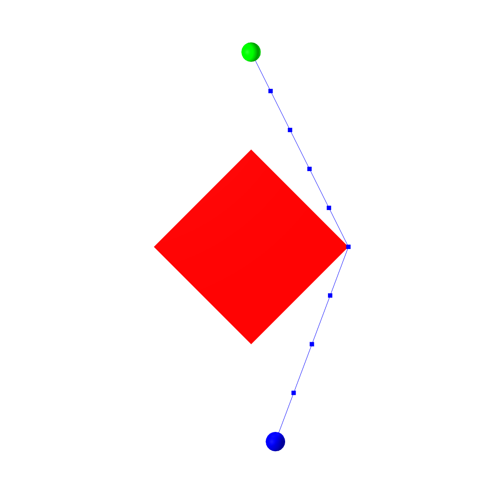

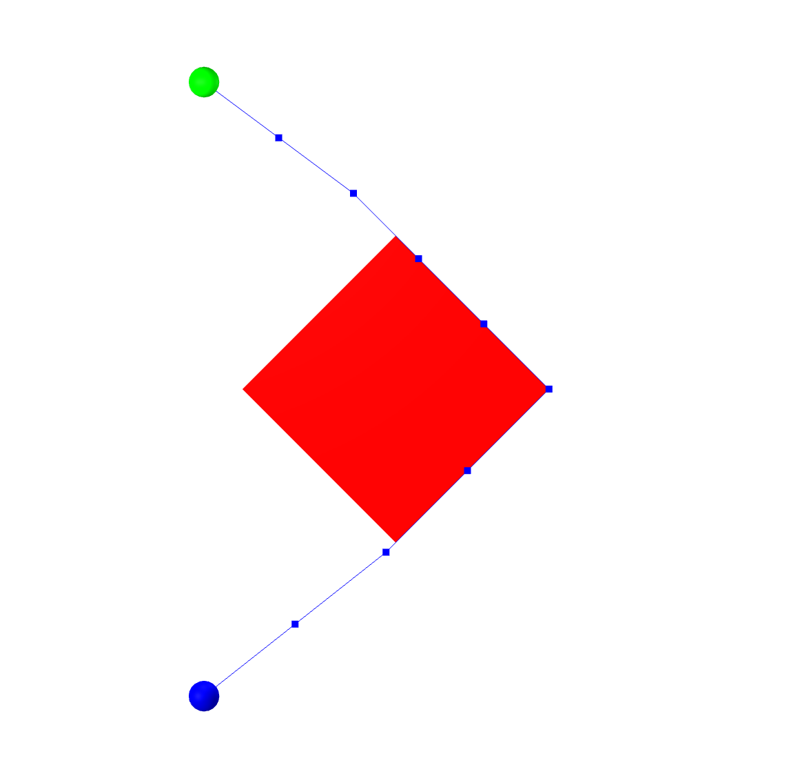

左侧是全局最小解，右侧明显是局部极小值。一旦非线性求解器开始考虑从障碍右侧绕行，就很难改到左侧，因为切换前得先违反避碰约束，让结果暂时变差。

为了应对这个局限，无碰撞运动规划越来越多地采用采样方法。

<a id="section3"></a>

## 6.3　基于采样的运动规划

我希望尽快补齐本节。暂时强烈推荐 Steve LaValle 的书 [参考文献 11](#LaValle06)，以及 [Open Motion Planning Library（OMPL）](https://ompl.kavrakilab.org/)。Drake 内部已有常见采样算法的高效实现，针对我们的碰撞引擎优化，[希望不久公开](https://github.com/RobotLocomotion/drake/issues/14431)。

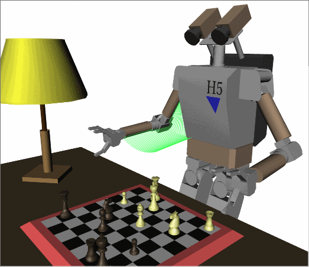


             

      

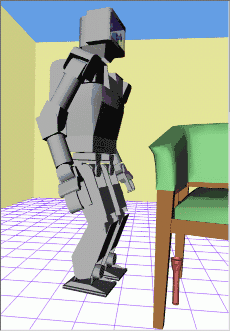

**图 6.5**：James Kuffner 在约 2002 年做出的一些出色采样规划结果，[资料来自这里](http://www.kuffner.org/james/humanoid/planning.php)；在线原图可悬停查看动画。问题的运动学复杂，维数也很高。

<a id="section3.1"></a>

### 6.3.1　快速扩展随机树（RRT）

<a id="example-8"></a>

<a id="example8"></a>

#### 示例 6.8　基本 RRT

**运行示例**：[在 Colab 中打开](https://colab.research.google.com/github/RussTedrake/manipulation/blob/master/book/trajectories/trajectories.ipynb)

<a id="example-9"></a>

<a id="example9"></a>

### 示例 6.9　RRT 的“陷阱”例子

**运行示例**：[在 Colab 中打开](https://colab.research.google.com/github/RussTedrake/manipulation/blob/master/book/trajectories/trajectories.ipynb)

<a id="section3.2"></a>

### 6.3.2　概率路线图（PRM）

<a id="section3.3"></a>

### 6.3.3　后处理

路径捷径化，以及[可随时返回结果的 B 样条平滑方法](https://github.com/RobotLocomotion/drake/issues/11827)。

<a id="section3.4"></a>

### 6.3.4　采样规划的实际使用

许多优化和启发式能显著提升效果，例如高效碰撞检测、加权欧氏距离等。

<a id="gcs"></a>

## 6.4　基于凸集图（GCS）的运动规划

轨迹优化支持丰富代价、约束，包括连续曲线导数约束，也能处理高维构型空间，但本质是局部梯度优化，会陷入局部极小值。采样方法考虑得更全局，具有概率完备性，却不擅长连续导数约束和高维问题。能否结合两者的优点？

我和学生们正在研究一条路线，用通用框架结合连续优化和图上的组合优化，称为“凸集图”（Graphs of Convex Sets，GCS）。

先想想 PRM 为何难处理连续曲率约束。离线构建路线图时，碰撞检查器确认顶点之间的直线段无碰撞，通常只保证到采样分辨率，虽然也能更强，见 [参考文献 12](#Amice23)。在线查询再搜索离散图，得到导数不连续的分段线性最短路径。一旦平滑或用连续曲线近似，既不保证无碰撞，也未必最短。离线阶段只考虑线段，没有给在线优化留下空间。加入动力学时更麻烦：运动学可行路径未必动态可行。采样方法虽[可以扩展](https://ompl.kavrakilab.org/planners.html#control_planners)到运动动力学规划、控制规划，但由于一些[较微妙的原因](https://underactuated.mit.edu/planning.html)，还不如纯运动学采样规划成功。

对 PRM 做一个小改动：每次采样后，不只把点加到图里，还将其扩展为构型空间中的凸区域。离线多花一些计算，能换来重要收益。少量大区域覆盖更多空间，图更稀疏，也更适合高维。更重要的是，只要曲线留在凸区域内，在线就能优化连续曲线。这需要图搜索同时选择离散路径和连续曲线参数，GCS 正好提供这种推广。

<a id="section4.1"></a>

### 6.4.1　凸集图

GCS 最早发表于 [参考文献 13](#Marcucci21)，Drake 已有成熟的[实现](https://drake.mit.edu/doxygen_cxx/classdrake_1_1geometry_1_1optimization_1_1_graph_of_convex_sets.html)。它将图搜索等组合优化，与前面的运动学轨迹等连续优化结合，可以连续地扩展任意网络流优化，参见 [参考文献 14](#Ahuja93)。运动规划中，先关注图上的最短路径。

左图是经典加权最短路径：从源点 $s$ 到目标 $t,$，给定顶点、可能有向的边和每条边的代价。

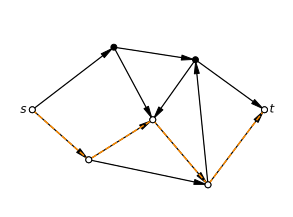

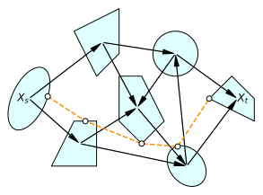

 GCS 的推广简单而有力：访问顶点时，还可以从关联凸集中选择一个连续变量；边代价可以是相邻凸集变量的凸函数，边上也可以设置必须满足的凸约束。

GCS 最短路径可表达 NP-hard 问题，但能写成混合整数凸规划（MICP）。强大之处在于它有很紧、很高效的凸松弛：二元变量放宽为连续后，得到的几乎就是原 MICP 解。因此全局求解可以比旧写法快几个数量级。实践中，通常只解凸松弛再稍作舍入，就已恢复最优解；如今机器人应用中，我们几乎不解完整 MICP。

更多细节、例子见我的[欠驱动笔记](http://underactuated.mit.edu/optimization.html#gcs)；[参考文献 15](#Marcucci24a) 则全面且易读地介绍 GCS 作为离散、连续混合优化工具。

<a id="section4.2"></a>

### 6.4.2　GCS 运动学轨迹优化

怎样把运动规划写成 GCS？我们首先在《Motion planning around obstacles with convex optimization》中提出下述形式，见 [参考文献 16](#Marcucci23a)。前面已经谈了规划的非凸性，所以你应该能理解我们为什么喜欢这个标题：竟能用凸优化高效解决这些问题，并获得全局最优，有些出人意料。

先假设已经有无碰撞空间的凸分解。这是较强假设，后面会解释如何获得。

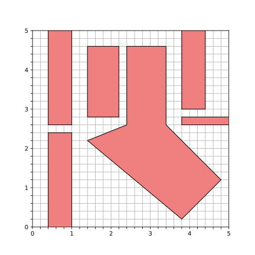

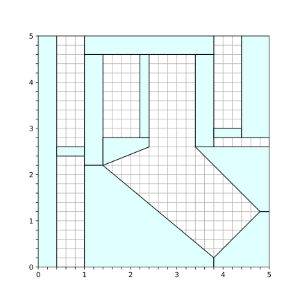

**图 6.6**：左：红色障碍物的简单二维构型空间。右：无碰撞空间的凸分解。

同一个无碰撞凸区域内的两点，连线必然无碰撞；区域交集中的点可将多个区域里的路径接成连续路径。这就是核心。每访问一个 GCS 顶点，需要在区域中选两点来定义路径。所以 GCS 凸集不是原区域本身：对 $n$ 维构型空间，它有 $2n$ 个变量，前 $n$、后 $n$ 个都属于同一区域，即原区域与自身的笛卡尔积。仅当区域相交时连无向边，并要求前一集合的第二点等于后一集合的第一点。

<a id="example-10"></a>

<a id="example10"></a>

#### 示例 6.10　简单二维空间中的 GcsTrajOpt

在上述空间运行 GCS，起点在左下，终点在右上。分别最小化距离，以及在速度约束下最小化时间：

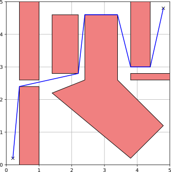


**图 6.7**：左：距离最小的 GcsTrajOpt 结果。右：带速度约束、时间最小的结果。

**运行示例**：[在 Colab 中打开](https://colab.research.google.com/github/RussTedrake/manipulation/blob/master/book/trajectories/trajectories.ipynb)

可以进一步推广。每个区域内不只用线段，而利用 Bézier 凸包性质，保证固定次数的连续曲线整体留在区域中。导数性质允许加入凸速度约束，并保证跨区域连接平滑。不过速度还需要路径的行进速率，因此像前面一样，在每个凸集中引入时间缩放参数。

最终得到较丰富的框架，能在 GCS 凸优化中表示很多，尽管并非全部，轨迹代价和约束。目标包括：

- 时间，即轨迹持续时间；

- 路径长度的上界近似；

- 路径“能量”的上界，例如 $\int |\dot{q}(t)|_2^2$；

 约束包括：

- 任意阶路径导数的连续性；

- 对全部 $t$ 严格成立的速度约束，而非只检查样本；

- 其他凸位置、路径导数约束，例如初末位置和速度。

 系统自动加入路径连续性和区域约束，保证整条轨迹对所有 $t$ 都留在区域并集中，而不仅采样点。[Drake 实现见这里](https://drake.mit.edu/doxygen_cxx/classdrake_1_1planning_1_1trajectory__optimization_1_1_gcs_trajectory_optimization.html)。

<a id="example-11"></a>

<a id="example11"></a>

#### 示例 6.11　简单二维空间中的 GcsTrajOpt：续

这次仍最小化时间，但每段改为带时间缩放的五次 Bézier 曲线，要求直到四阶导数 snap 都连续。

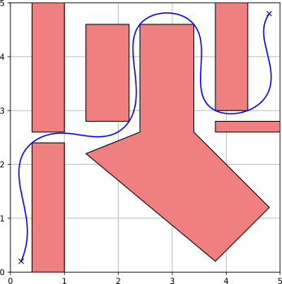

查看轨迹导数，可见速度平滑，而且整条轨迹始终满足 $[-1, 1]$ 的速度界限，不仅是采样点。

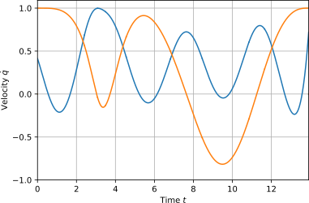

**运行示例**：[在 Colab 中打开](https://colab.research.google.com/github/RussTedrake/manipulation/blob/master/book/trajectories/trajectories.ipynb)

非凸轨迹优化能容纳更丰富的约束，却没有 GCS 的全局优化、完备性优势。我们持续为 GCS 增加代价、约束：有些看似非凸的约束其实有精确凸等价形式，有些可做好的凸近似。这也自然结合两类方法：先在 GCS 松弛中使用凸近似，由 GCS 选出离散图路径和强初值，再在舍入阶段用非线性优化精确处理非凸项，见 [参考文献 17](#Wrangel24)。在 Drake，可通过 GCS 的 `AddCost`、`AddConstraint` 方法中的 `use_in_transcription` 选项，并仅向 `Transcription::kRestriction` 加入非凸约束来实现。

<a id="iris"></a>

### 6.4.3　无碰撞构型空间的凸分解

怎样获得凸分解？继续类比 PRM：采样一个无碰撞点，如何将它扩展为凸区域？

若几何本身凸，问题简单一些。我认为，在欧氏空间 $\mathbb{R}^3.$ 中用凸形状近似机器人很合理。iiwa 等模型虽有非凸网格，通常可以用若干简单凸体的并集近似，例如球、圆柱，或直接对网格凸分解。但欧氏空间中的几何凸，不代表构型空间中的障碍仍凸。

有几个例外：如果只有平移，或机器人形状对旋转不变，例如点、球形机器人，那么对应的构型空间障碍仍凸。这是使构型空间成为机器人核心数学对象的早期观察，见 [参考文献 18](#Lozano-Perez90)；适合移动机器人，甚至近似成球的四旋翼。可计算采样处凸体之间最小距离，再把点扩展成相应半径的球，见 [参考文献 19](#Shkolnik11a)。想得到更大区域，我们广泛使用 [参考文献 20](#Deits14) 中提出、[在 Drake 中实现](https://drake.mit.edu/doxygen_cxx/group__geometry__optimization.html#gafd8111a93cb3461e05bec3477ee736f6) 的 IRIS，即基于半定规划的迭代区域膨胀。它交替寻找分离超平面和最大体积内接椭球，以局部最大化区域体积的高效近似。

IRIS 也能扩展到一般非凸构型空间，获得大的凸区域，方法如下：

- 非线性规划（NP）。IRIS-NP，见 [参考文献 21](#Petersen23a)，[已在 Drake 实现](https://drake.mit.edu/doxygen_cxx/group__geometry__optimization.html#ga3a51e0fec449a0abcf498f78a2a390a8)，将寻找最近碰撞的凸优化改为 SNOPT 等非线性求解器，并随机采样潜在碰撞，使方法具有概率可靠性。实际较快，但不保证区域完全无碰撞。较新的 [IRIS-NP2](https://github.com/orgs/RobotLocomotion/projects/5/views/1?pane=issue&itemId=75484893)，见 [参考文献 22](#Werner24)，显著改进这条流程，区域更大、面更少，比原 IRIS-NP 快几个数量级。

- 零阶优化（ZO）。IRIS-ZO 将 IRIS-NP 的非线性优化替换为不需要梯度、只用样本的零阶方法，区域稍小，但很容易并行，见 [参考文献 22](#Werner24)。

- 代数运动学与平方和优化。多数机器人运动学可用有理多项式表示，因此可用多项式优化寻找严格的无碰撞证书，见 [参考文献 23](#Dai23)，[已在 Drake 实现](https://drake.mit.edu/doxygen_cxx/classdrake_1_1geometry_1_1optimization_1_1_cspace_free_polytope.html)。方法通常慢些，但结果可靠。代价是必须在原空间的[球极投影](http://underactuated.mit.edu/lyapunov.html#stereographic)坐标下找凸区域，实际相当于轻微扭曲坐标，也改变区域内的轨迹长度。

<a id="example-12"></a>

<a id="example12"></a>

#### 示例 6.12　构型空间中的 IRIS

在前面 iiwa 伸进架子的例子上，运行 `IrisInConfigurationSpace`，即 IRIS-NP。使用完整七自由度及原碰撞几何，展示两点：如何使用 `IrisInConfigurationSpace`，以及即使面对复杂几何，IRIS 区域也能覆盖很大体积。


`IrisInConfigurationSpace` 可从一个种子开始，在附近的小区域逐步膨胀，局部最大化构型空间体积。先用 `InverseKinematics` 找一个伸进上层架子的种子位形 $q,$。但只从这里跑 IRIS，区域会向架子外膨胀，因为外面空间大得多。为避免如此，先从机器人初始位形生成架外区域，再从架内 IK 种子运行一次，并把第一个区域作为不得重叠的障碍，迫使第二个使用架内体积。

**运行示例**：[在 Colab 中打开](https://colab.research.google.com/github/RussTedrake/manipulation/blob/master/book/trajectories/trajectories.ipynb)

现在我更喜欢另一办法：先用 IK 在感兴趣区域收集多个构型样本，求 [`MinimumVolumeCircumscribedEllipsoid`](https://drake.mit.edu/doxygen_cxx/classdrake_1_1geometry_1_1optimization_1_1_hyperellipsoid.html#a0783f7f2e02468471d114e49cbbfa4fd)，作为 IRIS 的 [`starting_ellipse`](https://drake.mit.edu/doxygen_cxx/structdrake_1_1geometry_1_1optimization_1_1_iris_options.html#ae65f515b41261e98fb16dd1e810cba48)，再只运行一轮。这样体积目标直接对应所需区域，不必把已有区域人为当作障碍，因此区域更大、运行更快，也更容易并行。

**运行示例**：[在 Colab 中打开](https://colab.research.google.com/github/RussTedrake/manipulation/blob/master/book/trajectories/trajectories.ipynb)

继续类比 PRM，可以随机采样，拒绝碰撞或已位于 IRIS 区域内的点，再扩展剩余样本。但实际上能做得更好：相同区域数覆盖更多自由空间，或用更少区域覆盖相同体积。目前我们最好的凸分解算法，是计算可见性图的“最小团覆盖”，见 [参考文献 24](#Werner23)，[已在 Drake 实现](https://drake.mit.edu/doxygen_cxx/namespacedrake_1_1planning.html#ace53f3f8045d8eb96867bcd6eda63ed0)。

<a id="example-13"></a>

<a id="example13"></a>

#### 示例 6.13　简单二维空间中的 GcsTrajOpt：续

在二维例子中，运行最小团覆盖，并要求覆盖构型空间的 96%，可自动得到这样的分解：

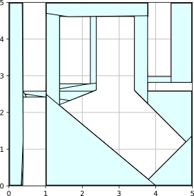

**运行示例**：[在 Colab 中打开](https://colab.research.google.com/github/RussTedrake/manipulation/blob/master/book/trajectories/trajectories.ipynb)

实际中，七自由度机械臂的稠密覆盖相当可行，甚至可能到十自由度。但更高维时，试图覆盖每个角落，恐怕是错误目标。我更喜欢用代表“重要”区域的点初始化团覆盖：通过 IK 手动提供，或从遥操作示范、其他能生成计划但缺乏相同保证的规划器，甚至强化学习策略的轨迹中提取。

<a id="example-14"></a>

<a id="example14"></a>

#### 示例 6.14　IRIS 区域构建工具

下面 notebook 提供几种工具，帮助引导 IRIS 区域的生成。

**运行示例**：[在 Colab 中打开](https://colab.research.google.com/github/RussTedrake/manipulation/blob/master/book/trajectories/trajectories.ipynb)

<a id="section4.4"></a>

### 6.4.4　GcsTrajOpt 示例

<a id="example-15"></a>

<a id="example15"></a>

#### 示例 6.15　平滑曲线应该用什么代价函数？

**运行示例**：[在 Colab 中打开](https://colab.research.google.com/github/RussTedrake/manipulation/blob/master/book/trajectories/trajectories.ipynb)

<a id="example-16"></a>

<a id="example16"></a>

#### 示例 6.16　iiwa 伸进架子

**运行示例**：[在 Colab 中打开](https://colab.research.google.com/github/RussTedrake/manipulation/blob/master/book/trajectories/trajectories.ipynb)

<a id="example-17"></a>

<a id="example17"></a>

#### 示例 6.17　双臂 iiwa

<a id="section4.5"></a>

### 6.4.5　变体与扩展

快速路径规划（FPP），见 [参考文献 25](#Marcucci23)。许多任务不需要 GCS 的全部能力，启发式近似就能得到很好结果。FPP 不同时求离散、连续变量，而交替求解，得到局部极小值。它通常比 `GcsTrajectoryOptimization` 快，还能借交替求解处理 `GcsTrajectoryOptimization` 无法直接处理的导数约束，例如加速度。但支持的凸集、约束类型较有限。Drake 实现[即将提供](https://github.com/RobotLocomotion/drake/issues/20388)！

流形上的 GCS，包括移动操作 [参考文献 26](#Cohn23) 和双臂操作 [参考文献 27](#Cohn23a)。

带动力学约束的 GCS。对分段仿射动力学、凸目标和约束描述的离散系统，GCS 提供了截至原文写作时最强的形式，见 [参考文献 13](#Marcucci21)。也能更直接地处理连续曲线上的连续动力学约束，后续再补充。

通过接触完成规划。令人兴奋的是，我们已有带接触准静态操作的紧凸松弛，见 [参考文献 28](#Graesdal24)。初步例子很简单，便于仔细分析问题，暂缓求解器扩展的细节；很快会有更多结果。

不确定性下的规划。（后续补充。）

任务与运动联合规划。（后续补充。）[参考文献 29](#Kurtz23) 给出了从时序逻辑到 GCS 的自然转换。

把 GCS 用作反馈策略。（后续补充。）

<a id="topp"></a>

## 6.5　时间最优路径参数化

已有运动计划后，自然会问：满足速度、加速度和力矩限值时，最快能多快执行？

将区间 $t \in [t_0, t_f]$ 上的轨迹 ${\mathbf{q}}(t)$，分为路径参数 ${\bf r}(s)$ 和时间参数 $s(t)$，满足 

$$
{\mathbf{q}}(t) = {\bf r}(s(t)),
    \text{ where }s(t) \in [0,1], s(t_0) = 0, s(t_f) = 1.
$$

。约束 $\forall t \in [t_0, t_f], \dot{s}(t) > 0,$，保证从 $s$ 到 $t$ 的逆映射存在。这样，在 ${\bf r}(s)$ 固定时，许多关于 ${\mathbf{q}}(t)$ 的目标和约束，对 $s(t).$ 的导数其实是凸的。用 ${\bf r}'(s) =
    \frac{\partial \bf r}{\partial s}, {\bf r}''(s) = \frac{\partial ^2 {\bf r}}{\partial s^2},$ 等简写，有：

$$
\begin{aligned} \dot{\mathbf{q}} &= {\bf r}'(s)\dot{s},\\ \ddot{\mathbf{q}}(t) &= {\bf r}''(s)
    \dot{s}^2 + {\bf r}'(s)\ddot{s}.\end{aligned}
$$

。更重要的是，代入[机械臂动力学方程](https://underactuated.mit.edu/multibody.html#manipulator)得到：

$$
{\mathbf{u}}(s) = {\bf m}(s)\ddot{s} + {\bf c}(s)\dot{s}^2 +
    \bar{\bf \tau}_g(s),
$$

，其中 ${\mathbf{u}}(s)$ 是缩放时刻 $s(t)$ 的指令力矩，

$$
\begin{aligned} {\bf m}(s) &= {\bf M}({\bf r}(s)){\bf
    r}'(s), \\ {\bf c}(s) &= {\bf M}({\bf r}(s)){\bf r}''(s) + {\mathbf{C}}({\bf r}(s),
    {\bf r}'(s)) {\bf r}'(s), \\ \bar{\bf \tau}_g(s) &= {\bf \tau}_g({\bf
    r}(s)).\end{aligned}
$$

。

接下来做变量替换：$b(s(t)) =
    \dot{s}^2(t)  ,$，注意 $b'(s) = 2 \ddot{s}.$，因为 $\dot{b}(s) = b'(s)\dot{s}$ 且 $\dot{b}(s) =
    2\dot{s}\ddot{s}.$。用参数化轨迹表示区间 $s\in[0,1]$ 上的 $b(s)$，便能将许多有用代价和约束，写成 $b(s)$ 的凸函数，在采样时刻 $s_i = s(t_i)$ 计算：

- 单调性约束：
  
    $$
    b(s_i) \ge \epsilon \Rightarrow
          \dot{s}(t_i) >
          0.
    $$
  
  

- 速度限值是包围盒约束：
  
    $$
    \forall j,\,
          \dot{q}_{min,j}^2 \le r'_j(s_i)^2 b(s_i) \le \dot{q}_{max,j}^2 \Rightarrow
          \dot{{\mathbf{q}}}_{min} \le \dot{{\mathbf{q}}}(t_i) \le \dot{{\mathbf{q}}}_{max}.
    $$
  
  

- 加速度限值是线性约束：
  
    $$
    \ddot{{\mathbf{q}}}_{min} \le
          {\bf r}''(s_i)b(s_i) + \frac{1}{2} {\bf r}'(s_i) b'(s_i) \le
          \ddot{{\mathbf{q}}}_{max} \Rightarrow \ddot{{\mathbf{q}}}_{min} \le \ddot{\mathbf{q}}(t_i) \le
          \ddot{\mathbf{q}}_{max}.
    $$
  
  

- 力矩限值是线性约束：
  
    $$
    \begin{gathered}{\mathbf{u}}_{min} \le
          \frac{1}{2}{\bf m}(s_i)b'(s_i) + {\bf c}(s_i)b(s_i) + \bar{\bf \tau}_g(s_i)
          \le {\mathbf{u}}_{max} \Rightarrow\\ {\mathbf{u}}_{min} \le {\mathbf{u}}(t_i) \le
          {\mathbf{u}}_{max}.\end{gathered}
    $$
  
  

- 最小化持续时间是凸目标：
  
    $$
    t_f - t_0 = \int_{t_0}^{t_f} 1 dt = \int_0^1
          \frac{1}{\sqrt{b(s)}} ds.
    $$
  
    。它看似非凸，但可以改写……（原文此处未展开。）

。我们当然希望有限个约束就能保证整段 $[t_0, t_f]$ 上成立，但实际通常取足够多样本，放弃严格的连续时间保证。

时间最优路径参数化（TOPP）在 20 世纪 80 年代得到大量研究，例如 [参考文献 30](#Bobrow85)，当时常用专门算法寻找 bang-bang 轨迹的所有切换时刻。[参考文献 31](#Verscheure09)、[参考文献 32](#Debrouwere13)、[参考文献 33](#Lipp14) 建立了本节所述的凸优化联系，[参考文献 34](#Pham18) 提供了广泛使用的 [TOPPRA](https://drake.mit.edu/doxygen_cxx/classdrake_1_1multibody_1_1_toppra.html)，即基于可达性分析的 TOPP。我们在 [参考文献 16](#Marcucci23a) 中大量使用这些思路，并详细说明它们与 Bézier 参数化的关系。Drake 也有 [PathParameterizedTrajectory](https://drake.mit.edu/doxygen_cxx/classdrake_1_1trajectories_1_1_path_parameterized_trajectory.html) 类。

常见问题是：TOPP 能否对 jerk，即加速度变化率，或更高阶导数 

$$
\dddot{\mathbf{q}}(t) = {\bf r}'''(s) \dot{s}^3(t) + 3{\bf r}''(s) \dot{s}(t)
    \ddot{s}(t) + {\bf r}'(s)\dddot{s}(t).
$$

 写出凸约束？许多工业机械臂有必须遵守的 jerk 限值，所以这很重要。[参考文献 32](#Debrouwere13) 讨论了其中一个版本，后续再展开。

<a id="section6"></a>

## 6.6　练习

<a id="exercise-1"></a>

<a id="exercise1"></a>

### 练习 6.1　开柜门

本题用基于优化的 IK 求解器打开柜门。所有工作都在 [对应 notebook](https://colab.research.google.com/github/RussTedrake/manipulation/blob/master/book/trajectories/exercises/door_opening.ipynb) 中完成，具体包括：

1. 写出抓取柜门把手的 IK 约束。

2. 将 IK 写成优化问题。

3. 用 MathematicalProgram 实现。

<a id="rrtExercise"></a>

<a id="exercise2"></a>

### 练习 6.2　RRT 运动规划

实现并分析课堂中的 RRT，所有工作都在 [对应 notebook](https://colab.research.google.com/github/RussTedrake/manipulation/blob/master/book/trajectories/exercises/rrt_planning.ipynb) 中完成，具体包括：

1. 为 Kuka 机械臂实现 RRT。

2. 回答算法性质相关问题。

3. 为 Kuka 机械臂实现 RRT-Connect。

<a id="exercise-3"></a>

<a id="exercise3"></a>

### 练习 6.3　改善 RRT 路径质量

节点随机生成，RRT 路径经常有些突兀，“RRT 舞蹈”因此成了机器人研究者的经典笑话。改善方法很多，这里看两种。本题用路径长度衡量质量，目标是在关节空间欧氏距离下找到尽可能短的路径。

1. 第一种是后处理捷径化，用较短线段替换现有路径的一部分，见 [参考文献 35](#Geraerts04)。典型流程是随机选两个非相邻节点，用 RRT 的 extend 操作连接，若更好就替换原路径，反复直到步数或时间上限。本题假设 extend 是关节空间直线。下图中，RRT 已找到从 $q_{start}$ 到 $q_{goal}$ 的曲折路径，障碍为红色，$q_{start}$、$q_{goal}$ 标蓝；图是手工绘制的说明例。
   
   
    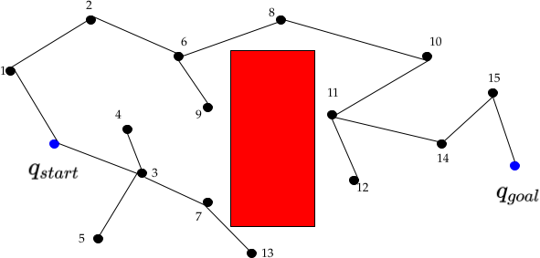
   
   
   
   
    请找一对现有路径节点，直接相连就能缩短路径，距离用二维欧氏距离。

2. 后处理捷径化只围绕现有路径做局部重连，是启发式，不能保证树表示最短路径。看下面的一轮 RRT：$q_{sample}$ 是随机位形，$q_{near}$ 是已有树中最近节点，$q_{new}$ 是从 $q_{near}$ 朝 q_sample 扩展得到的点。标准 RRT，也就是你在[前一道练习](https://manipulation.mit.edu/#rrtExercise)中实现的版本，加入 $q_{new}$ 时父节点是谁？如果希望树为每个节点保存从起点 $q_{start}$ 出发的最短路径，$q_{new}$ 的父节点应是谁？

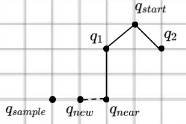

这种动态重连以寻找最低代价路径的思路，是渐近最优 RRT* 的关键，见 [参考文献 36](#Karaman11)。样本数趋于无穷时，RRT* 找到最优路径；普通 RRT 则已证明是次优的。直观上，它无法在搜索中不断改进既有路径，会把自己困住。

<a id="exercise-4"></a>

<a id="exercise4"></a>

### 练习 6.4　用凸优化分解无障碍空间

本题实现 IRIS 的一部分，见 [参考文献 20](#Deits14)。它通过一系列凸优化寻找大的无障碍区域，可用于从起点到终点的无碰撞轨迹搜索。所有工作都在 [对应 notebook](https://colab.research.google.com/github/RussTedrake/manipulation/blob/master/book/trajectories/exercises/taskspace_iris.ipynb) 中完成，具体包括：

1. 实现 QP，寻找障碍上距离自由空间椭球最近的点。

2. 实现寻找超平面组，将自由空间椭球与全部障碍分开。

<a id="exercise-5"></a>

<a id="exercise5"></a>

### 练习 6.5　规划与放置

接着前几章的字母模型操作，用 RRT-Connect 规划、仿真杂乱环境中的无碰撞轨迹，再用捷径化改善路径，减少“RRT 舞蹈”。所有工作都在 [对应 notebook](https://colab.research.google.com/github/RussTedrake/manipulation/blob/master/book/trajectories/exercises/5_plan_place_initials.ipynb) 中完成，具体包括：

1. 定义关键帧位姿。

2. 实现优化式 IK，为每个关键帧求可行机器人位形。

3. 实现 RRT-Connect。

4. 实现捷径化。

<a id="exercise-6"></a>

<a id="exercise6"></a>

### 练习 6.6　用关节空间 IRIS 与 GCS，让 iiwa 穿行架子

本题用 IRIS 寻找 Kuka iiwa 的大块无碰撞构型区域，再用 GCS 在关节空间规划穿过它们的轨迹。在 [对应 notebook](https://colab.research.google.com/github/RussTedrake/manipulation/blob/master/book/trajectories/exercises/gcs_with_kuka_iiwa.ipynb) 中完成，具体包括：

1. 围绕期望起点、终点定义并计算关节空间 IRIS 区域。

2. 构造并求解穿过这些区域的 GCS 轨迹优化问题，规划 iiwa 关节空间路径。

<a id="exercise-7"></a>

<a id="exercise7"></a>

### 练习 6.7　绕架子外侧的轨迹优化

本题帮助理解环境怎样影响轨迹优化的建模和求解。让夹爪绕架子外侧移动，尤其关注 iiwa 运动学工作空间边界和复杂碰撞约束的影响。在 [对应 notebook](https://colab.research.google.com/github/RussTedrake/manipulation/blob/master/book/trajectories/exercises/kinematic_trajopt_around_shelf_iiwa.ipynb) 中完成，具体包括：

1. 在 Kuka iiwa 完整关节空间中，构造并求解不带碰撞约束的运动学轨迹优化。

2. 加入碰撞约束，以上一步的“空手道劈砍”轨迹为初值，分析为何默认求解器参数下无法收敛。

3. 研究更合适的初始猜测如何加快收敛。

<a id="references"></a>

## 参考文献

<div class="references" markdown="1">

1. <a id="Fallon14"></a> Maurice Fallon and Scott Kuindersma and Sisir Karumanchi and Matthew Antone and Toby Schneider and Hongkai Dai and Claudia Pérez D'Arpino and Robin Deits and Matt DiCicco and Dehann Fourie and Twan Koolen and Pat Marion and Michael Posa and Andrés Valenzuela and Kuan-Ting Yu and Julie Shah and Karl Iagnemma and Russ Tedrake and Seth Teller , "An Architecture for Online Affordance-based Perception and Whole-body Planning" , Journal of Field Robotics , vol. 32, no. 2, pp. 229-254, September, 2014 .
    [文献链接](http://groups.csail.mit.edu/robotics-center/public_papers/Fallon14.pdf)

2. <a id="Marion16"></a> Pat Marion and Maurice Fallon and Robin Deits and Andrés Valenzuela and Claudia Pérez D'Arpino and Greg Izatt and Lucas Manuelli and Matt Antone and Hongkai Dai and Twan Koolen and John Carter and Scott Kuindersma and Russ Tedrake , "Director: A User Interface Designed for Robot Operation With Shared Autonomy" , Journal of Field Robotics , vol. 1556-4967, 2016 .
    [文献链接](http://groups.csail.mit.edu/robotics-center/public_papers/Marion16.pdf)

3. <a id="Wampler11"></a> Charles W. Wampler and Andrew J. Sommese , "Numerical algebraic geometry and algebraic kinematics" , Acta Numerica , vol. 20, pp. 469-567, 2011 .

4. <a id="Diankov10"></a> Rosen Diankov , "Automated Construction of Robotic Manipulation Programs" , 
    PhD thesis, Carnegie Mellon University, August, 2010 .

5. <a id="Dai17"></a> Hongkai Dai and Gregory Izatt and Russ Tedrake , "Global inverse kinematics via mixed-integer convex optimization" , International Symposium on Robotics Research , 2017 .
    [文献链接](http://groups.csail.mit.edu/robotics-center/public_papers/Dai17.pdf)

6. <a id="Trutman22"></a> Pavel Trutman and Mohab Safey El Din and Didier Henrion and Tomas Pajdla , "Globally optimal solution to inverse kinematics of 7DOF serial manipulator" , IEEE Robotics and Automation Letters , vol. 7, no. 3, pp. 6012--6019, 2022 .

7. <a id="Ratliff09a"></a> Nathan Ratliff and Matthew Zucker and J. Andrew (Drew) Bagnell and Siddhartha Srinivasa , "CHOMP: Gradient Optimization Techniques for Efficient Motion Planning" , IEEE International Conference on Robotics and Automation (ICRA) , May, 2009 .

8. <a id="Kalakrishnan11a"></a> Mrinal Kalakrishnan and Sachin Chitta and Evangelos Theodorou and Peter Pastor and Stefan Schaal , "STOMP: Stochastic trajectory optimization for motion planning" , 2011 IEEE international conference on robotics and automation , pp. 4569--4574, 2011 .

9. <a id="Toussaint17"></a> Marc Toussaint , "A tutorial on Newton methods for constrained trajectory optimization and relations to SLAM, Gaussian Process smoothing, optimal control, and probabilistic inference" , Geometric and numerical foundations of movements , pp. 361--392, 2017 .

10. <a id="Toussaint14"></a> Marc Toussaint , "A Novel Augmented Lagrangian Approach for Inequalities and Convergent Any-Time Non-Central Updates" , 
    , 2014 .

11. <a id="LaValle06"></a> Steven M. LaValle , "Planning Algorithms" , Cambridge University Press
    , 2006 .

12. <a id="Amice23"></a> Amice and Alexandre and Werner and Peter and Tedrake and Russ , "Certifying Bimanual RRT Motion Plans in a Second" , International Conference on Robotics and Automation , pp. 9293-9299, 2024 .
    [文献链接](http://groups.csail.mit.edu/robotics-center/public_papers/Amice23.pdf)

13. <a id="Marcucci21"></a> Tobia Marcucci and Jack Umenberger and Pablo A. Parrilo and Russ Tedrake , "Shortest Paths in Graphs of Convex Sets" , arxiv , 2023 .
    [文献链接](http://groups.csail.mit.edu/robotics-center/public_papers/Marcucci21.pdf)

14. <a id="Ahuja93"></a> Ravindra K Ahuja and Thomas L Magnanti and James B Orlin , "Network flows: theory, algorithms, and applications" , Prentice-Hall, Inc.
    , 1993 .

15. <a id="Marcucci24a"></a> Tobia Marcucci , "Graphs of Convex Sets with Applications to Optimal Control and Motion Planning" , 
    PhD thesis, Massachusetts Institute of Technology, May, 2024 .
    [文献链接](http://groups.csail.mit.edu/robotics-center/public_papers/Marcucci24a.pdf)

16. <a id="Marcucci23a"></a> Tobia Marcucci and Mark Petersen and David von Wrangel and Russ Tedrake , "Motion planning around obstacles with convex optimization" , Science Robotics , vol. 8, no. 84, 2023 .

17. <a id="Wrangel24"></a> David von Wrangel and Russ Tedrake , "Using Graphs of Convex Sets to Guide Nonconvex Trajectory Optimization" , Proceedings of the IEEE/RSJ International Conference on Intelligent Robots and Systems (IROS) , pp. 8, 2024 .
    [文献链接](http://groups.csail.mit.edu/robotics-center/public_papers/Wrangel24.pdf)

18. <a id="Lozano-Perez90"></a> Tomas Lozano-Perez , "Spatial planning: A configuration space approach" , Springer
    , 1990 .

19. <a id="Shkolnik11a"></a> Alexander Shkolnik and Russ Tedrake , "Sample-Based Planning with Volumes in Configuration Space" , arXiv:1109.3145v1 [cs.RO] , 2011 .

20. <a id="Deits14"></a> Robin L H Deits and Russ Tedrake , "Computing Large Convex Regions of Obstacle-Free Space through Semidefinite Programming" , Proceedings of the Eleventh International Workshop on the Algorithmic Foundations of Robotics (WAFR 2014) , 2014 .
    [文献链接](http://groups.csail.mit.edu/robotics-center/public_papers/Deits14.pdf)

21. <a id="Petersen23a"></a> Mark Petersen and Russ Tedrake , "Growing convex collision-free regions in configuration space using nonlinear programming" , arXiv preprint arXiv:2303.14737 , 2023 .

22. <a id="Werner24"></a> Peter Werner and Thomas Cohn and Rebecca H. Jiang and Tim Seyde and Max Simchowitz and Russ Tedrake and Daniela Rus , "Faster Algorithms for Growing Collision-Free Convex Polytopes in Robot Configuration Space" , Accepted to ISRR 2024 , 2024 .
    [文献链接](http://groups.csail.mit.edu/robotics-center/public_papers/Werner24.pdf)

23. <a id="Dai23"></a> Hongkai Dai* and Alexandre Amice* and Peter Werner and Annan Zhang and Russ Tedrake , "Certified Polyhedral Decompositions of Collision-Free Configuration Space" , The International Journal of Robotics Research (IJRR) , vol. 43, no. 9, pp. 1322-1341, November, 2023 .
    [文献链接](http://groups.csail.mit.edu/robotics-center/public_papers/Dai23.pdf)

24. <a id="Werner23"></a> Peter Werner and Alexandre Amice and Tobia Marcucci and Daniela Rus and Russ Tedrake , "Approximating Robot Configuration Spaces with few Convex Sets using Clique Covers of Visibility Graphs" , International Conference on Robotics and Automation , pp. 10359-10365, 2024 .
    [文献链接](http://groups.csail.mit.edu/robotics-center/public_papers/Werner23.pdf)

25. <a id="Marcucci23"></a> Tobia Marcucci and Parth Nobel and Russ Tedrake and Stephen Boyd , "Fast Path Planning Through Large Collections of Safe Boxes" , arXiv preprint arXiv:2305.01072 , 2023 .

26. <a id="Cohn23"></a> Thomas Cohn and Mark Petersen and Max Simchowitz and Russ Tedrake , "Non-Euclidean Motion Planning with Graphs of Geodesically-Convex Sets" , Robotics: Science and Systems , 2023 .
    [文献链接](http://groups.csail.mit.edu/robotics-center/public_papers/Cohn23.pdf)

27. <a id="Cohn23a"></a> Thomas Cohn and Seiji Shaw and Max Simchowitz and Russ Tedrake , "Constrained Bimanual Planning with Analytic Inverse Kinematics" , arXiv preprint arXiv:2309.08770 , May, 2024 .
    [文献链接](http://groups.csail.mit.edu/robotics-center/public_papers/Cohn23a.pdf)

28. <a id="Graesdal24"></a> Bernhard P Graesdal and Shao Yuan Chew Chia and Tobia Marcucci and Savva Morozov and Alexandre Amice and Pablo A Parrilo and Russ Tedrake , "Towards Tight Convex Relaxations for Contact-Rich Manipulation" , arXiv preprint arXiv:2402.10312 , 2024 .

29. <a id="Kurtz23"></a> Vince Kurtz and Hai Lin , "Temporal Logic Motion Planning with Convex Optimization via Graphs of Convex Sets" , arXiv preprint arXiv:2301.07773 , 2023 .

30. <a id="Bobrow85"></a> J.E. Bobrow and S. Dubowsky and J.S. Gibson , "Time-Optimal Control of Robotic Manipulators Along Specified Paths" , Int. J of Robotics Research , vol. 4, no. 3, pp. 3--17, 1985 .

31. <a id="Verscheure09"></a> Diederik Verscheure and Bram Demeulenaere and Jan Swevers and Joris De Schutter and Moritz Diehl , "Time-optimal path tracking for robots: A convex optimization approach" , Automatic Control, IEEE Transactions on , vol. 54, no. 10, pp. 2318--2327, 2009 .

32. <a id="Debrouwere13"></a> Frederik Debrouwere and Wannes Van Loock and Goele Pipeleers and Quoc Tran Dinh and Moritz Diehl and Joris De Schutter and Jan Swevers , "Time-optimal path following for robots with convex--concave constraints using sequential convex programming" , IEEE Transactions on Robotics , vol. 29, no. 6, pp. 1485--1495, 2013 .

33. <a id="Lipp14"></a> Thomas Lipp and Stephen Boyd , "Minimum-time speed optimisation over a fixed path" , International Journal of Control , vol. 87, no. 6, pp. 1297--1311, 2014 .

34. <a id="Pham18"></a> Hung Pham and Quang-Cuong Pham , "A new approach to time-optimal path parameterization based on reachability analysis" , IEEE Transactions on Robotics , vol. 34, no. 3, pp. 645--659, 2018 .

35. <a id="Geraerts04"></a> R. Geraerts and M. Overmars , "A comparative study of probabilistic roadmap planners" , Algorithmic Foundations of Robotics V , pp. 43--58, 2004 .

36. <a id="Karaman11"></a> S. Karaman and E. Frazzoli , "Sampling-based Algorithms for Optimal Motion Planning" , Int. Journal of Robotics Research , vol. 30, pp. 846--894, June, 2011 .

</div>

---

**继续阅读**：[上一章：箱内抓取（中文）](bin-picking.md) · [全书目录与前言（中文）](preface.md) · [下一章：移动操作（中文）](mobile-manipulation.md)  
[无障碍访问](https://accessibility.mit.edu/) · © Russ Tedrake, 2026
