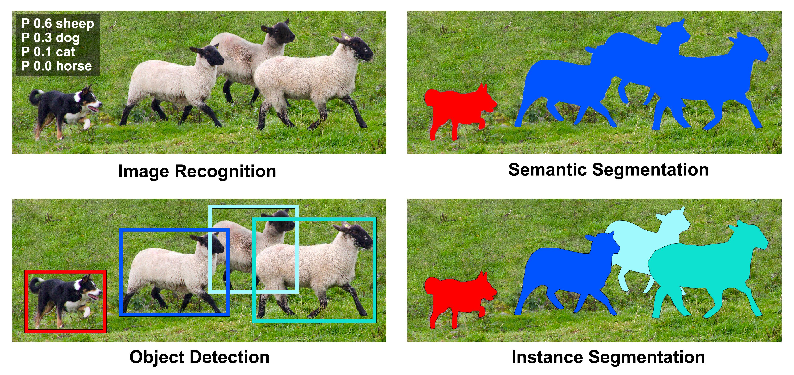
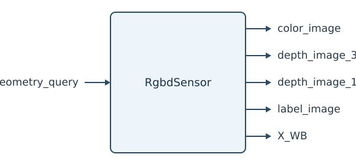
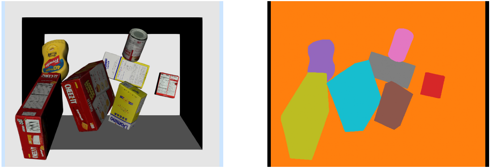
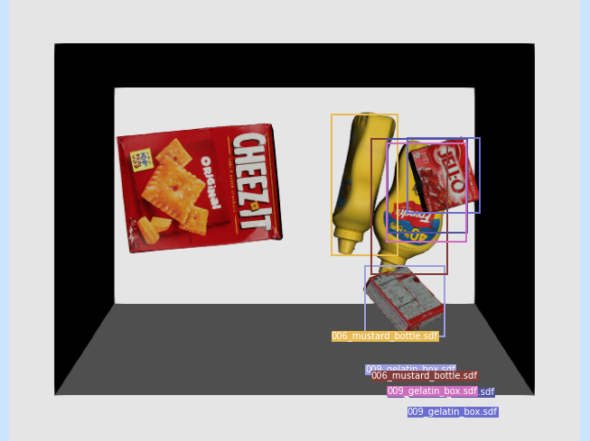
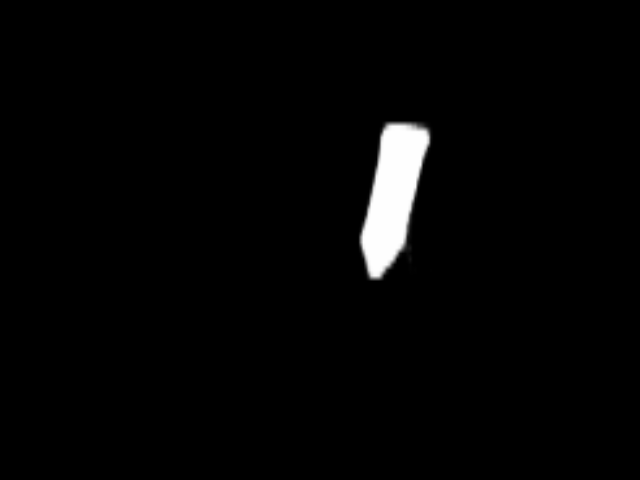

<div class="reader-kicker">ROBOTIC MANIPULATION / 中文译稿 / 09</div>

# 第 9 章　物体检测与分割

*Robotic Manipulation: Perception, Planning, and Control*

<div class="translation-meta" markdown>
**原著作者** [Russ Tedrake](http://people.csail.mit.edu/russt/)

**原文最后修改日期** 2026 年 10 月 11 日

**原文版权** © Russ Tedrake, 2020–2026

**对照阅读** [原文 PDF](pdfs/object-detection-original.pdf) · [在线原文](https://manipulation.mit.edu/segmentation.html)
</div>

## 本章目录

- [9.1　迈向大数据](#section1)
    - [9.1.1　众包标注数据集](#section1.1)
    - [9.1.2　通过微调分割新类别](#section1.2)
    - [9.1.3　面向操作任务的标注工具](#section1.3)
    - [9.1.4　合成数据集](#section1.4)
    - [9.1.5　自监督学习](#section1.5)
    - [9.1.6　更大规模的数据集](#section1.6)
- [9.2　物体检测与分割](#section2)
- [9.3　将各部分整合起来](#section3)
- [9.4　变体与扩展](#section4)
    - [9.4.1　使用自监督学习进行预训练](#section4.1)
    - [9.4.2　利用大规模模型](#section4.2)
- [9.5　练习](#section5)
- [参考文献](#references)

---

几何感知为估计已知物体的位姿提供了很好的工具，精度也可以很高，但仍容易陷入局部极小值。场景更杂乱、复杂，或物体种类更多时，单靠这些算法就不够了。

深度学习提供的数据驱动方法，恰好能与几何方法互补。从大规模数据中寻找关联，非常适合解决更全局的问题：芥末瓶是否出现在场景里？图像或点云的哪一部分属于它？甚至还能给出粗略位姿，再用几何方法细化。

网上有很多介绍深度学习的资料，我不打算在这里重复或取代它们。不过，本章将开始讨论操作中的深度感知，还是需要先交代一点背景。

<a id="section1"></a>

## 9.1　迈向大数据

<a id="section1.1"></a>

### 9.1.1　众包标注数据集

现代计算机视觉的变革，无疑离不开大规模标注数据集。其中最著名的是 ImageNet，无论图像数量，还是标签的准确性和实用性，都远超此前的数据集。[参考文献 1](#Russakovsky15)主持 ImageNet 建设的李飞飞也做过不少报告，回顾它诞生的过程。[这场报告](https://youtu.be/0bb9EcaQupI)稍微针对机器人、甚至操作任务调整了内容，可以从[这里](https://youtu.be/0bb9EcaQupI?t=857)开始观看。

[参考文献 1](#Russakovsky15)介绍了 ImageNet 的标注，主要分为两类：第一类是图像级二元标签，说明某类物体是否出现，比如“图中有汽车，但没有老虎”；第二类是物体级标签，为每个实例提供紧密包围框和类别，例如“螺丝刀位于 (20,25)，宽 50 像素、高 30 像素”。



**图 9.1**：COCO 数据集中的一张标注图，展示图像级、物体级标注，以及类别／语义分割与实例分割之间的区别。

ImageNet 推动了物体检测，COCO 则类似地推动了逐像素实例分割。[参考文献 2](#Lin14a)同一类别的不同实例各有独立标签，同时保留类别信息。COCO 的类别比 ImageNet 少，但每类实例更多。它竟然给 250 万张图像做了像素级标注，我至今仍觉得惊人。我还记得 MIT 早期的 LabelMe 等众包标注项目，[参考文献 3](#Russell08)Antonio Torralba 曾开玩笑说，众包得到的近乎逐像素标注，精度高得出乎意料，而他母亲正是标得又多又准的一位参与者。

实例分割很适合机器人操作的感知需求。上一章里，我们面对装满 YCB 物体的料箱。如果只想把芥末瓶一个个取出来，可以先用深度网络做实例分割，再只对相应点云使用抓取策略。如果需要估计物体位姿，例如按指定朝向放置，先分割点云也能显著提高几何位姿估计成功的机会。

<a id="section1.2"></a>

### 9.1.2　通过微调分割新类别

ImageNet 和 COCO 标注了[许多有意思的类别](https://tech.amikelive.com/node-718/what-object-categories-labels-are-in-coco-dataset/)，包括牛、象、熊、斑马和长颈鹿，也有盘子、叉子、刀、勺子等与操作有关的类别。但它们没有 YCB 数据集里的芥末瓶和肉罐头。怎么办？难道必须自己开发标注工具，再付钱请人标上千张图像吗？

适用于实例分割的深度网络，有一种很强的能力：迁移到新任务。先在 ImageNet、COCO 等大数据集上预训练，再用少得多的标注数据微调，就能适应我们需要的新类别。网络通常分为骨干网络和预测头；换类别时，常常只需把原来的头替换为输出新标签的头。即使数据不多、训练不长，也能得到出乎意料的鲁棒表现。更重要的是，先在多样的数据集上训练，似乎有助于学到适用于广泛感知任务的稳健表示。

这是好消息，不过仍需要给目标物体准备一些标注数据。近几年，有不少公司专门提供数据标注服务。幸好，这并不是唯一的办法。

<a id="section1.3"></a>

### 9.1.3　面向操作任务的标注工具

LabelMe 等项目让网络图像的逐像素标注更方便，机器人领域也出现了简化标注流程的工具。较早的例子是 [LabelFusion](http://labelfusion.csail.mit.edu/)，它结合点云几何感知和简单的交互界面，很快就能标注大量图像。[参考文献 4](#Marion17)


**图 9.2**：[LabelFusion](http://labelfusion.csail.mit.edu/)中的多物体场景。[参考文献 4](#Marion17)原网页中把鼠标移到图上可以查看动画。

使用 LabelFusion 时，用户提供静态场景的多张 RGB-D 图像，以及目标物体的 CAD 模型。系统用 ElasticFusion 稠密重建算法[参考文献 5](#Whelan16)把各张图像的点云合并，并同时确定相机相对点云的位置，本质上仍是点云配准。要定位其中的物体，例如电钻，用户只需在模型和场景中各点三个点，建立全局对应，再运行 ICP 精化位姿。一次配准就能为全部原始图像提供位姿标签；把 CAD 模型按该位姿渲染到每张图像上，还能得到精确的逐像素标注。

因此，LabelFusion 等工具可以快速标注大量图像，用户少量点击，就能产生许多图像的真值标签。

<a id="section1.4"></a>

### 9.1.4　合成数据集

真实数据很宝贵，但我们还有强大的仿真工具。计算机视觉领域过去对合成图像训练感知系统相当怀疑，如今游戏引擎级的基于物理的渲染已经普及，机器人研究者开始大量使用它补充，甚至替代真实数据。机器人会议也常举办讨论 sim2real 的[研讨会和辩论](https://sim2real.github.io/)。对于具体场景或较窄的物体类别，通常可以制作足够准确的模型资产，并调整材质、环境贴图和光照，让渲染图像用于训练。更大的问题是，能否生成足够多样、分布又能代表真实世界的数据，像 ImageNet 那样学出鲁棒的特征。不过，许多认真开展机器人研究的团队，已经大量使用合成数据，甚至取代真实标注数据。

背后还有一个细节：真实数据的人工标签再好，也不会完全准确，标注误差会限制学习系统的性能上限。[参考文献 6](#Northcutt21)即使渲染图像与自然图像有差距，能够生成任意规模、像素标签完全准确的数据，仍可能让合成数据训练的模型胜过真实数据训练的模型，哪怕测试集来自真实世界。

本章要训练的实例分割系统，主要用于我们的仿真图像，因此几乎没有必要争论数据来源。我们会采用在 COCO 上预训练的骨干网络，只用合成数据微调。

你也许已注意到，Drake 中使用的 `RgbdSensor` 还有一个尚未使用的标签图像输出端口。



[API 文档](https://drake.mit.edu/doxygen_cxx/classdrake_1_1systems_1_1sensors_1_1_rgbd_sensor.html)

这个端口正是为感知训练准备的。它输出与 RGB 图像相对应的图像，只不过每个像素的值，变成了所属物体实例的唯一标识。



**图 9.3**：`RgbdSensor` 的标签图像端口提供逐像素实例标签。这里重新映射了颜色，方便区分不同实例。

 
<a id="example-1"></a>

<a id="example1"></a>

#### 示例 9.1　生成实例分割训练数据

我提供了一个简单脚本，运行料箱抓取示例里的杂乱场景生成器，把随机 YCB 物体落进料箱。短暂仿真后，渲染 RGB 图和标签图，再连同实例、类别标识等元数据一起保存。

代码可以在 Colab 中运行，但这套未经优化的流程，在我的大型开发计算机上生成一万张图像也要约一小时。本地整理文件也更方便，因此这里提供的是 Python 脚本。

**运行脚本**：[segmentation/segmentation_data.py](https://manipulation.mit.edu/segmentation/segmentation_data.py)

```bash
python3 segmentation/segmentation_data.py
```


当然，也可以跳过生成步骤。我已把生成的一万张图像上传到[这里](https://groups.csail.mit.edu/locomotion/clutter_maskrcnn_data.zip)，训练 notebook 会直接下载它们。

<a id="section1.5"></a>

### 9.1.5　自监督学习

<a id="section1.6"></a>

### 9.1.6　更大规模的数据集

大语言模型兴起后，一个自然的问题是：计算机视觉能否也有基础模型？我们希望它对几乎任何新图像都有出色的零样本表现，用提示和非专家用户的少量交互，代替特定领域数据集上的微调。

2023 年较早的时候，Segment Anything 发布了，它是面向分割任务的基础模型。[参考文献 7](#Kirillov23)配套的 SA-1B 数据集，无论图像数量、分辨率，还是分割标注数量，都远超 COCO 等旧数据集。这个规模由数据引擎推动：不断增强的模型先生成标签，再交给付费专业标注者调整、纠正，并补上模型漏掉的细小区域。也许针对机器人专用数据集的微调，已经或即将不再必要。

<a id="section2"></a>

## 9.2　物体检测与分割

现代检测与分割流程有很多内容值得学习，这里只介绍最基本的部分。

图像识别时，可以用普通卷积网络输入整幅图像，输出其中有羊、狗等类别的概率。类似结构也适用于语义分割：输入图像，输出另一幅标签图，著名例子是全卷积网络 FCN。[参考文献 8](#Long15)但物体检测和实例分割连输出数量都可能变化，怎样让网络输出数量不固定的检测结果？

主流思路是，先把图像分成许多可能包含目标、彼此重叠的区域，数量可达上千，再分别运行识别或分割网络，输出概率较高的区域。检测网络还会预测包围框的精化结果，得到更紧的框。早期 R-CNN 使用传统图像预处理生成候选区域，[参考文献 9](#Girshick14)Fast、Faster R-CNN 则进一步引入学习得到的候选区域网络。[参考文献 10](#Girshick15)、[参考文献 11](#Ren15)

实例分割这里采用流行的 Mask R-CNN，结合候选区域网络和全卷积网络，分别完成检测与掩码预测。[参考文献 12](#He17)它并行预测检测结果和掩码，最后只返回最可信检测对应的掩码。撰写讲义时，Facebook AI Research 的 [Detectron2](https://github.com/facebookresearch/detectron2) 提供了更新、性能更强的实现，但不如 PyTorch [`torchvision`](https://pytorch.org/vision/stable/index.html) 软件包里的原始版本简洁易用，所以实验使用 `torchvision` 版本。

<a id="example-2"></a>

<a id="example2"></a>

### 示例 9.2　为料箱抓取微调 Mask R-CNN

下面的 notebook 加载我们的一万张图像，以及在 COCO 上预训练的 Mask R-CNN。然后替换预测头，使输出类别数量适合 YCB 识别任务，再用新数据集训练 10 个 epoch。

[](https://colab.research.google.com/github/RussTedrake/manipulation/blob/master/book/segmentation/segmentation_train.ipynb)（训练 notebook）

这个网络保存下来约占 150 MB，训练并不快。建议观看训练时就启动紧接着的保存单元格，让训练完成后自动保存、下载权重，免得 Colab 会话关闭时丢失结果。完成后，就有了一个能分割料箱中 YCB 物体的新网络。

我还提供了第二个 notebook，用于加载和评估训练好的模型。如果不想等自己的模型训练完成，也可以查看我已经训练好的版本。

[](https://colab.research.google.com/github/RussTedrake/manipulation/blob/master/book/segmentation/segmentation_inference.ipynb)（推理 notebook）





**图 9.4**：Mask R-CNN 的推理输出。左侧为物体检测，右侧为其中一个实例掩码。

<a id="section3"></a>

## 9.3　将各部分整合起来

把 Mask R-CNN 推理接入操作系统，就可以有选择地从料箱中取出物体……

<a id="section4"></a>

## 9.4　变体与扩展

<a id="section4.1"></a>

### 9.4.1　使用自监督学习进行预训练

<a id="section4.2"></a>

### 9.4.2　利用大规模模型

本讲义希望探索开放世界操作：让操作系统能在未见过的环境中，对未见过的物体完成实用任务。可我们怎么可能给机器人将来遇到的每个物体都准备标签？

所谓的基础模型，展示了一些最令人印象深刻的开放世界推理能力。[参考文献 13](#Bommasani21)机器人领域较早广泛采用的是大型视觉与文本模型 [CLIP](https://openai.com/blog/clip/)。[参考文献 14](#Radford21)

后续还会补充更多内容。

<a id="section5"></a>

## 9.5　练习

<a id="exercise-1"></a>

<a id="exercise1"></a>

### 练习 9.1　生成标签

本练习介绍一种自动生成 Mask R-CNN 训练数据的简单办法。所有操作都在[对应 notebook](https://colab.research.google.com/github/RussTedrake/manipulation/blob/master/book/segmentation/exercises/label_generation.ipynb)中完成，具体步骤如下：

1. 根据预处理后的点云，自动生成掩码标签。

2. 分析这种方法能否用于更复杂的场景。

3. 使用数据增强生成更多训练数据。

<a id="exercise-2"></a>

<a id="exercise2"></a>

### 练习 9.2　实例分割与对跖抓取

本练习结合 Mask R-CNN 和前面开发的对跖抓取策略，根据点云选择抓取。所有操作都在[对应 notebook](https://colab.research.google.com/github/RussTedrake/manipulation/blob/master/book/segmentation/exercises/segmentation_and_grasp.ipynb)中完成，具体步骤如下：

1. 自动筛选点云，保留与目标抓取物体对应的点。

2. 分析多相机配置的影响。

3. 解释为什么筛选点云对这套抓取流程有帮助。

4. 讨论怎样改进这套抓取流程。

<a id="exercise-3"></a>

<a id="exercise3"></a>

### 练习 9.3　视觉语言分割

本练习把视觉语言模型（VLM）与 Segment Anything Model（SAM）结合，实现由语言指定目标的物体分割。所有操作都在[对应 notebook](https://colab.research.google.com/github/RussTedrake/manipulation/blob/master/book/segmentation/exercises/segmentation_sam.ipynb)中完成，具体步骤如下：

1. 分析 SAM 的分割能力，并理解它在物体识别上的局限。

2. 使用视觉语言模型，根据自然语言提示生成包围框。

3. 把 VLM 生成的包围框交给 SAM，得到指定物体的精确分割掩码。

<a id="references"></a>

## 参考文献

<div class="references" markdown="1">

1. <a id="Russakovsky15"></a> Olga Russakovsky and Jia Deng and Hao Su and Jonathan Krause and Sanjeev Satheesh and Sean Ma and Zhiheng Huang and Andrej Karpathy and Aditya Khosla and Michael Bernstein and others , "Imagenet large scale visual recognition challenge" , International journal of computer vision , vol. 115, no. 3, pp. 211--252, 2015 .

2. <a id="Lin14a"></a> Tsung-Yi Lin and Michael Maire and Serge Belongie and James Hays and Pietro Perona and Deva Ramanan and Piotr Dollár and C Lawrence Zitnick , "Microsoft coco: Common objects in context" , European conference on computer vision , pp. 740--755, 2014 .

3. <a id="Russell08"></a> Bryan C Russell and Antonio Torralba and Kevin P Murphy and William T Freeman , "LabelMe: a database and web-based tool for image annotation" , International journal of computer vision , vol. 77, no. 1-3, pp. 157--173, 2008 .

4. <a id="Marion17"></a> Pat Marion and Peter R. Florence and Lucas Manuelli and Russ Tedrake , "A Pipeline for Generating Ground Truth Labels for Real RGBD Data of Cluttered Scenes" , International Conference on Robotics and Automation (ICRA), Brisbane, Australia , May, 2018 .
    [文献链接](https://arxiv.org/abs/1707.04796)

5. <a id="Whelan16"></a> Thomas Whelan and Renato F Salas-Moreno and Ben Glocker and Andrew J Davison and Stefan Leutenegger , "ElasticFusion: Real-time dense SLAM and light source estimation" , The International Journal of Robotics Research , vol. 35, no. 14, pp. 1697--1716, 2016 .

6. <a id="Northcutt21"></a> Curtis G Northcutt and Anish Athalye and Jonas Mueller , "Pervasive label errors in test sets destabilize machine learning benchmarks" , arXiv preprint arXiv:2103.14749 , 2021 .

7. <a id="Kirillov23"></a> Alexander Kirillov and Eric Mintun and Nikhila Ravi and Hanzi Mao and Chloe Rolland and Laura Gustafson and Tete Xiao and Spencer Whitehead and Alexander C Berg and Wan-Yen Lo and others , "Segment anything" , arXiv preprint arXiv:2304.02643 , 2023 .

8. <a id="Long15"></a> Jonathan Long and Evan Shelhamer and Trevor Darrell , "Fully convolutional networks for semantic segmentation" , Proceedings of the IEEE conference on computer vision and pattern recognition , pp. 3431--3440, 2015 .

9. <a id="Girshick14"></a> Ross Girshick and Jeff Donahue and Trevor Darrell and Jitendra Malik , "Rich feature hierarchies for accurate object detection and semantic segmentation" , Proceedings of the IEEE conference on computer vision and pattern recognition , pp. 580--587, 2014 .

10. <a id="Girshick15"></a> Ross Girshick , "Fast r-cnn" , Proceedings of the IEEE international conference on computer vision , pp. 1440--1448, 2015 .

11. <a id="Ren15"></a> Shaoqing Ren and Kaiming He and Ross Girshick and Jian Sun , "Faster r-cnn: Towards real-time object detection with region proposal networks" , Advances in neural information processing systems , pp. 91--99, 2015 .

12. <a id="He17"></a> Kaiming He and Georgia Gkioxari and Piotr Dollár and Ross Girshick , "Mask R-CNN" , Proceedings of the IEEE international conference on computer vision , pp. 2961--2969, 2017 .

13. <a id="Bommasani21"></a> Rishi Bommasani and Drew A Hudson and Ehsan Adeli and Russ Altman and Simran Arora and Sydney von Arx and Michael S Bernstein and Jeannette Bohg and Antoine Bosselut and Emma Brunskill and others , "On the opportunities and risks of foundation models" , arXiv preprint arXiv:2108.07258 , 2021 .

14. <a id="Radford21"></a> Alec Radford and Jong Wook Kim and Chris Hallacy and Aditya Ramesh and Gabriel Goh and Sandhini Agarwal and Girish Sastry and Amanda Askell and Pamela Mishkin and Jack Clark and others , "Learning transferable visual models from natural language supervision" , International Conference on Machine Learning , pp. 8748--8763, 2021 .

</div>

---

**继续阅读**：[上一章：机械臂控制（中文）](manipulator-control.md) · [全书目录与前言（中文）](preface.md) · [下一章：面向操作任务的深度感知（中文）](deep-perception.md)  
[无障碍访问](https://accessibility.mit.edu/) · © Russ Tedrake, 2026
