<div class="reader-kicker">ROBOTIC MANIPULATION / 中文译稿 / 03</div>

# 第 3 章　基本的抓取与放置

*Robotic Manipulation: Perception, Planning, and Control*

<div class="translation-meta" markdown>
**原著作者** [Russ Tedrake](http://people.csail.mit.edu/russt/)

**原文最后修改日期** 2026 年 10 月 11 日

**原文版权** © Russ Tedrake, 2020–2026

**对照阅读** [原文 PDF](pdfs/pick-and-place-original.pdf) · [在线原文](https://manipulation.mit.edu/pick.html)
</div>

## 本章目录

- [3.1　Monogram 记号法](#monogram)
- [3.2　通过空间变换实现抓取与放置](#section2)
- [3.3　空间代数](#spatial_algebra)
    - [3.3.1　三维旋转的表示方法](#3D_rotation)
- [3.4　正运动学](#kinematics)
    - [3.4.1　运动学树](#kinematic_tree)
    - [3.4.2　抓取与放置中的正运动学](#section4.2)
- [3.5　微分运动学与雅可比矩阵](#jacobian)
- [3.6　微分逆运动学](#section6)
    - [3.6.1　雅可比矩阵的伪逆](#section6.1)
    - [3.6.2　雅可比矩阵的可逆性](#section6.2)
- [3.7　定义抓取位姿与预抓取位姿](#section7)
- [3.8　抓取与放置轨迹](#pick_and_place_trajectory)
- [3.9　把各部分连接起来](#section9)
- [3.10　带约束的微分逆运动学](#diff_ik_w_constraints)
    - [3.10.1　把伪逆写成优化问题](#section10.1)
    - [3.10.2　加入速度约束](#section10.2)
    - [3.10.3　加入位置和加速度约束](#section10.3)
    - [3.10.4　让关节靠近标称位形](#joint_centering)
    - [3.10.5　跟踪期望位姿](#section10.5)
    - [3.10.6　其他问题形式](#section10.6)
- [3.11　练习](#section11)
- [参考文献](#references)

---

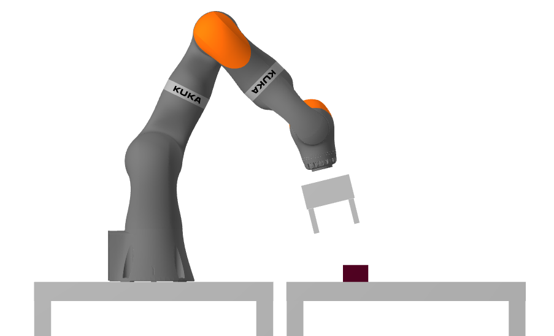

**图 3.1**：本章的挑战：控制机器人拿起积木，并按期望的位置和朝向放下。

机器人已经准备好了，我这里还有一块红色泡沫积木。把它放到机器人面前的桌子上，你的任务是把它移动到指定位置和朝向。感知问题再留到下一章，先假设你能完美测得积木当前的位姿。即使不考虑感知，完成任务也需要一些几何和运动学工具，这正适合作为起点。

先约定运动学的术语和记号。在这个领域，严谨的记号能帮上大忙，而含糊的记号迟早会造成混乱和 bug。Drake 开发者精心设计了一套一致的[多体系统记号](https://drake.mit.edu/doxygen_cxx/group__multibody__notation.html)，称为 Monogram 记号法，文档还说明了其中的动机和思想。本讲义会一直采用这套记号。

如果想更系统地了解运动学，我最喜欢的参考仍是[参考文献 1](#Craig05)。免费的在线资料中，Murray 等人 1994 年著作的第 2、3 章[参考文献 2](#Murray94)，以及 Lynch 和 Park 的[《现代机器人学》](http://hades.mech.northwestern.edu/index.php/Modern_Robotics)前七章[参考文献 3](#Lynch17)都很出色，后者还配有很好的视频。不过，三个参考会带来三套略有不同的记号，我们的用法最接近[参考文献 1](#Craig05)，Monogram 记号法也在[参考文献 4](#Mitiguy17)中作了较详细的介绍。

别被背景资料的数量吓住。我认为，只要真正理解几个基本思想，就足以有效地开展接下来的工作。需要更多细节时，再逐步补上。

<a id="monogram"></a>

## 3.1　Monogram 记号法

下面的概念看起来简单，细节却很微妙。我见过非常聪明的人，以为自己已经理解，却反复在记号上出错；我自己也这样过了很多年。请花一点时间认真读一读。

几何中最基本的概念，也许就是点。点占据空间中的某个位置，可以命名为 $A$、$C$，也可以用更具体的名称，比如用 $B_{cm}$ 表示刚体 $B$ 的质心。点的位置用位置向量 $p^A$ 表示。这里的 $p$ 指 position，而不是 point，因为其他几何量也可以具有位置。

还要更严谨一点：位置其实是相对量，我们真正应该描述的是两个点的相对位置。例如，$^Ap^C$ 表示从 $A$ 测得的 $C$ 的位置。左上标看着有点陌生，但等到开始做点的坐标变换，就会发现它很有用。

把相对位置写成数值向量时，必须明确它在哪个坐标系中表达。坐标系由符合右手定则的正交单位向量定义，也要命名，比如 $F$。点 $C$ 相对于点 $A$、在坐标系 $F$ 中表达的位置，写作 $^Ap^C_F$。如果只取其中的 $x$ 分量，就写作 $^Ap^C_{F_x}$。某种意义上，表达坐标系只是实现细节：只有把多体物理量表示为数值向量，比如放进计算机时，才必须指定它。

这套记号确实有点繁重，我自己也不觉得它特别漂亮，但它最经得住复杂问题的考验。上下文清楚时，我们也会使用简写。

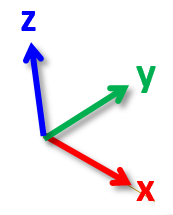

有几个坐标系特别重要。$W$ 表示世界坐标系，Drake 采用车辆坐标约定：$x$ 正向朝前，$y$ 正向朝左，$z$ 正向朝上。另一类是刚体坐标系，物理引擎中的每个刚体都附有一个独立坐标系，通常用 $B_i$ 表示刚体 $i$ 的坐标系。

坐标系也有位置，就是其原点的位置。因此，$^Wp^A_W$ 可以表示点 $A$ 相对世界坐标系原点、在世界坐标系中表达的位置。这里可以简写：如果参考坐标系和表达坐标系相同，下标就能省略，即 $^Fp^A \equiv {^Fp^A_F}$。如果连参考项也省略，就默认相对 $W$ 测量，因此有 $p^A \equiv {}^Wp^A_W$。

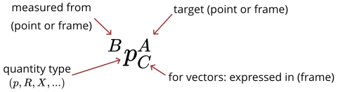

坐标系还具有朝向。用 $R$ 表示旋转，$^BR^A$ 表示坐标系 $A$ 相对于坐标系 $B$ 的朝向。与向量不同，纯旋转不需要再指定一个表达坐标系。

相对于另一个坐标系，位置和旋转就能完整描述坐标系 $F$。二者合起来称为[空间位姿](https://drake.mit.edu/doxygen_cxx/group__multibody__spatial__pose.html)，简称位姿。空间变换可以看作位姿的动作形式。Drake 用 [`RigidTransform`](https://drake.mit.edu/doxygen_cxx/classdrake_1_1math_1_1_rigid_transform.html) 表示位姿或变换，记号采用 $X$。例如，$^BX^A$ 是从坐标系 $B$ 测得的坐标系 $A$ 的位姿。谈到物体 $O$ 的位姿却不另说参考坐标系时，指的是 $^WX^O$，其中 $O$ 为物体的刚体坐标系。位姿不加表达坐标系下标，因为我们总是把它表达在参考坐标系中。

Drake [文档](https://drake.mit.edu/doxygen_cxx/group__multibody__notation.html)也介绍了代码中的命名方法：$^Bp^A_C$ 写作 `p_BA_C`，${}^BR^A$ 写作 `R_BA`，${}^BX^A$ 写作 `X_BA`。用习惯之后，它确实很有效。

<a id="section2"></a>

## 3.2　通过空间变换实现抓取与放置

有了这些记号，就可以描述基本抓取与放置策略。把物体记为 $O$，夹爪记为 $G$，理想感知系统提供 $^WX^O$。再建立坐标系 $O_d$，表示物体的期望位姿 $^WX^{O_d}$。任务就是让 $X^O = X^{O_d}$ 成立。

先作两个假设：夹爪打开时，物体相对世界不动，即 $^WX^O$ 保持不变；夹爪闭合后，物体相对夹爪不动，即 $^GX^O$ 保持不变。于是，可以按下面的步骤操作：

- 在世界中移动夹爪 $X^G$，让它到达相对物体合适的抓取位姿 $^OX^{G_{grasp}}$。

- 闭合夹爪。

- 把夹爪和物体一起移动到期望位姿 $X^O = X^{O_d}$。

- 打开夹爪，再把手撤回。

还有一个重要细节：为避免靠近时撞上物体，我们会在物体上方设置一个预抓取位姿 $^OX^{G_{pregrasp}}$，作为中间步骤。放下物体后，也使用同样的变换撤离。

要把这套策略写成程序，需要方便的变换运算工具，还要能把夹爪位姿与机器人关节角联系起来。

<a id="spatial_algebra"></a>

## 3.3　空间代数

下面定义位置、旋转和位姿在不同坐标系之间转换的规则，繁重记号的好处也就显现了。没有这套记号，我常常得举起右手比划右手定则，脑袋也跟着转来转去。有了记号，只需把符号正确衔接，算对的把握也更大。

空间量的基本运算规则如下：

- 位置在同一坐标系中表达时，只要参考点与目标点首尾衔接，就可以相加：
  
    $$
    {}^Ap^B_F + {}^Bp^C_F
            = {}^Ap^C_F.
    $$
  
    加法满足交换律，相反向量也有明确的定义：
  
    $$
    {}^Ap^B_F = -
            {}^Bp^A_F.
    $$
  
    这些关系应该很直观，请自己确认一下。

- 乘以旋转矩阵可以改变表达坐标系：
  
    $$
    {}^Ap^B_G = {}^GR^F {}^Ap^B_F.
    $$
  
    只用旋转就足够，也许有些出乎意料，但表达坐标系的位置确实不影响两点的相对位置。

- 旋转的参考和目标坐标系衔接时，可以相乘：
  
    $$
    {}^AR^B \: {}^BR^C = {}^AR^C.
    $$
  
    逆运算也很简单：
  
    $$
    \left[{}^AR^B\right]^{-1} = {}^BR^A.
    $$
  
    采用旋转矩阵时，这就是矩阵求逆；又因为旋转矩阵正交，所以 $R^{-1}=R^T.$。

- 当位置相对某个坐标系测量，也在该坐标系中表达时，变换可以把这些运算统一成方便的记号：
  
    $$
    {}^Gp^A = {}^GX^F {}^Fp^A = {}^Gp^F + {}^Fp^A_G
            = {}^Gp^F + {}^GR^F {}^Fp^A.
    $$
  
  

- 变换可以复合：
  
    $$
    {}^AX^B {}^BX^C =
            {}^AX^C,
    $$
  
    也有逆变换：
  
    $$
    \left[{}^AX^B\right]^{-1} = {}^BX^A.
    $$
  
    但请注意，虽然逆变换形式简单，$X^{-1}$ 一般并不等于 $X^T,$。

实际实现通常采用[齐次坐标](https://drake.mit.edu/doxygen_cxx/group__multibody__spatial__pose.html)，目前可以先把它视为实现细节。

<a id="example-1"></a>

<a id="example1"></a>

### 示例 3.1　从相机坐标系到世界坐标系

设工作空间中有一台固定安装的深度相机，相机坐标系记为 $C$，在世界中的位姿为 ${}^WX^C$。

深度相机返回的点在相机坐标系中表达，所以点 $P_i$ 的位置写作 ${}^Cp^{P_i}$。转换到世界坐标系，只需 

$$
p^{P_i}
      = X^C {}^Cp^{P_i}.
$$

。

这会是经常用到的操作。合并多台相机的点云时，通常先转换到世界坐标系，也总要把相机与机器人坐标系联系起来。把世界坐标转换到相机坐标系的逆变换 ${}^CX^W$，通常称为相机外参。

<a id="3D_rotation"></a>

### 3.3.1　三维旋转的表示方法

前面的旋转运算使用抽象的旋转概念。写进代码时，则要决定怎样用少量实数表示它。[三维旋转有许多表示方法](https://en.wikipedia.org/wiki/Rotation_formalisms_in_three_dimensions)各有所长，遗憾的是没有一种能包办所有情况，这也是二维问题往往更简单的原因之一。常见表示包括：

- [3$\times$3 旋转矩阵](https://drake.mit.edu/doxygen_cxx/classdrake_1_1math_1_1_rotation_matrix.html),

- [欧拉角，例如滚转、俯仰和偏航角](https://drake.mit.edu/doxygen_cxx/classdrake_1_1math_1_1_roll_pitch_yaw.html),

- [轴角](https://devdocs.io/eigen3/classeigen_1_1angleaxis)，也称指数坐标；

- [单位四元数](https://devdocs.io/eigen3/classeigen_1_1quaternion).

Drake 提供上述全部表示，并支持方便地互相转换。

3$\times$3 [旋转矩阵](https://drake.mit.edu/doxygen_cxx/group__multibody__spatial__pose.html#orientation_discussion)是正交矩阵，三列由 $x-$、$y-$、$z-$ 轴组成。具体说，变换 ${}^GR^F$ 的第一列，是坐标系 $F$ 的 $x-$ 轴在 $G$ 中的表达，其余列依此类推。

[欧拉角](https://en.wikipedia.org/wiki/Euler_angles)用绕 $x$、$y$、$z$ 轴的一系列旋转描述三维旋转。顺序很重要，不同组合都可能覆盖三维旋转。因此代码采用 `RollPitchYaw`，而不只说笼统的欧拉角，并且[仔细说明其约定](https://drake.mit.edu/doxygen_cxx/classdrake_1_1math_1_1_roll_pitch_yaw.html)。滚转绕 $x$ 轴，俯仰绕 $y$ 轴，偏航绕 $z$ 轴，也称固定轴 X–Y–Z 欧拉角。

轴角用三个数描述绕任意轴的转动：向量方向是转轴，长度是转角。单位四元数可以理解为经过精心归一化、长度为一，并具有良好运算性质的一种轴角形式。我最喜欢的严谨介绍，可能是[参考文献 5](#Stillwell08)的第 1 章。

为什么需要这么多表示，滚转—俯仰—偏航还不够吗？并不够。从它与旋转矩阵之间的转换就能看出问题：任意欧拉角都能转成旋转矩阵，但逆映射存在奇异点。俯仰角为 $\frac{\pi}{2}$ 时，滚转与偏航就无法区分。[这段视频](https://robotacademy.net.au/lesson/singularity-in-3d-rotation-angle-sequences/)很好地解释了这件事，以及机械上对应的万向节锁。类似地，轴角的转角为零时，转轴方向也不唯一。对旋转求导、建立运动方程时，这些奇异性会带来麻烦。我们已经知道，[参考文献 5](#Stillwell08)要妥善表示三维旋转群，至少需要四个数，最常用的四维表示就是单位四元数。

<a id="kinematics"></a>

## 3.4　正运动学

空间代数已经解决了抓取与放置所需的大部分几何运算，但机器人接口报告的是关节位置，接收的指令也通常是关节位置。因此还要在关节角与笛卡尔坐标系之间转换。先从关节位置求各坐标系的位姿，这就是正运动学。

本讲义用向量 $q$ 表示机器人关节位置，也称机器人构型。如果场景还包含环境中的物体，就用 $q$ 表示整个场景的构型向量，用 $q_{robot}$ 等表示其中的机器人关节部分。正运动学的目标是建立映射 

$$
X^G = f_{kin}^G(q).
$$

，而且应能对场景中任意已定义坐标系求值。前面的记号和空间代数，让这个计算相当直接。

<a id="kinematic_tree"></a>

### 3.4.1　运动学树

为了便于运动学和多体计算，`MultibodyPlant`把世界中的所有刚体组织成树。除世界刚体外，每个刚体都有父节点，二者通过 `Joint` 或浮动基座连接。

<a id="example-2"></a>

<a id="example2"></a>

#### 示例 3.2　查看运动学树

Drake 提供了查看运动学树的可视化工具。iiwa 是串联机械臂，所以更像一条藤蔓；灵巧手的树则更有意思。示例还加入了积木，让你看到自由刚体也只是世界根节点伸出的另一条分支。

**运行示例**：[在 Colab 中打开](https://colab.research.google.com/github/RussTedrake/manipulation/blob/master/book/pick/pick.ipynb)

每个 `Joint` 和浮动基座都关联若干位置变量，它们是构型向量 $q$ 的一部分。系统能够根据构型，计算从子关节坐标系 $J_C$ 到父关节坐标系 $J_P$ 的变换 ${}^{J_P}X^{J_C}(q)$。运动学树还给出关节坐标系与子刚体之间的固定变换 ${}^CX^{J_C}$，以及与父刚体之间的固定变换 ${}^PX^{J_P}$。组合起来，就能计算任意刚体到其父刚体的变换 

$$
{}^PX^C(q) = {}^PX^{J_P}
      {}^{J_P}X^{J_C}(q) {}^{J_C}X^C.
$$

。

你也许以为，向 `MultibodyPlant` 加一个关节，就是增加一个自由度。实际上正好相反：增加刚体会引入多个自由度，再添加关节，才会用约束消除它们。把机器人基座焊接到世界，消除全部浮动自由度；在两个刚体之间添加转动关节，则只留下一个自由度。

<a id="section4.2"></a>

### 3.4.2　抓取与放置中的正运动学

要计算夹爪在世界中的位姿 $X^G$，只需沿运动学树查询其父节点，递归复合各段变换，直到世界坐标系。

<a id="kinematic_frames"></a>

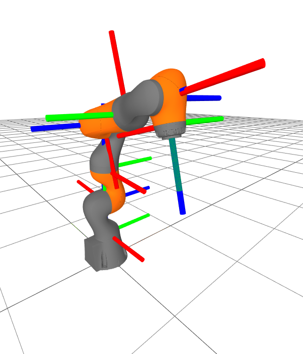

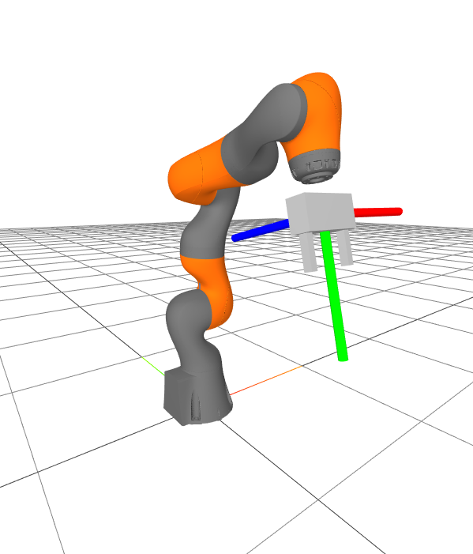

**图 3.2**：iiwa（左）和 WSG 夹爪（右）的运动学坐标系。$x$ 正轴为红色，$y$ 正轴为绿色，$z$ 正轴为蓝色，希望 XYZ $\Leftrightarrow$ RGB 这个对应关系便于记忆。

<a id="example-3"></a>

<a id="example3"></a>

#### 示例 3.3　夹爪坐标系的正运动学

现在计算夹爪在世界中的位姿 $X^G$。它取决于机器人构型，而构型只是 `MultibodyPlant` 完整状态的一部分，保存在 `Context` 中。下面的示例展示了具体用法。

**运行示例**：[在 Colab 中打开](https://colab.research.google.com/github/RussTedrake/manipulation/blob/master/book/pick/pick.ipynb)

关键代码是：

```python
gripper = plant.GetBodyByName("body", wsg)
pose = plant.EvalBodyPoseInWorld(context, gripper)
```

底层的 `MultibodyPlant` 会完成前面介绍的空间代数运算，返回位姿，并通过缓存复用许多计算，方便继续求同一机器人上其他坐标系的位姿。

<a id="floating-base"></a>

<a id="example4"></a>

#### 示例 3.4　浮动基座物体的正运动学

考虑一个特殊情形：`MultibodyPlant`里只有一个刚体，没有关节。运动学树只有世界和刚体坐标系，通过浮动基座连接。那么正运动学函数 

$$
X^B =
        f_{kin}^B(q),
$$

 是什么？既然 $q$ 已经表示浮动基座构型，$f^B_{kin}$ 是否就是恒等函数？

这涉及变换表示的细节，特别是[三维旋转怎样表示](https://manipulation.mit.edu/#3D_rotation)。为高效进行空间代数，`RigidTransform` 类使用旋转矩阵；但为使表示紧凑，构型向量 $q,$ 和 `Context` 中实际采用单位四元数。

因此，这个例子中函数 $f_{kin}^B$ 的软件实现，正是把位置 $\times$ 单位四元数转换为位姿，也就是位置 $\times$ 旋转矩阵的函数。

<a id="jacobian"></a>

## 3.5　微分运动学与雅可比矩阵

正运动学可以计算夹爪和物体在世界中的位姿。若想让夹爪移向物体，还要知道关节角变化与夹爪位姿变化有什么关系，这通常称为微分运动学。

乍看很直接：位姿变化与关节位置变化，通过正运动学的偏导数联系起来：

<a id="equation-eq-jacobian"></a>

$$
dX^B = \frac{\partial f_{kin}^B(q)}{\partial q} dq = J^B(q)dq.
 \tag{3.1}
$$

很多领域都把函数偏导数称为雅可比矩阵，在机器人学中，运动学导数也几乎总用这个名称。

微妙之处仍在于三维旋转有多种表示，例如矩阵和四元数。虽然旋转没有唯一最佳表示，微小旋转的变化率却可以统一描述：用六维[空间速度](https://drake.mit.edu/doxygen_cxx/group__multibody__spatial__vectors.html)表示位姿变化率，既不损失一般性，也不必担心奇异点：

$$
{}^AV^B_C = \begin{bmatrix}
    {}^A\omega^B_C \\ {}^A\text{v}^B_C \end{bmatrix}.
$$

其中，${}^AV^B_C$ 是坐标系 $B$ 相对 $A$、在 $C$ 中表达的空间速度，也称速度旋量。${}^A\omega^B_C \in \mathbb{R}^3$ 是 $B$ 相对于 $A$、在 $C$ 中表达的角速度，${}^A\text{v}^B_C \in \mathbb{R}^3$ 是平移速度，简写规则与位置相同。角速度的 $w_x$、$w_y$、$w_z$ 三个分量组成向量，长度表示角速率，方向表示瞬时转轴。它并不是滚转、俯仰、偏航角的时间导数，但二者可通过[线性映射](https://github.com/RobotLocomotion/drake/blob/d1a1d14b323c8a4a481a8d11fc8e9c527d63bf20/multibody/tree/rpy_ball_mobilizer.cc#L223)互相转换。它也不是轴角向量的时间导数，相应转换可见[这里](https://math.stackexchange.com/questions/4534687/axis-angle-representation-of-angular-velocity)。

空间速度也符合空间代数的规则：

- 旋转可用于改变表达坐标系：
  
    $$
    {}^A\text{v}^B_G = {}^GR^F {}^A\text{v}^B_F,
            \qquad {}^A\omega^B_G = {}^GR^F {}^A\omega^B_F.
    $$
  
  

- 角速度在同一坐标系中表达时，可以相加：
  
    $$
    \begin{gathered} {}^A\omega^B_F + {}^B\omega^C_F = {}^A\omega^C_F,\end{gathered}
    $$
  
    这个关系[值得亲自验证](https://manipulation.mit.edu/#angular_velocity_addition)，相反向量则满足 ${}^A\omega^C_F = - {}^C\omega^A_F,$。

- 平移速度的合成稍复杂一些：
  
    $$
    {}^A\text{v}^C_F = {}^A\text{v}^B_F + {}^B\text{v}^C_F +
            {}^A\omega^B_F \times {}^Bp^C_F.
    $$
  
    推导如下。对 
  
    $$
    {}^Ap^C = {}^AX^B {}^Bp^C = {}^Ap^B +
            {}^AR^B {}^Bp^C,
    $$
  
    求导，得到 
  
    $$
    \begin{aligned} {}^A\text{v}^C =& {}^A\text{v}^B +
            {}^A\dot{R}^B {}^Bp^C + {}^AR^B {}^B\text{v}^C \nonumber \\ =& {}^A\text{v}^B_A +
            {}^A\dot{R}^B {}^BR^A {}^Bp^C_A + {}^B\text{v}^C_A.\end{aligned}
    $$
  
    。暂时省略坐标系，用 $\dot{R}R^T = \dot{R}R^{-1}$ 表示 ${}^A\dot{R}^B {}^BR^A$，则 $\dot{R}R^T$ 总是斜对称矩阵。因为对 $RR^T = I$ 求导会得到 
  
    $$
    \dot{R}R^T + R\dot{R}^T = 0
            \Rightarrow \dot{R}R^T = - R\dot{R}^T \Rightarrow \dot{R} R^T = - (\dot{R}
            R^T)^T,
    $$
  
    ，这正是斜对称矩阵的定义。任意 3$\times$3 斜对称矩阵，都能用三个数表示；对 ${}^A\dot{R}^B
        {}^BR^A$ 而言，这三个数就是角速度向量 ${}^A
        \omega^B$，所以可以写成叉积 ${}^A\dot{R}^B {}^BR^A
        {}^Bp^C_A = {}^A \omega^B_A \times {}^B p^C_A.$。再在两边乘上 ${}^FR^A$ 改变表达坐标系，就得到上面的结果。

- 因此，平移速度的相反向量不能只靠交换参考和被测坐标系得到，还要考虑额外的一项：
  
    $$
    -{}^A\text{v}^B_F =
            {}^B\text{v}^A_F + {}^A\omega^B_F \times {}^Bp^A_F.
    $$
  
  

**补充说明**：如果熟悉螺旋理论，例如 [参考文献 2](#Murray94)、[参考文献 3](#Lynch17) 的用法，可以对照下面的说明，看看两套约定怎样联系。

螺旋理论，例如[参考文献 2](#Murray94)和[参考文献 3](#Lynch17)中的用法，常采用一种特殊形式，称为空间坐标系中的空间速度或空间速度旋量。这个量是 ${}^AV^{B_A}$，其中 $B_A$ 刚性附着于刚体 $B$，所以 ${}^BV^{B_A} = 0$，并在当前瞬间与 $A$ 具有相同位姿，即 ${}^Ap^{B_A} = 0$、${}^AR^{B_A} = I$。[参考文献 3](#Lynch17)（第 3.3.2 节）这些条件可以简化为 

$$
{}^AV^{B_A} = \begin{bmatrix} {}^A\omega^{B_A} \\
    {}^A\text{v}^{B_A} \end{bmatrix} = \begin{bmatrix} {}^A\omega^{B_A} +
    {}^{B_A}\omega^B_{A} \\ {}^A\text{v}^B + {}^B\text{v}^{B_A}_A +
    {}^A\omega^B \times {}^Bp^{B_A}_A \end{bmatrix} = \begin{bmatrix} {}^A
    \omega^{B} \\ {}^A\text{v}^B - {}^A\omega^B \times {}^Ap^{B}
    \end{bmatrix}.
$$

。

 
为什么角速度只用三个分量，而旋转本身却不行？因为轴角向量的长度表示角度，角度应当具有 $2\pi$ 的周期性，会导致表示退化；角速度则取值于 $(-\infty, \infty)$，不需要环绕，因此可以直接用向量长度表示角速率。

还有一种速度需要区分：$v$ 表示被控系统的广义速度，与广义位置 $q$ 的时间导数密切相关。空间速度 $^AV^B$ 有六个分量，平移速度 $^B\text{v}^C$ 和角速度 $^B\omega^C$ 各有三个分量；广义速度的长度则由表示构型变量 $q$ 的变化率所需的信息决定。iiwa 基座焊接到世界时，它有七个分量。本讲义会尽量用不同字形区分这些 v，通常也能从上下文判断。

<a id="qdot_vs_v"></a>

<a id="example5"></a>

### 示例 3.5　不要默认 $\dot{q} \equiv v$ { data-toc-label="示例 3.5　不要默认 q̇ ≡ v" }

单位四元数有四个分量，但必须构成长为一的单位向量；旋转矩阵有九个分量，但必须正交并满足 $\det(R)=1$。旋转的变化率却可以用无约束的三维角速度向量 $\omega$ 表示，这很方便，也值得采用，因为消除约束能简化数学推导和数值计算。

不过，这也带来一个小麻烦。我们习惯把广义速度看作广义位置的时间导数。模型中只有基座固定的 iiwa 时，这没问题，因为各关节都只有一个转动自由度。但当广义位置包含浮动基座的旋转时，就不能这样假设。下面只向 `MultibodyPlant` 加入一个刚体，并打印它的 `Context`。

**运行示例**：[在 Colab 中打开](https://colab.research.google.com/github/RussTedrake/manipulation/blob/master/book/pick/pick.ipynb)

输出如下：

```text
Context
--------
Time: 0
States:
  13 continuous states
    1 0 0 0 0 0 0 0 0 0 0 0 0

plant.num_positions() = 7
plant.num_velocities() = 6


Position names: ['$world_base_link_qw', '$world_base_link_qx', '$world_base_link_qy', '$world_base_link_qz', '$world_base_link_x', '$world_base_link_y', '$world_base_link_z']
Velocity names: ['$world_base_link_wx', '$world_base_link_wy', '$world_base_link_wz', '$world_base_link_vx', '$world_base_link_vy', '$world_base_link_vz']
```


系统共有 13 个状态变量，其中 7 个是位置 $q$，因为位置向量采用单位四元数；速度 $v$ 却只有 6 个分量，因为旋转变化用角速度表示。两个向量的长度都不同，自然不满足 $\dot{q} = v$。

处理这种表示差异并不难，Drake 的 `MultibodyPlant` 提供 `MapQDotToVelocity` 和 `MapVelocityToQDot`，可以来回转换，只要记得使用它们。

由于三维旋转表示不唯一，而且 $\dot{q}$ 可能不同于 $v$，运动学雅可比也有多种形式。解析雅可比是正运动学的显式偏导数，见 [式 3.1](#equation-eq-jacobian)；几何雅可比则把左侧旋转变化改为空间速度。Drake 的 `MultibodyPlant` 目前提供下列几何雅可比接口：

- `CalcJacobianAngularVelocity`,

- `CalcJacobianTranslationalVelocity`；

- `CalcJacobianSpatialVelocity`,

每个接口都有参数，指定对 $\dot{q}$ 还是对 $v$ 求雅可比。如果确实想用解析雅可比，也可以通过 Drake 的自动微分得到，只是效率低得多。

<a id="example-6"></a>

<a id="example6"></a>

### 示例 3.6　抓取与放置中的运动学雅可比

重复前面的配置，这次打印夹爪相对于世界、也在世界中表达的雅可比矩阵。

**运行示例**：[在 Colab 中打开](https://colab.research.google.com/github/RussTedrake/manipulation/blob/master/book/pick/pick.ipynb)

<a id="section6"></a>

## 3.6　微分逆运动学

几何雅可比给出广义速度与空间速度的线性关系：

$$
V^G =
    J^G(q)v.
$$

这能帮助我们改变夹爪坐标系 $G$ 吗？如果期望夹爪空间速度为 $V^{G_d}$，是否可以令关节速度为 $v = \left[J^G(q)\right]^{-1}
    V^{G_d}$？

<a id="section6.1"></a>

### 3.6.1　雅可比矩阵的伪逆

每次写出矩阵的逆，都应该先确认它是否可逆。首先看 $J^G(q)$ 的维数：空间速度有六个分量，夹爪固定在 iiwa 的末端连杆上，而 iiwa 有七个位置变量，所以 $J^G(q_{iiwa}) \in \mathbb{R}^{6 \times
      7}.$。它不是方阵，没有通常意义的逆。不过，列数多于行数，也就是自由度多于任务需要，反而是有利情形：可能有多个 $v$ 实现同一个空间速度。为了选出最小范数解，可以使用[Moore–Penrose 伪逆](https://en.wikipedia.org/wiki/Moore%E2%80%93Penrose_inverse) $J^+$：

$$
v =
      [J^G(q)]^+V^{G_d}.
$$

伪逆是一个很漂亮的数学工具。$J$ 是满秩方阵时，它等于通常的逆；若多个关节速度都能实现同一末端速度，它返回最小范数解，也就是按最小二乘意义最接近零的关节速度；若没有精确解，则返回让末端空间速度最接近期望值的关节速度，同样按最小二乘衡量。很实用。

<a id="example-7"></a>

<a id="example7"></a>

#### 示例 3.7　第一个末端执行器控制器

用雅可比伪逆写一个简单控制器。先建立 `LeafSystem`，输入端口接收 iiwa 测得的位置，输出端口给出关节速度指令。内部向 MultibodyPlant 查询夹爪雅可比，再计算实现期望夹爪空间速度的关节速度。


第一个示例先保持简单，只给定恒定的夹爪空间速度，并仿真几秒。

框图里还要加一个系统：控制器输出期望关节速度，而 iiwa 控制器接收期望关节位置，所以二者之间需要积分器。

不必立即理解每一行代码，但值得找出关键部分，改一改，看看会发生什么。

**运行示例**：[在 Colab 中打开](https://colab.research.google.com/github/RussTedrake/manipulation/blob/master/book/pick/pick.ipynb)

恭喜，机器人真正动起来了。

<a id="section6.2"></a>

### 3.6.2　雅可比矩阵的可逆性

伪逆能否为任意期望空间速度给出精确解，可以检查雅可比是否满行秩，也就是秩等于行数。这里需要 $\operatorname{rank}(J) = 6$。但整数形式的秩还不足以反映实际情况：真实机器人测得的关节位置带噪声，浮点矩阵接近降秩时，伪逆就可能变得非常大。更好的指标是最小[奇异值](https://en.wikipedia.org/wiki/Singular_value_decomposition)，它趋近零时，伪逆的范数会趋向无穷。

<a id="example-8"></a>

<a id="example8"></a>

#### 示例 3.8　夹爪雅可比的可逆性

前面的示例打印了 $J^G$ 的最小奇异值。不妨再运行一次，找找哪些构型会让它接近零。

**运行示例**：[在 Colab 中打开](https://colab.research.google.com/github/RussTedrake/manipulation/blob/master/book/pick/pick.ipynb)

提示：试试机械臂伸得很直的构型，例如把第 2、4 关节调到接近零。

也可以用伪逆控制器，给定把夹爪推向工作空间边界的空间速度指令。这很容易在实际末端控制中发生，后面会专门设法避免。

对于关心的坐标系，比如夹爪 $G$，满足 $\operatorname{rank}(J(q_{iiwa})) < 6$ 的构型 $q$ 称为运动学奇异位形。使用末端控制时，应避免接近它们。iiwa 有很多优点，但运动学工作空间并不是其中之一。试着让一台大 Kuka 长期伸进小厨房水槽，就会花不少时间考虑怎样避开奇异位形。

如果不再把机器人基座固定在世界中的某个位置，情况往往会好很多。移动底座虽然增加复杂性，却很有助于改善工作空间。

<a id="singularities"></a>

<a id="example9"></a>

#### 示例 3.9　运动学奇异性是真实的吗？

奇异性究竟是真实现象，还是分析方法造成的假象？机器人会突然失控、机械上卡住，还是只是数学出了问题？看看一个极简单的例子可能更清楚。

设两连杆机械臂的每段长度都为一，运动学为 

$$
p^G = \begin{bmatrix} c_0 + c_{0+1} \\ s_0 +
        s_{0 + 1} \end{bmatrix},
$$

。这里采用常见简写：$s_0$ 表示 $\sin(q_0)$，$c_0$ 表示 $\cos(q_0)$，$s_{0+1}$ 表示 $\sin(q_0+q_1),$，依此类推。平移雅可比为 

$$
J^G(q) = \begin{bmatrix} -s_0 -
        s_{0+1} & -s_{0 + 1} \\ c_0 + c_{0 + 1} & c_{0 + 1} \end{bmatrix},
$$

。机械臂完全伸展时，它会降秩；例如 $q_0 = q_1 = 0$ 时，第一行全为零。

▶ [打开原文交互内容或视频](https://manipulation.mit.edu/data/two_link_singularities.html)

[打开动画](https://manipulation.mit.edu/data/two_link_singularities.html)

让机器人沿 $x$ 轴运动，取 $q_0(t) = 1-t,$ 和 $q_1(t) = -2 + 2t$。轨迹在时刻 1 经过奇异点 $q_0 = q_1
        = 0$，然后又顺利离开，整个过程甚至保持恒定关节速度 $\dot{q}_0=-1,
        \dot{q}_1=2$。得到的轨迹为 

$$
p^G(t) = \begin{bmatrix}
        2\cos(1-t) \\ 0 \end{bmatrix}.
$$

。

这里需要区分几件事。奇异点处，机器人无法让夹爪继续沿 $x$ 正向前进，这是真实限制；它也不能瞬间沿 $-x.$ 反向运动。雅可比并非近似，而是关节速度与夹爪速度之间关系的精确描述。不过，不能产生某个瞬时速度，并不意味着以后不能到达那个方向。即使在 $t=1$ 处关节速度恒定、平移雅可比奇异，机器人仍在 $-x$ 方向加速：$\ddot{p}^G_{W_x}(t) = -2\cos(1-t).$。

当雅可比没有唯一逆时，还要留意可积性。机器人在时刻零的关节构型为 $q(0)$，对应末端位姿 $X^G(0)$。用伪逆控制器让末端沿任务空间中的闭合路径运动，时刻一回到原位姿，即 $X^G(1) = X^G(0)$，却不保证 $q(1) = q(0)$。这不仅是数值误差，伪逆一般并不产生可积的函数。[参考文献 6](#Mussa-Ivaldi91)详细讨论了这个问题，并借助虚拟柔顺函数提出加权伪逆，以恢复可积条件。

<a id="section7"></a>

## 3.7　定义抓取位姿与预抓取位姿

红色泡沫积木的几何被[定义](https://github.com/RobotLocomotion/models/blob/master/manipulation_station/061_foam_brick.sdf#L21)为 7.5 cm × 5 cm × 5 cm 的长方体。夹爪默认打开时，双指间距为 10.7 cm；掌部距离刚体原点 3.625 cm，手指长度为 8.2 cm。

先简化一下：我保证放下积木时，它的 $z$ 轴朝上，与世界 $z$ 轴对齐，并且稳妥地位于机器人工作空间内的桌面上。不过，初始偏航角可以任意变化。别担心，iiwa 的第七关节可以让夹爪灵活转动，范围甚至远大于人的手腕。

积木外形具有旋转对称性：绕 $x$ 轴转 90 度，视觉上仍无法区分。下一章讨论感知时，会进一步考虑这个问题。目前可以先使用仿真的全知作弊端口，获得明确的积木位姿。

<a id="grasp_frames"></a>

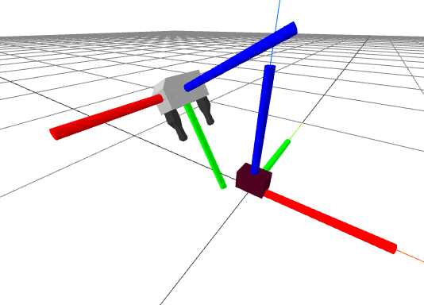

**图 3.3**：夹爪坐标系与物体坐标系。$x$ 正轴为红色，$y$ 正轴为绿色，$z$ 正轴为蓝色，即 XYZ $\Leftrightarrow$ RGB。

仔细看上图的夹爪坐标系，并用颜色区分各轴。根据夹爪和物体尺寸，我希望物体在夹爪坐标系中的位置，以米计，为 

$$
{}^{G_{grasp}}p^O = \begin{bmatrix} 0 \\ 0.11 \\ 0 \end{bmatrix}, \qquad
    {}^{G_{pregrasp}}p^O = \begin{bmatrix} 0 \\ 0.2 \\ 0 \end{bmatrix}.
$$

。预抓取位姿让夹爪先停在物体上方，再沿直线进入抓取位置，完成后沿原路退出，这样目前就不必过多考虑碰撞。朝向应使物体的 $z$ 正轴对齐夹爪的 $y$ 负轴，物体的 $x$ 正轴对齐夹爪的 $z$ 正轴，可以用 

$$
\begin{gathered}{}^{G_{grasp}}R^O = \text{MakeXRotation}\left(\frac{\pi}{2}\right)
    \text{MakeZRotation} \left(\frac{\pi}{2}\right).\end{gathered}
$$

 实现。我承认，这一步又举起右手比划了。不妨对照[上图](https://manipulation.mit.edu/#grasp_frames)逐步看：食指向前、中指向左、拇指向上，建立附着在物体上的手坐标系 $H$，于是 ${}^OR^H = I.$。我们要理解它在夹爪中的朝向 ${}^{G_{grasp}}R^H$。矩阵乘法从右向左，先绕当前 $z$ 轴，也就是拇指，转 90 度，食指朝左；再绕当前 $x$ 轴，它仍朝前，转 90 度。此时食指朝上、中指朝向自己、拇指朝右。于是 $z$ 正轴，也就是拇指，对齐 $y$ 负轴，$x$ 正轴，也就是食指，对齐夹爪 $z$ 正轴。

预抓取位姿与抓取位姿采用相同朝向。

<a id="example-10"></a>

<a id="example10"></a>

### 示例 3.10　计算抓取与预抓取位姿

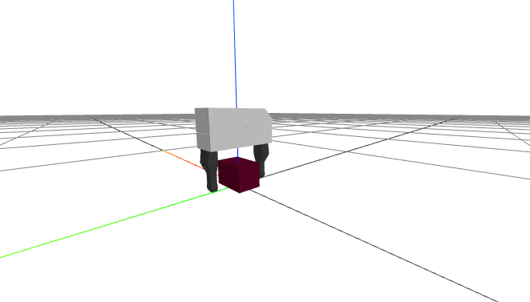

下面的简单示例加载浮动的 Schunk 夹爪和积木，明确地计算每一步抓取、预抓取变换，再显示夹爪相对物体的位置。

**运行示例**：[在 Colab 中打开](https://colab.research.google.com/github/RussTedrake/manipulation/blob/master/book/pick/pick.ipynb)

希望你能体会好记号的价值。决定物体相对夹爪的合适位姿时，我仍得用右手比划；一旦确定，写进代码，各项运算就自然对上了。

<a id="pick_and_place_trajectory"></a>

## 3.8　抓取与放置轨迹

我们已经接近目标：能计算期望夹爪位姿，也能用空间速度指令瞬时改变它。接下来，要指定夹爪位姿怎样随时间变化，才能把位姿轨迹转换为空间速度指令。

先列出夹爪要经过的全部关键帧，以及到达每一帧的时刻。下面的示例正是这样做的。

<a id="example-11"></a>

<a id="example11"></a>

### 示例 3.11　规划草图

**运行示例**：[在 Colab 中打开](https://colab.research.google.com/github/RussTedrake/manipulation/blob/master/book/pick/pick.ipynb)

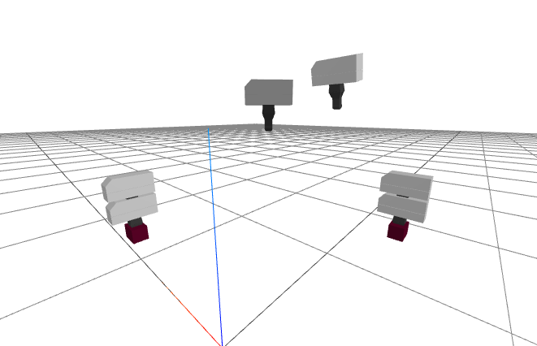

**图 3.4**：夹爪的关键帧。机器人基座位于原点，视角相当于从未显示的机器人肩后看过去。夹爪从中央附近的 initial 开始，依次经过 prepick、pick、postpick、clearance、preplace、place，最后到达 postplace。

这些时刻怎样选择？起始时刻设为 $t=0$，其他时刻都以零为基准，这时机器人开始运行并看到积木。初始位姿到预抓取位姿所需时间，理想情况下要考虑关节速度限制，但目前不追求快速。我先按夹爪的总欧氏距离选一个保守时间，比如 $k=10~s/m$，也就是 $10~cm/s$：

$$
t_{pregrasp} = k
      \left\|{}^{G_0}p^{G_{pregrasp}}\right\|_2.
$$

。预抓取到抓取再退回，每段固定为两秒；手指开合时，也留两秒让夹爪保持静止。

计算机里有很多轨迹表示方法，Drake 提供了一组[轨迹](https://drake.mit.edu/doxygen_cxx/namespacedrake_1_1trajectories.html)类，不少采用[样条](https://en.wikipedia.org/wiki/Spline_(mathematics))，也就是分段的时间多项式。朝向插值要特别小心，位置则可以在关键帧之间线性插值，称为[一阶保持](https://en.wikipedia.org/wiki/First-order_hold)，由 [PiecewisePolynomial](https://drake.mit.edu/doxygen_cxx/classdrake_1_1trajectories_1_1_piecewise_polynomial.html) 类实现。旋转采用球面线性插值，也叫 [slerp](https://en.wikipedia.org/wiki/Slerp)，Drake 用 [PiecewiseQuaternionSlerp](https://drake.mit.edu/doxygen_cxx/classdrake_1_1trajectories_1_1_piecewise_quaternion_slerp.html) 实现，[这个练习](https://manipulation.mit.edu/#slerp)可以帮助你探索其性质。[PiecewisePose](https://drake.mit.edu/doxygen_cxx/classdrake_1_1trajectories_1_1_piecewise_pose.html) 类则方便把位置与朝向轨迹一起构建和使用。

<a id="example-12"></a>

<a id="example12"></a>

### 示例 3.12　用轨迹完成抓取

三维轨迹有多种可视化方式，下面先画出位置随时间变化的曲线。

[对应 notebook](https://colab.research.google.com/github/RussTedrake/manipulation/blob/master/book/pick/pick.ipynb) 

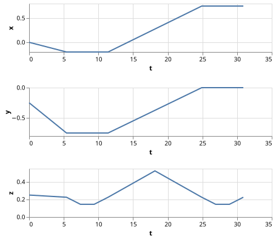

对于三维数据，可以[画出它在三维空间中的轨迹](https://manipulation.mit.edu/data/gripper_position_trajectory.html)，不过我最喜欢[在三维渲染器中播放动画](https://manipulation.mit.edu/data/gripper_trajectory.html)。试试“Open controls > Animation”界面，暂停之后用时间滑块查看轨迹的各个时刻。

我们身处三维空间，要怎样理解四维的四元数？[这组可交互的视频](https://eater.net/quaternions)对此有一番很有意思的讨论，不妨看看。

最后还差一个细节：夹爪张开和闭合的指令也需要一条轨迹。这里同样采用一阶保持。

<a id="section9"></a>

## 3.9　把各部分连接起来

稍微扩展一下 PseudoInverseController，增加用于输入期望夹爪空间速度 ${}^WV^G$ 的端口即可。最初的版本把这个值直接写在控制器里。


我们构造的是位姿轨迹，而控制器需要空间速度指令。好在这些轨迹类都支持求导：`PiecewiseQuaternionSlerp` 能把四维四元数轨迹的导数转换为三维角速度轨迹；`PiecewisePose` 的导数则是一条空间速度轨迹。剩下的工作就是把系统图中的各个模块接好。

<a id="example-13"></a>

<a id="example13"></a>

### 示例 3.13　完整的抓取与放置演示

运行 notebook 接下来的几个代码单元，就能看到一个相当令人满意的结果。也可以[直接观看演示视频](https://manipulation.mit.edu/data/pick.html)。

**运行示例**：[在 Colab 中打开](https://colab.research.google.com/github/RussTedrake/manipulation/blob/master/book/pick/pick.ipynb)

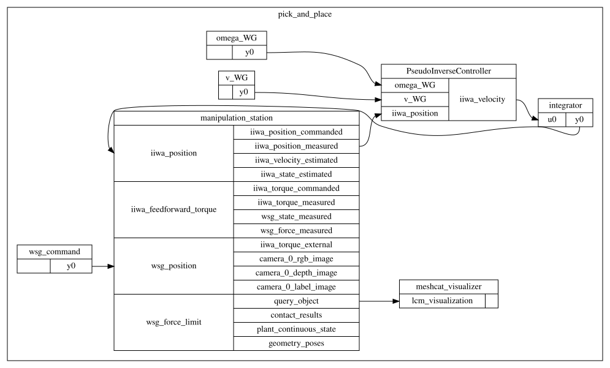

不过，值得仔细看看这个结果。例如，检查终止时刻的 context：夹爪离期望的最终位置还有多远？各关节的位置是否合适？如果像工业机器人那样，把同一条轨迹反复正向、反向执行，误差会不会累积？

<a id="diff_ik_w_constraints"></a>

## 3.10　带约束的微分逆运动学

上面的方案在很多情况下已经能用。但再多做一点工作，我们就能得到一个稳健得多的方案，后面好几章都可以放心使用。

伪逆控制器有什么问题？首先，它在奇异位形附近表现不好。雅可比矩阵 的最小奇异值一旦变小，其伪逆中的某些数值就会变得很大。于是，一个看似合理的末端空间速度指令，可能对应极大的关节速度。

还有一些更隐蔽却同样重要的限制。真实机器人的关节角度、速度、加速度和力矩都有实实在在的限值。例如，发给 iiwa 的速度指令如果超出执行能力，就会被截断。在当前的关节阻抗模式下，iiwa 并不知道你想让末端怎样运动，很可能只是对每个关节分别限幅。结果并非末端沿原轨迹慢一点走，而可能是末端严重偏离预定路线。

既然知道 iiwa 的限值，最好就在我们的控制器中显式考虑这些约束。位置、速度和加速度约束相对容易加入；力矩约束需要完整的动力学模型，本章暂不讨论，但它们也能自然地纳入这个框架。

<a id="section10.1"></a>

### 3.10.1　把伪逆写成优化问题

前面说，伪逆有些近乎神奇的性质：有精确解时给出精确解，没有精确解时给出最小二乘意义下的最佳解。其实这些性质都来自同一个事实：伪逆给出的正是下面这个最小二乘优化问题的最优解：

$$
\min_v \left|J^G(q)v - V^{G_d}\right|^2_2.
$$

 在这样的写法中，$v$ 称为决策变量，$v^*$ 表示最优解，也就是使代价最小的决策变量取值。这个问题恰好有闭式解：

$$
v^* = \left[ J^G(q) \right]^+V^{G_d}.
$$

 它与伪逆给出的结果完全相同。更一般的优化问题，则需要数值方法求解。

优化是一门内容极其丰富的学科，本书会用到其中许多工具。若想系统学习凸优化，我很推荐 [参考文献 7](#Boyd04a)：这本书严谨、清晰，又不难入门，可以免费在线阅读；即使只读第一章，也会很有收获。关于 Drake 中的优化接口，可以先看简短的 [MathematicalProgram 教程](https://drake.mit.edu/tutorials/mathematical_program.html)。我基本把“数学规划”和“优化问题”当作同义词；如果只有约束而没有目标函数，“数学规划”这个说法可能更准确。

<a id="section10.2"></a>

### 3.10.2　加入速度约束

把现有方案理解为优化之后，就很自然地能将它推广到带约束的情况。最容易加入的是速度约束：

$$
\begin{aligned} \min_v && \left|J^G(q)v -
      V^{G_d}\right|^2_2\,, \\ \text{subject to} && v_{min} \le v \le v_{max}. \nonumber
      \end{aligned}
$$

 这个问题的意思是：在满足关节速度约束的前提下，尽量实现期望的夹爪空间速度。直接求解它，通常会比先解无约束问题、再逐个截断超限速度好得多。

当然，这个问题也更难了，不能再只靠 雅可比矩阵 的伪逆写出解。我们将在控制器每次执行时，直接求解这个小规模优化问题。它具有凸二次目标函数和线性约束，属于凸二次规划（Quadratic Programming，QP）。这是一类性质很好的优化问题，已有成熟且高效的数值求解工具。

<a id="example-14"></a>

<a id="example14"></a>

#### 示例 3.14　带速度约束的 雅可比矩阵 控制

为了直观理解微分逆运动学的优化形式，我做了下面这个 QP 可视化。在 notebook 中，红色表示约束，绿色曲面表示目标函数。

**运行示例**：[在 Colab 中打开](https://colab.research.google.com/github/RussTedrake/manipulation/blob/master/book/pick/pick.ipynb)

<a id="section10.3"></a>

### 3.10.3　加入位置和加速度约束

只要新增约束对决策变量仍然是线性的，就能轻松加入 QP，而不会明显增加求解难度。那么，关节位置和加速度该怎么约束？

一个自然的办法是使用一阶近似。为此，控制器需要一个特征时间步长，用来把速度决策与位置、加速度联系起来，记作 $h$。

控制器已经将当前测得的关节位置 $q$ 作为输入；现在再加入当前关节速度 $v$。用 $v_n$ 表示决策变量，即下一步要下发的速度指令。对位置使用简单的[欧拉近似](https://en.wikipedia.org/wiki/Euler_method)，对加速度使用一阶差分，就得到：

$$
\begin{aligned} \min_{v_n} \quad &
      \left|J^G(q)v_n - V^{G_d}\right|^2_2, \\ \text{subject to} \quad & v_{min} \le v_n
      \le v_{max}, \nonumber \\ & q_{min} \le q + h v_n \le q_{max}, \nonumber
      \\ & \dot{v}_{min} \le \frac{v_n - v}{h} \le \dot{v}_{max}. \nonumber
      \end{aligned}
$$

<a id="joint_centering"></a>

### 3.10.4　让关节靠近标称位形

我们的 雅可比矩阵 是 $6 \times 7$，也就是说，机器人的自由度多于末端任务所需的自由度。这既是机会，也是必须处理的问题。如果 $J^G$ 的秩小于列数，即小于自由度数，优化问题就有无穷多个解，而我们把选哪个解的决定交给了求解器。凸优化求解器通常会选一个合理的结果，比如约束区域的解析中心，或无约束问题的最小范数解。不过，与其依赖求解器的默认选择，不如把问题定义完整，使它具有唯一的全局最优解。

基于 雅可比矩阵 的机器人控制有一个很漂亮的思路：将“次要”控制任务投影到 $J^G$ 的零空间，在某些条件下，它就不会干扰主要的末端空间速度任务。这里，我们用一个作用于所有关节的次要控制器来补全问题：$v = K(q_0 - q)$ 这是一个简单的关节空间比例控制器，用来把机器人拉回标称位形。

令 $P(q)$ 表示从广义速度到 $J(q)$ 零空间的线性映射。传统机器人算法通过伪逆构造它：$P = (I - J^+J)$；现在不少线性代数库也能直接求出 雅可比矩阵 $J$ 零空间的标准正交基。把 $Pv \approx PK(q_0 - q)$ 加为次要目标，可写成：

$$
\begin{aligned}\min_{v_n} \quad & \left|J^G(q)v_n - V^{G_d}\right|^2_2 + \epsilon
      \left|P(q)\left(v_n - K(q_0 - q)\right)\right|^2_2, \\ \text{subject to} \quad &
      \text{constraints}.\nonumber\end{aligned}
$$

 注意次要目标前的标量 $\epsilon$。没有约束时，可以直接去掉 $\epsilon$：次要任务完全不会干扰主要的空间速度跟踪任务。但存在约束时，约束可能把两个目标耦合起来，使它们互相争夺资源，见[练习](https://manipulation.mit.edu/#competing_objectives)。因此，我们取 $\epsilon \ll 1$，让主要目标获得更大权重。不过也别取得太小，否则可能影响数值求解的稳定性；我觉得 $\epsilon ~=
      0.01$ 就比较合适。

若希望在有约束时也严格保证任务优先级，还有更复杂的方法，例如 [参考文献 8](#Flacco15)、[参考文献 9](#Escande14)。但对于这里这样简单的优先级安排，惩罚项已经是一个合理的选择。

<a id="section10.5"></a>

### 3.10.5　跟踪期望位姿

有时，用期望位姿 ${}^AX^{G_d}$ 来描述微分 IK 的目标，比直接给定空间速度更自然。我们可以把位姿指令转换为空间速度指令：${}^AV^{G_d}_A.$ 平移部分很简单，采用 

$$
{}^Ap^{G_d}_A = {}^Ap^G_A + h {}^Av^{G}_A \quad \Rightarrow
      \quad {}^A\text{v}^{G}_A  = \frac{1}{h} \left({}^Ap^{G_d}_A - {}^Ap^G_A\right) =
      \frac{1}{h}{}^Gp^{G_d}_A.
$$

；角速度部分类似，取 

$$
{}^A\omega^{G}_A = \frac{1}{h} {}^GR^{G_d},
$$

，其中 ${}^GR^{G_d}$ 用[轴角](https://manipulation.mit.edu/#axis-angle)形式表示。

<a id="section10.6"></a>

### 3.10.6　其他问题形式

既然已经接受在控制回路中求解小规模优化问题，还可以采用许多其他形式，文献中也有大量例子。使实际空间速度与指令之间的最小二乘误差最小，并不一定是最合适的选择。Drake 中常用的另一种形式会额外要求：机器人必须沿指令指定的方向运动。遇到约束时，可以减速，但瞬时运动方向不能偏离指令。毕竟，如果花了很大力气为末端规划无碰撞路径，却让控制器把它当成可随意偏离的建议，未免可惜。当然，轨迹执行系统也必须能察觉实际发生了减速；仅靠开环速度指令还不够。

$$
\begin{aligned} \max_{v_n, \alpha} \quad & \alpha, \\ \text{subject to} \quad &
      J^G(q)v_n = \alpha V^{G_d}, \nonumber \\ & 0 \le \alpha \le 1, \nonumber
      \\ & \text{additional constraints}. \nonumber \end{aligned}
$$

 看到这里，你应该马上问：空间速度乘以一个标量是否合理？这也是一道很好的[练习](https://manipulation.mit.edu/#scaling_spatial_velocity)。

如果 雅可比矩阵 不再满行秩，这个形式会怎样？注意 $v_n = 0, \alpha = 0$ 始终是可行解。因此，只要无法沿指令方向运动，机器人就会停下来。

<a id="rpy_diffik"></a>

对于人工遥操作，稍有方向限制就完全停住，往往过于严格：机器人每次靠近约束，操作者都会觉得它“卡住了”。例如，夹爪与桌面之间有避碰约束，而操作者想让夹爪沿桌面移动，严格形式下这几乎做不到。我们发现，下面这种放宽方式对操作者更直观：

$$
\begin{aligned} \max_{v_n, \alpha} \quad & \sum_i \alpha_i, \\ \text{subject to} \quad &
      J^G(q)v_n = E(q) \text{diag}(\alpha) E^{-1}(q) V^{G_d}, \nonumber \\ & 0 \le
      \alpha_i \le 1, \nonumber \\ & \text{additional constraints}. \nonumber
      \end{aligned}
$$

 这里的 $E(q)$ 是把欧拉角表示的导数（如 $\frac{d}{dt}[roll, pitch, yaw, x, y, z]$）转换为空间速度的[线性映射](https://github.com/RobotLocomotion/drake/blob/d1a1d14b323c8a4a481a8d11fc8e9c527d63bf20/multibody/tree/rpy_ball_mobilizer.cc#L223)。如果直接以欧拉角导数的形式接收速度指令，就能避免计算可能出现奇异性的 $E^{-1}(q)$。熟悉优化的人也许会觉得这个写法有些奇怪：对角矩阵意味着速度缩放依赖坐标选择。但这正是我们想要的效果。对操作者来说，在 x、y、z、roll、pitch、yaw 这几个分量上分别限幅更直观；通常这些坐标以机器人基座为参考系。当你让末端沿桌面滑动时，朝向桌面的速度分量会被限制，而与它正交的分量仍可保留。更重要的是，发出纯平移指令时，末端不会突然转动；发出纯旋转指令时，也不会额外平移。

<a id="example-15"></a>

<a id="example15"></a>

#### 示例 3.15　Drake 的 DifferentialInverseKinematics

后面几章需要控制末端运动时，我们都会使用这套微分逆运动学实现。

<a id="section11"></a>

## 3.11　练习

<a id="exercise-1"></a>

<a id="exercise1"></a>

### 练习 3.1　空间坐标系与位置


下图画出了夹爪、砖块及各自的刚体坐标系。请留意那些很细的彩色线段，它们表示世界坐标系。$W.$ 对于图中的位形，${^Gp^O}$ 可能取下面哪个值？

1. [0.2, 0, -.2]

2. [0, 0.3, .1]

3. [0, -.3, .1]

${^Gp^O_W}$ 可能取哪个值？

<a id="angular_velocity_addition"></a>

<a id="exercise2"></a>

### 练习 3.2　角速度向量的可加性

（原文此练习尚待补充。）

<a id="slerp"></a>

<a id="exercise3"></a>

### 练习 3.3　球面线性插值（slerp）

位置可以在线段上做线性插值，也就是“一阶保持”。旋转则不能简单地线性插值，需要使用球面线性插值（slerp）。本题将进一步探究它的原理。

先考虑更简单的情况：旋转属于 $\mathbb{R}^{2}$，可用复数表示。约定二维向量 (x, y) 对应复数 $z
    = x + yi$，要将它旋转 $\theta$，就乘以 $e^{i\theta} = \cos(\theta) + i\sin(\theta).$。

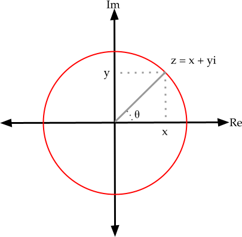

1. 先验证这个方法。把二维向量 $(x,y) = (1,1)$ 转成复数，按复数乘法乘以 $z =
         e^{i\pi/4}$，再转回二维向量，结果是否符合预期？写出计算过程，并说明为什么应当得到这个结果。

再想一想：将二维向量转为复数、乘以 $e^{i\theta}$、再转回向量，其实就等价于将原向量乘以下面的二维旋转矩阵：

$$
R(\theta) = \begin{bmatrix} \cos\theta & -\sin\theta
    \\ \sin\theta & \cos\theta \end{bmatrix}.
$$

坐标系 $F$ 的朝向，可以用它相对于世界坐标系的旋转表示，例如 $^WR^F$。我们刚刚验证，这个旋转也能用复数 $e^{i\theta}$ 表示。现在，要在坐标系 $F$ 与 $G$ 所表示的两个朝向之间平滑插值，例如用 $t\in [0,1]$ 控制插值比例，应当怎么做？下面的 (b)、(c) 两问将分别尝试两种办法。

1. 尝试一：考虑 $z(t) = (a_F*(1-t) + a_G*t) + i (b_F*(1-t) +
         b_G*t)$，取 $t=.5$。将二维向量 $(1,1)$ 乘以 $z(t = .5)$ 后会发生什么？写出计算过程，并解释问题出在哪里。

2. 尝试二：改用另一种表示 $z(t) =
         e^{i \theta_{F}*(1-t) + i\theta_{G}*t}$。将二维向量 $(1,1)$ 乘以 $z(t = .5)$，会得到什么？同样写出计算过程。

四元数就是把这个思路推广到三维。在二维中，用两个数再加约束 $a^2 + b^2
    = 1$ 表示一个旋转，似乎有些多余——为什么不直接用 $\theta$？但我们已经看到，它确实有效。三维中则用四个数 $x,y,z,w$，加上约束 $x^2+y^2+z^2+w^2 = 1$，表示一个三维旋转。二维用单个 $\theta$ 没什么问题；三维只用三个数，却会遇到著名的[万向节锁](https://en.wikipedia.org/wiki/Gimbal_lock)等问题。单位四元数的四个分量，能够对所有三维旋转给出无奇异的表示。

和二维情形一样，不能直接对四元数的四个分量做线性插值来插值朝向。四元数 slerp 实际上对两个朝向之间的夹角做线性插值。具体公式需要一些四元数记号，但基本思路与二维相同。

<a id="scaling_spatial_velocity"></a>

<a id="exercise4"></a>

### 练习 3.4　缩放空间速度

（原文此处的说明尚待补充。）在正式推导补齐之前，先看看下面这段代码，或许就能理解为什么这种缩放是合理的。

```python
from pydrake.all import (
    PiecewiseQuaternionSlerp,
    RandomGenerator,
    UniformlyRandomQuaternion,
)

g = RandomGenerator()
q1 = UniformlyRandomQuaternion(g)
q2 = UniformlyRandomQuaternion(g)

alpha = 0.5
s1 = PiecewiseQuaternionSlerp([0, 1], [q1, q2])
s2 = PiecewiseQuaternionSlerp([0, 1 / alpha], [q1, q2])
print(s1.EvalDerivative(0.5))
print(s2.EvalDerivative(0.5 / alpha) / alpha)
```


<a id="planar_manipulator"></a>

<a id="exercise5"></a>

### 练习 3.5　平面机械臂

本题要求推导平面二连杆机械臂的平移正运动学 ${^A}p{^C}=f(q)$ 和平移 雅可比矩阵 $J(q)$。所有工作都在 [对应 notebook](https://colab.research.google.com/github/RussTedrake/manipulation/blob/master/book/pick/exercises/05_planar_manipulator.ipynb) 中完成，具体包括：

1. 推导机械臂的正运动学。

2. 推导机械臂的 雅可比矩阵 矩阵。

3. 根据 雅可比矩阵 分析机械臂的运动学奇异位形。

<a id="jacobian_exploration"></a>

<a id="exercise6"></a>

### 练习 3.6　进一步理解 雅可比矩阵

练习 3.5 要求推导平面二连杆机械臂的平移 雅可比矩阵。本题将把视野扩展到多连杆机械臂，进一步考察它的性质。

1. 平面二连杆机械臂的平移 雅可比矩阵 是一个 2×2 矩阵。对于 N 连杆机械臂，若关节角为 $(q_{0}, q_{1}, ..., q_{N-1})$、末端位置用 (x, y, z) 表示，平移 雅可比矩阵 的尺寸是多少？

2. 对于这类多连杆机械臂，把所有可能关节角组成的空间称为构型空间，把所有可能末端位置组成的空间称为操作空间。
   
   1. 如果构型空间与操作空间的维数相同，雅可比矩阵 在什么条件下可逆？请给出比“雅可比矩阵 可逆时”更具体的回答。如果能求逆，有多少组关节速度可以产生给定的末端速度？
   
   
   
   2. 如果构型空间的维数大于操作空间，是否可能有多组关节速度产生同一个期望末端速度？如果可能，什么情况下会出现，有多少组？如果不可能，请说明原因。
   
   
   
   3. 接着 (b.ii) 考虑：是否可能根本不存在任何一组关节速度，能产生给定的期望末端速度？请解释。
   
   
   
   
   
   

3. 下图在平面二连杆机械臂的 $\dot{q_{1}}-\dot{q_{2}}$ 平面上画出关节速度的单位圆，再通过平移 雅可比矩阵，将它映射为末端速度空间中的椭圆。它直观展示了 雅可比矩阵 如何把关节速度映射为末端速度。末端速度空间中的这个椭圆称为可操作度椭球，用来描述机器人沿各个方向移动末端的能力。例如，它越接近圆，末端越容易向任意方向运动。处于奇异位形时，机器人无法在某些方向上产生末端速度。回顾练习 3.5 中的奇异位形：此时可操作度椭球会退化成什么形状？

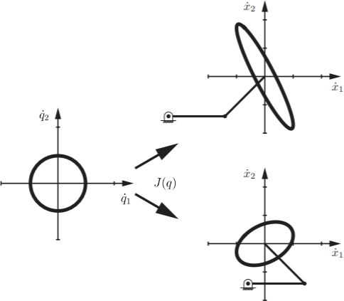

**图 3.5**：平面二连杆机械臂在两种姿态下的可操作度椭球。改编自 [参考文献 3](#Lynch17)。

<a id="spatial_transforms"></a>

<a id="exercise7"></a>

### 练习 3.7　空间变换与抓取位姿

本题将运用空间代数知识，把坐标系的位姿写到不同参考系下，并自行设计抓取位姿。所有工作都在 [对应 notebook](https://colab.research.google.com/github/RussTedrake/manipulation/blob/master/book/pick/exercises/07_rigid_transforms.ipynb) 中完成，具体包括：

1. 用空间代数，将坐标系的位姿改写到不同参考系下。

2. 根据目标物体及夹爪的配置，设计抓取位姿。

<a id="robot_painter"></a>

<a id="exercise8"></a>

### 练习 3.8　机器人画家

本题将设计一些有趣的运动轨迹，让机器人在空中“作画”。所有工作都在 [对应 notebook](https://colab.research.google.com/github/RussTedrake/manipulation/blob/master/book/pick/exercises/08_robot_painter.ipynb) 中完成，具体包括：

1. 设计并计算指定轨迹上关键帧的位姿。

2. 对关键帧做插值，构造完整轨迹。

<a id="intro_to_qp"></a>

<a id="exercise9"></a>

### 练习 3.9　QP 入门

本题将练习使用 Drake 的 MathematicalProgram 接口求解二次规划（QP）。所有工作都在 [对应 notebook](https://colab.research.google.com/github/RussTedrake/manipulation/blob/master/book/pick/exercises/09_intro_to_qp.ipynb) 中完成。

<a id="virtual_wall"></a>

<a id="exercise10"></a>

### 练习 3.10　虚拟墙

本题将用基于优化的微分逆运动学，为机械臂实现一面虚拟墙。所有工作都在 [对应 notebook](https://colab.research.google.com/github/RussTedrake/manipulation/blob/master/book/pick/exercises/10_differential_ik_optimization.ipynb) 中完成，具体包括：

1. 实现带关节速度限制的优化式微分 IK 控制器。

2. 自行设计约束，用这个控制器在末端空间中实现虚拟墙。

<a id="competing_objectives"></a>

<a id="exercise11"></a>

### 练习 3.11　互相竞争的目标

在[让关节靠近标称位形](https://manipulation.mit.edu/#joint_centering)一节，我提到：如果约束将次要目标与主要目标联系起来，两者就可能互相竞争。先看这个优化问题：

$$
\begin{aligned}\min_{x,y} \quad (x-5)^2 +
    (y+3)^2.\end{aligned}
$$

 显然，最优解是 $x^*=5,
    y^*=-3$，而且两个目标相互独立。加入第二个目标 $(y+3)^2$，丝毫没有影响第一个目标的解。

现在加入约束：

$$
\begin{aligned}\min_{x,y} \quad&
    (x-5)^2 + (y+3)^2 \\ \text{subject to} \quad& x - y \le 6. \end{aligned}
$$

 如果删掉第二个目标，仍会得到 $x^*=5$。按现在的形式求解，结果会是什么？愿意动手的话，只需几行代码。你会发现，这两个原本“正交”的目标确实发生了竞争。

再把问题改成 

$$
\begin{aligned}\min_{x,y} \quad&
    (x-5)^2 + \frac{1}{100}(y+3)^2 \\ \text{subject to} \quad& x - y \le 6? \end{aligned}
$$

，会怎样？解应该已经很接近 $x^*=5$，但 $y^*$ 仍会明显不同于完全删去“次要”目标时得到的 $y^*=0$。

如果约束在最优解处不起作用，例如 $x=5, y=-3$ 已经满足约束，那么两个目标就不会竞争。

这个例子看起来非常简单，但它与前面零空间目标形式中发生的事情，其实很相似。

<a id="spatial_velocity_moving"></a>

<a id="exercise12"></a>

### 练习 3.12　运动坐标系的空间速度

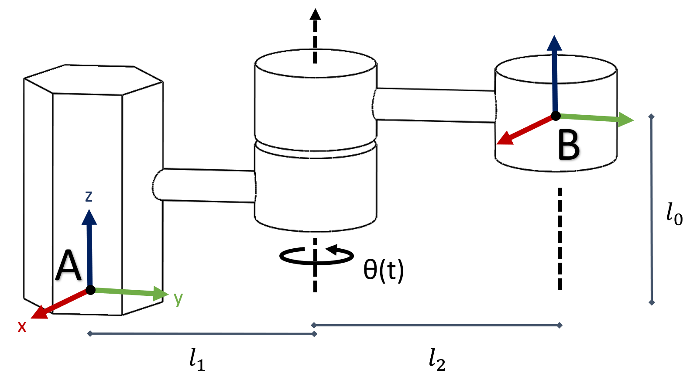

**图 3.6**：只有一个运动关节的机械臂。坐标系 A 位于机器人基座，坐标系 B 位于末端。

上图的机械臂只有一个关节，关节角随时间变化，记作 $\theta(t)$。当 $t=0, \theta(t)=0$ 时，连杆与坐标系 A、B 的 y 轴重合。本题将分析末端的空间速度。

1. 对于这个机械臂，给定 ${}^Bp^C(0) = [1, 0, 0]^T$，写出 ${}^Ap^C(0)$。对任意点 C，推导 3×3 旋转矩阵 ${^A}R{^B}(t)$ 和平移向量 ${^A}p{^B}(t)$，使得 ${^A}p^C_A(t)={^A}R{^B}(t) {^B}p^C_B+{^A}p{^B} (t)$。结果应包含 $l_0, l_1, l_2,$ 和 $\theta(t)$。

2. 证明：对任意旋转矩阵 $R$，$\widehat{\omega} \equiv
         \dot{R}R^{-1}$ 满足 $\widehat{\omega} = -\widehat{\omega}^T$。再代入 $R={^A}R{^B}(t)$ 验证证明。

3. 求出这个机械臂的 ${^A}V{^B}(t)$，写成 $l_0,
         l_1, l_2, \theta(t)$ 与 $\dot\theta(t)$ 的函数。

<a id="representing_rotations"></a>

<a id="exercise13"></a>

### 练习 3.13　三维旋转表示的困难

在[三维旋转的表示](https://manipulation.mit.edu/#3D_rotation)一节，我提到：没有一种三维旋转表示能在所有场景下都最好用。本题将考察几种常见表示中容易被忽略的性质。

1. Roll–Pitch–Yaw：可以用一组 roll、pitch、yaw 角 $(r,p,y)$ 表示旋转。各个旋转的组合顺序，请参考 Drake 的 [RollPitchYaw](https://drake.mit.edu/doxygen_cxx/classdrake_1_1math_1_1_roll_pitch_yaw.html) 类。给定 $p=-\pi/2$，求出以 $r$ 和 $y$ 为变量的旋转矩阵。在这个矩阵中，改变 $r$ 与改变 $y$ 的效果有什么关系？这说明 roll–pitch–yaw 表示有什么特点？提示：试着用[三角函数和角公式](https://en.wikipedia.org/wiki/List_of_trigonometric_identities#Angle_sum_and_difference_identities)化简结果。
   
    $$
    \sin(\alpha+\beta)=\sin\alpha\cos\beta+\cos\alpha\sin\beta
    $$
   
    
   
    $$
    \cos(\alpha+\beta)=\cos\alpha\cos\beta-\sin\alpha\sin\beta
    $$
   
   

2. 轴角：将右手坐标系绕其 z 轴旋转 $\pi/2$ 弧度，旋转后的 x 轴正方向会指向原先的 y 轴正方向。这个旋转可以用轴角向量 $(0,0,\pi/2)$ 表示。回忆：向量的方向是旋转轴，模长是旋转角。这种表示并不唯一，请找出另外两组表示同一旋转的轴角。

3. 四元数：单位四元数由四个数 $(w,x,y,z)$ 构成，满足 $w^2+x^2+y^2+z^2=1$。它很适合表示朝向，因为它没有 roll–pitch–yaw、轴角等表示中的奇异性，所以[对朝向做插值](https://manipulation.mit.edu/#pick_and_place_trajectory)时尤其可靠。不过，它仍有“同一个朝向对应多个表示”的问题。把单位四元数 $(w,x,y,z)$ 转成轴角向量 $(a_x,a_y,a_z)$，先计算 $\theta=2\arccos(w)$，再对任意整数 $n$ 使用：
   
    $$
    (a_x,a_y,a_z)=\left\{\begin{array}{ll} \displaystyle\frac{\theta}{\sin(\theta/2)}(x,y,z) & \theta\ne 2n\pi\\ (0,0,0) & \theta=2n\pi \end{array}\right.
    $$
   
    请将四元数转换为轴角并化简三角表达式，证明对任意单位四元数 $(w,x,y,z)$，$(-w,-x,-y,-z)$ 都表示同一朝向。事实上，每个朝向恰好对应两个单位四元数！提示 1：对任意 $\alpha$ 和 $\beta$，都有 $\arccos(-\alpha)=\pi-\arccos(\alpha)$ 与 $\sin(\pi-\beta)=\sin(\beta)$。提示 2：对任意旋转角 $\theta$，$\theta\pm 2\pi$ 表示相同朝向。提示 3：$\frac{1}{\sin(\theta/2)}(x,y,z)$ 是单位向量。

<a id="pick_place_initials"></a>

<a id="exercise14"></a>

### 练习 3.14　抓取和操作模型资源

本题将在本章的[抓取与放置演示](pick-and-place.md#example13)基础上，让机器人抓取并摆放代表你姓名首字母的字母模型。所有工作都在 [对应 notebook](https://colab.research.google.com/github/RussTedrake/manipulation/blob/master/book/pick/exercises/14_pickplace_initials.ipynb) 中完成，具体包括：

1. 求出模型的抓取位姿与放置位姿。

2. 补全微分 IK 控制器。

3. 构建一个 `Diagram`，仿真 IIWA 对字母模型的抓取和摆放过程。

<a id="references"></a>

## 参考文献

<div class="references" markdown="1">

1. <a id="Craig05"></a> John J. Craig , "Introduction to Robotics: Mechanics and Control" , Pearson Education, Inc
    , 2005 .

2. <a id="Murray94"></a> Richard M. Murray and Zexiang Li and S. Shankar Sastry , "A Mathematical Introduction to Robotic Manipulation" , CRC Press, Inc.
    , 1994 .

3. <a id="Lynch17"></a> Kevin M Lynch and Frank C Park , "Modern Robotics" , Cambridge University Press
    , 2017 .

4. <a id="Mitiguy17"></a> Paul Mitiguy , "Advanced Dynamics & Motion Simulation: For Professional Engineers and Scientists (graduate Work) ; 3D, Computational, Guided" , Prodigy Press
    , 2017 .

5. <a id="Stillwell08"></a> John Stillwell , "Naive Lie theory" , Springer Science & Business Media
    , 2008 .

6. <a id="Mussa-Ivaldi91"></a> Ferdinando A. Mussa-Ivaldi and Neville Hogan , "Integrable Solutions of Kinematic Redundancy via Impedance Control" , The International Journal of Robotics Research , vol. 10, no. 5, pp. 481-491, 1991 .

7. <a id="Boyd04a"></a> Stephen Boyd and Lieven Vandenberghe , "Convex Optimization" , Cambridge University Press
    , 2004 .

8. <a id="Flacco15"></a> Fabrizio Flacco and Alessandro De Luca and Oussama Khatib , "Control of redundant robots under hard joint constraints: Saturation in the null space" , IEEE Transactions on Robotics , vol. 31, no. 3, pp. 637--654, 2015 .

9. <a id="Escande14"></a> Adrien Escande and Nicolas Mansard and Pierre-Brice Wieber , "Hierarchical quadratic programming: Fast online humanoid-robot motion generation" , The International Journal of Robotics Research , vol. 33, no. 7, pp. 1006--1028, 2014 .

</div>

---

**继续阅读**：[上一章：先给你准备一个机器人（中文）](robot.md) · [全书目录与前言（中文）](preface.md) · [下一章：基于几何的位姿估计（中文）](pose-estimation.md)  
[无障碍访问](https://accessibility.mit.edu/) · © Russ Tedrake, 2026
