
ROBOTIC MANIPULATION / 中文译稿 / 04

# 第 4 章　基于几何的位姿估计

*Robotic Manipulation: Perception, Planning, and Control*

**原著作者** [Russ Tedrake](http://people.csail.mit.edu/russt/)

**原文最后修改日期** 2026 年 10 月 11 日

**原文版权** © Russ Tedrake, 2020–2026

**对照阅读** [原文 PDF](pdfs/pose-estimation-original.pdf) · [在线原文](https://manipulation.mit.edu/pose.html)

## 本章目录

- [4.1　相机与深度传感器](#section1)
    - [4.1.1　深度传感器](#section1.1)
    - [4.1.2　仿真](#section1.2)
        - [4.1.2.1　传感器噪声与深度缺失](#section1.2.1)
        - [4.1.2.2　遮挡与不完整视野](#partial_views)
- [4.2　几何的表示方式](#section2)
- [4.3　已知对应关系的点云配准](#registration)
- [4.4　迭代最近点（ICP）](#icp)
- [4.5　处理不完整视野与离群点](#section5)
    - [4.5.1　检测离群点](#section5.1)
    - [4.5.2　点云分割](#section5.2)
    - [4.5.3　更一般的对应关系](#section5.3)
    - [4.5.4　软对应关系](#section5.4)
    - [4.5.5　非线性优化](#section5.5)
        - [4.5.5.1　预计算距离函数](#section5.5.1)
    - [4.5.6　全局优化](#section5.6)
- [4.6　非穿透约束与自由空间约束](#section6)
    - [4.6.1　把自由空间约束写成非穿透约束](#section6.1)
- [4.7　跟踪](#section7)
- [4.8　把各部分连接起来](#section8)
- [4.9　接下来往哪里走](#section9)
- [4.10　练习](#exercises)
- [参考文献](#references)

---

上一章已经给出了移动物体的初步方案，但有一个关键假设，让它还无法用于真实机器人：我们事先知道物体的初始位姿。本章将迈出取消这一假设的第一步，利用机器人深度相机获得的信息来估计位姿。这些方法最适合已知物体，例如已有其几何网格模型，并且环境比较整洁的情况；它们也会成为后面更复杂方法的基准。

本章采用几何方法。如今的感知系统并非都显式使用几何；一些深度学习方法直接学习从像素到输出的映射。不过，许多深度学习方法仍以几何为基础，近年的几何处理技术也经历了快速发展，包括稠密重建、从文本生成三维模型等。除了机器人操作，自动驾驶和虚拟、增强现实的需求也推动了这些进展，带来了更先进的传感器和出色的新算法。

我们从几何出发，是为了给后续的感知学习打好基础。不过先说明一点：本章选择“位姿估计”作为目标，是因为它具体且马上能派上用场。在我们最先进的操作系统中，我反而尽量避免依赖显式位姿估计。它不仅假定物体已知，而且在视野不完整或存在遮挡时，很难准确估计位姿；很多操作任务其实也不需要知道得这么精确。

## 4.1　相机与深度传感器

像挑选机械臂和夹爪一样，为机器人或环境配置传感器也有许多选择。近几年，这些传感器的质量提升、成本降低和尺寸缩小，甚至比机械臂的发展还显著。手机产业是主要推动力，自动驾驶的竞争也推动了高端传感器的发展。

硬件的进步有时会彻底改变算法思路。例如，当传感器的分辨率和帧率足够高，两帧之间的场景变化就很小，估计会容易许多。这无疑也是过去十多年同步定位与建图（SLAM）快速发展的原因之一。

你可能觉得，操作任务最重要的传感器应该是触觉传感器——也许确实如此。但目前实际系统主要依靠相机和测距传感器。至少应该先考虑视觉：如果不知道该到哪里触碰，触觉传感器也无从发挥作用。

传统相机按一定帧率输出彩色图像，当然很重要。不过，机器人还大量使用直接测量相机与环境之间距离、也就是深度的传感器。这些设备有的同时输出颜色，有的只输出深度。

### 4.1.1　深度传感器

主要包括 RGB-D 相机，例如飞行时间（ToF）相机、投射纹理的双目相机等，以及激光雷达（LiDAR）。

本课程使用 Intel RealSense D415 相机。

单目深度估计。

基于学习的双目匹配，见 [参考文献 1](#Shankar22)。

### 4.1.2　仿真

D415 这样的相机可以按不同保真度仿真。我们先从“理想”RGB-D 相机开始：深度图的每个像素，给出对应像素方向上的真实几何深度。在 Drake 中，这由 `RgbdSensor` 系统实现，可以直接与 `SceneGraph` 连接。

[API 文档](https://drake.mit.edu/doxygen_cxx/classdrake_1_1systems_1_1sensors_1_1_rgbd_sensor.html)

这里的信号与系统抽象，封装了大量复杂工作。系统内部是一套完整的渲染引擎，类似高端游戏中的引擎。Drake 支持多种[渲染引擎](https://drake.mit.edu/doxygen_cxx/group__render__engines.html)；课程主要使用基于 OpenGL、适合实时仿真的渲染器，它建立在 [VTK](https://vtk.org/) 之上。Drake 还可以连接采用光线追踪的高质量[基于物理的渲染（PBR）](https://en.wikipedia.org/wiki/Physically_based_rendering)引擎，例如 [Blender 的 Cycles 渲染器](https://www.blender.org/features/rendering/)，参见 [Drake-Blender 项目](https://github.com/RobotLocomotion/drake-blender)。这些工具适合生成高质量图像，用于训练深度感知系统，或制作展示材料。

#### 示例 4.1　仿真 RGB-D 相机

**运行示例**：[在 Colab 中打开](https://colab.research.google.com/github/RussTedrake/manipulation/blob/master/book/pose/pose.ipynb)

先看一个简单例子。我在场景中放入一个物体，即 [YCB 数据集](https://github.com/RobotLocomotion/models/tree/master/ycb) 中的芥末酱瓶，并在系统图中加入 `RgbdSensor`。连接完成后，只需计算输出端口，就能取得彩色图和深度图：

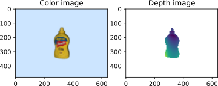

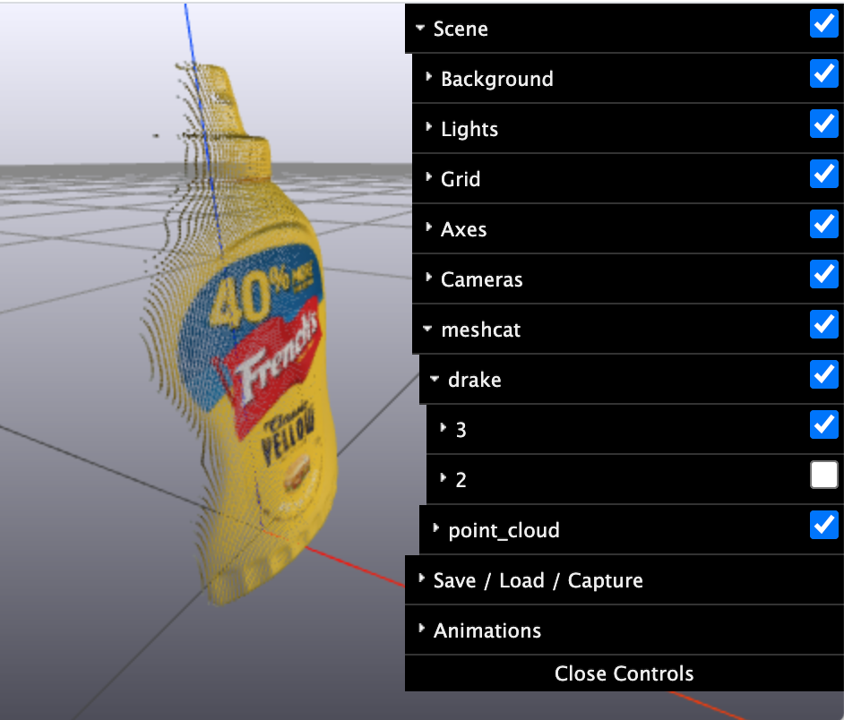

 请花一点时间看看 MeshCat 可视化，[可在这里打开](https://manipulation.mit.edu/data/mustard.html)。里面有相机及其坐标系，也有熟悉的芥末酱瓶，不过瓶子看起来可能有点奇怪，因为我同时显示了真实模型和相机生成的点云。在 MeshCat 界面中取消显示真实模型，见右图，就能只看点云。

除了阅读代码，也可以通过系统框图了解各模块之间的关系。[这张系统图](https://manipulation.mit.edu/data/depth_camera_diagram.svg)展示了本例使用的系统结构。

在 `HardwareStation` 工作流程中，只要在场景数据（例如 YAML 描述）中声明相机，`HardwareStation` 系统图内部就会自动加入 `RgbdSensors`，并把它们的输出端口暴露出来，与真实硬件的接口对应。

#### 4.1.2.1　传感器噪声与深度缺失

真实深度传感器当然远非理想。深度误差并不是简单的高斯噪声，还取决于光照、物体表面法线、材料的视觉属性等因素；颜色通道也只是近似。即使用高端渲染器，也要为场景提供足够准确的几何、材料和光源，才能得到好结果，而真实环境的细节很难完整复现。等掌握一些基本操作之后，我们会再看真实传感器数据，以及模型与实物之间的差距。

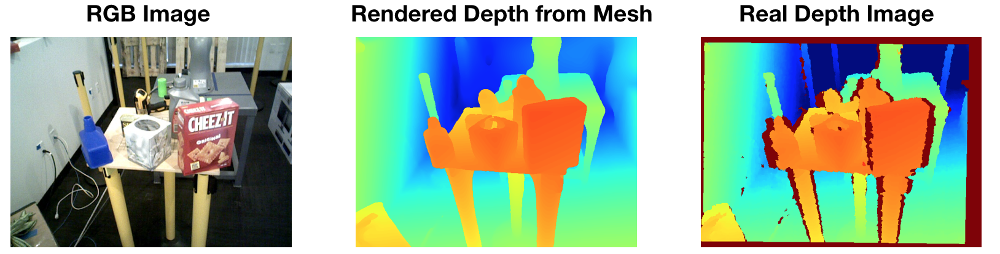

**图 4.1**：真实深度传感器的输出并不干净。最右图的红色像素表示未获得有效回波，此时传感器返回“最大深度”。这种缺失在物体边缘和反光物体上尤其常见。图片转载自 [参考文献 2](#Sweeney18a)。

#### 4.1.2.2　遮挡与不完整视野

上面的芥末酱瓶清楚展示了相机的一大局限：它只能看到视线所及之处。想看瓶子背面，就得移动相机；瓶子放在桌上时，想看底部，还得把它拿起来。杂乱场景更困难，其他物体会挡住瓶子。即使环境整洁，安装在头部或桌边的相机，也经常被正在操作的机器人手臂遮挡。最希望传感器发挥作用的时候，它反而可能什么都看不到！

一种常见做法是把深度相机装在机器人腕部，以改善视野，但仍不能彻底解决问题。所有深度传感器都有最大、最小工作距离。RealSense D415 的有效匹配范围大约是 0.3–1.5 m。因此，接近物体的最后 30 cm——恰恰是我们希望相机最有用的阶段——物体反而会从深度数据中消失。

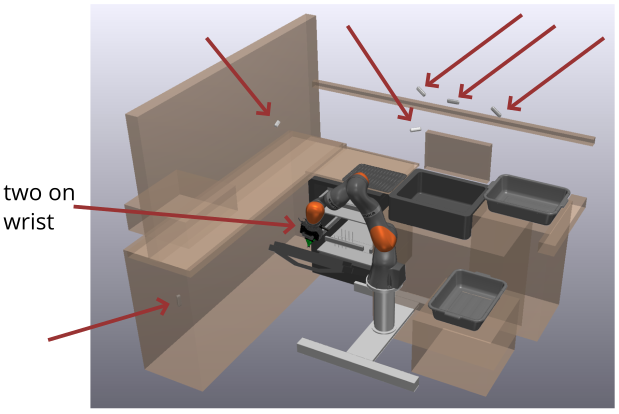

**图 4.2**：条件允许时，我们会尽量多装相机。[TRI](https://www.tri.global/news/tri-taking-on-the-hard-problems-in-manipulation-re-2019-6-27) 的这个餐具装载实验平台一共安装了八台相机，但遮挡问题仍然存在。

## 4.2　几何的表示方式

三维几何有多种表示，各自适合不同的计算。它们通常可以相互转换，但有时会损失信息。例如三角面片表面网格、四面体体网格、体素或占据栅格，以及符号距离函数、神经辐射场（NeRF）等隐式表示。后者近年在三维视觉的深度学习中又变得很流行，见 [参考文献 3](#Park19)、[参考文献 4](#Mildenhall21)。这里先从深度图和点云开始。

深度相机输出一张图，每个像素是一个数，表示相机沿该像素方向到最近物体的距离。结合相机内参，例如镜头参数，Drake 用 [`CameraInfo`](https://drake.mit.edu/doxygen_cxx/classdrake_1_1systems_1_1sensors_1_1_camera_info.html) 存储，就能将深度图转换为三维点集 $s_i$。这里使用 $s$，是因为后面的算法通常将它们称为“场景点”。这些点在某个参考坐标系下表达，参考系由刚体变换指定，也可以附带颜色等信息；这就是点云表示。Drake 的 `DepthImageToPointCloud` 系统默认使用相机坐标系 $^CX^{s_i}$，也支持通过可选输入端口接收 $^PX^C$，方便将点转换到世界坐标系等其他坐标系中。

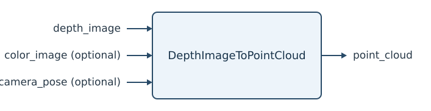

[API 文档](http://drake.mit.edu/doxygen_cxx/classdrake_1_1perception_1_1_depth_image_to_point_cloud.html)

随着深度传感器普及，已经出现许多点云几何操作和表示转换的工具库。Drake 直接实现了不少基本操作；如果需要更多功能，还可以使用开源的 [Open3D](http://www.open3d.org/)。许多较早的项目使用 [Point Cloud Library（PCL）](http://pointclouds.org/)，它如今已停止发展，不过文档仍很有参考价值。

注意，深度图转成点云会丢失一部分信息：从相机出发、到达这个点的那条射线。结合相机位姿，深度图不仅告诉我们“这个点有几何表面”，也告诉我们“相机到这个点之间的直线路径上没有几何物体”。后面的算法会利用这条信息，所以不要把深度图完全丢掉。更一般地说，各种几何表示都有优缺点；同时保留多种表示，并按需要相互转换，是很常见的做法。

## 4.3　已知对应关系的点云配准

现在回到本章的目标：已知物体位于机器人的工作空间中，我们从深度相机获得了点云，怎样估计物体位姿 $X^O$？

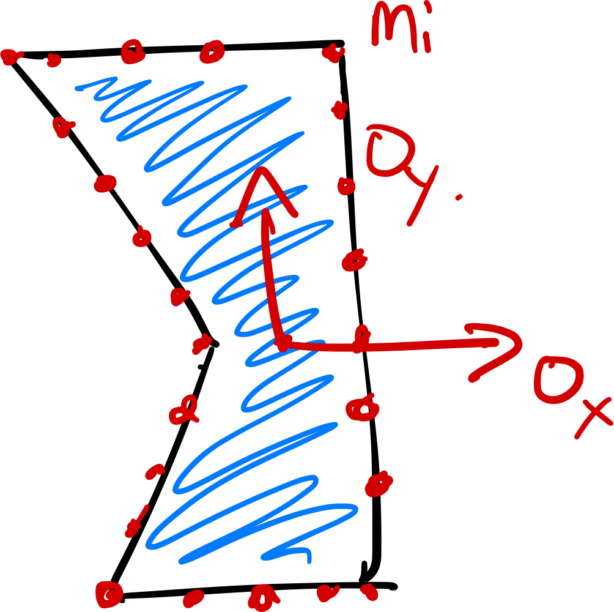

 一个自然且研究充分的建模方式来自[点云配准](https://en.wikipedia.org/wiki/Point_set_registration)，也叫点集配准或扫描匹配。给定两组点云，求一个刚体变换，使它们尽可能对齐。因此，我们暂时也用点云表示物体模型，把模型点记为 $m_i$，并在物体坐标系下描述其位置：$^OX^{m_i}.$

第二组点云是深度相机获得的场景点 $s_i$，通过相机内参转换到相机坐标系下，记为 $^CX^{s_i}$。模型点和场景点的数量分别记为 $N_m$、$N_s$。

暂时假设我们也知道 $X^C.$。这个假设合理吗？如果相机装在腕部，可以通过机械臂的正运动学求得；如果装在环境中，则需要知道相机在世界坐标系中的位姿。不过，这些位姿的微小误差，也可能使点云产生明显偏差，因此我们很重视[相机外参标定](http://www.mathworks.com/help/vision/ug/camera-calibration.html)；[附录](manipulation-station.md)中提供了标定代码。如果机械臂安装在移动底盘上，上述讨论仍成立，只是通常应在机器人坐标系、而非世界坐标系中进行配准。

本节第二个重要假设是“已知对应关系”。这里的对应关系，是指每个场景点都能与某个模型点配对。例如，如果每个点都有独特颜色，且相机能可靠识别，就可能实现。这在实践中并不现实，但适合用作起点。用对应关系向量 $c \in [1,N_m]^{N_s}$ 表示这个映射，其中 $c_i = j$ 表示场景点 $s_i$ 对应模型点 $m_j$。注意，这不要求一一对应：每个场景点都有模型点与之对应，但并非每个模型点都被观测到，多个场景点也可能对应同一个模型点。

这样，点云配准就变成一个逆运动学问题。把模型点和场景点写到共同的世界坐标系下：

$$
{}^W p^{m_{c_i}} = {}^W X^O \: {}^Op^{m_{c_i}}
    = {}^W X^C \: {}^Cp^{s_i},
$$

，就只剩一个未知变换 $X^O$ 需要求解。上一章我建议使用微分运动学而不是逆运动学，这里为什么变了？微分运动学在感知中仍然有用，例如得到初始位姿之后，可以用它持续跟踪。但机器人可以直接读取关节传感器获知当前状态；视觉感知却必须至少先解一次这个更困难的初始估计问题。

求解 $X^O$ 意味着什么？每个模型点在满足 $p^{s_i} \in \mathbb{R}^3.$ 时都给出三个约束。未知数的数量取决于位姿的表示方式，但约束数量通常远多于未知数。把每个点都作为相对位姿的硬约束，也会对测量噪声很敏感。因此，更好的做法是找一个尽量解释观测数据的位姿，例如求最小二乘解：

$$
\min_{X
    \in \mathrm{SE}(3)} \sum_{i=1}^{N_s} \| X \: {}^Op^{m_{c_i}} - X^C \:
    {}^Cp^{s_i}\|^2.
$$

 这里 $\mathrm{SE}(3)$ 是“[特殊欧氏群](http://lavalle.pl/planning/node147.html)”的记号，表示 $X$ 必须是有效的刚体变换。

接下来选一种具体表示：这里使用 3×3 旋转矩阵，下面的方法也有等价的四元数形式，见 [参考文献 5](#Horn87)。将旋转矩阵和平移向量的各个分量作为决策变量，可以写成：

$$
\begin{aligned} \min_{p,
    R} \quad& \sum_{i=1}^{N_s} \| p + R \: {}^Op^{m_{c_i}} - X^C
    \: {}^Cp^{s_i} \|^2, \\ \text{subject to} \quad& R^T = R^{-1}, \quad \det(R) = +1.
    \nonumber \end{aligned}
$$

 并非每个 3×3 矩阵都是旋转矩阵，所以必须加入约束，保证 $R$ 是有效旋转。其实 $R^T =
    R^{-1}$ 已经几乎够了，它意味着 $\det(R) = \pm 1.$。但若矩阵满足该约束且 $\det(R) = -1$，它就属于“[非正常旋转（improper rotation）](https://en.wikipedia.org/wiki/Improper_rotation)”，相当于旋转再加上沿旋转轴的镜像反射。

看看这个优化问题的类型。采用旋转矩阵后，$p +
    R{}^Op^{m_{c_i}} - X^C {^Cp^{s_i}}$ 对决策变量是线性的，可以把它理解为 $Ax \approx b$，因此目标函数是凸二次函数。第一个约束是二次等式：写成 $RR^T=I$ 后，共有九个约束，每个都对 $R$ 的元素呈二次关系。行列式约束则对 $R$ 的元素呈三次关系。

### 示例 4.2　二维的纯旋转点集配准

我想直观展示这个优化问题，但 9+3 个决策变量实在难画。先假设场景点与模型点之间只有旋转，这就是著名的 [Wahba 问题](https://en.wikipedia.org/wiki/Wahba%27s_problem)；再把问题从三维简化到二维。

二维旋转矩阵只需两个变量就能线性参数化：

$$
R = \begin{bmatrix} a & -b \\ b & a\end{bmatrix}.
$$

 此时，$RR^T=I$ 和行列式约束完全相同，都要求 $a^2 + b^2 = 1.$。

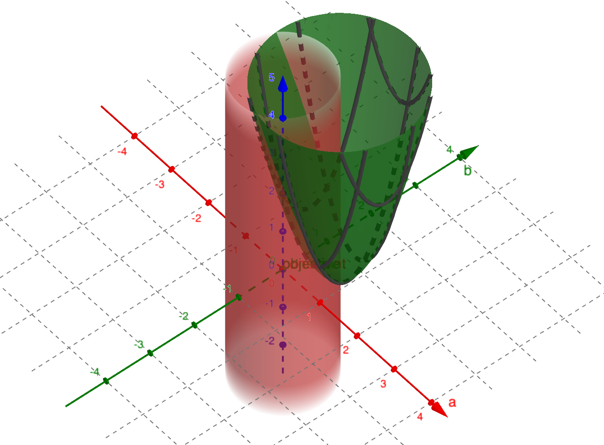

**图 4.3**：图中 $x$、$y$ 轴分别对应定义二维旋转矩阵 $R$ 的参数 $a$、$b$。绿色的二次曲面是目标函数 $\sum_i \| R \: {}^O p^{m_{c_i}} - p^{s_i}\|^2,$，红色的空心圆柱表示旋转矩阵约束。[点击打开交互版本。](https://www.geogebra.org/3d/pn628maw)

这和你预期的一样吗？图中只用了两对模型点与场景点；增加点数会改变二次曲面的形状，但不会改变其最小值所在的位置。在[交互版本](https://www.geogebra.org/3d/pn628maw)中还加了滑块，可以调节参数 $\theta$，控制由 $R$ 描述的真实旋转。试试看！

没有测量噪声时，也就是场景点恰好由模型点经过旋转得到时，目标函数的无约束最小值已经满足约束。但只要给点加一点噪声，就不再如此，约束便开始发挥作用。

三维情形的几何结构类似，只是维数高得多。希望这张图能帮助你理解：为什么这个问题会有一个基于奇异值分解（SVD）的漂亮数值解。

平移怎么办？有一个关键观察，可以把旋转优化与平移优化分开：点之间的相对位置受旋转影响，却不受平移影响。因此，先以物体上某个基准点为原点描述所有点，就能单独求旋转，再反推出平移。对于最小二乘目标，最合适的基准点就是欧氏度量下的点集中心；如果把每个点视为质量相同的质点，它就是质心。

因此，要求解 

$$
\begin{aligned}
    \min_{p\in\mathbb{R}^3,R\in\mathbb{R}^{3\times3}} \quad & \sum_{i=1}^{N_s} \| p + R
    \: {}^Op^{m_{c_i}} - p^{s_i}\|^2, \\ \text{subject to} \quad & RR^T =
    I,\end{aligned}
$$

，先定义模型点和场景点的中心 $\bar{m}$、$\bar{s}$：

$$
{}^Op^{\bar{m}} = \frac{1}{N_s}
    \sum_{i=1}^{N_s} {}^Op^{m_{c_i}}, \qquad p^{\bar{s}} = \frac{1}{N_s}
    \sum_{i=1}^{N_s} p^{s_i}.
$$

 如果好奇，这也可以通过对[拉格朗日函数](https://en.wikipedia.org/wiki/Lagrange_multiplier)关于 $p$ 求梯度并令其为零得到：

$$
\sum_{i=1}^{N_s} 2 (p +
    R \: {}^Op^{m_{c_i}} - p^{s_i}) = 0 \Rightarrow p^* = \frac{1}{N_s}
    \sum_{i=1}^{N_s} p^{s_i} - R^*\left(\frac{1}{N_s} \sum_{i=1}^{N_s}
    {}^Op^{m_{c_i}}\right),
$$

 但别忘了上面的几何解释。这个结果说明，可以将等式右侧代入目标函数中的 $p$，单独求解 $R$。

为求 $R$，先构造数据矩阵 

$$
W = \sum_{i=1}^{N_s} (p^{s_i} -
    p^{\bar{s}}) ({}^Op^{m_{c_i}} - {}^Op^{\bar{m}})^T,
$$

，再用 SVD 得到 $W
    = U \Sigma V^T$。最优解为：

$$
\begin{gathered} R^* = U D V^T,\\
    p^* = p^{\bar{s}} - R^* {}^Op^{\bar{m}},\end{gathered}
$$

，其中 $D$ 是对角矩阵，对角元素为 $[1, 1, \det(UV^T)]$ [参考文献 6](#Myronenko09)。看起来有些神奇，但 SVD 中将奇异值替换为 1，实际上给出了到正交矩阵集合的最优投影；额外的对角矩阵则保证结果不会是非正常旋转。相关推导很多，不过不少文献直接省略行列式约束，没有处理反射问题。我很早就喜欢的一篇推导是 [参考文献 7](#Haralick89) 的第 3 节。

### 示例 4.3　已知对应关系的点云配准

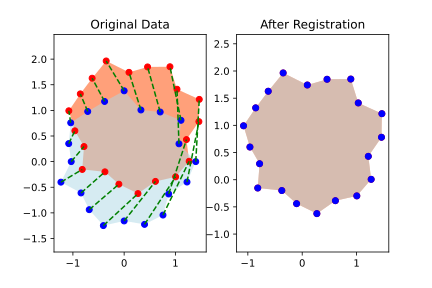

 
示例代码在 $x$–$y$ 平面随机生成一组点，作为随机物体，再施加一个随机二维刚体变换。蓝点是模型坐标系中的模型点，红点是场景点，绿色虚线是准确的对应关系。右图再次绘出两组点，但这次用估计位姿把它们都转换到世界坐标系。和预期一致，算法准确恢复了真实变换。

**运行示例**：[在 Colab 中打开](https://colab.research.google.com/github/RussTedrake/manipulation/blob/master/book/pose/pose.ipynb)

关键在于：一旦对应关系已知，就有高效、稳健的数值方法估计位姿。

## 4.4　迭代最近点（ICP）

那么，对应关系从哪里来？如果已知物体位姿，其实很容易：将两组点转换到同一坐标系后，每个场景点对应的模型点，就是离它最近的点。

这启发了一种自然的迭代方法：从初始位姿猜测出发，按最近点建立对应关系，再用这些对应关系更新位姿估计。这就是点云配准中著名且广泛使用的迭代最近点（Iterative Closest Point，ICP）算法，尽管它的局限也早已为人熟知。

具体来说，用 $\hat{X}^O$ 表示估计的物体位姿，$\hat{c}$ 表示估计的对应关系。“最近点”这一步为：

$$
\forall i, \hat{c}_i = \operatorname{argmin}_{j \in
    N_m}\| \hat{X}^O \: {}^Op^{m_j} - p^{s_i} \|^2.
$$

 即对变换后的每个场景点，找欧氏距离最近的模型点。这是经典的最近邻搜索问题，借助优化的数据结构可以高效求解。例如，Open3D 使用 [FLANN](https://github.com/mariusmuja/flann)，见 [参考文献 8](#Muja09)。

同时求位姿与对应关系很困难，但 ICP 将它们分开交替求解，使每一部分都容易处理。类似迭代也常见于双线性优化、期望最大化等问题。必须记住：它求的是非凸优化问题的局部解，因此会陷入局部极小值。

### 示例 4.4　迭代最近点

▶ [打开原文交互内容或视频](https://manipulation.mit.edu/data/iterative_closest_point.html?height=240px)

[点击观看动画。](https://manipulation.mit.edu/data/iterative_closest_point.html)

这里展示 ICP 对随机二维物体的配准过程。蓝点是模型点，红点是场景点，绿色虚线是对应关系。建议亲自运行代码看看。

动画恰好展示了一次收敛到真实最优解的情况，但算法更多时候会陷入局部极小值。逐步观察有助于建立直觉：只要对应关系全部正确，位姿估计就会得到精确解。因此，收敛前的每一步，至少还有几对错误对应。仔细找找它们！

**运行示例**：[在 Colab 中打开](https://colab.research.google.com/github/RussTedrake/manipulation/blob/master/book/pose/pose.ipynb)

对这些局部极小值的理解，催生了许多 ICP 变体，包括点到平面 ICP、法线 ICP、利用颜色的 ICP、基于特征的 ICP 等。其中基于“点对特征”的一种变体，在几乎每年举行的物体位姿估计挑战中表现尤其出色，见 [参考文献 9](#Drost10)、[参考文献 10](#Hodan20)。

## 4.5　处理不完整视野与离群点

前面的例子已足够展示 ICP 的局部极小值问题，但点云本身仍理想得不现实。点云配准广泛用于许多领域，文献中的方法并不都适合机器人面对的这类杂乱数据。

### 示例 4.5　对不理想点云运行 ICP

notebook 提供了几个参数，可以加入离群点，即不对应任何模型点的场景点，也可以加入噪声或限制可见范围。请分别尝试，再组合起来看看。

**运行示例**：[在 Colab 中打开](https://colab.research.google.com/github/RussTedrake/manipulation/blob/master/book/pose/pose.ipynb)

▶ [打开原文交互内容或视频](https://manipulation.mit.edu/data/icp_outliers.html?height=240px)

[点击观看动画。](https://manipulation.mit.edu/data/icp_outliers.html)

**图 4.4**：带离群点的 ICP 示例。离群点在工作空间内按均匀分布随机生成。

▶ [打开原文交互内容或视频](https://manipulation.mit.edu/data/icp_noise.html?height=240px)

[点击观看动画。](https://manipulation.mit.edu/data/icp_noise.html)

**图 4.5**：在场景点位置加入高斯噪声后的 ICP 示例。

▶ [打开原文交互内容或视频](https://manipulation.mit.edu/data/icp_partial_view.html?height=240px)

[点击观看动画。](https://manipulation.mit.edu/data/icp_partial_view.html)

**图 4.6**：只能看到部分物体时的 ICP 示例。结果并不总这么糟，但看到这次运行时，我实在忍不住拿它做例子！

### 4.5.1　检测离群点

一旦有了合理的位姿估计 $X^O$，离群点就容易识别了。每个场景点对目标函数的贡献，是它与对应模型点之间距离的平方。距离过大的点可以标为离群点并从点云移除，再重新估计位姿。许多 ICP 实现，包括 [Open3D 的这个实现](http://www.open3d.org/docs/release/python_api/open3d.pipelines.registration.registration_icp.html)，都提供“最大对应距离”参数来做这件事。

这又成了先有鸡还是先有蛋的问题：识别离群点需要合理的位姿估计，但离群点很多时，恰恰难以获得这样的估计。一个常用于 ICP 初始化的方法是随机采样一致性（RANdom SAmple Consensus，RANSAC），见 [参考文献 11](#Fischler81)。它反复随机选取少量“种子”点，为每个子集计算位姿，再统计距离小于阈值的“内点”。内点最多的子集获胜，其位姿可作为 ICP 的起点。

还有一个很巧妙的思路。前面利用点之间的相对位置与平移无关，将旋转和平移分开。进一步看，点间距离其实对旋转、平移都不变。这一性质传统上用于将尺度估计与旋转、平移估计分开；本章暂不考虑尺度变化，因为当前任务并不需要。在 [参考文献 12](#Yang20a) 中，作者用它在尚无初始位姿时剔除离群点：如果两个场景点之间的距离，与任意两个模型点之间的距离都不相符，那么这两个场景点至少有一个是离群点。按这个条件寻找最大的内点集合，对应图中的最大团问题。可以在较强假设下证明最大团就是最佳匹配，也可以把它作为实用启发式。大点云求最大团太贵时，还可采用保守近似。

#### 示例 4.6　对应关系图中的最大团

下面是 [参考文献 12](#Yang20a) 中最大团思路的简单例子。我和作者 Hank 一起推敲了它，确保自己理解了他的想法。

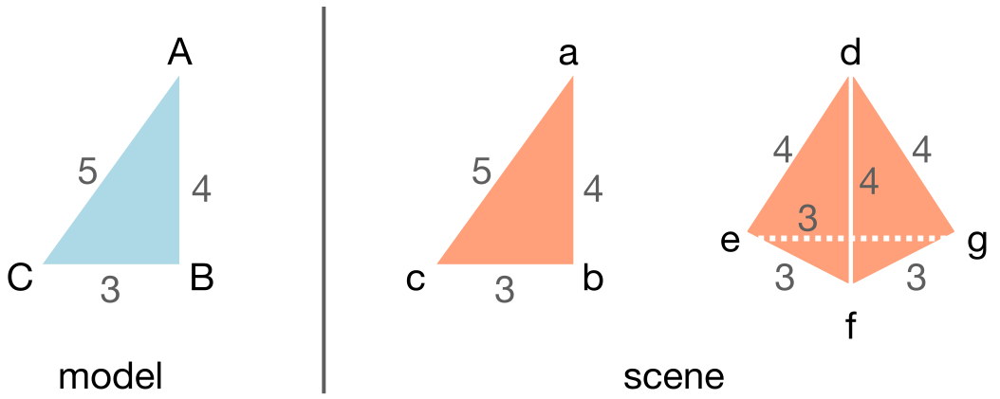

左侧模型是三角形，顶点标为 [$A$, $B$, $C$]。右侧场景有同样的三角形 [$a$, $b$, $c$]，产生三个点对距离；还多了一个金字塔，它共有六组匹配距离，其中三组长度为 3，三组为 4。金字塔上的错误对应，会不会形成比真实三角形 [$A-a$, $B-b$, $C-c$] 更大的团？

先假设任意模型点都可能对应任意场景点，构造点对距离图。每个可能对应关系都是一个节点，例如 $A-e$ 表示模型点 $A$ 与场景点 $e$ 的对应。仅当 $A$、$B$ 之间的距离等于 $e$、$f$ 之间的距离时，才在节点 $(A-e)$ 与 $(B-f)$ 之间连边。

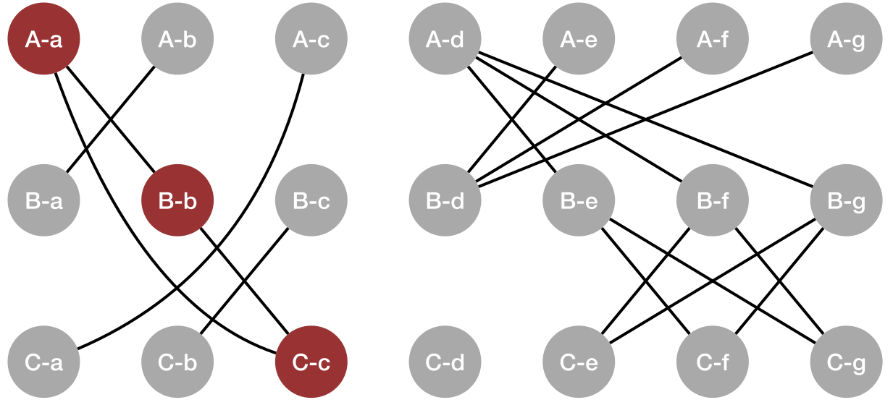

现在就能看出找团的意义了。涉及金字塔的最大团只有两个节点，场景三角形的最大团却有三个，我将它标成了红色。因此，这个例子中的最大团确实恢复了真实对应关系。

以上只是众多离群点剔除算法与启发式中的两个例子。还值得一提的是 [参考文献 9](#Drost10)：它基于点对特征进行优化的投票、聚类，效率很高，多年来在在线位姿估计基准中表现出色。

### 4.5.2　点云分割

离群点不一定来自深度相机的错误回波，更多时候来自场景中的其他物体。即使最简单的任务，目标物体也往往放在桌上或箱内。如果事先知道桌子、箱子的几何，就能删去这些区域的点；也可以用 [`Crop`](https://drake.mit.edu/doxygen_cxx/classdrake_1_1perception_1_1_point_cloud.html#aa3e3e56ca9276b5caf4c6422154616ca) 把点云裁剪到感兴趣区域。对于简单、整洁的场景，这已经足够，本章的任务也可以这样完成。

更一般地，场景中有多个物体时，仍需要找出目标，例如芥末酱瓶。如果点云配准足够稳健，最优配准应该能够仅将模型点与部分场景点对应起来；这样配准本身就能完成物体检测。可惜，现有算法还不够强。

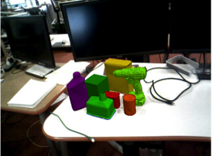

**图 4.7**：来自 [LabelFusion](http://labelfusion.csail.mit.edu/) 的多物体场景，见 [参考文献 13](#Marion17)。

因此，通常先用另一种算法把场景分成若干可能的物体，再对各个分割结果分别配准。基于几何的分割方法很多，见 [参考文献 14](#Nguyen13)。但目前我们更常用神经网络做分割，这里就不展开几何方法了。

### 4.5.3　更一般的对应关系

离群点和多物体场景，对现有对应关系提出了挑战。此前用 $c_i
      = j$ 表示每个场景点到模型点的对应，算法具有不对称性：场景 $\Rightarrow$ 模型。选择这个方向，是因为开头芥末酱瓶的例子强调不完整视野。可是一旦考虑桌子和其他物体，也许模型 $\Rightarrow$ 场景更合适？你可以验证，这只需对 ICP 做很小的修改。但如果既有多个物体，又有不完整视野呢？

一个简单改进是允许 $c_i$ 取特殊值，表示“无对应”。理想情况下，属于目标物体的场景点对应各自的模型点，离群点和其他物体的点标为“无对应”；被遮挡部分的模型点则没有任何场景点与之对应。

还可以使用更一般的对应矩阵 $C\in \{0,1\}^{N_s \times
      N_m}$：当且仅当场景点 $i$ 对应模型点 $j$ 时，$C_{ij} = 1$。这样，已知对应关系的估计步骤可写为：

$$
\min_{X\in \mathrm{SE}(3)} \sum_{i=1}^{N_s}
      \sum_{j=1}^{N_m} C_{ij} \|X \: {}^Op^{m_j} - p^{s_i}\|^2.
$$

 它包含之前的表示：若 $c_i = j$，令 $C_{ij} = 1$，该行其余元素为零；若场景点 $i$ 是离群点，就把整行置零。此前的记号更紧凑，体现了最近点计算的不对称性，也明确只需计算 $N_s$ 个距离。但这个更一般的表示，将带来新的方法。

### 4.5.4　软对应关系

如果不再要求严格的二元对应，而把它放宽为权重 $C_{ij} \in [0,1]$，代替 $C_{ij} \in \{0, 1\}$，会怎样？这正是相干点漂移（Coherent Point Drift，CPD）算法的核心，见 [参考文献 15](#Myronenko10)。CPD 文献通常用高斯混合模型（GMM）进行概率解释。这个视角很有用，但别让术语把问题弄复杂了：最大化高斯似然时，通常先取 $\log$，因为它是单调函数，结果就又回到了二次目标函数。

概率解释自然给出了每轮迭代的对应权重：将它理解为给定模型点时场景点的概率，

$$
C_{ij} = \frac{1}{a_i} \exp^{\frac{-\left\|X^O
      \: {}^Op^{m_j} - p^{s_i}\right\|^2}{2\sigma^2}},
$$

。这是标准高斯密度，其中 $\sigma$ 是标准差，$a_i$ 是使概率和为 1 的归一化常数。离群点的概率也可以自然纳入，只需修改归一化常数。

**补充说明**：归一化常数的具体形式如下；它主要是实现细节。

归一化常数为：

$$
a_i = (2\pi \sigma^2)^\frac{D}{2} \left[
      \sum_{j=1}^{N_m} \exp^{\frac{-\left\|X^O \: {}^Op^{m_j} -
      p^{s_i}\right\|^2}{2\sigma^2}} + \frac{w}{1-w}\frac{N_m}{N_s} \right],
$$

 其中 $D=3$ 是欧氏空间维数，$0 \le w \le 1$ 是采样点为离群点的概率，见 [参考文献 15](#Myronenko10)。

CPD 因而与 ICP 很相似：交替更新对应权重和位姿估计。位姿步骤几乎不变，只是中心点变为 

$$
{^Op^{\bar{m}}} = \frac{1}{N_C} \sum_{i,j} C_{ij}
      \: {}^Op^{m_j}, \quad p^{\bar{s}} = \frac{1}{N_C} \sum_{i,j} C_{ij}
      p^{s_i}, \quad N_C = \sum_{i,j} C_{ij},
$$

，数据矩阵变为 

$$
W =
      \sum_{i,j} C_{ij} \left(p^{s_i} - p^{\bar{s}}\right) \left({}^Op^{m_j} -
      {}^Op^{\bar{m}}\right)^T.
$$

。其余步骤，即用 SVD 提取 $R$，再由 $R$ 求 $p$，都相同。代码中不一定会直接看到求和符号，因为将点按列放进矩阵后，各步骤都能写成简洁的矩阵运算。

概率视角还给出了每轮更新高斯协方差的方法。[参考文献 15](#Myronenko10) 推导了 $\sigma$ 的估计式。（原文这部分推导尚未整理完成。）

一般认为，CPD 比使用硬对应和二次目标的 ICP 更稳健，因为高斯模型会把离群点的对应权重压到接近零。不过，大点云中计算所有点对距离也更昂贵。在 [参考文献 16](#Gao18a) 中，我们提出一种小改动：让场景点在空间中按高斯分布，而不是围绕模型点建立高斯分布，就又能只对场景点求和。这样既保留了 CPD 的不少稳健性优势，也接近 ICP 的计算效率。

### 4.5.5　非线性优化

到目前为止，所有算法都利用已知对应关系下的 SVD 位姿解，交替估计对应关系和位姿。另一类重要方法则同时求解两者。问题会变成非凸优化，因此同样可能陷入局部极小值。不过，一些研究认为，非线性求解器的运行时间可以与迭代算法相当，例如 [参考文献 17](#Fitzgibbon03)。

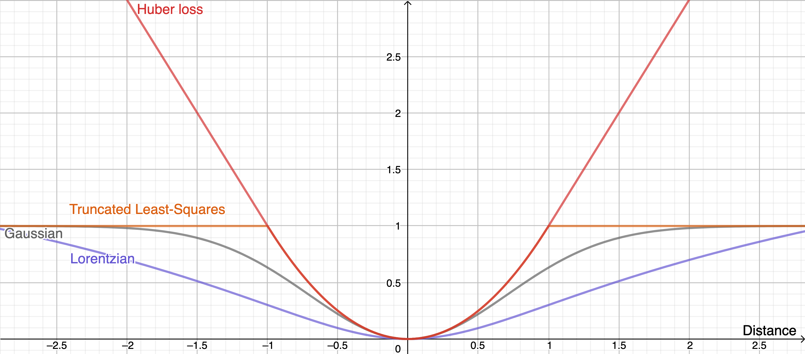

**图 4.8**：用于稳健配准的几种目标函数。[点击打开交互版本](https://www.geogebra.org/calculator/hcgacefe)。

非线性优化的另一优势，是支持多种目标函数，从而获得类似 CPD 的离群点稳健性。上图画出了几种常见函数；它们的共同特点是逐渐变平，距离大到一定程度后，代价不再继续增加。因此，可以像 CPD 一样，在目标中考虑所有点对：离群点若只贡献常数代价，例如 1，就不会产生关于决策变量的梯度，也不会影响最优解。选一个损失函数 $l(x)$，便可写成：

$$
\min \sum_{i,j}
      \left[ l\left(\| X^O \: {}^Op^{m_j} - p^{s_i} \|\right)\right].
$$

 决策变量也更灵活，可以使用最小参数表示，例如二维旋转用 $\theta$，三维旋转用欧拉角。目标函数虽更复杂，却可以去掉旋转矩阵约束。

#### 示例 4.7　已知对应关系的非线性位姿估计

为了看清这一步究竟失去了什么，先考虑已知对应关系、用最小参数表示位姿的非线性优化。只要不加其他约束，仍可把旋转与平移分开。考察：

$$
\min_\theta \sum_{j} \left\| \begin{bmatrix} \cos\theta & -\sin\theta
        \\ \sin\theta & \cos\theta \end{bmatrix} \left({}^Op^{m_{c_i}} -
        {}^Op^{\bar{m}}\right) - \left( p^{s_i} -
        p^{\bar{s}}\right)\right\|^2.
$$

 现在目标函数是复杂的非线性函数，是否已经出现局部极小值？

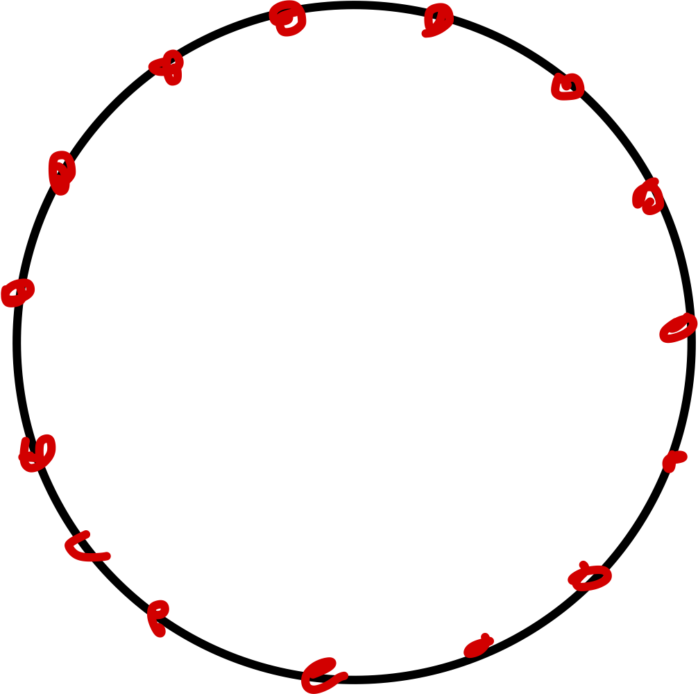

 做个思想实验：假设所有模型点都在一个完美圆上。对于任意场景点 $i$，纯旋转优化中最差的情况，是估计 $\theta$ 与最优旋转相差 180°，即 $\pi$ 弧度，此时代价为 $4r^2$，其中 $r$ 是圆半径。根据余弦定理，任意角度误差 $\theta_{err} = \theta - \theta^*,$ 对应的距离平方为 

$$
\text{distance}^2 =
        r^2 + r^2 - 2 r^2 \cos\theta_{err}.
$$

。圆上的所有其他点贡献相同代价。它虽然不是凸函数，但每个极小值都是全局最优，只是以 $2\pi$ 为周期重复。

即使几何更复杂、不是圆形，这个论证仍成立：每个点都绕圆运动，只是半径可能不同。随着 $\cos\theta_{err}$ 趋近 1，所有模型点的误差都减小，因此每个极小值仍是全局最优。到这一步，我们其实还没有引入不良的局部极小值！

真正引入局部极小值的，是对应关系搜索，以及可能额外加入的约束。

#### 4.5.5.1　预计算距离函数

非线性优化还有一个很好用的加速技巧，不过需要重新考虑场景点到模型的最小距离，而不再对所有点对分别计算。既然已经不显式枚举对应关系，我觉得这个调整并不算大的牺牲。把目标稍改为：

$$
\min \sum_{i} \left[ l\left( \min_j \| X^O \: {}^Op^{m_j} -
        p^{s_i} \|\right)\right].
$$

 也就是先求每个场景点到模型的最小距离，再对它应用任意稳健损失。

嵌套的 $\min$ 看起来计算量很大，但模型点固定，恰好可以通过预计算加速在线阶段。先把优化改写到模型坐标系，将内部项改为 

$$
\min_j \|{}^Op^{m_j} - {}^OX^W p^{s_i}\|.
$$

。对任意三维点 $x$，预先计算它 $x$ 到模型上所有点的最小距离，记为 $\phi(x).$；上面的项就变成 $\phi({^OX^Wp^{s_i}}).$。这种定义在三维空间中的函数叫作[距离场](https://en.wikipedia.org/wiki/Distance_transform)，与符号距离函数（SDF）、[水平集](https://en.wikipedia.org/wiki/Level-set_method)密切相关，也是几何建模中的常见表示。它正好能让我们快速计算大量场景点的代价。

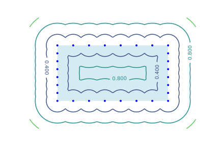

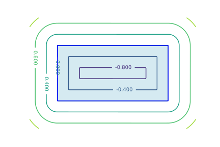

**图 4.9**：左图是以点集表示矩形时的距离函数等高线，右图是以二维网格表示矩形时的符号距离函数。网格表示的等高线更平滑，有助于缓解前面遇到的局部极小值问题。

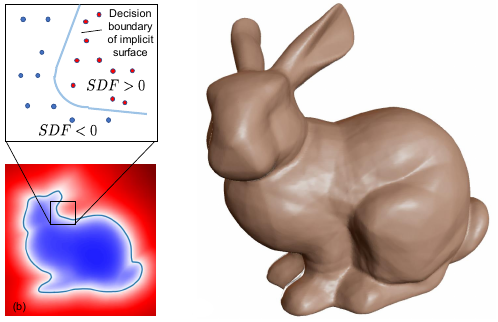

**图 4.10**：三维几何的符号距离函数（SDF）表示。经许可转载自 [参考文献 3](#Park19)。

如上图所示，预计算距离函数不仅可以表示到点云的最小距离，也能表示到网格模型的最小距离。还可以仔细设计其他类似距离的三维函数，使其具有平滑的次梯度，更适合非线性优化。这方面文献很丰富，[参考文献 18](#Osher03) 是一篇不错的参考。

### 4.5.6　全局优化

能否利用已知对应关系时位姿估计的漂亮结构，同时搜索对应关系和位姿，并获得全局解？

一些算法声称能保证 ICP 目标的全局最优，通常使用分支定界，见 [参考文献 19](#Gelfand05)、[参考文献 20](#Mellado14)、[参考文献 21](#Yang15)。但它们在真实点云上的表现让我们失望。我们也提出过一种方法，用分支定界显式枚举对应关系，配合截断最小二乘目标和较紧的 SE(3) 约束松弛，见 [参考文献 22](#Izatt17b)；不过它仍只适用于较小问题。

较新的 TEASER 方法，见 [参考文献 12](#Yang20a)，采用了另一条路线：利用截断最小二乘在尺度和平移估计中可高效优化的性质，对旋转则求解目标函数的半定规划（SDP）松弛。松弛不一定紧，但和本章其他凸松弛一样，求解后很容易检查最优解是否满足原约束。而旋转矩阵二次约束 [效果有时好得令人惊讶](https://underactuated.csail.mit.edu/optimization.html#sdp_unit_circle) 的 SDP 松弛，[参考文献 23](#Saunderson15)！

## 4.6　非穿透约束与自由空间约束

前面有两条主要路线：利用 SVD 的方法和非线性优化。非穿透与自由空间约束通常非凸，因此更适合后者。不过，某些非穿透约束是凸的，例如点不能穿过一个半平面，此时也可纳入凸优化。下面用简单例子分别说明。

### 示例 4.8　用非线性优化处理非穿透约束

为简化讨论，只考虑二维，用 

$$
R(\theta) = \begin{bmatrix}
      \cos(\theta) & -\sin(\theta) \\ \sin(\theta) & \cos(\theta)
      \end{bmatrix},
$$

 参数化旋转矩阵，并假设对应关系已知。不过别忘了，非线性优化框架也可以包含对应关系搜索。

求解：

$$
\begin{aligned} \min_{p,\theta}
      \quad & \sum_i \| p + R(\theta) \: {}^Op^{m_{c_i}} - p^{s_i} \|^2, \\
      \text{subject to} \quad & {}^W p^{m_i} \ge 0, \quad \forall i \in [1, N_m].
      \end{aligned}
$$

 加入非线性代价和约束时，把 Python 函数及与之绑定的决策变量传给 `MathematicalProgram` 的 `AddCost`、`AddConstraint` 方法即可。下面的 notebook 给出了实现：

**运行示例**：[在 Colab 中打开](https://colab.research.google.com/github/RussTedrake/manipulation/blob/master/book/pose/pose.ipynb)

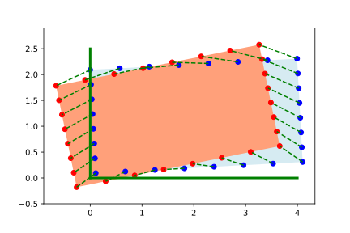

**图 4.11**：已知对应关系的带约束位姿估计。绿色线表示约束：估计位姿下所有点在世界坐标系中的 $x$、$y$ 坐标都必须大于 $0$。红色场景点存在穿透，求解器返回的蓝色位姿则满足约束。

### 示例 4.9　用凸优化处理非穿透约束

这个二维例子可继续采用方便的旋转矩阵形式：

$$
R = \begin{bmatrix} a & -b \\ b & a \end{bmatrix}.
$$

。它的约束简化为 $a^2+b^2=1$，虽然非凸，却可以松弛成 $a^2 + b^2 \le 1.$。这几乎就是[前面的示例](https://manipulation.mit.edu/#2D_rotation_only)里可视化的问题，只是现在多了平移。松弛相当于将非凸的单位圆周约束，改为凸的单位圆盘约束。从此前的图来看，我们有理由期待它可能是紧的。

求解：

$$
\begin{aligned} \min_{p,a,b}
      \quad & \sum_i \| p + R \: {}^Op^{m_{c_i}} - p^{s_i} \|^2, \\ \text{subject to}
      \quad & a^2 + b^2 \le 1, \\ & {}^W p^{m_i} \ge 0, \quad \forall i \in [1,
      N_m], \end{aligned}
$$

，其中 $R$ 按上式依赖于 $a, b$。就像上一章加入约束后，必须从伪逆转向数值优化一样，这个问题也不能再直接用 SVD 求解。它属于二阶锥规划（Second-Order Cone Program，SOCP），不过要引入松弛变量，才能写成目标函数为线性的标准形式。

**运行示例**：[在 Colab 中打开](https://colab.research.google.com/github/RussTedrake/manipulation/blob/master/book/pose/pose.ipynb)

注意：加入依赖 $p$ 的约束之后，原来独立求 $R$ 的方法不再直接成立，至少需要修改。notebook 给出了简单实现。

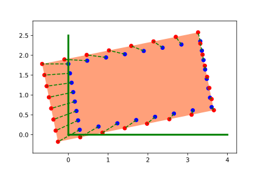

**图 4.12**：已知对应关系的约束位姿估计之凸近似。绿色线表示估计位姿下所有点在世界坐标系中的 $x$、$y$ 坐标都必须大于 $0$。

这里特意用了一个比较极端的例子：场景点强烈地把箱子往约束边界里拉。可以看出松弛并不紧；为解释观测数据，箱子被稍微缩小了。

这类约束优化可以做得比较高效，中等规模点云也能放进 ICP 循环。但它只适用于凸的非穿透约束，或约束的凸近似，例如这里的半平面约束。对于场景中两个物体之间的非穿透，它大概就不太适合。

顺便说一句，能这么轻松地加入这个例子，其实很难得。我还不知道有哪个工具箱，能像 Drake 这样，把先进优化算法与几何、物理及动力系统工具结合起来。

### 4.6.1　把自由空间约束写成非穿透约束

我最早在 [参考文献 24](#Schmidt15) 中看到另一个很漂亮的思路……

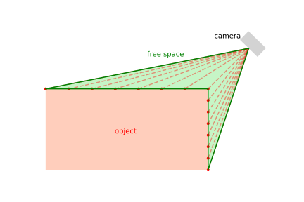

**图 4.13**：从相机到深度回波点的射线，定义了一种“自由空间障碍物”，其他物体不应穿入其中。

虽然我偏爱凸形式，因为它更易理解，也可能给出更强的算法保证，但非穿透和自由空间约束实在太有价值，不能忽略。如今深度学习往往能给出良好的初始猜测，也减轻了局部极小值的影响。希望一两年后你再读这些笔记，我已经能介绍这类复杂形式的有力结果。目前，对大多数应用，我会建议采用非线性优化，并充分利用这些约束。

## 4.7　跟踪

## 4.8　把各部分连接起来

现在可以把各部分接起来了。notebook 中，我把芥末酱瓶放在一个箱子里，先用 ICP 估计它的位姿，再像上一章那样规划简单轨迹，将它抓起并放入另一个箱子，最后用微分逆运动学执行。看着整套流程跑通，很有成就感！

**运行示例**：[在 Colab 中打开](https://colab.research.google.com/github/RussTedrake/manipulation/blob/master/book/pose/pose.ipynb)

## 4.9　接下来往哪里走

几何方法可以严谨分析，这一点我很喜欢。但也要认真问问：我们优化的目标，真的合适吗？

即使只考虑几何，给所有点相同权重的最小二乘目标，也未必正确。想象一本又长又窄的书平放在桌上：边缘的深度回波可能很少，但这些点携带的信息，比封面上大量回波更有价值。给本章目标加入不同权重并不困难，难的是如何一般性地选择这些权重；纯几何方法目前还没有特别成功的答案。这个方向研究很多，但确实很难。

另外，几何再漂亮，我们到现在也几乎忽略了最重要的一类信息：颜色！虽然可以把颜色等特征纳入 ICP 流程，但很难为颜色空间定义简单、可靠的距离。同一物体在不同光照下颜色可能差别很大，不同物体的颜色又可能很相似。近年计算机视觉，尤其深度学习的进步，让这个问题出现了新希望。我最近问学生：“深度和颜色必须放弃一个，你选哪个？”答案几乎一边倒：“放弃深度，别拿走颜色！”这与几年前很不一样。直到 2019 年，几乎每年举行的六自由度物体位姿估计基准挑战中，几何方法仍优于深度学习，见 [参考文献 10](#Hodan20)；到 2020 年，深度学习就已经追上了。

深度学习与几何当然可以，而且也许应该结合。2020 年挑战的优胜方法先用深度学习给出初始位姿，再利用深度通道和 ICP 变体做几何精修，见 [参考文献 10](#Hodan20)。本章反复讨论、却尚未完全解决的点云对应关系，也是颜色和深度学习很有潜力的方向，见 [参考文献 25](#Florence18a)。我们很快就会转向它们。

## 4.10　练习

### 练习 4.1　至少需要多少个点？

考虑已知对应关系的点云配准。将场景点与模型点直接对应，就能确定物体的位置和朝向。通常点数远多于位姿决策变量的数量，因此把每对对应关系作为等式约束会使问题过约束。这自然引出一个问题：

1. 在二维中，至少需要几个点才能唯一确定物体位姿？简要说明原因。

2. 在三维中，至少需要几个点才能唯一确定物体位姿？简要说明原因。

提示：如果对应关系未知，答案会怎样变化？

### 练习 4.2　旋转对称性

已知对应关系时，我们得到一个漂亮的点云配准问题：二次目标，加上二次等式约束，暂时忽略行列式约束。可有些物体具有旋转对称性，例如正方体。相差 90° 的旋转理应同样好，这个二次目标怎么体现它们？

### 练习 4.3　随机初始化 ICP

运行随机几何和随机真实位姿的 ICP 示例，就会发现：平移往往估计得不错，旋转却很差，至少我生成的这些物体是如此。一个补救方法是从多个不同旋转初值分别运行 ICP。这适用于许多存在局部极小值的非凸问题，这里尤其合适：点云即使复杂，搜索空间的维数仍低。少量样本就能较好地覆盖二维甚至三维旋转；三维可以考虑 `UniformlyRandomRotationMatrix`。这些运行还可以并行完成。

试着从多个初始估计 $\hat{X}^O$ 启动 ICP，只对旋转采样。保留误差最低的结果，性能相比只运行一次能改善多少？

### 练习 4.4　旋转固定的点集配准

考虑 $X^O$ 的旋转已知、平移未知的配准问题，也就是示例 4.2 的相反情况。

具体地，场景点 ${}^WX^C{}^Cp^{s_i}={}^Wp^{s_i}$ 定义为：

$$
\begin{aligned} {}^Wp^{s_0}&=(1,5) \\ {}^Wp^{s_1}&=(3,10) \\
        {}^Wp^{s_2}&=(5,10) \end{aligned}
$$

 对应图形如下：

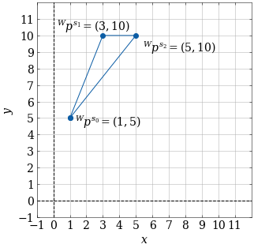

模型点定义为：

$$
\begin{aligned} {}^Op^{m_0}&=(-2,-5) \\ {}^Op^{m_1}&=(0,0) \\
        {}^Op^{m_2}&=(2,0) \end{aligned}
$$

 对应图形如下：

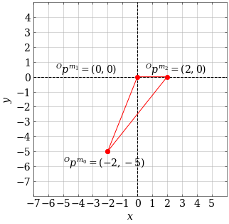

两个三角形朝向相同，所以 $R^O=
        \begin{bmatrix} 1 & 0 \\ 0 & 1 \end{bmatrix}$。但仍需求 $X^O$ 的平移部分。

本例的模型与场景朝向已经一致，所以很容易将旋转和平移分开。不过，这种解耦对一般情况也成立，见正文示例 4.2 后的解释。

1. 这个优化问题的决策变量是什么？请具体说明。

2. 当 $p^O = (0,0)$ 时，目标函数值是多少？取 (3, 10) 和 (6, 12) 又是多少？

3. 以决策变量为坐标画出目标函数，会是什么形状？这意味着什么？

4. 考虑一般情况：旋转固定，模型点与场景点数量相同，只需求平移。求解后，每个决策变量对应什么量？即使有噪声、两组点无法完全重合，答案也应成立。提示：最小化所有变换后场景点与对应模型点的距离平方和。

### 练习 4.5　平面两点 ICP

ICP 有很多局部极小值，它们具体是什么？初始猜测偏离多少，才会落入这些错误解？一般几何的分析可能很复杂，先看只有两个点的平面例子。

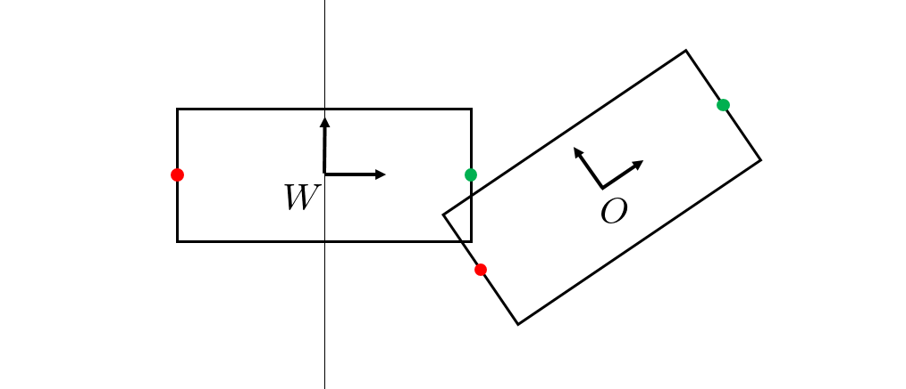

模型点与场景点在各自坐标系下为：

$$
{}^Op^{m_1}=\begin{pmatrix} 1 \\ 0 \end{pmatrix} \qquad
      {}^Op^{m_2}=\begin{pmatrix} -1 \\ 0 \end{pmatrix} \qquad
      {}^Wp^{s_1}=\begin{pmatrix} 1 \\ 0 \end{pmatrix} \qquad
      {}^Wp^{s_2}=\begin{pmatrix} -1 \\ 0 \end{pmatrix}.
$$

编号给出了真实对应关系，但算法并不知道它；ICP 只按最近邻选择。使用标准 ICP 的点对距离平方和，将二维位姿 $X^O$ 参数化为 $p_x,p_y,a,b$，可写出优化问题：

$$
\begin{aligned} \min_{p_x,p_y,a,b} \quad & \sum_i \bigg\|
      \begin{pmatrix} p_x \\ p_y \end{pmatrix} + \begin{pmatrix} a & -b \\ b &
      a \end{pmatrix} {}^Op^{m_{c_i}} - {}^Wp^{s_i} \bigg\|^2 \\ \text{s.t.} \quad &
      a^2 + b^2 = 1. \end{aligned}
$$

1. 如果初始位姿的最近邻对应恰好正确，证明 ICP 代价在 $p_x,p_y,b=0$、$a=1$ 时最小。描述能够收敛到真实解的初始位姿集合。

2. 如果初始位姿使对应关系颠倒，证明 ICP 代价在 $p_x,p_y,b=0$、$a=-1$ 时最小。描述会收敛到这个错误解的初始位姿集合。

3. 对应关系不必一一对应，按最近邻建立时尤其如此。构造数据矩阵 $W$，证明两个场景点都对应同一个模型点时，ICP 会停滞，且代价不为零。下一轮迭代会发生什么？提示：可假设零矩阵的 SVD 会给出单位矩阵 $U$、$V$。

### 练习 4.6　兔子模型的 ICP

本题要求实现 ICP，将两组 Stanford bunny 点云配准。所有工作都在 [对应 notebook](https://colab.research.google.com/github/RussTedrake/manipulation/blob/master/book/pose/exercises/bunny_icp.ipynb) 中完成，具体包括：

1. 实现已知对应关系下的最小二乘刚体变换计算。

2. 利用 (a) 的方法实现 ICP。

### 练习 4.7　RANSAC

本题将用 RANSAC 从 Stanford bunny 点云中移除环境背景。所有工作都在 [对应 notebook](https://colab.research.google.com/github/RussTedrake/manipulation/blob/master/book/pose/exercises/ransac.ipynb) 中完成，具体包括：

1. 实现 RANSAC 算法。

2. 用 RANSAC 从场景点云中移除平面。

### 练习 4.8　ICP 中的离群点

本题探讨 ICP 处理离群点的一种方法，并考察距离度量怎样影响稳健性。题目分为两部分，每部分有三个小问。

1. 考虑下图。黑色模型点标为 $b_{i}$，红色场景点标为 $r_{j}$。
   
   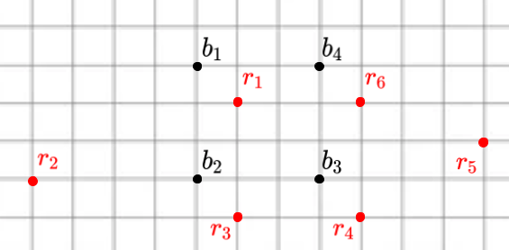
   
   
   
    我们尝试用以下方式处理离群点：
   
   1. 先写出每组对应关系，即 ($b_{i},
                  r_{j}$) 点对，再计算 ICP 误差：各对应点之间的距离平方和。
   
   2. 已知场景点中有 $\frac{1}{3}$ 是离群点。根据各 $b_{i}$ 与 $r_{j}$ 之间的距离，哪两个场景点 $r_{j}$ 最可能是离群点？
   
   3. 删掉这两个疑似离群点，再计算 ICP 误差。
   
   
   
    这就是截尾 ICP（Trimmed ICP）的基本思路。

2. ICP 用对应点的欧氏距离平方和度量两组点的差异。另一个可能、但不太便于优化的度量是[单向 Hausdorff 距离](https://en.wikipedia.org/wiki/Hausdorff_distance)。直观地说，对手先在一个形状上选一个点，你必须走到另一个形状的最近点，这段距离就是该选择下的距离。考虑两种方案：方案 1 中，对手选场景点，你选最近模型点；方案 2 中，对手选模型点，你选最近场景点。哪种对离群点更稳健？下面用二维例子考察。黑色模型点标为 $b_{i}$，红色场景点标为 $r_{j}$。
   
   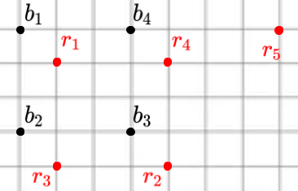
   
   
   
    
   
   1. 先看方案 1：作为对手，我选场景点 $r_{5}$。你能选的最近模型点 $b_{i}$ 是哪个？距离是多少？
   
   2. 再看方案 2：我选模型点 $b_{1}$。你能选的最近场景点 $r_{j}$ 是哪个？距离是多少？
   
   3. 据此，哪种方案对离群点更稳健？
   
   
   
   

### 练习 4.9　位姿估计

回到第 3 章的例子，但取消已知红色泡沫砖位姿的假设。你会得到先前场景中深度相机生成的原始仿真点云，需要先分割，再用 ICP 估计砖块位姿。所有工作都在 [对应 notebook](https://colab.research.google.com/github/RussTedrake/manipulation/blob/master/book/pose/exercises/pose_estimation_icp.ipynb) 中完成，具体包括：

1. 分割原始点云，移除背景。

2. 使用课程中的 ICP 实现，正确估计红色泡沫砖的位姿。

### 练习 4.10　组合符号距离函数（SDF）

本题探讨符号距离函数及其组合。回顾一下：某个集合的 SDF 给出点 $p$ 到集合边界的最小距离，符号由点 $p$ 在边界内还是边界外决定。内部为负，外部为正。

看下图绿色方框。中心位于原点，到各边距离为 1，且在内部，所以 SDF 值为 −1。边界上的点为 0，外部点为 $+d$，其中 $d$ 是到边界的最短距离。

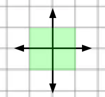

下图有红、蓝两个阴影物体；把它们视为无限半平面，重叠处为紫色。用 $\phi_r(p)$ 表示点 $p$ 到红色物体边界的符号距离，$\phi_b(p)$ 表示点 $p$ 到蓝色边界的符号距离。例如 $\phi_b(p_0) = -3, \phi_b(p_1) = +2$。

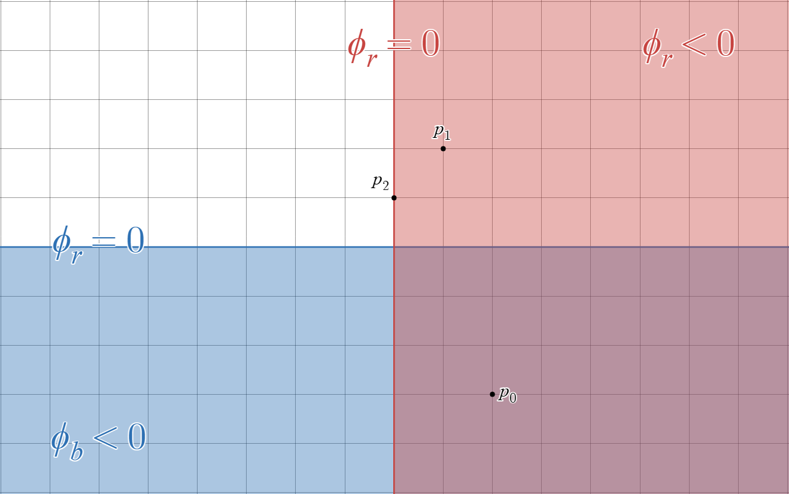

1. 先考虑红、蓝物体的并集。令 $\phi_{r \cup b}(p)$ 为点 $p$ 到新边界的符号距离，计算 $\phi_{r \cup b}(p_{0}), \phi_{r \cup b}(p_{1}), \phi_{r \cup b}(p_{2})$。

2. 再考虑交集，即紫色区域。令 $\phi_{r \cap b}(p)$ 为点 $p$ 到新边界的符号距离，计算 $\phi_{r \cap b}(p_{0}), \phi_{r \cap b}(p_{1}), \phi_{r \cap b}(p_{2})$。

3. 根据 (a)，写出二维空间中任意点 $p$ 到红、蓝物体并集的符号距离，用 $\phi_r(p)$、$\phi_b(p)$ 表示。建议先按点所在区域分类。提示：先分四种区域，再尝试整理成只有两种情况的简洁表达式。

4. 根据 (b)，类似地写出任意点 $p$ 到交集，即紫色区域的符号距离，用 $\phi_r(p)$、$\phi_b(p)$ 表示。只需考虑两种情况。

直接取两个物体 SDF 的最小值，并不能正确计算并集的 SDF。请想一想为什么！不过，虽然距离可能不对，符号却始终正确，也请验证这一点。因此，这个“错误”的方法仍能判断点是否进入并集内部，非常适合构造非穿透约束。下面把它称为“穿透约束 SDF”，看看怎么使用。

1. 如课上所述，刚体的 SDF 可以预计算，大幅加快后续运算。但机械臂这类铰接物体的整体几何随关节值变化，无法预计算整体 SDF；每次位形变化都重算也很昂贵。DART（Dense Articulated Real-Time Tracking，稠密铰接物体实时跟踪）算法，见 [参考文献 24](#Schmidt15)，为每根连杆保留一个“局部”SDF，输入是在该连杆坐标系下表达的点，因此可以预计算。考虑下图熟悉的平面二连杆机械臂。给定 $q_{0}, q_{1}$，以及 AB、BC 两根连杆预计算的局部 SDF，简述怎样计算点 $(^{W}x_{p},
         ^{W}y_{p})$ 的整体穿透约束 SDF。

,
      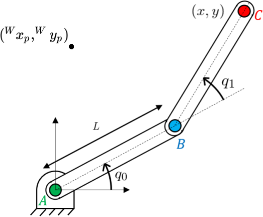

### 练习 4.11　用几何感知操作未知初始位姿的模型

本题接着上一章的[练习 3.14](pick-and-place.md#pick_place_initials)，仍让机器人抓取、摆放代表姓名首字母的字母模型。不过，这次不再假设已知初始位姿，而要利用深度相机和几何感知。请在下面的 notebook 中完成。

**运行示例**：[在 Colab 中打开](https://colab.research.google.com/github/RussTedrake/manipulation/blob/master/book/pose/exercises/11_pickplace_initials_with_geometry.ipynb)

具体步骤如下：

1. 创建包含机器人、桌子、姓名首字母模型和三台 RGB-D 传感器的场景。

2. 用 RGB-D 传感器获取字母模型的点云。

3. 用 ICP 估计字母模型在世界坐标系中的位姿。

4. 利用估计位姿，以及练习 3.14 的微分 IK 控制器，抓取并摆放字母模型。

## 参考文献

1. Krishna Shankar and Mark Tjersland and Jeremy Ma and Kevin Stone and Max Bajracharya , "A learned stereo depth system for robotic manipulation in homes" , IEEE Robotics and Automation Letters , vol. 7, no. 2, pp. 2305--2312, 2022 .

2. Chris Sweeney and Greg Izatt and Russ Tedrake , "A Supervised Approach to Predicting Noise in Depth Images" , Proceedings of the IEEE International Conference on Robotics and Automation , May, 2019 .
[文献链接](http://groups.csail.mit.edu/robotics-center/public_papers/Sweeney18a.pdf)

3. Jeong Joon Park and Peter Florence and Julian Straub and Richard Newcombe and Steven Lovegrove , "DeepSDF: Learning Continuous Signed Distance Functions for Shape Representation" , Proceedings of the IEEE International Conference on Computer Vision and Pattern Recognition (CVPR) , June (To Appear), 2019 .
[文献链接](http://groups.csail.mit.edu/robotics-center/public_papers/Park19.pdf)

4. Ben Mildenhall and Pratul P Srinivasan and Matthew Tancik and Jonathan T Barron and Ravi Ramamoorthi and Ren Ng , "Nerf: Representing scenes as neural radiance fields for view synthesis" , Communications of the ACM , vol. 65, no. 1, pp. 99--106, 2021 .

5. Berthold K.P. Horn , "Closed-form solution of absolute orientation using unit quaternions" , Journal of the Optical Society of America A , vol. 4, no. 4, pp. 629-642, April, 1987 .

6. Andriy Myronenko and Xubo Song , "On the closed-form solution of the rotation matrix arising in computer vision problems" , arXiv preprint arXiv:0904.1613 , 2009 .

7. Robert M Haralick and Hyonam Joo and Chung-Nan Lee and Xinhua Zhuang and Vinay G Vaidya and Man Bae Kim , "Pose estimation from corresponding point data" , IEEE Transactions on Systems, Man, and Cybernetics , vol. 19, no. 6, pp. 1426--1446, 1989 .

8. Marius Muja and David G Lowe , "Flann, fast library for approximate nearest neighbors" , International Conference on Computer Vision Theory and Applications (VISAPP’09) , vol. 3, 2009 .

9. Bertram Drost and Markus Ulrich and Nassir Navab and Slobodan Ilic , "Model globally, match locally: Efficient and robust 3D object recognition" , 2010 IEEE computer society conference on computer vision and pattern recognition , pp. 998--1005, 2010 .

10. Tomás Hodan and Martin Sundermeyer and Bertram Drost and Yann Labbé and Eric Brachmann and Frank Michel and Carsten Rother and Jirí Matas , "BOP Challenge 2020 on 6D Object Localization" , European Conference on Computer Vision Workshops (ECCVW) , 2020 .

11. M.A. Fischler and R.C. Bolles , "Random Sample Consensus: A Paradigm for Model Fitting with Applications to Image Analysis andd Automated Cartography" , Communications of the Association for Computing Machinery (ACM) , vol. 24, no. 6, pp. 381--395, 1981 .

12. Heng Yang and Jingnan Shi and Luca Carlone , "Teaser: Fast and certifiable point cloud registration" , arXiv preprint arXiv:2001.07715 , 2020 .

13. Pat Marion and Peter R. Florence and Lucas Manuelli and Russ Tedrake , "A Pipeline for Generating Ground Truth Labels for Real RGBD Data of Cluttered Scenes" , International Conference on Robotics and Automation (ICRA), Brisbane, Australia , May, 2018 .
[文献链接](https://arxiv.org/abs/1707.04796)

14. Anh Nguyen and Bac Le , "3D point cloud segmentation: A survey" , 2013 6th IEEE conference on robotics, automation and mechatronics (RAM) , pp. 225--230, 2013 .

15. Andriy Myronenko and Xubo Song , "Point set registration: Coherent point drift" , IEEE transactions on pattern analysis and machine intelligence , vol. 32, no. 12, pp. 2262--2275, 2010 .

16. Wei Gao and Russ Tedrake , "FilterReg: Robust and Efficient Probabilistic Point-Set Registration using Gaussian Filter and Twist Parameterization" , Conference on Computer Vision and Pattern Recognition (CVPR) , June, 2019 .
[文献链接](http://groups.csail.mit.edu/robotics-center/public_papers/Gao18a.pdf)

17. Andrew W Fitzgibbon , "Robust registration of 2D and 3D point sets" , Image and vision computing , vol. 21, no. 13-14, pp. 1145--1153, 2003 .

18. Stanley Osher and Ronald Fedkiw , "Level Set Methods and Dynamic Implicit Surfaces" , Springer
, 2003 .

19. Natasha Gelfand and Niloy J Mitra and Leonidas J Guibas and Helmut Pottmann , "Robust global registration" , Symposium on geometry processing , vol. 2, no. 3, pp. 5, 2005 .

20. Nicolas Mellado and Dror Aiger and Niloy J Mitra , "Super 4pcs fast global pointcloud registration via smart indexing" , Computer Graphics Forum , vol. 33, no. 5, pp. 205--215, 2014 .

21. Jiaolong Yang and Hongdong Li and Dylan Campbell and Yunde Jia , "Go-ICP: A globally optimal solution to 3D ICP point-set registration" , IEEE transactions on pattern analysis and machine intelligence , vol. 38, no. 11, pp. 2241--2254, 2015 .

22. Gregory Izatt and Hongkai Dai and Russ Tedrake , "Globally Optimal Object Pose Estimation in Point Clouds with Mixed-Integer Programming" , International Symposium on Robotics Research , Dec, 2017 .
[文献链接](http://groups.csail.mit.edu/robotics-center/public_papers/Izatt17b.pdf)

23. James Saunderson and Pablo A Parrilo and Alan S Willsky , "Semidefinite descriptions of the convex hull of rotation matrices" , SIAM Journal on Optimization , vol. 25, no. 3, pp. 1314--1343, 2015 .

24. Tanner Schmidt and Richard Newcombe and Dieter Fox , "DART: dense articulated real-time tracking with consumer depth cameras" , Autonomous Robots , vol. 39, no. 3, pp. 239--258, 2015 .

25. Peter R. Florence* and Lucas Manuelli* and Russ Tedrake , "Dense Object Nets: Learning Dense Visual Object Descriptors By and For Robotic Manipulation" , Conference on Robot Learning (CoRL) , October, 2018 .
[文献链接](http://groups.csail.mit.edu/robotics-center/public_papers/Florence18a.pdf)

---

**继续阅读**：[上一节（中文）](pick-and-place.md) · [全书目录与前言（中文）](preface.md) · [下一节（中文）](bin-picking.md)
