<div class="reader-kicker">ROBOTIC MANIPULATION / 中文译稿 / 02</div>

# 第 2 章　先给你准备一个机器人

*Robotic Manipulation: Perception, Planning, and Control*

<div class="translation-meta" markdown>
**原著作者** [Russ Tedrake](http://people.csail.mit.edu/russt/)

**原文最后修改日期** 2026 年 10 月 11 日

**原文版权** © Russ Tedrake, 2020–2026

**对照阅读** [原文 PDF](pdfs/robot-original.pdf) · [在线原文](https://manipulation.mit.edu/robot.html)
</div>

[如何引用讲义、使用批注和提供反馈](miscellaneous.md)

---

## 本章目录

- [引言](#introduction)
- [2.1　机器人描述文件](#section1)
- [2.2　机械臂](#section2)
    - [2.2.1　位置控制机器人](#position-controlled)
    - [2.2.2　力矩控制机器人](#torque-controlled)
    - [2.2.3　日益丰富的硬件](#hardware-options)
    - [2.2.4　Kuka iiwa 仿真](#iiwa-simulation)
- [2.3　机械手](#section3)
    - [2.3.1　灵巧手](#dexterous-hands)
    - [2.3.2　简单夹爪](#simple-grippers)
    - [2.3.3　柔性／欠驱动机械手](#underactuated-hands)
    - [2.3.4　其他末端执行器](#other-end-effectors)
    - [2.3.5　如果你还没见过……](#high-speed-hand)
- [2.4　传感器](#section4)
- [2.5　将各部分整合起来](#hardware_station)
    - [2.5.1　HardwareStation](#hardware-station)
    - [2.5.2　HardwareStationInterface](#hardware-station-interface)
    - [2.5.3　HardwareStation 独立仿真](#hardware-sim)
- [2.6　更多 HardwareStation 示例](#section6)
- [2.7　练习](#section7)
- [参考文献](#references)

---

<a id="introduction"></a>

## 引言

这一章，我们要给你的[“机甲”](https://en.wikipedia.org/wiki/Mecha)配上合适的装备。我希望你能了解讲义中使用的机器人硬件，知道它与其他现有硬件相比有什么特点。学完本章，你还应该明白怎样仿真这些机器人，以及通过机器人的接口可以发出哪些指令。

<a id="section1"></a>

## 2.1　机器人描述文件

后续大多数章节会反复使用一两种机器人配置。不过，现代机器人学的一大优点是，许多方法具有很强的通用性。我们在讲义中开发的工具，往往可以方便地从一种机器人迁移到另一种机器人上。也许将来更新讲义时，你真的可以在这一章里搭建自己的机器人，再用它完成后面的学习！

能够方便地仿真和控制不同机器人，部分得益于通用机器人描述文件的普及。遗憾的是，这个领域还没有统一采用某一种格式，各种格式也都有自己的特点和不足。Drake 目前可以加载[通用机器人描述格式（URDF）](http://wiki.ros.org/urdf)、[仿真描述格式（SDF）](http://sdformat.org/)，并对 [MuJoCo 的 MJCF 格式](https://mujoco.readthedocs.io/en/latest/XMLreference.html)提供有限支持。

Drake 开发者一直在尝试把改进贡献给 SDF 上游项目，而不是再另起炉灶，发明一种新格式。不过，我们确实提供了一个很简单的 YAML 规范，叫作 [Drake 模型指令（Drake Model Directives）](https://drake.mit.edu/doxygen_cxx/structdrake_1_1multibody_1_1parsing_1_1_model_directives.html)。它可以把采用不同文件格式的多个机器人和物体，方便地加载到同一个仿真中。你已经在[第 1 章的示例 notebook](https://colab.research.google.com/github/RussTedrake/manipulation/blob/master/book/intro/intro.ipynb)里见过这种用法。

<a id="section2"></a>

## 2.2　机械臂

市面上的机械臂种类很多，该怎样选呢？成本、可靠性、易用性、负载能力、运动范围……这些都值得考虑。研究实验室和初创公司看重的因素，也可能很不一样。

### 示例 2.1　浏览机械臂

我准备了一个简单的示例，供你查看目前比较常见的几种机械臂。如果列表里还没有你喜欢的那一款，欢迎告诉我。

**运行示例**：[在 Colab 中打开](https://colab.research.google.com/github/RussTedrake/manipulation/blob/master/book/robot/inspector.ipynb)

不过，只要加上一项要求，可选的机械臂就会迅速缩小到少数几个平台：它必须支持关节力矩的测量和控制。在具备这一能力的机器人中，本讲义最常使用的是 Kuka LBR iiwa。我会尽量采用小写的“iiwa”，以便与[制造商的写法](https://www.kuka.com/en-us/products/robotics-systems/industrial-robots/lbr-iiwa)保持一致，虽然每次看起来都让我有点不习惯。

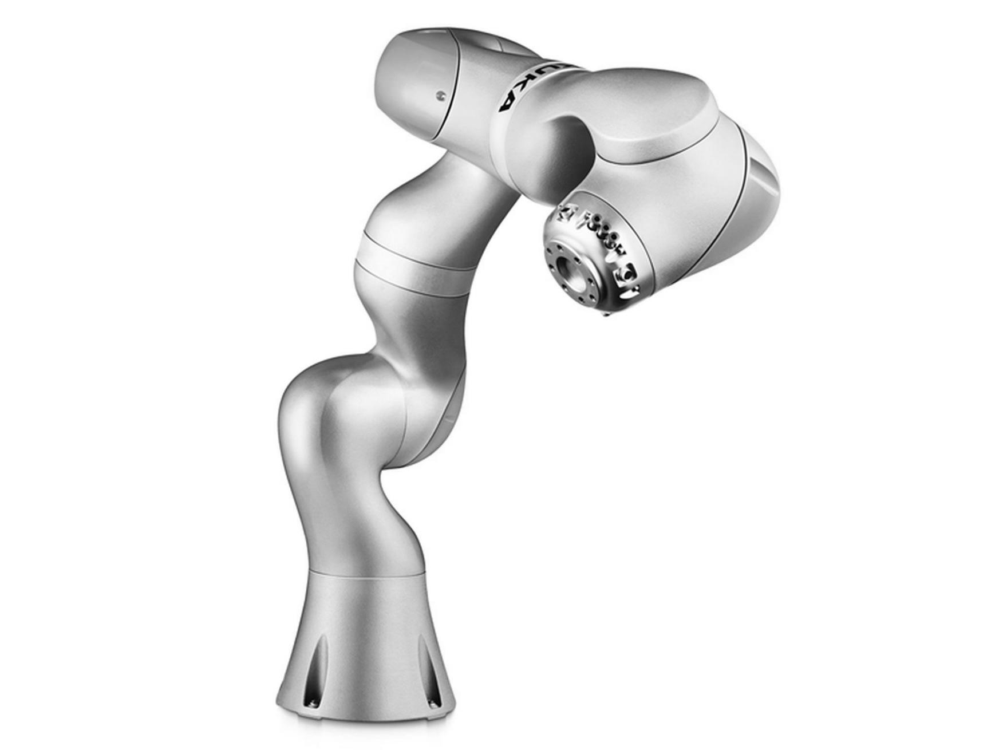

**图 2.1**：[Kuka LBR iiwa 机器人](https://www.kuka.com/en-us/products/robotics-systems/industrial-robots/lbr-iiwa)。图中型号的额定负载为 7 kg。

即使是很先进的应用，也不见得一定需要关节力矩测量和控制。但我很关心机器人与外界接触时发生的事情，所以更愿意先拥有这项能力，再探索它是否必要，而不想事后猜测：如果当初有它，情况会不会不同？

要理解其中的原因，我们先比较两类机器人：一类是占多数的位置控制机器人；另一类则接受了额外的成本和复杂性，以提供力矩测量和控制。

<a id="position-controlled"></a>

### 2.2.1　位置控制机器人

|         Universal Robots UR10         |                     ABB YuMi                     |
| :-----------------------------------: | :-----------------------------------------------: |
| 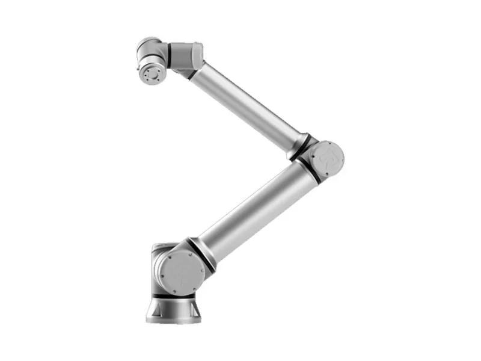 | 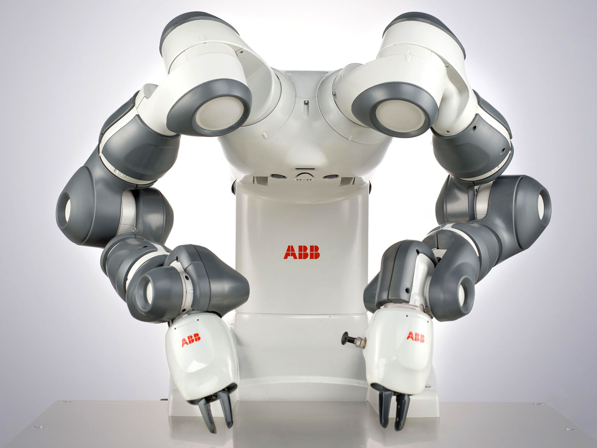 |

**图 2.2**：两款常见的位置控制机械臂。左侧为 Universal Robots 的 UR10，右侧为 ABB 的 YuMi。

目前，大多数机械臂都采用“位置控制”：给定期望的关节位置或关节轨迹，机器人就会以较高的精度执行。事实上，几乎所有机械臂都能做位置控制。如果机器人提供带宽足够高的力矩控制接口，当然也可以用它来调节位置。因此，称一台机器人为“位置控制机器人”，往往只是委婉地说，它不提供力矩控制接口。

为什么位置控制比力矩控制更普遍？

上面这样的轻型机械臂通常由电机驱动。对于质量较好的电机，例如经过绕组设计来减小力矩波动的电机，输出力矩与施加的电流应当成正比：

$$
\tau_{motor} = k_t i.
$$

其中，$\tau_{motor}$ 是电机力矩，$i$ 是施加的电流，$k_t$ 是[电机力矩常数](https://en.wikipedia.org/wiki/Motor_constants)。类似地，施加的电压与电机的稳态转速之间，也存在简单的仿射关系。既然能控制电流，为什么不能直接控制力矩呢？

原因在于传动机构。为了兼顾成本和重量，我们通常选用较小的电机，再配上大减速比的齿轮传动。齿轮传动会带来齿隙、振动、摩擦等难以建模的动力学效应，使电流与关节力矩之间不再保持简单的关系。一般认为，当减速比很大，比如远大于 10 时，这些未建模因素已经不能忽略。

<a id="position-control"></a>

#### 怎样实现位置控制？

既然传动机构的动力学模型不够准确，我们该怎么办？如果只想调节电机的电流或转速，在传动机构的电机侧装传感器就够了。但要准确控制关节，通常还需要在输出侧增加传感器。

虽然传动机构产生的力矩很难准确计算，它也不是任意变化的。例如，它不会凭空向系统注入能量。更关键的是，电机电流与关节力矩，以及最终的关节加速度之间，仍然有单调不减的关系。

这里的“单调”是有意选择的：它表示“不减”，并不意味着“严格增加”。比如，关节从静止开始运动时，较小的力矩可能被静摩擦抵消，输出端仍然没有加速度。

关节上最常见的是位置传感器，通常采用编码器或电位计。这些传感器价格低、精度高，也很可靠。经过适当的信号滤波和调理后，我们通常可以得到准确的关节位置和速度。对位置求两次导数，也可以估计加速度，但噪声往往较大，不太适合用于需要精密反馈的控制回路。

有了位置传感器，就足以准确跟踪机械臂的期望位置轨迹。对某个关节，记当前位置为 $q$，期望轨迹为 $q^d(t)$，可以使用[比例—积分—微分（PID）控制](https://en.wikipedia.org/wiki/PID_controller)：

$$
\tau = k_p (q^d - q)
     + k_d (\dot{q}^d - \dot{q})
     + k_i \int (q^d - q)\,dt.
$$

其中，$k_p$、$k_d$ 和 $k_i$ 分别是位置、速度和积分增益。

PID 控制有丰富的理论，怎样选择增益也积累了大量经验，这里就不再展开。不过有一点值得注意：仿真位置控制机器人时，实机和仿真往往需要采用不同的增益。原因不仅在于传动机构的动力学，还在于真实硬件上的 PID 控制器通常输出电压指令，通过[脉宽调制（PWM）](https://en.wikipedia.org/wiki/Pulse-width_modulation)实现，而不是直接输出电流指令。

过去，补上这部分模型并不是机器人仿真的首要任务。仿真与现实之间的差距，也就是“sim-to-real”差距，还主要受许多其他细节影响。但我想，随着这个领域逐渐成熟，主流仿真器最终也会把这些因素考虑进去。

有些读者也许会想：“神经网络什么都能建模，我才不怕复杂的传动机构！”我确实认为，这条路值得乐观期待，也已经有一些初步成果，例如[参考文献 1](#reference-1)。当然，它还不能完全替代基于第一性原理的模型：后者只需从描述文件中读取少量参数，就能适用于新的执行器。不过，学习得到的模型仍然可能很有用。

<a id="transmission-dynamics"></a>

#### 补充：带传动机构的连杆动力学

有件事可能让你意外：机械臂各关节的动力学高度耦合，还会随状态变化，但实际使用时，PID 增益往往按关节分别选取，而且保持不变，并不采用[增益调度](https://en.wikipedia.org/wiki/Gain_scheduling)。

想想看，机械臂完全伸展、托着一壶牛奶时，与空载、竖直下垂时，所需的电机指令应该差很多吧？然而，实际需要的增益和指令，可能并没有想象中那么不同。

电机通常在较高转速下效率最高，往往每分钟上百转，甚至上千转。机器人即使能动得这么快，我们大概也不希望它如此运动。所以，电驱动机器人几乎都采用相当大的减速比，常见的量级是 100:1：电机转 100 圈，输出端才转 1 圈，输出力矩则是电机力矩的 100 倍。

若减速比为 $n$，被驱动关节的位置为 $q$，则有：

$$
q_{motor} = n q,\qquad
\dot{q}_{motor} = n\dot{q},\qquad
\ddot{q}_{motor} = n\ddot{q},\qquad
\tau_{motor} = \frac{\tau}{n}.
$$

即使只有一个关节，这也会明显改变系统的动力学。先不考虑电机自身，把牛顿第二定律 $ma = \sum f$ 写成转动形式，得到关节力矩与加速度的关系：

$$
I_{arm}\ddot{q} = \tau_{gravity} + \tau,
$$

其中，$I_{arm}$ 是转动惯量。例如，对于[单摆](http://underactuated.mit.edu/pend.html)，方程可以写为：

$$
ml^2\ddot{q} = -mgl\sin q + \tau.
$$

关节力矩 $\tau$ 实际上来自电机。改用电机侧的坐标表示，就有：

$$
\frac{I_{arm}}{n}\ddot{q}_{motor}
= \tau_{gravity} + n\tau_{motor}.
$$

两边再除以 $n$，并把电机自身的转动惯量计入，比如旋转磁体带来的惯量。它在电机侧不受减速比影响，于是得到：

$$
\left(I_{motor} + \frac{I_{arm}}{n^2}\right)\ddot{q}_{motor}
= \frac{\tau_{gravity}}{n} + \tau_{motor}.
$$

这揭示了一件有意思的事：电机的质量可能只占机器人总质量的一小部分，但在大减速比的机器人上，它仍然可能显著影响关节动力学。

我们把传动机构一侧的惯量，按传动比折算到另一侧后所表现出的惯性负载，称为**折算惯量**（reflected inertia）。机械臂惯量折算到电机侧，会除以减速比的平方；反过来，电机惯量折算到机械臂侧，则要乘以减速比的平方。

在多连杆系统中，$I_{arm}$ 会[随状态变化，既包含被驱动连杆的惯量，也包含其他关节的惯性耦合](http://underactuated.mit.edu/multibody.html)。而 $I_{motor}$ 是常数，只作用于当前关节。减速比足够大时，电机惯量项就会占主导，带来两个重要结果：

1. 机械臂动力学方程近似呈对角形式，因为关节之间的惯性耦合项相对较小。
2. 机器人在整个工作空间中的动力学变化较小，因为随状态变化的那些项相对较小。

因此，按关节分别调出一组固定的反馈增益，让它们在不同构型下都表现良好，就变得相对容易。

<a id="torque-controlled"></a>

### 2.2.2　力矩控制机器人

直接控制关节力矩的机器人虽然没有那么普遍，但也有不少。实现这项能力，大致有几条路线。

第一条路线是使用较小的减速比，比如不超过 10:1，让摩擦力的影响可以忽略。早期的“直驱机器人”往往需要很大的电机，负载能力却有限。[参考文献 2](#reference-2) 后来，[Barrett WAM](https://robots.ieee.org/robots/wam/) 等机械臂采用绳索传动，把较大的电机放在基座上，以减轻机械臂本体的重量。近几年，高力矩外转子电机和无框电机的进步，又推动了一代低成本“准直驱”机器人出现，例如 MIT Cheetah、[Berkeley Blue](http://rll.berkeley.edu/blue/) 和 [Halodi Eve](https://www.halodi.com/)。[参考文献 3](#reference-3)

液压执行器是另一条路线，它可以在不使用大减速比传动的情况下产生较大力矩。Sarcos 曾开发一系列[力矩控制机械臂](https://www.youtube.com/watch?v=VDxWHNtZvyI)和人形机器人，[Boston Dynamics](https://www.bostondynamics.com/robots) 的许多著名机器人也采用液压驱动，尽管近年来电驱动越来越常见。

这类机器人通常共用一个中央液压泵，每个执行器配有一个轻量的阀门，控制液体流经执行器还是旁路。执行器两侧的压差，与最终产生的力或力矩至少有近似的对应关系。

还有一种办法，是保留大减速比电机，但在执行器的关节侧增加传感器，直接测量输出力矩。本讲义使用的 Kuka iiwa 就采用这条路线：它在传动机构中集成了[应变片](https://en.wikipedia.org/wiki/Strain_gauge)。不过，传动机构的刚度与力／力矩测量精度之间存在权衡。[参考文献 4](#reference-4) iiwa 的传动机构中包含一个柔轮（Flex Spline），其刚度约为 5000 N·m/rad。[参考文献 5](#reference-5)

Gill Pratt 把这个思路进一步发展，提出了“串联弹性执行器”：在传动链中加入刚度更低的弹簧，同时测量电机侧和关节侧的位置，据此估计施加的力矩。[参考文献 6](#reference-6) Rethink 的 [Baxter](https://en.wikipedia.org/wiki/Baxter_(robot)) 和 Sawyer 就使用了这种执行器。我不记得它们公开过弹簧刚度，但采用类似思路的 [HEBI Robotics 执行器，其刚度更接近 100 N·m/rad](http://docs.hebi.us/hardware.html)。

即使在 iiwa 上，关节弹性也足够明显。为了实现高性能关节控制，底层控制器需要专门考虑这一因素。[参考文献 7](#reference-7) 后面讨论[力控制](manipulator-control.md)时，我们会进一步介绍这些细节。

<a id="hardware-options"></a>

### 2.2.3　日益丰富的硬件

前面提到的低成本力矩控制机械臂，可能只是机械臂大规模普及的开端。疫情期间，我看到不少人在家里使用 [xArm](https://www.ufactory.cc/xarm-collaborative-robot) 等价格较低的机器人。随着需求增加，成本还会继续下降。

相比之下，研究腿式机器人时，我们有几十年都在使用实验室自制的原型机。它们往往由研究生，有时也包括教授，在走廊另一头的机加工车间里搭建。如今能够直接使用经过专业设计、质量可靠、能长时间运行的硬件，实在是一件令人高兴的事。

这还意味着，一个实验室测试的算法，可以由另一所大学的实验室在几乎相同的硬件上验证。研究结果的复现和分享，因此达到了过去难以实现的程度。价格继续下降后，更多实验室和其他环境中也会出现类似的机器人。这是我对未来几年如此乐观的重要原因之一。

现在确实是研究机器人操作的好时候。

<a id="iiwa-simulation"></a>

### 2.2.4　Kuka iiwa 仿真

接下来，该把选好的机械臂放进仿真了。第一步是取得机器人描述文件，通常是 URDF 或 SDF。为了方便使用，Drake [随库提供](https://github.com/RobotLocomotion/models)了包括 iiwa 在内的几种机器人模型。如果想仿真其他机器人，大多数商用机器人的 URDF 或 SDF 文件也能在网上找到。

不过，这些模型的质量差别很大。我们甚至见过连杆长度、几何形状等运动学参数出现明显错误；惯量、摩擦等动力学参数尤其容易不准确。有时模型还会违反基本的数学或物理要求，比如 URDF／SDF 中指定的惯量矩阵，根本不可能对应任何真实刚体。遇到这种情况，Drake 会在加载时报错。我们宁愿尽早指出问题，也不愿让仿真继续给出错误结果。

此外，直接从 [SolidWorks 等 CAD 软件导出机器人描述文件](http://wiki.ros.org/sw_urdf_exporter)的支持，也在不断完善。

拿到描述文件后，就要把它导入物理引擎。在 Drake 中，物理引擎叫作 `MultibodyPlant`。“plant”这个词乍看有些奇怪，却是控制领域的常用术语，指待控制的物理系统，也就是“被控对象”。这个用法最早源于对化工厂的控制。

我很重视物理引擎与控制理论之间的这种联系。像 Drake 这样，专门为控制理论的设计和分析提供支持的物理引擎，其实并不多。

[`MultibodyPlant`](https://drake.mit.edu/doxygen_cxx/classdrake_1_1multibody_1_1_multibody_plant.html) 提供了丰富的类方法，可以计算机器人的运动学和动力学。无论是求质心位置、运动学雅可比矩阵，还是其他类似查询，都要用到这个类的接口。

同时，它也实现了 Drake [系统框架](https://medium.com/toyotaresearch/drake-model-based-design-in-the-age-of-robotics-and-machine-learning-59938c985515)中的 `System` 接口，拥有输入和输出端口。要把物理引擎与感知、规划、控制等其他系统一起仿真或分析，就需要把它们连接成[系统框图](https://en.wikibooks.org/wiki/Control_Systems/Block_Diagrams)。

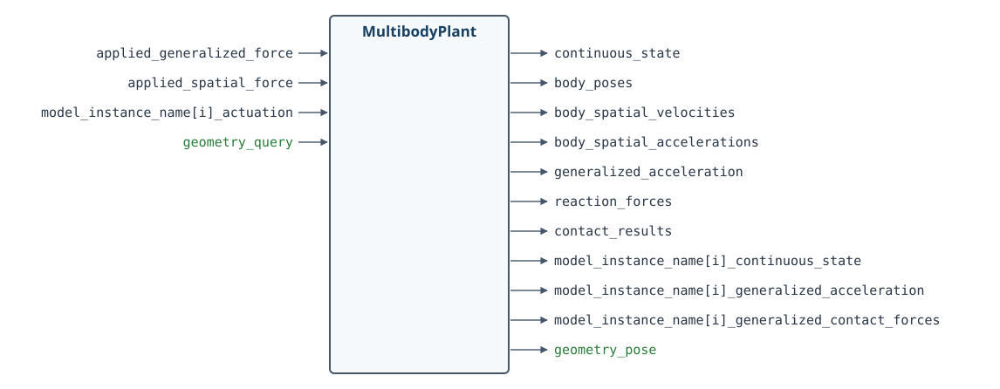

*`MultibodyPlant` 端口图。端口名称保留英文，按原文定义重新排版，以避免 PDF 中的文字被裁切。*

物理引擎既复杂又通用，自然会有很多输入和输出端口，其中大多数是可选的。下面的示例会说明怎样使用它们。

#### 示例 2.2　仿真未施加驱动力矩的 iiwa

这个示例值得花几分钟亲手运行。它不仅能帮助你认识物理引擎，也会介绍在 Drake 中进行仿真的一些基本操作。

**运行示例**：[在 Colab 中打开](https://colab.research.google.com/github/RussTedrake/manipulation/blob/master/book/robot/simulation.ipynb)

要直观地查看物理引擎的运行结果，最好使用二维或三维可视化工具。为此，还需要一个负责管理场景几何的系统，在 Drake 中叫作 `SceneGraph`。有了它，就可以接入不同的可视化工具和传感器，把场景渲染出来。

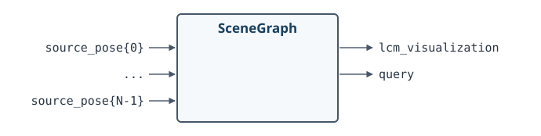

#### 示例 2.3　场景可视化

这个示例看起来有意思多了，因为现在我们终于能看到三维场景！

**运行示例**：[在 Colab 中打开](https://colab.research.google.com/github/RussTedrake/manipulation/blob/master/book/robot/simulation.ipynb)

你也许会问，为什么不让 `MultibodyPlant` 顺便管理场景几何？因为在很多应用中，我们需要渲染复杂场景、使用复杂传感器，却希望采用自己的动力学模型，而不是默认的物理引擎。

自动驾驶就是一个很好的例子。我们会把车辆和环境的全部几何信息交给 `SceneGraph`，但仿真车辆时，往往只用很简单的车辆模型，不必在物理引擎里详细模拟轮胎力学。我的[《欠驱动机器人学》课程](http://underactuated.mit.edu)中也有不少类似例子，大量使用了这样的简单模型。

现在，iiwa 的基本仿真已经有了，但一些细节也随之出现。物理引擎需要知道各个关节施加什么力矩。在这个示例中，我们设为零力矩，于是机械臂在重力作用下落了下来。真实 iiwa 却不会这样：即使控制器关闭，关节上的力矩也几乎不可能为零。

与许多成熟的工业机械臂一样，iiwa 的每个关节都有机械制动器，关闭控制器时就会接合。要仿真这种状态，物理引擎还需要考虑制动器产生的力矩。

事实上，即使控制器打开，iiwa 也不允许我们真正向电机发送零力矩指令，尽管它本身是力矩控制机器人。它的软件接口接收的是“前馈力矩”，这些力矩会叠加到底层控制器的输出上。底层控制器一直在补偿重力以及电机、传动机构的动力学。这个限制有时让人觉得不方便，但我们大概也不想为了仿真，把驱动机构的所有细节都重新研究一遍。

因此，要得到一个简单又合理的 iiwa 仿真，仍然必须把 Kuka 的底层控制器包括进来。我们会使用 iiwa 的“关节阻抗控制”模式。等到需要进一步提高机器人的表现时，再详细讨论它；目前可以先把它当作已有组件。

#### 示例 2.4　加入 iiwa 底层控制器

这个示例加入了 iiwa 控制器，并将期望位置设为机器人当前的关节位置。这次给定的是位置，而不再是力矩。仿真更接近真实机器人了，只不过画面又变得有些无聊。

**运行示例**：[在 Colab 中打开](https://colab.research.google.com/github/RussTedrake/manipulation/blob/master/book/robot/simulation.ipynb)

最后再补充一点。如果操作任务中的机器人运动较慢，质量、惯量和力的作用可能不如机器人及物体在空间中的位置那么重要。你也许会觉得，为这种任务做完整的动力学仿真有些大材小用。我其实同意。

但要让纯运动学仿真遵守基本的交互规律，却出乎意料地困难。比如，它怎样判断物体究竟有没有被拿起来？相关讨论可见[参考文献 8](#reference-8)。目前，Drake 中的仿真大多使用完整物理引擎，而操作规划和控制则常常采用更简单的模型。

---

<a id="section3"></a>

## 2.3　机械手

你可能已经注意到，刚才的 iiwa 模型还没有安装机械手。机器人出厂时带有安装法兰，可以接上你选择的末端执行器；它还提供一些连接接口，让末端执行器接入计算机，而不用把电线沿着机器人外侧一路布置下来。

所以，我们还有一个选择要做：该用什么样的机械手？

### 示例 2.5　浏览机械手

与浏览机械臂一样，我们也可以在 Drake 中使用相同类型的界面，查看不同的机械手模型。目前收录的机械手还没有那么多。如果你喜欢的型号不在列表里，欢迎告诉我。

**运行示例**：[在 Colab 中打开](https://colab.research.google.com/github/RussTedrake/manipulation/blob/master/book/robot/inspector.ipynb)

有意思的是，在末端执行器的选择上，操作研究者往往形成几个不同的阵营。

<a id="dexterous-hands"></a>

### 2.3.1　灵巧手

|             Shadow Dexterous Hand             |                   Allegro Hand                   |
| :--------------------------------------------: | :----------------------------------------------: |
| 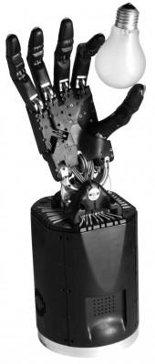 | 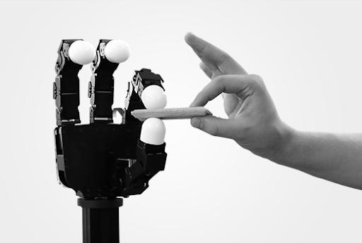 |

**图 2.3**：灵巧手。左侧为 [Shadow Dexterous Hand](https://www.shadowrobot.com/dexterous-hand-series/)，右侧为 [Allegro Hand](https://wonikrobotics.com/en/)。

我们对人手着迷，当然有充分的理由，也一直梦想着造出同样灵巧、拥有丰富感知能力的机械手。但现实是，我们还没有达到这个水平。有些研究者选择继续追求这个目标，使用市面上最好的灵巧手，同时也要应对随之而来的复杂性和鲁棒性不足。

OpenAI 著名的 [“Learning Dexterity”项目](https://openai.com/blog/learning-dexterity/)就用 Shadow 手操作魔方。为了让机械手经受住长时间的学习实验，团队在硬件上投入的工作，也是这个项目不可忽略的一部分。

新的制造技术可能会改变这个领域。比如，[FLLEX v2 的视频](https://www.youtube.com/watch?v=cZuzXdMyJsA)就很惊艳。[参考文献 9](#reference-9) 我很乐观地相信，不久之后，我们会拥有能力更强、也更可靠的灵巧手。

<a id="simple-grippers"></a>

### 2.3.2　简单夹爪

▶ [观看 PR1 遥操作视频](https://www.youtube.com/embed/oyHWkQcin7I)

**图 2.4**：Ken Salisbury 团队使用 PR1 进行遥操作的视频，如今已是一个经典例子：只用非常简单的机械手，也能完成许多实用的工作。他们的[网站](https://sr.stanford.edu/?page_id=509)上还有扫地、取啤酒、从洗碗机中取出餐具等视频。

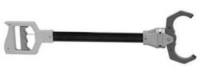

另一派研究者认为，灵巧手并非必需。哪怕给你一个玩具店里的简单夹爪，你也能用它完成不少家务。前面的 PR1 视频很好地说明了这一点。

支持简单机械手的另一个重要理由，是减少复杂性之后，问题往往更清楚，也更容易分析。如果先研究简单夹爪，能帮助我们更深入地理解为什么需要灵巧手，那就很好；我相信确实如此。对于本讲义的大多数内容，简单的双指夹爪最适合教学。具体来说，我选择了 Schunk WSG 050，过去几年，我们在研究中大量使用过它。后面需要说明某些概念时，也会尝试其他末端执行器。

当然，结构简单、自由度少，并不意味着质量低。恰恰相反，Schunk WSG 是一款质量很高的夹爪。它在唯一的自由度上提供力控制和力测量，其精度甚至超过 Kuka。要在关节众多的灵巧手上达到同样水平，就困难得多。

<a id="underactuated-hands"></a>

### 2.3.3　柔性／欠驱动机械手

第三个阵营出现得较晚，主张用巧妙的机械结构解决问题，这类设计通常称为“欠驱动机械手”。基本思路是：对于许多任务，执行器的数量不必与关节数量相同。

不少欠驱动机械手用绳索传动来闭合手指。一根肌腱就能带动手指上的多个关节弯曲。如果设计得当，即使不改变执行器指令，手指也能[被动地顺应被抓物体的形状](https://www.youtube.com/watch?v=C340gbK3sZc)。[参考文献 10](#reference-10) 这种效果并不一定需要绳索，巧妙设计的刚性连杆机构也可以实现类似行为。

|            RightHand Robotics Reflex2            |                   Robotiq 三指夹爪                   |
| :-----------------------------------------------: | :---------------------------------------------------: |
| 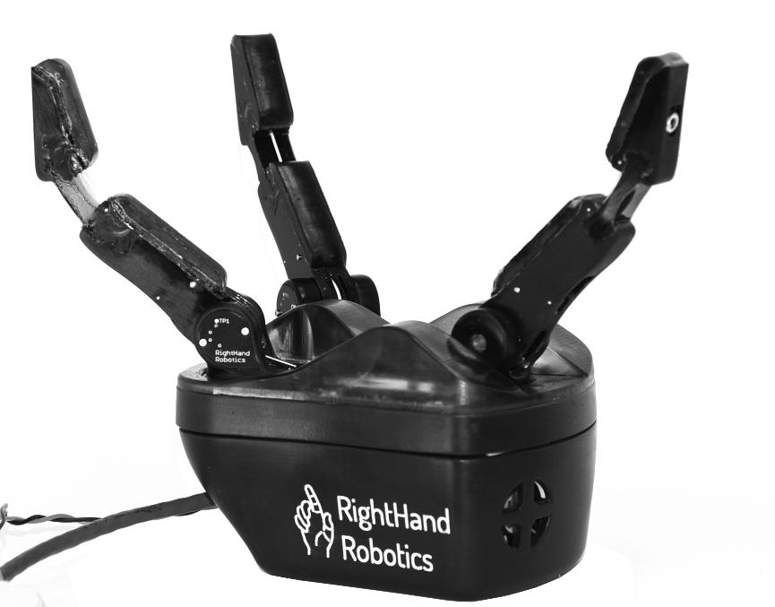 | 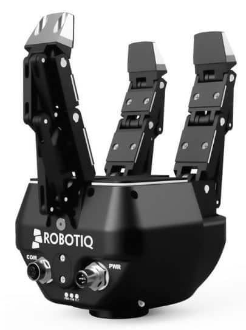 |

**图 2.5**：欠驱动机械手。左侧的 RightHand Robotics Reflex2 由 i-HY 机械手发展而来，相关研究见[参考文献 10](#reference-10)。右侧为 Robotiq 三指夹爪。

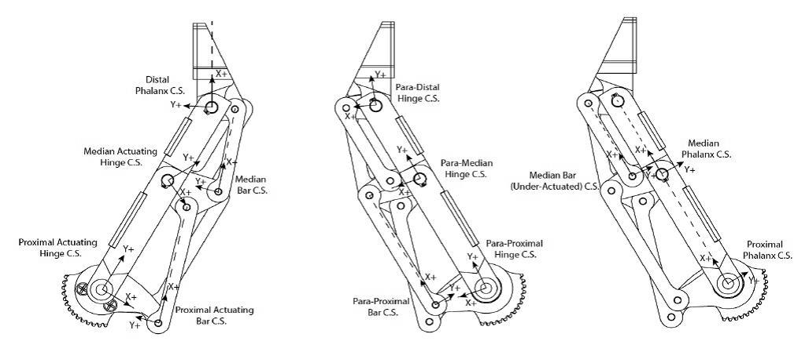

**图 2.6**：通过[巧妙的连杆机构](https://blog.robotiq.com/3-finger-adaptive-gripper-simulation-data)，欠驱动的 Robotiq 三指夹爪能够顺应被抓物体的形状。

如果把欠驱动和被动柔顺的思路再往前推进，就会走向完全柔软的机械手，或至少是完全柔软的手指。近几年，软体机器人领域正在迅速改变机器人的制造方式：肢体、执行器、传感器，甚至供能装置，都可以做成柔软的。这些技术有望提高耐用性、降低成本，也可能让机器人在人身边工作时更加安全。

|               哈佛大学的 3D 打印软体手               |                    RBO Hand 2                    |
| :---------------------------------------------------: | :----------------------------------------------: |
| 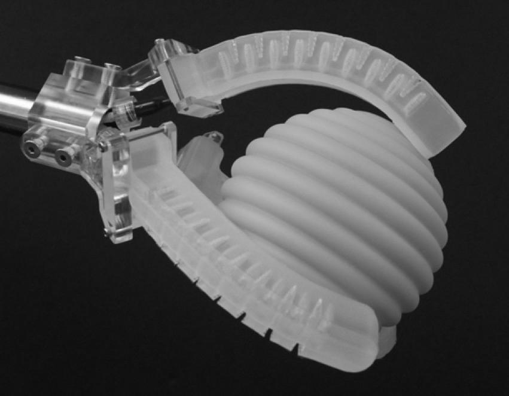 | 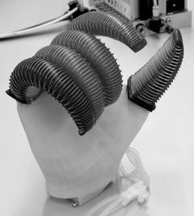 |

**图 2.7**：欠驱动机械手。左侧为[哈佛大学的 3D 打印软体手](https://doi.org/10.1038/d41586-018-02778-5)，图片由 Ryan Truby 提供；右侧为 [RBO Hand 2](http://www.robotics.tu-berlin.de/menue/research/soft_hands/)，图片由 Disney Research Zurich 提供。

欠驱动机械手很好地说明了，机械设计可以怎样减轻执行器和控制系统的负担。它们常常特别擅长某一类任务，尤其是包络抓取，但通用性相对有限。比如，要用这样的手给衬衫扣纽扣，就会很难。不过，它们也在变得越来越灵巧，不妨看看下面的视频。

▶ [观看软体手的手内操作视频](https://www.youtube.com/embed/Z6ECG3KHibI)

<a id="other-end-effectors"></a>

### 2.3.4　其他末端执行器

末端执行器不一定要模仿人手，无论是灵巧版本还是简化版本。如今，许多工业抓取与放置任务使用真空夹爪，也就是吸盘夹爪。

吸盘对许多物体都很有效，但并非适用于所有物体。有的物体太软或孔隙太多，不容易吸住；有的太脆弱或太重，不能只靠上方的吸力提起，还需要从下方支撑。一些机械手会先用掌心的吸盘把物体拿起来，再用传统手指稳固抓取。

其他巧妙的夹爪设计也不少。我很喜欢的一种，是[颗粒阻塞夹爪（jamming gripper）](https://www.creativemachineslab.com/jamming-gripper.html)。它由一个装满咖啡粉或其他颗粒材料的软袋构成。把软袋压在物体上，颗粒就会流动并包住物体；再对软袋抽真空，颗粒发生“阻塞”，软袋迅速变硬，就形成了稳定的抓取。[参考文献 11](#reference-11)

▶ [观看颗粒阻塞夹爪的视频](https://www.youtube.com/embed/bFW7VQpY-Ik)

[这个视频](https://www.youtube.com/watch?v=r_HaJfANyT8)展示了另一种巧妙的设计：在指尖装上可驱动的滚轮，帮助物体在手中改变朝向。

还有一个不必执着于灵巧手的理由：人类许多有意思的操作，其实也是借助工具完成的。我很喜欢 Matt Mason 在[一次机器人学研讨会末尾的问答](https://youtu.be/LfWiBdOc2FI?t=4025)中给出的回答。他多年来一直主张使用简单夹爪，认为厨房等环境中的实用机器人，很可能会配备可以快速更换的专用工具。

如果灵巧手的主要任务只是更换工具，那么不妨直接给机器人安装[工具快换装置](https://blog.robotiq.com/bid/72926/Top-Manufacturers-of-Robotic-Tool-Changers)，配上兼容的工具，省去机械手本身的复杂性。

<a id="high-speed-hand"></a>

### 2.3.5　如果你还没见过……

有一次参加活动，报名表上问：“有史以来，你最喜欢哪个机器人？真实的或虚构的都可以。”

对于一个喜欢机器人的人来说，这个问题可不好回答。我最后选了 [Ishikawa 团队](http://ishikawa-vision.org/fusion/index-e.html)的高速多指机械手。这个项目早在 2004 年就开始拿出令人惊叹的成果。他们给机械手“超频”：在短时间内输入较大的电流，这样的电流并不适合长时间维持，再配合高速相机，实现了那些精彩的演示。2017 年，他们还展示了[操作魔方](http://ishikawa-vision.org/fusion/RubikManipulation/index-e.html)。

▶ [观看高速机械手的视频](https://www.youtube.com/embed/-KxjVlaLBmk)

实在精彩。

<a id="section4"></a>

## 2.4　传感器

到目前为止，我们还没怎么讨论传感器。等到介绍用相机、深度相机进行感知，以及[触觉感知](https://en.wikipedia.org/wiki/Tactile_sensor)时，它们会成为重要主题。这里先不展开，等需要时再详细介绍。

目前，我们先关注机器人的关节传感器。iiwa 和 Schunk WSG 都能提供关节反馈：

- iiwa 驱动程序为七个关节分别提供“位置测量值”“速度估计值”和“力矩测量值”。还记得吗，关节加速度的噪声通常太大，不适合直接依赖。
- Schunk WSG 则提供“状态测量值”，包括位置和速度，以及“力测量值”。

这些反馈都可以作为系统框图中的输出端口，供其他系统使用。

---

<a id="hardware_station"></a>

## 2.5　将各部分整合起来

如果你已经运行过前面的示例，就会发现，要合理地仿真机器人，光有物理引擎还不够。物理模型、执行器模型、传感器模型和底层控制器，都需要放进同一个框架。在 Drake 中，这意味着我们要把越来越多的组件连接成系统框图。

<a id="hardware-station"></a>

### 2.5.1　HardwareStation

基于框图建模的一个重要优点，是可以进行抽象和封装。我们可以把仿真机器人硬件及其环境所需的全部组件，组装成一个 `Diagram`，称为“硬件工作站”（Hardware Station）。`MakeHardwareStation` 接收一份 YAML 描述，用来指定场景和机器人硬件。

例如，给定一个描述 iiwa、WSG 夹爪和若干相机的 YAML 文件，就能得到下面这样的 `HardwareStation` 系统：

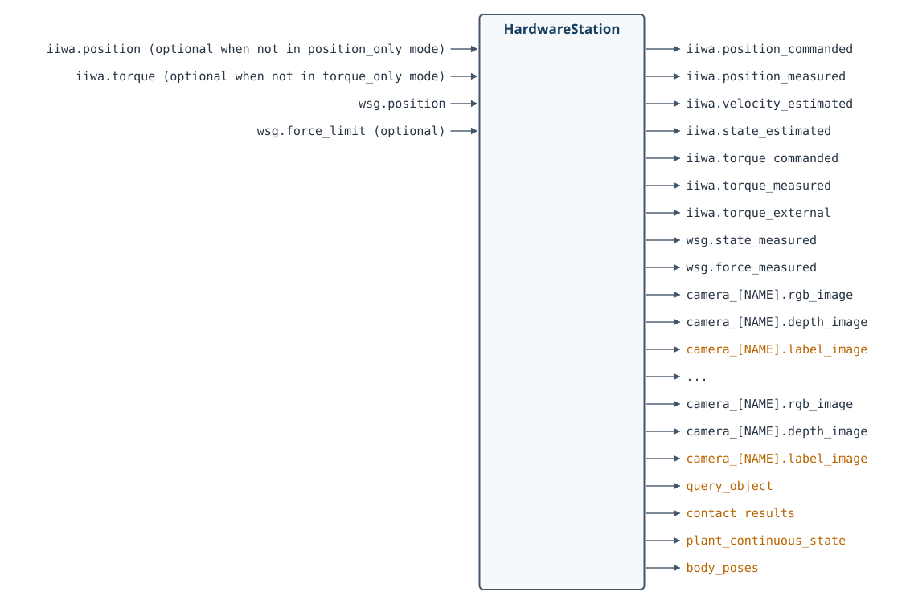

*端口图按原文定义重新排版。`optional` 表示可选输入；橙色表示仅在仿真中可用的输出端口。*

图中橙色的输出被作者戏称为“作弊端口”（cheat ports）。仿真中可以直接获得它们，但真实机器人无法提供，因为这些端口依赖我们对场景真值的了解。

#### 示例 2.6　遥操作演示中的硬件工作站

[第 1 章](introduction.md)的遥操作 notebook，就是通过 `MakeHardwareStation` 接口搭建仿真的。现在，你应该更清楚这个子系统内部在做什么了。如果想再看一遍，可以打开下面的示例。

**运行示例**：[在 Colab 中打开](https://colab.research.google.com/github/RussTedrake/manipulation/blob/master/book/intro/intro.ipynb)

#### 示例 2.7　双臂操作工作站

只需在 YAML 文件中多写几行，就可以用同一个 `MakeHardwareStation` 方法，搭建一个双臂工作站。

**运行示例**：[在 Colab 中打开](https://colab.research.google.com/github/RussTedrake/manipulation/blob/master/book/robot/bimanual.ipynb)

如果还想仿真其他机器人或驱动程序，可以直接修改讲义配套 manipulation 仓库中的 `station.py`。也可以告诉我，通常我能很快把它们加进去。

<a id="hardware-station-interface"></a>

### 2.5.2　HardwareStationInterface

从前面的示例可以看到，`HardwareStation` 虽然本身是一个框图，也可以作为 `System` 接入更大的框图，与感知、规划和高层控制系统组合。它还提供了一层抽象，把仿真和真实硬件衔接起来。

调用 `MakeHardwareStation` 时，只要传入 `hardware=True`，得到的就不再是仿真工作站，而是一个接口几乎相同的系统，叫作 `HardwareStationInterface`。

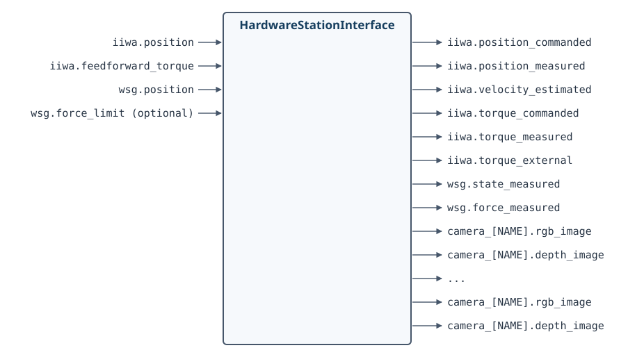

`HardwareStationInterface` 同样是一个框图，但内部不再使用 `MultibodyPlant`、`SceneGraph` 等仿真组件，而是通过网络消息传递，与那些连接各个硬件驱动程序的小型可执行程序通信。

如果进一步查看实现，就会发现我们使用的是 [LCM](https://lcm-proj.github.io/)，而不是 ROS 消息。主要原因是，对公开仓库而言，LCM 是更轻量的依赖；此外，在驱动层接口中，多播 UDP 比 TCP/IP 更合适。不过，许多 Drake 开发者和用户，也会在 [ROS／ROS2 生态中使用 Drake](https://github.com/RobotLocomotion/drake-ros)。

如果你已经有类似的机器人硬件，想在自己的计算机上运行硬件接口，可以查阅[附录](manipulation-station.md)。我已经开始在那里整理驱动程序和物料清单。

<a id="hardware-sim"></a>

### 2.5.3　HardwareStation 独立仿真

采用 `HardwareStation` 的工作方式，就比较容易从仿真开发过渡到真实机器人。为此，我们还提供了一个独立工具：`hardware_sim`。

这个 Python 脚本通过命令行接收同样的 YAML 文件，在单独的进程中启动仿真，并像真实机器人硬件那样收发消息。这样，就可以测试加入消息传递层之后，整套逻辑是否仍然正常。

消息传递会带来一定延迟和非确定性。在开发初期使用 `MakeHardwareStation(..., hardware=False)` 时，我们有意避开了这些因素；独立仿真则让我们能把它们重新纳入测试。

```bash
python3 drake/examples/hardware_sim/hardware_sim.py \
  --scenario_file=station.yaml --scenario_name=Name
```

<a id="section6"></a>

## 2.6　更多 HardwareStation 示例

我很喜欢同学们为这门课完成的项目。为了支持这些项目，也希望能帮到你将来的项目，我会在这里继续收集不同硬件配置下搭建 `HardwareStation` 的示例。这个列表还会不断增加。

### 示例 2.8　搭载 Allegro 手的 iiwa

这个简单示例把 iiwa 上的 Schunk WSG 夹爪换成了 Allegro 手。注意，Allegro 手有左手和右手两个版本。

**运行示例**：[在 Colab 中打开](https://colab.research.google.com/github/RussTedrake/manipulation/blob/master/book/robot/iiwa_with_allegro.ipynb)

---

<a id="section7"></a>

## 2.7　练习

### 练习 2.1　折算惯量的作用

本练习研究折算惯量怎样影响机器人的关节空间动力学，以及简单的位置控制律。所有操作都在[这个 notebook](https://colab.research.google.com/github/RussTedrake/manipulation/blob/master/book/robot/exercises/01_reflected_inertia.ipynb)中完成。

你需要完成以下步骤：

1. 对一个配有电机和减速器的单摆，推导其一阶状态空间动力学：

   $$
   \dot{\mathbf{x}} = f(\mathbf{x},\mathbf{u}).
   $$
2. 在相同的位置控制律下，比较直驱单摆与配有大减速比减速器的单摆，它们的运动表现有什么不同。

### 练习 2.2　操作工作站的输入和输出端口

本练习带你了解，操作工作站在 Drake 系统框架中是怎样被抽象和封装的。所有操作都在[这个 notebook](https://colab.research.google.com/github/RussTedrake/manipulation/blob/master/book/robot/exercises/02_hardware_station_io.ipynb)中完成。

你需要完成以下步骤：

1. 学会访问操作工作站的输入和输出端口，并读取其中的内容。
2. 查看不同端口的数值，理解各个端口代表什么。

### 练习 2.3　在 Drake 中直接遥操作关节

本练习需要实现一种在 Drake 中直接控制机器人关节的方法。所有操作都在[这个 notebook](https://colab.research.google.com/github/RussTedrake/manipulation/blob/master/book/robot/exercises/03_direct_joint_control.ipynb)中完成。可以参考[第 1 章的示例 notebook](https://colab.research.google.com/github/RussTedrake/manipulation/blob/master/book/intro/intro.ipynb)，相关讲解见[第 1 章中文译文](introduction.md#section-1-4)。

你需要完成以下步骤：

1. 替换第 1 章示例中的遥操作接口，改用其他 Drake 函数，直接控制机器人的各个关节。

### 练习 2.4　在 Drake 中实现 PID 控制

本练习需要为机器人的关节实现一个 PID 控制器。所有操作都在[这个 notebook](https://colab.research.google.com/github/RussTedrake/manipulation/blob/master/book/robot/exercises/04_pid_controller.ipynb)中完成。

你需要完成以下步骤：

1. 为机器人关节实现一个 PD 控制器。
2. 在 PD 控制器的基础上，扩展出完整的 PID 控制器。

---

<a id="references"></a>

## 参考文献

<a id="reference-1"></a>

1. Jemin Hwangbo、Joonho Lee、Alexey Dosovitskiy、Dario Bellicoso、Vassilios Tsounis、Vladlen Koltun、Marco Hutter，《让腿式机器人学习敏捷的动态运动技能》（“Learning agile and dynamic motor skills for legged robots”），*Science Robotics*，第 4 卷，第 26 期，文章编号 eaau5872，2019 年。

<a id="reference-2"></a>

2. Haruhiko Asada、Kamal Youcef-Toumi，《直驱机器人：理论与实践》（“Direct-Drive Robots — Theory and Practice”），MIT Press，1987 年。

<a id="reference-3"></a>

3. P. M. Wensing、A. Wang、S. Seok、D. Otten、J. Lang、S. Kim，《MIT Cheetah 的本体感知执行器设计：面向动态腿式机器人的冲击缓解与高带宽物理交互》（“Proprioceptive Actuator Design in the MIT Cheetah: Impact Mitigation and High-Bandwidth Physical Interaction for Dynamic Legged Robots”），*IEEE Transactions on Robotics*，第 33 卷，第 3 期，第 509–522 页，2017 年 6 月。

<a id="reference-4"></a>

4. Navvab Kashiri、Jörn Malzahn、Nikos Tsagarakis，《力矩控制执行器的传感器设计：基于应变片与编码器原理的比较研究》（“On the Sensor Design of Torque Controlled Actuators: A Comparison Study of Strain Gauge and Encoder Based Principles”），*IEEE Robotics and Automation Letters*，卷号 PP，02，2017 年。

<a id="reference-5"></a>

5. A. Wedler、M. Chalon、K. Landzettel、M. Görner、E. Krämer、R. Gruber、A. Beyer、H. J. Sedlmayr、B. Willberg、W. Bertleff 等，《用于空间机器人应用的 DLR 动态执行器模块》（“DLRs dynamic actuator modules for robotic space applications”），*Proceedings of the 41st Aerospace Mechanisms Symposium*，2012 年 5 月 16–18 日。

<a id="reference-6"></a>

6. G. A. Pratt、M. M. Williamson，《串联弹性执行器》（“Series elastic actuators”），*Proceedings 1995 IEEE/RSJ International Conference on Intelligent Robots and Systems. Human Robot Interaction and Cooperative Robots*，第 1 卷，第 399–406 页，1995 年 8 月。

<a id="reference-7"></a>

7. Alin Albu-Schaffer、Christian Ott、Gerd Hirzinger，《柔性关节机器人位置、力矩与阻抗控制的统一无源性框架》（“A unified passivity-based control framework for position, torque and impedance control of flexible joint robots”），*The International Journal of Robotics Research*，第 26 卷，第 1 期，第 23–39 页，2007 年。

<a id="reference-8"></a>

8. Tao Pang、Russ Tedrake，《准静态刚性多体系统的鲁棒时间步进方法》（“A Robust Time-Stepping Scheme for Quasistatic Rigid Multibody Systems”），*IEEE/RSJ International Conference on Intelligent Robots and Systems (IROS)*，2018 年。[原文链接](http://groups.csail.mit.edu/robotics-center/public_papers/Pang18.pdf)

<a id="reference-9"></a>

9. Yong-Jae Kim、Junsuk Yoon、Young-Woo Sim，《具有类人冲击吸收能力的流体润滑灵巧手指机构》（“Fluid Lubricated Dexterous Finger Mechanism for Human-Like Impact Absorbing Capability”），*IEEE Robotics and Automation Letters*，第 4 卷，第 4 期，第 3971–3978 页，2019 年。

<a id="reference-10"></a>

10. Lael U. Odhner、Leif P. Jentoft、Mark R. Claffee、Nicholas Corson、Yaroslav Tenzer、Raymond R. Ma、Martin Buehler、Robert Kohout、Robert D. Howe、Aaron M. Dollar，《用于鲁棒操作的柔顺欠驱动机械手》（“A Compliant, Underactuated Hand for Robust Manipulation”），*International Journal of Robotics Research (IJRR)*，第 33 卷，第 5 期，第 736–752 页，2014 年。

<a id="reference-11"></a>

11. Eric Brown、Nicholas Rodenberg、John Amend、Annan Mozeika、Erik Steltz、Mitchell R. Zakin、Hod Lipson、Heinrich M. Jaeger，《基于颗粒材料阻塞的通用机器人夹爪》（“Universal robotic gripper based on the jamming of granular material”），*Proceedings of the National Academy of Sciences*，第 107 卷，第 44 期，第 18809–18814 页，2010 年。

---

**继续阅读**：[上一章：引言（中文）](introduction.md) · [全书目录与前言（中文）](preface.md) · [下一章：基本的抓取与放置（中文）](pick-and-place.md)
[无障碍访问](https://accessibility.mit.edu/) · © Russ Tedrake, 2026
